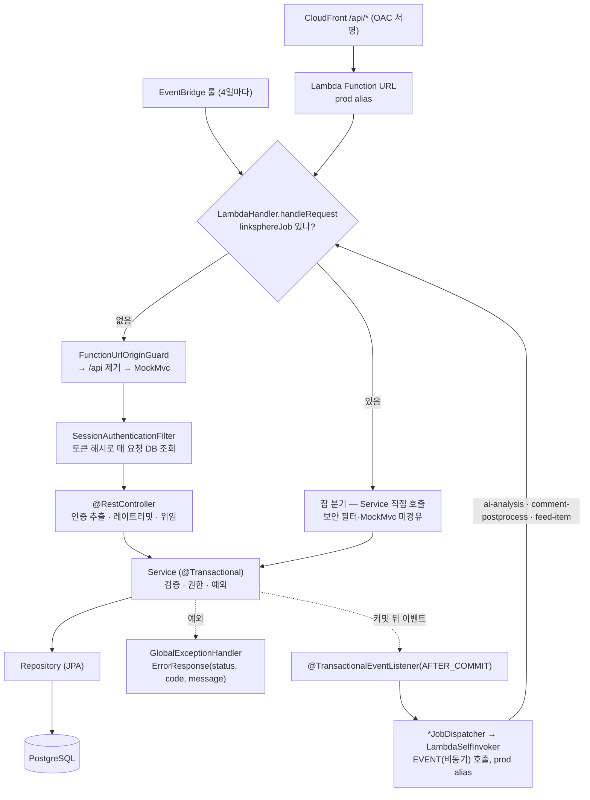
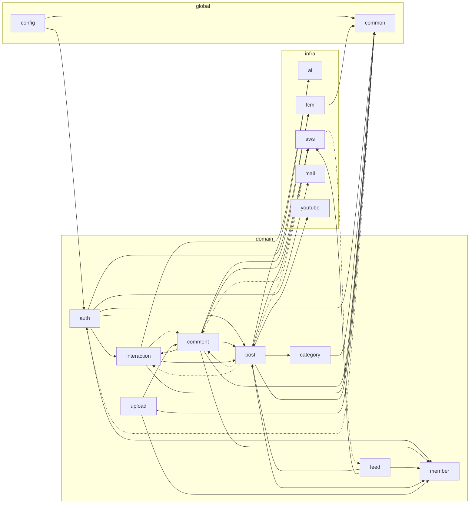
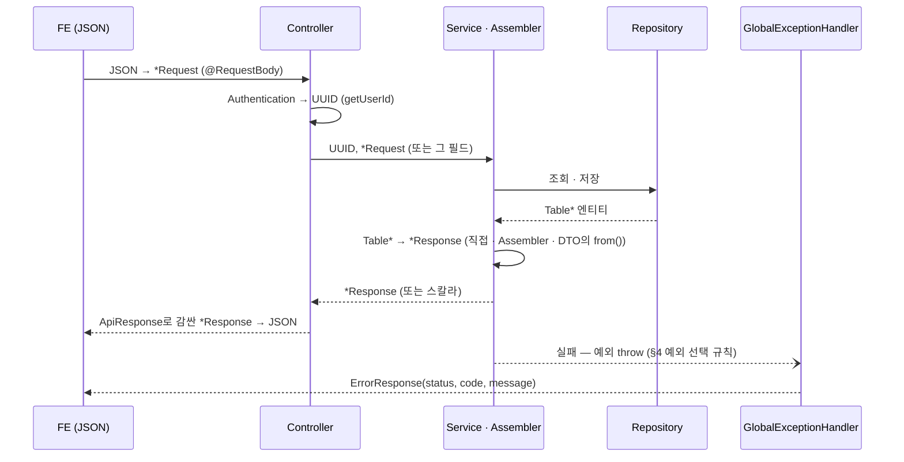
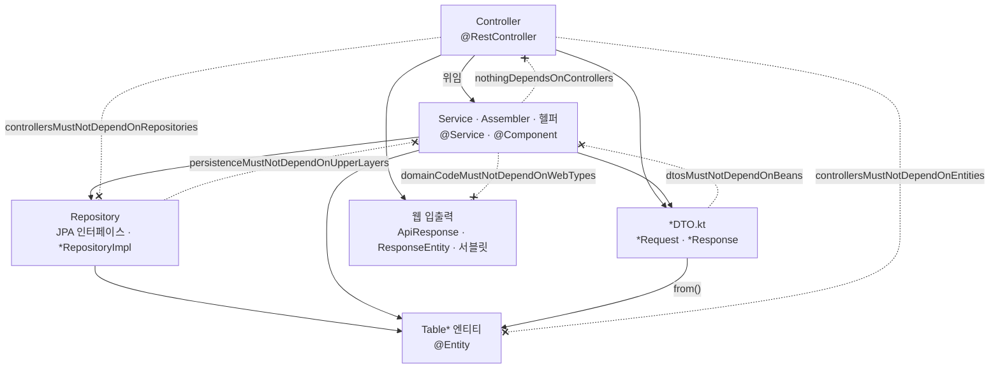

# Link-Sphere BE — Architecture & Pattern Guide

> **문서 성격**: 레퍼런스 — "지금 무엇으로, 왜 이렇게 구성되어 있는가"
>
> **대상 독자**: 이 레포 BE를 처음 보거나, 새 엔드포인트·도메인·배치 잡·외부 클라이언트를 추가하려는 사람과 Claude
>
> **읽고 나면**: 요청이 어느 코드를 거치는지, 레이어끼리 무엇을 참조하고 어떤 타입을 주고받는지(§3) 따라갈 수 있고, 자동 검사(§2)와 선례 패턴(§7)에 맞춰 새 코드를 쓸 수 있다.
> 지금 코드가 규칙과 어긋나는 곳은 §9에 모아 두었다 — 그쪽을 본떠 쓰지 않는다.
>
> **마지막 검토**: 2026-10-30

시스템 전체(CloudFront·S3·Lambda·배포 파이프라인)는 FE 레포
[`docs/SYSTEM-ARCHITECTURE.md`](https://github.com/BAECHAN/link-sphere_FE_NEW/blob/main/docs/SYSTEM-ARCHITECTURE.md)가,
파일 트리와 API 목록은 루트 [`README.md`](../README.md#프로젝트-구조)가 정본이다 — 여기에 옮겨 적지 않는다. 이 문서의
근거가 된 전체 점검 기록은 [`docs/plans/2026-10-25-be-architecture-audit.md`](plans/2026-10-25-be-architecture-audit.md).

---

## 1. 요청 파이프라인

Lambda 한 함수가 두 종류의 입력을 받는다. **HTTP 요청**은 MockMvc로 Spring MVC를 그대로 태우고, **내부 잡**
(`linksphereJob` 필드가 있는 이벤트)은 보안 필터·MockMvc를 건너뛰고 Service 빈을 직접 부른다.



| 잡(`linksphereJob`) | 누가 보내나 | 받는 Service |
|---|---|---|
| `ai-analysis` | 글 등록·수정 커밋 뒤 `PostAIService.handlePostCreatedEvent` → `AiJobDispatcher` | `PostAIService.processAiJob` |
| `comment-postprocess` | 댓글 등록·답글·수정 커밋 뒤 `CommentPostProcessService.handleCommentPostProcess` → `CommentJobDispatcher` | `CommentPostProcessService.processCommentJob`(FCM 알림·링크 프리뷰) |
| `feed-crawl` | EventBridge `link-sphere-feed-crawl` 룰 | `FeedCrawlService.collectAndDispatch` → `FeedJobDispatcher` |
| `feed-item` | `FeedCrawlService`(5건씩) | `FeedCrawlService.processFeedItemJob` → 항목마다 `FeedItemProcessor.processFeedItem` → `PostService.createPost` → 다시 `ai-analysis` |
| `account-purge` | 같은 EventBridge 룰 | `AccountPurgeService.purgeExpired` |
| `orphan-image-gc` | 같은 EventBridge 룰(`dryRun` 지원) | `OrphanImageGcService.collect` |

- self-invoke를 쓰는 이유(같은 실행 환경에서 이어 처리하면 응답 반환 뒤 컨테이너가 얼어붙는다)와 PENDING 고착 복구는
  [`AI-ASYNC-PROCESSING.md`](AI-ASYNC-PROCESSING.md), 룰 조작은 [`DEPLOY.md`](DEPLOY.md), 콜드스타트·SnapStart는
  [`PERFORMANCE.md`](PERFORMANCE.md).
- `tools/*Runner.kt`는 `@Profile("<이름>")` `CommandLineRunner`로, 로컬에서
  `./gradlew bootRun --args='--spring.profiles.active=secret,<이름>'`로만 도는 1회성 도구다. Lambda의 `app.run()`도
  `CommandLineRunner`를 실행하므로 **`@Profile` 가드를 빼면 운영에서 돈다.**

### 패키지 역할

| 패키지 | 담는 것 | 의존해도 되는 곳 |
|---|---|---|
| 루트 | `LambdaHandler`(진입점·잡 분기), `FunctionUrlOriginGuard`, `FunctionUrlResponse`(응답 직렬화) | 전부 |
| `domain/<도메인>/` | 도메인별 평면 구조 — Controller·Service·Repository·`Table*` 엔티티·`*DTO.kt`와 그 도메인 전용 헬퍼 | 다른 도메인(§3), `global`, `infra` |
| `global/common/` | 응답 래퍼, `SecurityUtils`, `SecureToken`, `ClientIpResolver`, `Paging`, `RateLimitService`, `SupabaseStorageService`, `TransactionCallbacks`, `BatchJobLimits` | `domain` 금지(허용 3쌍 예외, §3) |
| `global/config/` | Security·Swagger·Async 설정 | 위와 같음 |
| `global/exception/` | 커스텀 예외 전부 + `GlobalExceptionHandler` | — |
| `infra/<기술>/` | 외부 연동(Gemini·YouTube·SES·FCM·Lambda self-invoke) | `domain`은 이벤트 DTO만(디스패처) |
| `tools/` | 로컬 1회성 CLI | 전부 |

도메인 안에는 서브패키지를 만들지 않는다(`infra/<기술>/dto/`만 예외). 도메인·`global` 하위는 단수 소문자
(`post/`, `common/`), `infra` 하위는 기술·서비스명 그대로(`ai/`, `fcm/`, `youtube/`)다.

### 실제 패키지 의존 그래프

아래 그림은 손으로 그린 것이 아니다. `PackageGraphDocTest`가 바이트코드에서 패키지(`domain.post`처럼 두 단계) 사이
간선을 계산해 이 블록과 비교하고, 다르면 실패하면서 붙여 넣을 새 블록을 출력한다 — 새 의존을 만들면 이 그림이 같은 PR에서
바뀌어 리뷰에 드러난다. 점선은 순환을 만들지만 허용한 간선이다(§9의 8개 중 7개 — `global.exception → global.common`은
아래처럼 그림에서 뺀 패키지라 보이지 않는다). 모든 패키지가 예외를 던지느라 의존하는 `global.exception`은 그림에서만
뺐고 순환 검사에는 들어간다. 루트(`LambdaHandler` 등)와 `tools/`는 두 단계 패키지가 아니라 그림·순환 검사 모두에서 빠진다 —
다른 패키지가 이들을 참조하는 곳이 없어(2026-10-26 확인) 순환에 낄 수 없다.

<!-- package-graph:start -->

<!-- package-graph:end -->

---

## 2. 자동 검사가 강제하는 규칙

글로만 있는 규칙은 낡는다 — 이 레포의 아키텍처 규칙은 아래 테스트로 강제한다. `./gradlew test`(PR CI·배포 모두)가
깨지면 규칙을 어긴 것이다. 규칙을 바꾸려면 테스트와 이 표를 함께 고친다.

| 규칙 (테스트) | 막는 것 | 파일 |
|---|---|---|
| `controllersMustNotDependOnRepositories` | `@RestController`가 Repository·`*RepositoryImpl`을 직접 참조(앱 전체) | `architecture/AppWideArchitectureRulesTest.kt` |
| `repositoriesMustNotConstructExceptions` | Repository·`*RepositoryImpl`이 예외를 생성 | 위와 같음 |
| `globalMustNotDependOnDomain` | `global` → `domain` 의존(허용 3쌍 제외) | 위와 같음 |
| `appCodeMustNotConstructIllegalArgumentException` | 앱 코드의 `IllegalArgumentException` 생성(`require()` 같은 inline 함수 포함) | 위와 같음 |
| `controllerMustNotDependOnRepository` | 위 첫 규칙의 domain 한정판(먼저 있던 것) | `architecture/ArchitectureRulesTest.kt` |
| `servicesMustNotHaveCrossDomainCycles` | 도메인 Service 사이 순환 의존(빈 생성 실패로만 드러남) | 위와 같음 |
| `repositoryDeleteMethodsMustBeBulk` | derived delete(`deleteBy…`) — `@Modifying @Query` 일괄 DELETE만 | `architecture/RepositoryDeleteRulesTest.kt` |
| `global exception 패키지의 모든 예외에 @ExceptionHandler가 있다` | 등록 안 된 예외가 500으로 떨어짐 | `global/exception/ExceptionHandlerCoverageTest.kt` |
| `Spring MVC 표준 예외는 500 안전망으로 떨어지지 않는다` | 405·415·400 같은 Spring 예외가 `Exception` 안전망(500)으로 감 — 대상은 설치된 Spring의 `ResponseEntityExceptionHandler` 목록에서 읽는다 | `global/exception/SpringMvcExceptionCoverageTest.kt` |
| `응답 상태코드에 숫자 리터럴을 쓰지 않는다` | `ApiResponse(200, …)`·`ResponseEntity.status(401)` — 상수 인자는 바이트코드로 구별되지 않아 소스 텍스트를 스캔 | `architecture/HttpStatusLiteralTest.kt` |
| `모든 컨트롤러에 @Tag 가, 모든 엔드포인트에 @Operation summary 가 있다` | Swagger 문서 누락 | `global/config/SwaggerDocsCoverageTest.kt` |
| `onlySecurityUtilsReadsPrincipalName` | `Principal`·`Authentication`의 `name`을 `SecurityUtils` 밖에서 읽어 직접 파싱 | `architecture/AppWideArchitectureRulesTest.kt` |
| `엔드포인트는 Principal이나 @AuthenticationPrincipal로 사용자를 받지 않는다` | 사용자를 `Authentication` + `getUserId()` 밖의 방식으로 받음 | `architecture/ControllerSignatureRulesTest.kt` |
| `Authentication 파라미터의 nullable은 @SecurityRequirements가 붙은 공개 엔드포인트에만 쓴다` | 인증 필수 엔드포인트의 `Authentication?` — Kotlin nullability를 봐야 해 리플렉션으로 검사 | 위와 같음 |
| `엔드포인트는 ApiResponse 또는 ResponseEntity로 감싼 ApiResponse를 반환한다` | 응답 래퍼를 안 쓰는 엔드포인트(제네릭 반환형 검사) | 위와 같음 |
| `응답 데이터에 이름 없는 Map을 쓰지 않는다` | `ApiResponse<Map<…>>` | 위와 같음 |
| `본문 status가 201인 엔드포인트는 HTTP 상태도 201이다` | 본문 `HttpStatus.CREATED`와 `@ResponseStatus(CREATED)` 중 하나만 있음(바이트코드의 상수 읽기를 본다) | 위와 같음 |
| `ResponseEntity는 응답 헤더를 붙이는 엔드포인트만 반환한다` | 헤더 빌더(`header`·`headers`·`cacheControl`)를 부르지 않는데 `ResponseEntity` 반환 — 같은 클래스의 private 함수 한 단계까지 따라간다 | 위와 같음 |
| `controllersMustNotDependOnEntities` | `@RestController`가 `@Entity`(`Table*`)를 참조 | `architecture/LayerSkeletonRulesTest.kt` |
| `nothingDependsOnControllers` | 컨트롤러 밖의 코드가 `@RestController`를 참조 | 위와 같음 |
| `domainCodeMustNotDependOnWebTypes` | 컨트롤러·서블릿 필터 밖의 domain·infra 코드가 서블릿·`ResponseEntity`·`ApiResponse`·`ErrorResponse`·`web.bind.annotation`을 참조 | 위와 같음 |
| `persistenceMustNotDependOnUpperLayers` | Repository·엔티티가 Service·`@Component`·Controller·DTO를 참조 | 위와 같음 |
| `dtosMustNotDependOnBeans` | `*DTO.kt`의 클래스가 Service·`@Component`·Repository·Controller를 참조 | 위와 같음 |
| `apiDtosLiveInDtoFiles` | domain의 `*Request`·`*Response`를 `*DTO.kt` 밖에 정의 | 위와 같음 |
| `packagesMustBeFreeOfCyclesExceptDocumented` | 패키지 사이 새 순환 — 허용 간선 8개는 `PackageGraphDocTest.kt`의 `DOCUMENTED_CYCLE_EDGES`, 이유는 §9 | 위와 같음 |
| `문서의 패키지 의존 그래프가 코드와 같다` | §1 "실제 패키지 의존 그래프"가 코드와 어긋남 | `architecture/PackageGraphDocTest.kt` |
| `순환 허용 간선 목록의 간선은 모두 실제로 있다` | 끊은 간선이 `DOCUMENTED_CYCLE_EDGES`에 남아 다시 생겨도 조용히 통과 | 위와 같음 |
| `afterCommitGoesThroughTransactionCallbacks` | `TransactionSynchronizationManager.registerSynchronization` 직접 호출(§7-6) | `architecture/LayerSkeletonRulesTest.kt` |
| `emailVerificationGoesThroughGate` | `EmailVerificationGate` 밖에서 `EmailNotVerifiedException` 생성 | 위와 같음 |
| `generatedIdsOnlyOnLegacyEntities` | `TableMember`·`TablePost`·`TableCategory` 밖의 `@GeneratedValue`(§7-13) | 위와 같음 |
| `제약 어노테이션이 있는 요청 본문은 @Valid로 받는다` | DTO에 `@NotBlank` 등을 달고 `@Valid`를 빼 제약이 무시됨 | `architecture/ControllerSignatureRulesTest.kt` |

ArchUnit 규칙은 대상 클래스가 0개면 실패한다(`archRule.failOnEmptyShould` 기본값, 2026-10-25 빈 대상 규칙을 일부러
넣어 확인) — 패키지가 바뀌어도 조용히 통과하지 않는다. 클래스패스 스캔 테스트는 최소 개수 하한선을 둔다.

2026-10-25 점검에서 찾은 위반은 위 검사를 켜며 모두 고쳤다. 2026-10-26 골격 점검에서 더한 `LayerSkeletonRulesTest`
7개는 켤 때 위반 0건이었고, 규칙마다 위반을 일부러 넣어 실패하는 것을 확인했다. 같은 날 남은 것 정리에서 중복을 헬퍼로 모은
뒤 더한 5개(커밋 뒤 처리·이메일 인증 게이트·`@GeneratedValue`·`@Valid`·순환 허용 목록)도 같은 방식으로 확인했다. 검사로 막을 수
없어 그대로 둔 곳은 §9에 있다.

---

## 3. 레이어 규칙과 허용 예외

### 레이어 골격 — 누가 누구를 알고, 무엇을 주고받나

요청 하나에서 타입은 아래 순서로 바뀐다. 엔티티(`Table*`)는 Service·Assembler 안에서만 응답 DTO로 바뀌고 컨트롤러로
올라가지 않는다. 실패는 반환값이 아니라 예외로 흐른다.



허용하는 의존 방향과, 반대 방향을 막는 검사(§2)는 이렇다. 실선은 써도 되는 방향, 점선은 검사가 막는 방향이다.



같은 내용을 표로 보면:

| 행이 열을 참조해도 되나 | Controller | Service류 | Repository | 엔티티 | DTO | 웹 입출력 타입 |
|---|---|---|---|---|---|---|
| **Controller** | — | ✅ | ❌ `controllersMustNotDependOnRepositories` | ❌ `controllersMustNotDependOnEntities` | ✅ | ✅ |
| **Service류**(`@Service`·`@Component`·`*Assembler`·헬퍼) | ❌ `nothingDependsOnControllers` | ✅ 다른 도메인 것도. 순환만 금지(`servicesMustNotHaveCrossDomainCycles`, 패키지 순환 규칙) | ✅ 다른 도메인 것도(아래 "허용하는 것") | ✅ | ✅ | ❌ `domainCodeMustNotDependOnWebTypes` |
| **Repository**·`*RepositoryImpl` | ❌ `nothingDependsOnControllers` | ❌ `persistenceMustNotDependOnUpperLayers` | ✅ | ✅ | ❌ 같은 규칙 | ❌ `domainCodeMustNotDependOnWebTypes` |
| **엔티티**(`Table*`) | ❌ `nothingDependsOnControllers` | ❌ `persistenceMustNotDependOnUpperLayers` | ❌ 같은 규칙 | ✅ 연관관계 | ❌ 같은 규칙 | ❌ 위와 같음 |
| **DTO**(`*DTO.kt`) | ❌ `dtosMustNotDependOnBeans` | ❌ 같은 규칙 | ❌ 같은 규칙 | ✅ `companion from()` | ✅ | ❌ `domainCodeMustNotDependOnWebTypes` |

`tools/*Runner.kt`는 1회성 CLI라 Repository를 직접 써도 된다(§1). 서블릿 `Filter`(`SessionAuthenticationFilter`)는 웹 입출력
계층이라 웹 타입 규칙에서 빠진다.

### 파일별 역할

| 파일 | 역할 | 하지 않는 것 |
|---|---|---|
| `*Controller.kt` | 인증 추출 → (필요하면) 레이트리밋 → Service 위임 → `ApiResponse` 반환. Service가 돌려준 스칼라를 응답 DTO로 감싸는 것은 된다(아래 "허용하는 것") | Repository·엔티티 참조, 비즈니스 분기, 숫자 상태코드 |
| `*Service.kt` | 검증 · 권한 · 예외 throw · 엔티티 → 응답 DTO 변환(직접, `*Assembler`, DTO의 `companion from()`) · 트랜잭션 경계 | HTTP 개념(쿠키·헤더·서블릿·`ApiResponse`) |
| `*Repository.kt` | 쿼리 메서드(파생·JPQL·네이티브) | 예외 throw, 비즈니스 판단 |
| `*RepositoryCustom` + `*RepositoryImpl` | Criteria API가 필요한 동적 검색(`PostRepositoryImpl`, `BookmarkRepositoryImpl`) | 위와 같음 |
| `Table*.kt` | JPA 엔티티 | 비즈니스 규칙(§9에 예외 있음) |
| `*DTO.kt` | 도메인별 Request/Response `data class` 모음 — 요청은 `*Request`, 응답은 `*Response` 접미사, nullable은 명시, 목록 기본값은 `= emptyList()` | 컨트롤러·서비스 파일 안에 DTO 정의 |

**의도적으로 허용하는 것** (2026-10-25·26 점검에서 규칙을 코드에 맞춰 정정):

- **컨트롤러가 Service의 스칼라 결과를 응답 DTO로 감싸기** — `AuthController`는 `AuthResult`를 쿠키(refresh 토큰)와
  본문(`TokenResponse`)으로 가르고, `InteractionController`는 처리 건수를 `BatchResultResponse`로 감싼다. 엔티티를 만지지
  않으므로 허용한다(2026-10-26 정정 — 그 전에는 "DTO 변환은 Service"라고만 적었다). 컨트롤러가 엔티티를 모른다는 경계는
  `controllersMustNotDependOnEntities`가 막는다.

- **컨트롤러 레이트리밋** — 한도는 사용자 요청 경로에만 걸어야 한다. 봇(`FeedItemProcessor`)은 `PostService`를 직접
  부르므로, 한도를 Service에 두면 봇까지 막힌다(`PostController` companion 주석). 그래서 글 등록·검색·링크 미리보기·
  업로드 서명은 컨트롤러가 `rateLimitService.consume(...)`을 먼저 부른다. 로그인·가입·비밀번호 재설정처럼 Service 안에서
  판정이 갈리는 한도는 지금처럼 Service에서 건다.
- **다른 도메인 Repository 직접 사용** — 예: `PostService`가 interaction의 `BookmarkRepository`를 쓴다. 금지하는 것은
  **Service끼리의 순환**뿐이다(`servicesMustNotHaveCrossDomainCycles`). 순환이 생기면 `PostResponseAssembler`처럼 어느
  Service도 참조하지 않는 조립기로 뺀다(§7-8).
- **global → domain 3쌍** — `SecurityConfig` → `SessionAuthenticationFilter`(필터 체인 구성),
  `RateLimitService` → `AuthRateLimitRepository`·`TableAuthRateLimit`(범용 카운터가 auth 테이블을 공유). 이 밖은
  `globalMustNotDependOnDomain`이 막는다.
- **패키지 위치 예외** — 외부 연동인 `SupabaseStorageService`가 `global/common`에, FCM의 Controller·Entity·Repository가
  `infra/fcm`에 있다. 옮기지 않는다(새 외부 연동은 `infra/<기술>/`에 둔다).

### 역할 접미사

| 접미사 | 뜻 | 예 |
|---|---|---|
| `*Assembler` | 여러 Repository를 모아 응답 DTO를 조립(트랜잭션은 호출부 것을 씀) | `PostResponseAssembler` |
| `*Processor` | 잡 항목 하나를 독립 트랜잭션으로 처리(같은 클래스 self-invocation을 피하려는 별도 빈) | `FeedItemProcessor` |
| `*Dispatcher` | 커밋 뒤 이벤트를 self-invoke 잡으로 보냄 | `AiJobDispatcher` |
| `*Client` | 외부 HTTP API 호출 | `YoutubeVideoClient` |
| `*Validator` · `*Parser` · `*Extractor` · `*Normalizer` · `*Classifier` · `*Detector` | 한 가지 판단·변환 | `SafeUrlValidator`, `FeedParser` |

상태도 의존성도 없으면 `object`(예: `WeakTitleDetector`, `SecureToken`, `ClientIpResolver`), 다른 빈이나 I/O가 필요하거나
테스트에서 mock해야 하면 `@Component`(예: `FeedParser`, `UrlMetadataExtractor`)로 둔다. I/O 없는 순수한 부분은 별도
함수로 떼어 네트워크 없이 테스트한다(`FeedParser.parse(xml)`, `YoutubeVideoClient`의 `internal fun parseSnippet`).

---

## 4. 응답·에러 계약

### 성공 — `ApiResponse<T>`

```kotlin
return ApiResponse(HttpStatus.OK.value(), "Link preview", postService.previewLink(userId, url))
```

- status는 반드시 `HttpStatus.X.value()` — 숫자 리터럴을 쓰지 않는다(`HttpStatusLiteralTest`가 막는다).
- **HTTP 상태는 본문 status와 같다.** 자원을 만드는 POST는 `@ResponseStatus(HttpStatus.CREATED)` + 본문 `HttpStatus.CREATED`,
  그 밖은 200이다(`본문 status가 201인 엔드포인트는 HTTP 상태도 201이다`). 2026-10-26 전에는 생성 5곳이 본문만 201이었다.
- 응답 헤더(쿠키·캐시)를 붙이는 곳만 `ResponseEntity<ApiResponse<T>>`를 쓴다 — `AuthController`의 쿠키 6곳(로그인·갱신·로그아웃·전체 로그아웃·비밀번호 변경·탈퇴),
  `CategoryController`의 목록(`ResponseEntity는 응답 헤더를 붙이는 엔드포인트만 반환한다`). 상태만 바꿀 때는 `@ResponseStatus`다.
- `data`는 `*DTO.kt`의 이름 있는 타입이다 — `Map`은 OpenAPI 스키마 이름이 생기지 않아 FE 생성 타입이 익명이 된다
  (`응답 데이터에 이름 없는 Map을 쓰지 않는다`).
- `message`는 FE가 화면에 쓰지 않는다(FE는 `TEXTS`로 문구를 정한다) — 언어가 섞여 있어도 계약 문제는 아니다.
- 성공 응답 스키마는 PR마다 `api-compat`가 운영 스펙과 비교한다 — FE를 깨는 변경(필드 삭제·타입 변경·필수 요청 필드 추가)이면
  실패하고, 의도한 변경이면 PR에 `breaking-api` 라벨을 붙인다(`docs/CI-CHECK-GATE.md` §4.1). 오류 응답(`ErrorResponse`)은 스펙에
  없어 비교되지 않는다.

### 실패 — 예외를 던지고 핸들러가 `ErrorResponse(status, code, message)`로 바꾼다

`code`는 대문자 SNAKE_CASE(`FOLDER_NOT_FOUND`)로, FE가 분기에 쓰는 계약이다. `message`는 로그·디버깅용이다.

예외 선택 기준:

| 상황 | 던질 것 |
|---|---|
| 클라이언트 입력이 틀림(빈 값·길이 초과·형식) | `InvalidInputException` → 400 `INVALID_INPUT` |
| 대상이 없음(또는 볼 권한이 없어 없는 것처럼 보여야 함) | `PostNotFoundException` 등 `*NotFoundException` → 404 전용 code |
| 권한 없음(존재를 숨길 필요가 없을 때) | `ForbiddenException` → 403 |
| 동시 요청·중복 | 전용 예외(`DuplicateNicknameException` 등) 또는 전역 409 안전망 |
| **있어서는 안 되는 내부 불변조건 위반**(인증된 principal이 UUID가 아님 등) | `IllegalStateException` → 전용 핸들러 없이 500 |
| ~~`IllegalArgumentException`~~ | **쓰지 않는다**(`appCodeMustNotConstructIllegalArgumentException`) — 핸들러는 라이브러리가 던진 IAE(예: `page=-1`)만 받는 400 안전망이다. 예전에 404 `NOT_FOUND`로 매핑해 입력 오류가 "없음"으로 나갔다 |

새 예외 클래스는 `global/exception/`에 만들고 `GlobalExceptionHandler`에 `@ExceptionHandler`를 추가한다 —
`ExceptionHandlerCoverageTest`가 빠뜨림을 잡는다. Spring MVC 표준 예외(설치된 `ResponseEntityExceptionHandler`의 목록)가
500 안전망으로 떨어지지 않는지는 `SpringMvcExceptionCoverageTest`가 본다. FE가 code로 분기해야 하면 FE `shared/config/error-code.ts`에도 추가한다.

### code 표

정본은 `global/exception/GlobalExceptionHandler.kt`와 `global/config/security/`다 — 이 표는 그 파생본이다.

| 예외 | HTTP | code |
|---|---|---|
| `PostNotFoundException` | 404 | `POST_NOT_FOUND` |
| `CategoryNotFoundException` | 404 | `CATEGORY_NOT_FOUND` |
| `CommentNotFoundException` | 404 | `COMMENT_NOT_FOUND` |
| `BookmarkFolderNotFoundException` | 404 | `FOLDER_NOT_FOUND` |
| `CommentDeletedException` | 409 | `COMMENT_DELETED` |
| `DuplicateMemberException` | 409 | `DUPLICATE_MEMBER`(이메일 중복) |
| `DuplicateNicknameException` | 409 | `DUPLICATE_NICKNAME`(가입·수정 모두) |
| `DuplicateFolderNameException` | 409 | `DUPLICATE_FOLDER_NAME` |
| `SessionMismatchException` | 409 | `SESSION_MISMATCH` |
| `ForbiddenException` | 403 | `FORBIDDEN` |
| `EmailNotVerifiedException` | 403 | `EMAIL_NOT_VERIFIED` |
| `InvalidCredentialsException` | 401 | `INVALID_CREDENTIALS` |
| `InvalidTokenException` | 401 | `INVALID_REFRESH_TOKEN` |
| `InvalidActionTokenException` | 401 | `INVALID_ACTION_TOKEN` |
| `RateLimitExceededException` | 429 | `RATE_LIMIT_EXCEEDED` (+ `Retry-After`) |
| `InvalidInputException` | 400 | `INVALID_INPUT` |
| `InvalidUrlException` | 400 | `INVALID_URL` / `URL_UNRESOLVABLE` / `URL_NOT_ALLOWED` (`e.code`) |
| `UnsupportedImageTypeException` | 400 | `UNSUPPORTED_IMAGE_TYPE` |
| `IllegalArgumentException`(라이브러리발만) | 400 | `INVALID_INPUT` |
| Spring `MissingRequestCookieException` | 401 | `MISSING_REFRESH_TOKEN` |
| Jakarta `ConstraintViolationException` · Spring `MethodArgumentNotValidException` | 400 | `INVALID_INPUT` |
| Spring `MethodArgumentTypeMismatchException` | 400 | `INVALID_PATH_VARIABLE` |
| Spring `HttpMessageNotReadableException` | 400 | `INVALID_REQUEST_BODY` |
| Spring `DataIntegrityViolationException` | 409 | `DUPLICATE_RESOURCE` |
| Spring `ConcurrencyFailureException` | 409 | `CONCURRENT_UPDATE` |
| Spring `NoResourceFoundException` | 404 | `NOT_FOUND` |
| Spring `HttpMediaTypeNotAcceptableException` | 406 | (본문 없음) |
| 그 밖의 Spring MVC 표준 예외(`ErrorResponse` 구현 — 405 메서드·415 Content-Type·400 필수 파라미터 누락 등) | 예외가 정한 상태(405는 `Allow` 헤더 포함) | 400이면 `INVALID_INPUT`, 그 밖은 상태 이름(`METHOD_NOT_ALLOWED`, `UNSUPPORTED_MEDIA_TYPE` …) |
| 그 밖의 `Exception` | 500 | `INTERNAL_SERVER_ERROR` |
| 보안 진입점(`CustomAuthenticationEntryPoint`) | 401 | `TOKEN_EXPIRED` / `INVALID_TOKEN` / `NOT_LOGGED_IN` |
| 보안 거부(`CustomAccessDeniedHandler`) | 403 | `ACCESS_DENIED` |

---

## 5. 인증

```kotlin
// 인증 필수 — Security가 보장하므로 non-null. getUserId()가 null이면 "인증 안 됨"이 아니라
// 이미 검증된 principal이 UUID로 안 읽히는 내부 불변조건 위반이라 IllegalStateException(500)이다.
fun previewLink(@RequestParam url: String, authentication: Authentication): ApiResponse<LinkPreviewResponse> {
    val userId = authentication.getUserId() ?: throw IllegalStateException("User not authenticated")
    ...
}

// 공개(비로그인 허용) — nullable + Swagger에 공개임을 표시
@SecurityRequirements
@GetMapping("/post")
fun getPosts(authentication: Authentication?, ...): ApiResponse<PostPageResponse> {
    val currentUserId = authentication.getUserId()  // null이면 비로그인
    ...
}
```

- 사용자 id는 항상 `global/common/SecurityUtils.kt`의 `Authentication?.getUserId()`로 꺼낸다. `Authentication.name`·
  `Principal.name`을 직접 파싱하지 않는다. 세션 계열 id가 필요하면 `getSessionFamilyId()`.
- 정석 컨트롤러는 `domain/post/LinkPreviewController.kt` — non-null 인증, `IllegalStateException`, `HttpStatus`,
  컨트롤러 레이트리밋, 근거 주석이 달린 companion 상수가 다 있다.
- **공개 경로는 `SecurityConfig`에 하나씩 나열한다** — `/auth/**` 같은 와일드카드는 `/auth/logout-all`처럼 인증이 필요한
  경로까지 연다. 로그인 여부에 따라 응답이 달라지는 공개 GET(`/post`, `/post/*`, `/post/*/comment`)은 `permitAll()`이
  아니라 `.access { … getAttribute("exception") == null }`을 쓴다 — 토큰 없이 오면 허용하고, 만료·무효 토큰이면 401을
  돌려 FE가 갱신하게 한다(#104, [`plans/2026-10-20-public-get-expired-token-401.md`](plans/2026-10-20-public-get-expired-token-401.md)).
- 세션 토큰·액션 토큰은 `SecureToken`으로 만들고 **DB에는 sha256 해시만** 저장한다. 세션 회전·재사용 탐지는
  `MemberSessionService.rotate`(§7-2).

---

## 6. 트랜잭션

- **새 코드는 클래스에 `@Transactional(readOnly = true)`, 쓰기 메서드에만 `@Transactional`** (`PostService` 형태).
  메서드마다 따로 붙이는 기존 서비스(`CommentService`, `InteractionService` 등)는 그대로 둔다 — 두 스타일이 공존한다.
- 같은 클래스 안에서 `@Transactional` 메서드를 부르면 프록시를 안 거쳐 설정이 적용되지 않는다. 항목마다 독립 트랜잭션이
  필요하면 별도 빈으로 뺀다(`FeedCrawlService` → `FeedItemProcessor`, `AccountPurgeService` → `AccountDeletionService.purge`).
- **rollback-only 함정** — `@Transactional` 메서드에서 예외가 경계를 넘으면, 호출부가 잡고 정상 종료해도 커밋 때
  `UnexpectedRollbackException`(500)이 난다. "없음"을 정상 흐름으로 다뤄야 하면 예외 대신 null을 돌려준다
  (`MemberService.findByEmailOrNull` 주석, [`TRAFFIC-MANAGEMENT.md`](TRAFFIC-MANAGEMENT.md) 시행착오).
  **같은 트랜잭션 안에서 난 DB 오류는 try로 삼켜도 커밋을 막는다** — Hibernate가 `PersistenceException`(NoResult 등 4종
  제외)에서 트랜잭션을 롤백 전용으로 표시하고, Spring은 커밋 때 그 표시를 보고 롤백한 뒤 `UnexpectedRollbackException`을
  던진다(hibernate-core 6.6.36 `ExceptionConverterImpl.rollbackIfNecessary`, spring-tx 6.2.14 `AbstractPlatformTransactionManager.commit`, 2026-10-25 업스트림 태그 소스로 확인). 실패해도 바깥 작업이 살아야 하는 부수 작업(알림 등)은
  REQUIRES_NEW로 떼어 낸다(`FcmService.sendToUser`, `FcmServiceIntegrationTest`).
- **제약 위반을 그 자리에서 잡으려면 `saveAndFlush`(이름 변경 등 dirty checking이면 `flush()`)** — `save()`는 INSERT를
  커밋 때까지 미뤄 try 블록 밖에서 예외가 난다 — `save()`는 `persist`/`merge`만 하고(spring-data-jpa 3.5.6
  `SimpleJpaRepository.save`), Hibernate는 id를 미리 만든 엔티티의 INSERT를 `ActionQueue`에 넣어 flush 때 실행한다
  (hibernate-core 6.6.36 `AbstractSaveEventListener.addInsertAction`). `@GeneratedValue` UUID(`MemberServiceIntegrationTest`)든 앱이 만든
  UUID(`BookmarkFolderRepositoryIntegrationTest`)든 같다 — 선례는 `MemberService.signup`, `BookmarkFolderService.createFolder`. 같은 이유로 방금 `save()`한 행을 FK로 가리키는
  네이티브 쿼리 앞에서는 `flush()`가 필요하다(`PostService.saveBookmarkWithFolders`).
- **REQUIRES_NEW** — 호출부가 바로 예외를 던져 롤백돼도 남아야 하는 기록(로그인 실패 카운트, 재사용 탐지 시 계열 폐기)만
  쓴다(`RateLimitService` KDoc). 같은 행에 쓰기 락을 쥔 채 부르면 교착하니 그 경로는 읽기만 한다.
- **AFTER_COMMIT 리스너의 예외는 삼켜진다** — spring-tx 6.2.14 `TransactionSynchronizationUtils.invokeAfterCompletion`이
  `catch (Throwable)` 후 error 로그만 남긴다(2026-10-25 업스트림 v6.2.14 소스로 확인). 그래서 self-invoke 발사가 실패하면
  요청은 성공하고 잡만 사라진다 — 복구 경로는 [`AI-ASYNC-PROCESSING.md`](AI-ASYNC-PROCESSING.md) §5.2.

---

## 7. 패턴 카탈로그

새 코드를 쓰기 전에 같은 문제를 푼 항목을 찾아 그 형태를 따른다. "정석"은 그대로 본뜰 파일이다.

### 7-1. 멱등 insert + 상태 지정(set-state) API

- **언제**: 좋아요·북마크·폴더 소속처럼 "있다/없다"를 바꾸는 쓰기. 연타·여러 탭·재시도에도 결과가 같아야 할 때.
- **정석**: `InteractionService.setPostLike` + `PostReactionRepository.insertIgnoreConflict`
- **모양**: 요청이 원하는 상태(`liked: Boolean`)를 보낸다 → true면 `ON CONFLICT DO NOTHING` insert, false면 일괄 DELETE →
  같은 트랜잭션에서 다시 세어 응답한다.

```kotlin
@Modifying
@Query(
    value = "INSERT INTO post_reactions (user_id, post_id, created_at) " +
        "VALUES (:userId, :postId, CURRENT_TIMESTAMP) ON CONFLICT DO NOTHING",
    nativeQuery = true,
)
fun insertIgnoreConflict(@Param("userId") userId: UUID, @Param("postId") postId: UUID): Int

// Service
if (liked) postReactionRepository.insertIgnoreConflict(userId, postId)
else postReactionRepository.deleteByUserIdAndPostId(userId, postId)
val likeCount = postReactionRepository.countByPostId(postId).toInt() // 같은 트랜잭션 COUNT
```

- **안티패턴**: 토글(현재 상태를 읽고 뒤집기), `exists` 확인 후 분기 저장 — 동시 요청에서 둘 다 통과한다. #92에서 토글을
  모두 없앴다.

### 7-2. 조건부 UPDATE로 선점(claim)

- **언제**: 토큰 소비·탈퇴 퍼지 대상 확보처럼 "먼저 온 한 요청만 이겨야" 할 때.
- **정석**: `MemberSessionRepository.consumeRefreshIfActive`(주석에 READ COMMITTED 전제까지 있음),
  `MemberActionTokenRepository.consumeIfActive`, `MemberRepository.claimForPurge`
- **모양**: `UPDATE … SET consumed_at = :now WHERE id = :id AND consumed_at IS NULL …` → 영향 행 수가 0이면 진 쪽.

```kotlin
if (memberActionTokenRepository.consumeIfActive(token.id, Instant.now()) == 0) {
    throw InvalidActionTokenException("...")
}
```

- **안티패턴**: 읽고 → 조건 확인 → `save()`. 격리 수준을 올리면 이 패턴이 직렬화 오류(500)로 바뀐다.

### 7-3. Upsert (`ON CONFLICT DO UPDATE`)

- **언제**: 같은 키로 여러 번 들어오는 기록(FCM 토큰, 조회 기록, 링크 프리뷰 캐시, 레이트리밋 카운터).
- **정석**: `FcmTokenRepository.upsertToken`(조회 후 분기 저장이 왜 StaleObjectState를 내는지 주석),
  `PostViewRepository.upsertView`, `AuthRateLimitRepository.incrementHit`
- **원자적 카운터**는 `UPDATE … SET view_count = COALESCE(view_count, 0) + 1`(`PostRepository.incrementViewCount`).
  좋아요·북마크·댓글 수는 저장하지 않고 매번 센다.

### 7-4. 삭제는 일괄 DELETE

- **언제**: Repository에 삭제 메서드를 만들 때 항상.
- **정석**: 모든 `deleteBy*`가 `@Modifying @Query("DELETE FROM …")` — 지울 게 없으면 예외 없이 0을 돌려준다.
- **강제**: `repositoryDeleteMethodsMustBeBulk`. derived delete는 엔티티를 읽어 하나씩 지우다 동시 삭제와 부딪혀
  `StaleObjectStateException`을 낸다(2026-10-13 좋아요 연타 500).
- **안티패턴**: derived `deleteBy…`(검사가 막는다), 상속받은 `delete(entity)`·`deleteAll(entities)` — 규칙이 못 잡으니
  리뷰에서 본다(남은 곳은 §9). 새 코드는 일괄 DELETE 메서드를 만든다.

### 7-5. 커밋 뒤 비동기 잡 (self-invoke)

- **언제**: 오래 걸리는 후처리(AI 분석, 알림·링크 프리뷰)를 요청 응답과 분리할 때.
- **정석**: `PostService.createPost`(이벤트 발행) → `PostAIService.handlePostCreatedEvent`(AFTER_COMMIT, 디스패치만) →
  `AiJobDispatcher` → `LambdaHandler`의 `"ai-analysis"` 분기 → `PostAIService.processAiJob`
- **모양**: 이벤트 DTO는 그 도메인 `*DTO.kt`에(`PostCreatedEvent`), payload는 `{linksphereJob, event}`.
  리스너는 디스패치만 하고 즉시 리턴한다. 처리부는 대상이 이미 지워졌을 수 있다고 보고 `?: return`.
- 새 잡을 추가할 때: `infra/aws/<이름>JobDispatcher` + `LambdaHandler`의 `when`에 분기 + `handle<이름>Job` +
  이 문서 §1 표.
- **안티패턴**: 리스너에서 직접 무거운 처리, `@Async`로 요청 스레드 밖에 던지기(Lambda가 응답 뒤 얼어붙는다). `@Async`는
  잡 내부의 병렬화(`GeminiService.analyzeContentAsync`)에만 쓴다.

### 7-6. 커밋 뒤 동기 정리 (`afterCommit`)

- **언제**: 롤백되면 하면 안 되는 외부 부수효과(스토리지 파일 삭제, 토큰 링크가 담긴 메일)를 같은 요청 안에서 할 때.
- **정석**: `TransactionCallbacks.afterCommit { … }`(`global/common`) — `CommentService.deleteComment`의 이미지 삭제,
  `AuthService.sendVerificationEmail`·`PasswordResetService.requestReset`의 메일. 트랜잭션 밖에서 부르면 예외다.
- 삭제 실패는 로그만 남긴다 — 남은 파일은 고아 이미지 GC(§7-7)가 회수한다.
- **안티패턴**: 트랜잭션 안에서 바로 외부 삭제(롤백돼도 파일은 이미 없다), `TransactionSynchronizationManager.registerSynchronization`
  직접 호출(`afterCommitGoesThroughTransactionCallbacks`가 막는다 — 2026-10-26 전에는 같은 블록이 5곳에 복사돼 있었다).

### 7-7. 배치 잡 형태

- **언제**: EventBridge가 주기적으로 부르는 정리·수집 잡.
- **정석**: `AccountPurgeService.purgeExpired`(`FeedCrawlService`, `OrphanImageGcService`도 같은 형태)
- **모양**: 대상 id를 한 번에 조회 → 90초 데드라인(Lambda 120초 안) → 항목마다 별도 빈의 `@Transactional` 메서드를
  `runCatching`으로 호출해 한 건 실패가 나머지를 막지 않게 → 남은 건 다음 실행으로 → 요약 로그(`purged=…, failed=…`).

```kotlin
for (id in ids) {
    if (System.currentTimeMillis() > deadline) { logger.warn("... 다음 실행으로 미룸"); break }
    runCatching { accountDeletionService.purge(id, cutoff) }
        .onSuccess { claimed -> if (claimed) purged++ else skipped++ }
        .onFailure { e -> failed++; logger.error("[AccountPurge] 퍼지 실패 - memberId: $id", e) }
}
```

- **안티패턴**: 전체를 한 트랜잭션으로 처리(한 건 실패가 전부를 롤백), 마감 없이 끝까지 처리(Lambda 120초 초과로 잘림).

### 7-8. N+1 없는 목록 조립

- **언제**: 목록 응답에 작성자·좋아요·북마크·댓글 수처럼 다른 테이블 정보를 붙일 때.
- **정석**: `PostResponseAssembler.buildResponsesFromPosts`
- **모양**: id를 모은다 → `findAllBy…In(ids)` 한 번씩 → `associate`/`groupingBy`로 Map → 한 번에 조립. 개수는 GROUP BY
  projection(`CommentRepository`의 `PostCommentCount`)이 가장 싸다.
- 그 밖: `@EntityGraph`·`JOIN FETCH` + 별도 `countQuery`(`CommentRepository`), `default_batch_fetch_size: 100`.
- 조립기를 Service 밖 클래스로 두면 Service 순환도 피한다(KDoc 참고).
- **안티패턴**: 목록을 돌며 항목마다 `findById`·`countBy…` 호출. 단건 상세(`convertToResponse`)는 여러 번 조회해도 된다.

### 7-9. 페이징

- **언제**: 클라이언트가 `page`·`size`를 보내는 목록 API.
- **정석**: `Paging.pageRequest(page, size)` — size를 1~50으로 묶는다(무제한 size 요청 방어). offset 페이징만 있다.
- 정렬 동점은 `createdAt desc, id desc`로 끊는다(`PostRepositoryImpl`).
- **안티패턴**: `PageRequest.of(page, size)`를 직접 호출(size 상한 없음), 정렬 키 하나만 써 페이지 경계에서 중복·누락.

### 7-10. 비공개 글 404 게이트

- **언제**: 글이나 그 글에 딸린 것(댓글·좋아요·북마크)을 읽거나 쓰는 모든 경로.
- **정석**: `PostVisibility.assertVisible(post, viewerId, postId)`(`domain/post`) — 비공개 글을 작성자가 아닌 사람이 보면
  **403이 아니라 `PostNotFoundException`(404)** 을 던져 존재 자체를 숨긴다. 상세 조회·댓글·좋아요·북마크가 모두 이 함수를
  쓴다(2026-10-26 전에는 6곳에 인라인으로 복사돼 있었다). 목록 쿼리는 같은 조건을 SQL로 건다.
- **안티패턴**: `ForbiddenException`(403)으로 막기 — "그 글이 있다"는 사실이 새어 나간다.

### 7-11. 외부 클라이언트

- **정석**: `infra/youtube/YoutubeVideoClient.kt`
- **모양**: `RestClient` + `JdkClientHttpRequestFactory`로 **connect·read 타임아웃을 명시**한다 → 실패는 warn 로그 후
  null 반환 → 호출부가 폴백한다. 키 설정은 `@Value("\${키:}")` 기본값으로 비어 있어도 부팅되게 한다. AWS SDK 클라이언트는
  SnapStart 때문에 `by lazy`(`MailService`). 응답 파싱은 `internal` 순수 함수로 떼어 테스트한다.
- **안티패턴**: 기본 생성자 `RestTemplate()` — 타임아웃이 없다(spring-web 6.2.14 `SimpleClientHttpRequestFactory`는
  timeout이 -1이면 설정하지 않음, 2026-10-25 업스트림 소스로 확인). `SupabaseStorageService`가 이것으로 업로드 서명
  요청이 끝없이 멈췄다 — 지금은 팩토리에 타임아웃을 건 `RestTemplate`이다(§9).

### 7-12. 상수와 설정

- **언제**: 한도·기간·크기처럼 바꿀 수 있는 숫자를 코드에 둘 때.
- **정석**: 서비스 `companion object`의 `private const val` + **왜 그 값인지 주석**
  (`CommentService.MAX_COMMENT_CONTENT_BYTES` — WAF 8KB 벽과 FE 상수와의 동기화 이유).
- 외부 키·URL만 `@Value`로 주입한다. `@ConfigurationProperties`는 쓰지 않는다.
- 다른 클래스가 참조해야 하는 값만 공개 상수로 둔다(`AccountDeletionService.GRACE_PERIOD`).
- 여러 클래스가 같은 제약을 공유하면 그 제약을 이름으로 가진 `object`에 둔다 — 배치 잡 90초 마감은
  `BatchJobLimits.DEADLINE_MILLIS`(Lambda 120초 타임아웃 근거), 이메일 정규화는 `EmailNormalizer.normalize`.
- **안티패턴**: 근거 주석 없는 매직 넘버, 같은 값을 여러 파일에 따로 선언(2026-10-26 전에는 90초 마감 3곳·이메일 정규화 4곳).

### 7-13. 엔티티 PK와 시간

- **언제**: 새 `Table*` 엔티티를 만들 때.
- **새 엔티티는 앱에서 만든 UUID**: `val id: UUID = UUID.randomUUID()`(`TableBookmarkFolder`). `@GeneratedValue`와 섞지
  않는다 — `TableMember`·`TablePost`는 `@GeneratedValue` + nullable id라 곳곳에 `id!!`가 있다(바꾸지 않음).
- 복합 키는 `@IdClass`(`TableBookmark`).
- 연관관계는 `LAZY`, 대부분 FK는 원시 UUID 컬럼으로 둔다.
- **안티패턴**: `@GeneratedValue`와 `= UUID.randomUUID()` 기본값을 함께 쓰기(옛 `/new-domain` 템플릿이 그랬다).

---

## 8. 테스트 패턴

| 종류 | 형태 | 정석 |
|---|---|---|
| Service 단위 | `@ExtendWith(MockitoExtension::class)` + `@Mock` + `@InjectMocks` (MockK·AssertJ는 쓰지 않음) | `domain/interaction/InteractionServiceTest.kt` |
| Controller | `@WebMvcTest(excludeFilters = [SecurityFilterChain…])` + `@MockitoBean` + `@WithMockUser(username = <UUID 문자열>)` + `csrf()` | `domain/interaction/InteractionControllerTest.kt` |
| 보안 규칙·사용자 추출 | `@WebMvcTest` + `@Import(SecurityConfig, CustomAuthenticationEntryPoint, CustomAccessDeniedHandler)` + `MemberSessionService` mock으로 `X-Access-Token` 판정 | `domain/comment/CommentControllerTest.kt`, `domain/post/PostSecurityTest.kt` |
| 실제 Postgres | `@PostgresIntegrationTest`(`@DataJpaTest` + Testcontainers `pgvector:pg17` + 운영 덤프 `schema.sql` + `@Tag("integration")`) | `support/PostgresIntegrationTest.kt` |
| 커밋 동작·동시성 | 위 + `@Import(Service)` + `@Transactional(propagation = NOT_SUPPORTED)` | `domain/auth/MemberSessionServiceIntegrationTest.kt` |
| 순수 함수 | 일반 클래스에서 직접 호출 | `domain/post/WeakTitleDetectorTest.kt` |
| 아키텍처 | ArchUnit `@AnalyzeClasses` + `@ArchTest` | `architecture/AppWideArchitectureRulesTest.kt` |

- 테스트 이름은 백틱 한국어 문장이다.
- `./gradlew test`는 `integration` 태그를 빼고 돈다. `./gradlew integrationTest`(Docker 필요)는 PR CI(`ci.yml`)에서만 돈다.
- 쿼리·제약·트랜잭션 경계가 걸린 버그는 Mockito로 재현되지 않는다 — 실제 Postgres 테스트로 재현한다.

---

## 9. 알려진 예외 — 지금 코드가 규칙과 어긋나는 곳

아래는 본뜨지 않는다. 정리 PR이 병합될 때마다 이 표에서 지운다(2026-10-25 점검 기준).

| 항목 | 어디 | 정리 계획 |
|---|---|---|
| 외부 클라이언트가 RestClient가 아니라 `RestTemplate` | `SupabaseStorageService` — 타임아웃(연결 3초·읽기 10초)은 설정돼 있다 | 바꾸지 않음 — 전환하면 호출부 3곳과 DELETE+본문 동작까지 바뀌어 회귀 범위가 크다 |
| 엔티티 안의 표시 규칙 | `TableMember.isWithdrawn`·`publicNickname`·`publicImage`, `TableLinkPreview.toMetadata` | 바꾸지 않음(기록만) |
| 상속받은 `delete(entity)` 3곳 | `PostService.deletePost`, `CommentService.deleteComment`, `BookmarkFolderService.deleteFolder` | 바꾸지 않음 — 409 `CONCURRENT_UPDATE` 안전망에 기댄다 |
| 패키지 순환을 만드는 간선 8개 | 아래 표 | 바꾸지 않음(지금은) — 새 순환은 `packagesMustBeFreeOfCyclesExceptDocumented`가 막는다. 해소 후보는 "남은 것" |

**순환을 허용한 간선 8개** — `PackageGraphDocTest.kt`의 `DOCUMENTED_CYCLE_EDGES`가 정본이다. 이 간선을 빼면 패키지 그래프에
순환이 없다(2026-10-26 계산).

| 간선 | 대표 위치 | 이유 |
|---|---|---|
| `global.common → domain.auth` | `RateLimitService` → `AuthRateLimitRepository` | 범용 레이트리밋이 auth의 카운터 테이블을 쓴다(§3 global → domain 허용 쌍) |
| `global.exception → global.common` | `GlobalExceptionHandler` → `ErrorResponse` | 핸들러가 응답 봉투를 쓰고, 반대로 `RateLimitService`가 `RateLimitExceededException`을 던진다 |
| `infra.aws → domain.post`·`comment`·`feed` | `AiJobDispatcher` → `PostCreatedEvent` 등 | 커밋 뒤 디스패처가 도메인의 이벤트 DTO를 받는다(§1 패키지 역할) |
| `domain.post → domain.comment` | `PostResponseAssembler` → `CommentRepository`, `PostService` → `CommentService` | 목록 응답의 댓글 수, 글 삭제 때 댓글 이미지 정리 |
| `domain.post → domain.interaction` | `PostResponseAssembler`·`PostService`·`PostRepositoryImpl` → 반응·북마크 Repository·엔티티 | 목록 응답의 좋아요·북마크 상태와 `filter=isLiked` 같은 조인 |
| `domain.interaction → domain.comment` | `InteractionService` → `CommentRepository` | 댓글 좋아요 때 댓글 존재·삭제 여부 확인 |

2026-10-25 점검에서 의심만 하던 6건(가입 제약 위반 catch가 `save()` 지연으로 헛돎, 폴더 이름 동시 중복이
`DUPLICATE_RESOURCE`로 나감, 인증·재설정 메일이 토큰 커밋 전에 나감, `FcmService`가 바깥 트랜잭션을 깨뜨림, 상세 조회
응답의 조회수가 증가 전 값, 댓글 `updatedAt` 미갱신)은 재현 테스트로 확인한 뒤 모두 고쳤다(CHANGELOG `Fixed`).

---

## 10. 체크리스트

### 새 엔드포인트

- [ ] 컨트롤러는 인증 추출(§5) → 필요하면 레이트리밋 → Service 위임 → `ApiResponse(HttpStatus.X.value(), …)`
- [ ] 자원을 만드는 POST면 `@ResponseStatus(HttpStatus.CREATED)` + 본문 `HttpStatus.CREATED`(§4), `data`는 이름 있는 `*Response`
- [ ] 인증 필수면 `Authentication`(non-null), 공개면 `Authentication?` + `@SecurityRequirements` + `SecurityConfig` 경로 추가
- [ ] `@Operation(summary, description = "실패: 401 X · 429 Y")` (`SwaggerDocsCoverageTest`)
- [ ] `@WebMvcTest` 컨트롤러 테스트, Service 단위 테스트
- [ ] README `## API 엔드포인트`, FE 코드 생성(`pnpm codegen:fetch && pnpm codegen`)
- [ ] 기존 응답 필드를 지우거나 바꿨으면 PR의 `api-compat`가 실패한다 — 의도했으면 `breaking-api` 라벨을 붙이고 FE 동기화 PR을 함께 준비한다(§4)

### 새 도메인

- [ ] `domain/<단수 소문자>/`에 평면 구조: `Table*` · `*Repository` · `*DTO` · `*Service` · `*Controller` (`/new-domain`)
- [ ] 엔티티 PK는 앱에서 만든 UUID(§7-13), 새 테이블 SQL은 `src/main/resources/sql/`, 통합 테스트용 `schema.sql` 갱신
- [ ] 다른 도메인 Service를 참조해 순환이 생기면 조립기로 뺀다(§3)
- [ ] 다른 패키지를 새로 참조하면 §1 그래프가 바뀐다 — `PackageGraphDocTest` 실패 메시지의 블록으로 갱신한다. 순환이 생기면
  `packagesMustBeFreeOfCyclesExceptDocumented`가 실패한다 — 간선을 허용 목록에 넣지 말고 먼저 의존 방향을 바꿀 수 있는지 본다

### 새 예외

- [ ] `global/exception/<이름>Exception.kt` + `GlobalExceptionHandler`에 `@ExceptionHandler`(`ExceptionHandlerCoverageTest`)
- [ ] §4 code 표, FE가 분기하면 FE `error-code.ts`

### 새 배치 잡

- [ ] §7-7 형태(데드라인 + 항목별 `runCatching` + 요약 로그), 항목 처리는 별도 빈의 `@Transactional`
- [ ] `LambdaHandler` 잡 분기 + §1 표, EventBridge 대상 추가는 [`DEPLOY.md`](DEPLOY.md)

### 새 외부 클라이언트

- [ ] `infra/<기술>/`에 `*Client`, `RestClient` + 명시 타임아웃 + 실패 시 null(§7-11)
- [ ] 키는 `@Value("\${…:}")` 기본값, 파싱은 `internal` 순수 함수 + 단위 테스트

---

## 11. 업계 표준 대비

2026-10-26 점검에서 표준 문서·공식 문서가 권하는 방식과 이 레포를 나란히 놓았다. 따르지 않는 것은 이유를 적는다.

| 항목 | 표준·공식 문서 | 이 레포 | 결정 |
|---|---|---|---|
| 에러 응답 형식 | [RFC 9457](https://www.rfc-editor.org/rfc/rfc9457) Problem Details. Spring은 `ProblemDetail`과 `ResponseEntityExceptionHandler`를 준다 | 자체 봉투 `ErrorResponse(status, code, message)` | 유지 — FE가 최상위 `code`로 분기한다. 전환하면 모든 에러 응답 모양이 바뀐다. Spring MVC 표준 예외는 상태·헤더를 그대로 쓰는 핸들러 하나(`handleSpringMvcException`)로 맞췄다 |
| 생성 응답 | [RFC 9110 §9.3.3](https://www.rfc-editor.org/rfc/rfc9110#section-9.3.3) | HTTP 201(`@ResponseStatus`, 2026-10-26 전에는 본문만 201) | 따른다. `Location`은 "남은 것" |
| 405 응답 | [RFC 9110 §10.2.1](https://www.rfc-editor.org/rfc/rfc9110#section-10.2.1) | 405 + `Allow`(`handleSpringMvcException`, 2026-10-26 전에는 500) | 따른다 |
| 경계 입력 검증 | Bean Validation(`@Valid`) | `@RequestBody` 23곳 중 10곳 | 방식 혼재로 둔다 — `PostCreateRequest`는 봇 경로(`FeedItemProcessor`)도 쓰므로 Service 검증이 어차피 필요하다 |
| 모듈 순환 | [Spring Modulith 검증](https://docs.spring.io/spring-modulith/reference/verification.html), ArchUnit `slices().beFreeOfCycles()` | 허용 간선 8개(§9) | 새 순환만 막는다 |
| 관측성 | 구조화 로그·요청 상관 ID | 앱 로그는 logstash JSON 한 줄 + MDC `awsRequestId`(2026-10-26, `LambdaHandler`·`AsyncConfig`). Lambda LogFormat은 Text 유지 | 따른다 — 찾는 법은 `DEPLOY.md` "운영 로그 읽기" |
| 지원 버전 | [Spring Boot 지원 일정](https://api.spring.io/projects/spring-boot/generations) — 3.5.x OSS 지원 2026-06-30 종료 | 3.5.16(OSS 마지막 패치, 2026-10-26). Dependabot이 Gradle minor·patch를 월간으로 올린다 | 4.x 이동은 "남은 것" |

표에 링크한 문서가 하는 말(모두 번역):

- RFC 9110 §9.3.3은 _"POST 요청을 처리한 결과로 원 서버에 자원이 하나 이상 만들어졌다면, 원 서버는 만들어진 주 자원을
  가리키는 Location 헤더와 함께 201 (Created) 응답을 보내야 한다(SHOULD)"_ 고 쓴다.
- RFC 9110 §10.2.1은 _"원 서버는 405 (Method Not Allowed) 응답에 Allow 헤더를 반드시(MUST) 만들어야 한다"_ 고 쓴다.
- Spring Framework 6.2 문서는 `ResponseEntityExceptionHandler`를 _"모든 Spring MVC 예외와 ErrorResponseException을 처리하고
  본문 있는 오류 응답을 그리는 @ControllerAdvice용 편의 기반 클래스"_ 로 소개한다
  ([Error Responses](https://docs.spring.io/spring-framework/reference/6.2/web/webmvc/mvc-ann-rest-exceptions.html)). 이 레포는
  상속하지 않는다 — 우리 핸들러 4개(`MethodArgumentNotValidException` 등)와 같은 예외가 겹쳐 기동이 실패한다
  (spring-web 6.2.14 `ExceptionHandlerMethodResolver.java:142-145`).
- Spring Modulith 검증 문서는 _"애플리케이션 모듈 수준에 순환이 없다 — 모듈 사이 의존은 방향 있는 비순환 그래프여야 한다"_ 를
  검증 항목으로 둔다.

### 도구 선택

| 도구 | 쓰는가 | 이유 |
|---|---|---|
| ArchUnit 1.5.0 | ✅ 이미 사용 | 바이트코드를 보므로 Kotlin도 그대로 검사한다. 필요한 API(`slices().ignoreDependency`, `Source.getFileName`)가 설치본에 있다 |
| JUnit 리플렉션·소스 스캔 | ✅ 이미 사용 | Kotlin nullability(`ControllerSignatureRulesTest`)·상수 인자(`HttpStatusLiteralTest`)·문서 대조(`PackageGraphDocTest`)처럼 ArchUnit 규칙 문법으로 안 되는 것 |
| Spring Modulith | ❌ | [Fundamentals](https://docs.spring.io/spring-modulith/reference/fundamentals.html)에 따르면 _"기본적으로 메인 패키지의 직계 하위 패키지 하나하나를 애플리케이션 모듈 패키지로 본다"_ (번역) — 이 레포에서는 `domain`·`global`·`infra`·`tools` 4덩어리가 돼 도메인을 구분하지 못한다. 도메인을 모듈로 나누려면 감지 방식을 따로 설정하고, 순환(§9)부터 풀어야 한다 |
| Detekt | ❌ | 1.23.8은 Kotlin 2.0.21 기준이다([호환 표](https://detekt.dev/docs/introduction/compatibility/), 이 레포는 2.4.21). 스타일 검사는 ktlint와 겹친다 |
| Konsist | ❌ | 이번에 강제한 규칙은 모두 바이트코드·리플렉션으로 된다 |

---

## 남은 것

이번 점검에서 찾았지만 통일·수정하지 않기로 한 것(되돌릴 근거가 생기면 다시 본다):

- **통일하지 않기로 한 6건**(2026-10-26 사용자 결정 — 계약·FE·DB가 바뀌는데 사용자가 얻는 것이 없다):
  - 응답 `message` 언어(영어 24곳·한국어 26곳) — FE는 성공 응답 `message`를 읽지 않는다.
  - Request 이름 어순(`PostCreateRequest` vs `CreateFolderRequest`) — 바꾸면 OpenAPI 스키마 이름이 바뀐다.
  - Page 응답 DTO 2벌(`PostPageResponse`·`MyCommentPageResponse`) — 제네릭으로 합치면 스키마 이름이 바뀐다.
  - 시간 타입(`LocalDateTime` 18필드·`Instant` 11필드, `timestamptz`인데 `LocalDateTime`인 컬럼 4개) — 응답 JSON 형식이나 DB
    마이그레이션이 걸린다. JVM 기본 시간대가 Asia/Seoul로 고정돼 있어(`LinkSphereBeApplication`) 지금 값은 일관된다.
  - `@Valid` 확대(23곳 중 10곳) — `PostCreateRequest`는 봇 경로(`FeedItemProcessor`)도 써서 Service 검증이 어차피 필요하고,
    폴더 이름 변경은 검사 순서가 바뀐다(소유 확인 403/404 → 입력 400). 대신 **제약을 단 DTO는 반드시 `@Valid`로 받는다**
    (`제약 어노테이션이 있는 요청 본문은 @Valid로 받는다`).
  - 201 `Location` 헤더 — 아래 항목.
- **그대로 둔 방식 혼재**(각자 쓰임이 달라 하나로 합치지 않았다):
  - 엔티티 ID 생성 4종 — §7-13이 이미 "바꾸지 않음"으로 정했다. 새 엔티티의 `@GeneratedValue`만 검사로 막는다
    (`generatedIdsOnlyOnLegacyEntities`).
  - 커밋 뒤 처리 3종 — 비동기 잡 발행은 AFTER_COMMIT 리스너(`CommentPostProcessService`·`PostAIService`), 메일·스토리지 삭제는
    `TransactionCallbacks.afterCommit`(5곳), 트랜잭션이 없는 피드 크롤링은 바로 디스패치(`FeedCrawlService`). 2026-10-26에
    합친 것은 인라인 `registerSynchronization` 복사본 5곳뿐이다.
- **2026-10-26에 정리한 중복**: 커밋 뒤 처리 복사본(`TransactionCallbacks`), 비공개 글·이메일 인증 게이트(`PostVisibility`·
  `EmailVerificationGate`), `CommentService` 검증 3벌·응답 변환 2벌, 90초 마감(`BatchJobLimits`)·이메일 정규화
  (`EmailNormalizer`), 로거 변형 2곳, 메모리에서 세던 개수 3곳(GROUP BY로).
- **검증하지 않은 위험 후보**: SSRF 검증과 실제 연결 사이의 DNS 재해석(`UrlMetadataExtractor`가 검증한 뒤 URL 문자열로
  다시 연결한다). JVM DNS 캐시(기본 30초)와 Lambda 안 Tomcat 포트 제거로 위험이 낮다. 해석 결과를 고정하려면 JDK 17에는
  리졸버 SPI가 없어(JEP 418은 18) https 소켓 래핑 같은 우회가 필요하다.
  - 2026-10-26에 확인하고 고친 것: 응답 헤더가 이름당 첫 값만 남던 것(`FunctionUrlResponse`), Lambda 안 Tomcat의 8080 바인딩
    (`--server.port=-1`), 봇 회원 조회의 단건 실패, SSRF 차단 대역 누락(IPv6 ULA·CGNAT), 100자 넘는 폴더 이름의 409.
- **확인해서 위험 후보에서 뺀 것**: "`deploy.yml`은 `integrationTest`를 돌리지 않음" — main 룰셋("Main Branch Protect")이
  `ci.yml`의 `check` 잡(`integrationTest` 포함)을 필수 체크로 요구한다(2026-10-26 `gh api …/rulesets` 확인). 다만
  `strict_required_status_checks_policy`가 `false`라 뒤처진 브랜치의 통과 결과로도 병합된다.
- **Spring Boot 4 이동**: 2026-10-26에 OSS 마지막 3.5.x 패치(3.5.16)로 올렸지만 3.5.x OSS 지원은 2026-06-30에 끝났다 —
  이후 3.5.x 보안 수정은 상용(enterprise) 빌드로만 나온다([api.spring.io](https://api.spring.io/projects/spring-boot/generations)).
  새 권고가 3.5.16에 걸리면 4.x(springdoc 3·Hibernate 7 동반)로 옮겨야 한다 — 따로 계획한다. Dependabot은 메이저를 무시한다.
- **201의 `Location` 헤더**: `LambdaHandler`가 `/api`를 떼고 MockMvc에 넘겨 `ServletUriComponentsBuilder.fromCurrentRequest()`가
  틀린 경로를 만든다. FE는 쓰지 않는다.
- **순환 해소 후보**(§9의 간선 중 도메인 사이 3개, 2026-10-26 사용자 결정으로 미룸):
  - `interaction → comment`: 댓글 좋아요(`TableCommentReaction`·`CommentReactionRepository`·엔드포인트 2개)를 comment로 옮기면
    `comment → interaction`과 함께 사라진다(약 13파일, 같은 `@Tag`·메서드명이면 스펙은 그대로).
  - `post → comment·interaction`: "목록 조립을 별도 조회 패키지로" 빼는 것만으로는 끊기지 않는다 — `PostService`·
    `BookmarkFolderService`가 조립기를 쓰고, `PostRepositoryImpl`은 Repository 인터페이스 패키지 밖으로 못 나간다. post에 포트
    (묶음 통계·필터 서브쿼리·북마크 쓰기)를 두고 interaction·comment가 구현하는 의존 역전이 필요하다.
  - `member → auth`는 2026-10-26에 요청 DTO 2개를 `member/MemberDTO.kt`로 옮겨 끊었다.
- **정리 후보**: Lambda 환경변수 `JWT_SECRET` — 코드·tracked 설정 어디서도 읽지 않는다(2026-10-26, 변수 이름만 조회).
  환경변수를 API로 고치려면 다른 비밀값까지 다시 넘겨야 해서, 값이 노출되지 않게 콘솔에서 지운다. (쓰지 않던
  `spring-boot-starter-oauth2-client` 의존성, 호출 0건인 Repository 메서드 5개, HTTP로 도달할 수 없던 `createComment`의
  `parentId` 분기, 파일명 `PostAiService.kt` 불일치는 2026-10-26에 정리했다. oauth2-client가 빠지자 켜진 Boot 기본 사용자
  `UserDetailsServiceAutoConfiguration`은 `application.yml`의 `spring.autoconfigure.exclude`로 다시 껐다.)
