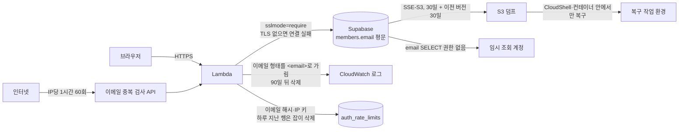

# Link-Sphere BE — 개인정보 보호 정책: 이메일을 어떻게 다루는가

> **문서 성격**: 서사형(설명) — 이메일 등 개인정보를 어디에 어떤 형태로 두고, 왜 그렇게 정했는지를 기록한다. 법률 의견이 아니라
> 개발자가 조문을 읽고 내린 판단이다.
>
> **대상 독자**: 이 레포 BE를 처음 보거나, 개인정보가 드는 컬럼·로그·덤프를 다룰 일이 생긴 개발자.
>
> **읽고 나면**: 이메일 컬럼을 왜 암호화하지 않는지 설명할 수 있고, 언제 다시 검토해야 하는지 알며, 로그 가림·행 삭제·보존
> 기간·중복 검사 한도를 고칠 수 있다.
>
> **마지막 검토**: 2026-11-05 (최초 작성)

## 1. 쉬운 설명

회원 명부를 금고에 넣는 대신, 명부의 사본이 굴러다니는 곳을 치웠다고 보면 된다.

이메일 컬럼을 앱에서 암호화하면 "DB만 털린" 경우는 막지만, 금고 열쇠를 잃으면 전 회원이 로그인하지 못한다. 그리고 이 서비스는 DB
덤프와 그 열쇠가 놓일 곳(Lambda 환경변수)을 같은 AWS 키 하나로 읽을 수 있어, 그 키가 새는 경우는 막지 못한다. 반면 조사해 보니
이메일 원문은 무기한 보존되는 로그와 임시 조회 계정에서 더 쉽게 샜다. 그래서 컬럼은 평문으로 두고 그 지점들을 막았다.

## 2. 전제 지식

- **가정한다**: Spring Boot와 Postgres 기초, 이 앱이 Lambda + Supabase로 돈다는 것.
- **가정하지 않는다**
  - 저장소 암호화와 컬럼 암호화의 차이는 §12에 있다.
  - 레이트리밋 구조는 [`TRAFFIC-MANAGEMENT.md`](./TRAFFIC-MANAGEMENT.md), 탈퇴 뒤 익명화는 [`ACCOUNT-DELETION.md`](./ACCOUNT-DELETION.md),
    백업은 [`DEPLOY.md`](./DEPLOY.md) 13장을 먼저 본다.

## 3. 사용한 도구·기술

**기능 자체**

- Spring Boot 3.5 structured logging의 `StructuredLoggingJsonMembersCustomizer`(모든 JSON 값에 처리기를 건다)
- pgjdbc `sslmode` 연결 속성(Hikari `data-source-properties`로 전달)
- PostgreSQL 컬럼 단위 `GRANT`
- CloudWatch Logs 보존 기간, 기존 `account-purge` EventBridge 잡

**구현·검증 과정에서 쓴 도구**

- `javap`(라이브러리 설치본 확인), Testcontainers, TLS 없는 임시 Postgres 컨테이너, CloudWatch 필터 패턴(건수만 집계)

## 4. 왜 만들었나

"이메일을 암호화해야 하나, 정책은 어떻게 해야 하나"라는 질문에서 시작했다. 2026-11-05 코드와 운영 설정을 직접 측정한 결과는 다음과
같다. 이 문서의 수치는 모두 그날의 직접 측정이고, 이메일 값은 출력하지 않고 건수만 셌다.

| 확인한 것 | 결과 |
| --- | --- |
| 원문 위치 | `members.email` 한 컬럼에 평문. 공개 API로 남의 이메일이 나가는 경로 없음. 글·댓글 소유권은 회원 id로 판정 |
| 규모 | 계정 14개(봇 제외 13개) |
| CloudWatch | 로그 그룹 4개 모두 보존 무기한. `/aws/lambda/link-sphere-api`에 이메일 원문 8건(주소 5개, 7건은 테스트 도메인, 2026-09-28~11-02) |
| `auth_rate_limits` | 이메일 해시 키 17행, IP 키 9행(세 버킷 합계). 2026-09-28 행이 남아 있어 "창이 지나면 사라진다"던 문서와 어긋남 |
| DB 연결 | Lambda URL에 `sslmode` 없음. pgjdbc 42.7.11 기본값은 `PREFER`(`SslMode.of`, `javap`로 확인)라 TLS를 못 쓰면 평문으로 넘어갈 수 있음. 서버는 6543에서 TLS 1.3으로 응답 |
| S3 덤프 | 객체는 SSE-S3(`AES256`). 이메일·비밀번호 해시 포함 |
| AWS 키 | `link-sphere-user` 키 하나로 S3 덤프와 Lambda 환경변수를 모두 읽을 수 있음 |
| 임시 조회 계정 | `members.email` 조회 가능(`has_column_privilege`=`t`). 조회 결과는 세션 기록에 남음 |

## 5. 구조

### 5-1. 결정: 이메일 컬럼은 암호화하지 않는다 (2026-11-05 사용자 결정)

| 선택지 | 막는 것 | 못 막거나 새로 생기는 것 | 판정 |
| --- | --- | --- | --- |
| **A. 평문 유지 + 유출 지점 보완** | 로그·임시 조회·레이트리밋 행·평문 전송으로 새는 경로 | Supabase가 뚫리거나 덤프가 새면 이메일과 bcrypt 해시가 함께 나감 | **채택** |
| B. 컬럼 암호화 + 블라인드 인덱스 | Supabase 쪽 유출, 덤프만 유출된 경우 | 키를 잃으면 전 회원 로그인 불가. `link-sphere-user` 키가 새면 덤프와 키가 같이 나감. 유니크 인덱스(`lower(email)`)·조회·복구 절차를 모두 새로 만들어야 함 | 기각 |

**받아들인 위험은 A의 "못 막는 것" 칸이다.** 판단 근거는 다음과 같다.

- **법:** [안전성 확보조치 기준](https://www.law.go.kr/LSW/admRulInfoP.do?admRulSeq=2100000281400)(고시 제2026-9호, 2026-07-01 시행) 제7조 제2항의
  저장 암호화 대상은 주민등록번호·여권번호·운전면허번호·외국인등록번호·신용카드번호·계좌번호·생체인식정보 7종이고 이메일은 없다.
  제3조는 _"처리하는 개인정보의 보유 수, 유형 및 정보주체에게 미치는 영향 등을 고려하여 스스로의 환경에 맞는"_ 조치를 요구한다.
- **위협 모델:** [OWASP Cryptographic Storage Cheat Sheet](https://cheatsheetseries.owasp.org/cheatsheets/Cryptographic_Storage_Cheat_Sheet.html)는
  _"어느 계층이 가장 적절한지는 위협 모델에 달려 있다"_ 고 쓰고, _"민감한 정보를 보호하는 가장 좋은 방법은 애초에 저장하지 않는 것이다"_ 라고도 쓴다(둘 다 번역).
- **저장소 암호화:** [Supabase Security](https://supabase.com/security)는 _"모든 고객 데이터는 저장 시 AES-256으로 암호화된다"_ (번역)고 쓴다. 업체의 주장이고 직접
  검증하지는 못했다.
- **다른 제품(샘플일 뿐, 업계 통계가 아니다):** [Mastodon](https://raw.githubusercontent.com/mastodon/mastodon/main/db/schema.rb),
  [Discourse](https://raw.githubusercontent.com/discourse/discourse/main/app/models/user_email.rb),
  [Supabase Auth](https://raw.githubusercontent.com/supabase/auth/master/migrations/00_init_auth_schema.up.sql)의 공개 스키마는 이메일 컬럼을 평문으로 둔다.

**재검토 조건:** 제7조 제2항 대상 정보를 받게 될 때, 법무 검토에서 요구할 때, 유료 결제·기업 고객이 생길 때.

### 5-2. 데이터별 정책

| 데이터 | 저장 형태 | 전송 | 보관 |
| --- | --- | --- | --- |
| 비밀번호 | bcrypt 일방향 해시(제7조 제1항) | TLS | 퍼지 때까지 |
| 이메일 원문 `members.email` | 평문, Supabase 저장소 암호화에 의존 | TLS | 탈퇴 유예 14일 뒤 잡이 `deleted-<id>@deleted.invalid`로 치환 |
| 이메일 해시·IP `auth_rate_limits.bucket_key` | 솔트 없는 SHA-256, IP 원문. **개인정보로 다룬다** | TLS | 하루 지난 행을 잡이 삭제, 최대 약 5일. 덤프에는 구조만 들어감 |
| 앱 로그 | 이메일 형태를 `<email>`로 가림. 로컬 텍스트 로그는 제외 | AWS 내부 | 90일 |
| DB 덤프 | SSE-S3 | HTTPS | 30일 + 이전 버전 30일(최대 약 60일) |
| FCM 토큰 | 평문(현행 유지, §11) | TLS | 해제·탈퇴 때까지 |

### 5-3. 유출 경로별 위협

| 경로 | 지금 막는 것 | 남는 위험 |
| --- | --- | --- |
| Supabase 쪽 유출 | 저장소 암호화(업체 주장), 공개 테이블 RLS 켬(정책 0개, `schema.sql`) | 앱 계정으로 읽히면 평문. 받아들임(§5-1) |
| S3 덤프 | SSE-S3, 수명 규칙 | `link-sphere-user` 키가 새면 읽힘. 이 로컬 키는 사용자 결정으로 유지 중 |
| 앱 로그 | 값 처리기 한 곳에서 가림 | 이메일이 아닌 식별자(닉네임 등)는 안 가림. 가리기 전 8건은 늦어도 2027-01-31에 사라짐 |
| 레이트리밋 행 | 하루 지난 행 삭제 | 삭제 전 최대 약 5일은 남음. 솔트가 없어 후보 주소가 있으면 대조 가능 |
| DB 전송 구간 | `sslmode=require`(TLS 없으면 연결 실패) | 인증서는 검증하지 않음. 풀러 인증서가 기본 신뢰 저장소로 검증되지 않아(`openssl` 검증 코드 19) `verify-full`은 CA 인증서를 따로 배포해야 한다. 범위 밖 |
| 임시 조회 | `members.email` 권한 회수 | 이메일로 회원을 찾으려면 Supabase 콘솔 |
| 이메일 중복 검사 API | IP당 1시간 60회 | IP를 돌리면 우회됨. 가입 여부 응답 자체는 그대로(가입 화면 UX) |
| 담당자 PC | FileVault 켜짐, 로컬 덤프 없음(2026-11-05 검색). 복구는 CloudShell·컨테이너 안에서 | 제7조 제5항을 충족하는지는 판단하지 못함(§11) |

전송 구간의 근거는 고시 제7조 제4항 _"개인정보를 정보통신망을 통하여 인터넷망 구간으로 송ㆍ수신하는 경우에는 (...) 암호화하여야 한다"_ 이고,
임시 조회의 근거는 제12조 제1항 _"용도에 따라 출력 항목을 최소화하여야 한다"_ 이다. 담당자 PC는 제7조 제5항 _"이용자의 개인정보 (...) 를
개인정보취급자의 컴퓨터, 모바일 기기 및 보조저장매체 등에 저장할 때에는 (...) 암호화한 후 저장하여야 한다"_ 를 본다.

고시 제8조의 1년 보관은 _"개인정보처리시스템에 접속한 자(다만, 정보주체는 제외한다)"_ 의 접속기록이다. 회원 요청을 처리하는 앱 로그와는 별개로
읽어 90일로 정했는데, 이 해석은 법무 확인을 받지 않았다.

## 6. 데이터 모델

스키마는 바꾸지 않았다. 원본은 `src/test/resources/db/schema.sql`이고, `auth_rate_limits`의 키 형태는 다음과 같다.

| `bucket_key` | 개인정보 여부 |
| --- | --- |
| `login-fail:<sha256(email)>`, `email-verify:…`, `password-reset:…` | 이메일 파생값(솔트 없음) |
| `*:ip:<IP>` (`email-availability:ip:<IP>` 포함) | IP 원문 |
| `*:member:<회원ID>` | 회원 id |

## 7. 운영 파라미터

경로는 `src/main/kotlin/com/example/linksphere/` 기준이다.

| 값 | 현재 | 위치 | 왜 이 값인가 |
| --- | --- | --- | --- |
| 이메일 정규식 | `[A-Za-z0-9._%+-]+@[A-Za-z0-9.-]+\.[A-Za-z]{2,}` | `global/common/EmailMaskingLogCustomizer.kt:23` | `user@localhost`처럼 TLD가 없으면 안 가린다 |
| `sslmode` | `require` | `LambdaHandler.kt:101` | 기본값 `PREFER`는 평문으로 넘어갈 수 있다. `verify-full`은 §11 |
| 레이트리밋 행 보존 | 1일 | `global/common/RateLimitService.kt:41` | 가장 긴 창이 1시간이다. 더 긴 창을 쓰면 늘린다 |
| 행 삭제 주기 | 4일 | `account-purge` EventBridge 룰(레포 밖, [`DEPLOY.md`](./DEPLOY.md) 10장) | 새 룰 없이 기존 잡에 얹었다. 그래서 최대 약 5일 |
| 중복 검사 한도 | IP당 1시간 60회 | `domain/auth/AuthController.kt:56-57` | 계측값이 아닌 판단. 링크 미리보기 한도와 같은 값이고 FE는 500ms 디바운스로 호출한다 |
| 로그 보존 | 90일 | CloudWatch 설정(레포 밖). 그룹 4개: `/aws/lambda/link-sphere-api`, `/aws/lambda/link-sphere-be-lambda`, `/aws/apprunner/link-sphere-be/c09223138fad464093519b142e13daf3/application`, 같은 경로의 `/service` | 사고를 늦게 발견해도 볼 수 있는 기간으로 잡은 판단. 지난 로그는 되돌릴 수 없다 |

## 8. 코드 지도와 자주 하는 수정

| 동작 | 파일 |
| --- | --- |
| 로그 가림 | `global/common/EmailMaskingLogCustomizer.kt`, 등록은 `LambdaHandler.kt:100` |
| TLS 강제 | `LambdaHandler.kt:101` |
| 행 삭제 | `RateLimitService.purgeExpired`(`:90`) → `AuthRateLimitRepository.deleteOlderThan`, 호출은 `LambdaHandler.kt:335` |
| 중복 검사 한도 | `AuthController.checkEmailAvailability` |
| 임시 조회 권한 | Supabase, SQL은 [`DEPLOY.md`](./DEPLOY.md) 12장 |

| 이렇게 고치려면 | 할 일 | 재배포 |
| --- | --- | --- |
| 다른 값도 로그에서 가리기 | `EmailMaskingLogCustomizer`에 치환을 더하고 `EmailMaskingLogCustomizerTest`에 형태를 추가 | 필요 |
| 한도 값 바꾸기 | 위 상수를 바꾸고 `AuthControllerTest`의 기대값과 `TRAFFIC-MANAGEMENT.md` §7-1을 함께 고침 | 필요 |
| 1일보다 긴 레이트리밋 창 추가 | `RETENTION`을 그 창보다 길게 늘린다. 안 늘리면 창이 끝나기 전에 행이 지워져 한도가 풀린다 | 필요 |
| 로그 보존 기간 바꾸기 | `aws logs put-retention-policy --log-group-name <그룹> --retention-in-days <일>`을 4개 그룹에 실행. `link-sphere-user`에는 권한이 없어 관리자 권한의 CloudShell에서 한다 | 불필요 |
| 로그 속 이메일 건수 세기 | `aws logs filter-log-events --log-group-name /aws/lambda/link-sphere-api --start-time <ms> --filter-pattern '%[a-zA-Z0-9._-]+@[a-zA-Z0-9-]+\.[a-zA-Z]{2,}%'`. 값을 대화나 파일에 남기지 않고 건수만 본다 | 불필요 |

## 9. 검증 결과

2026-11-05 직접 측정. 임시 Postgres(`pgvector/pgvector:pg17`, `ssl=off`)에 앱을 띄워 확인했다.

| 대상 | 방법 | 결과 |
| --- | --- | --- |
| TLS 인자가 실제로 먹는가 | TLS 없는 DB에 인자를 주고 기동, 빼고 기동 | 있으면 health 503 + 로그에 `does not support SSL`, 없으면 200 `UP` |
| 로그 가림(`message`) | 대소문자만 다른 이메일로 가입해 유니크 위반 재현, 가림 유무 비교 | 없으면 `Detail: Key (lower(email))=(주소)`가 그대로 남고, 있으면 `<email>`. 응답은 둘 다 409 `DUPLICATE_MEMBER`라 가입 로직에 영향 없음 |
| 로그 가림(`stack_trace`) | `EmailMaskingLogCustomizerTest`로 실제 logstash 인코더를 태움 | `<email>`. 이메일이 든 예외를 실제 기동에서 만들지 못해 이 필드만 인코더 테스트로 확인했다 |
| 중복 검사 한도 | 같은 IP로 61회, 다른 IP로 1회 | 60회 200, 61번째 429 `RATE_LIMIT_EXCEEDED`, 다른 IP는 200 |
| 행 삭제 경계 | `RateLimitServicePurgeIntegrationTest`(실제 Postgres) | 기준 전 1초 행만 삭제, 기준과 같은 행은 유지 |

운영에서 2026-11-05 배포(`prod` alias 버전 192) 뒤 확인한 결과는 다음과 같다. 이메일 값은 출력하지 않고 건수만 셌다.

| 대상 | 방법 | 결과 |
| --- | --- | --- |
| 기동 | 배포 run 성공 뒤 `/api/actuator/health` | `UP` |
| 중복 검사 한도 | `example.com` 주소로 61회 호출 | 60회 200, 61번째 429 `RATE_LIMIT_EXCEEDED`, `Retry-After` 2954초 |
| 배포 뒤 로그 | 배포 시각 이후 약 10분치를 필터 패턴으로 집계 | 이메일 형태 0건, `does not support SSL` 0건, ERROR 0건 |
| 레이트리밋 행 삭제 | `account-purge` 잡을 1회 호출하고 전후를 `linksphere-ro`로 조회 | 163행 → 6행, 하루 지난 행 157 → 0. 유예가 끝난 계정은 0개라 퍼지 대상은 없었다 |
| 로그 보존 | 사용자가 CloudShell에서 설정한 뒤 `describe-log-groups` | 4개 그룹 모두 90일 |
| 임시 조회 권한 | 사용자가 Supabase에서 `revoke select (email)` 실행 뒤 `has_column_privilege('members','email','SELECT')` | `f`(`select count(email) from members`도 권한 오류) |
| 옛 Supabase Auth에 남은 이메일 | 사용자가 Supabase에서 `select count(*) from auth.users` | 0행, 정리할 것 없음 |

배포 뒤 로그는 표본이 작고, 운영 로그에서 `<email>`로 가려진 줄을 직접 보지는 못했다(발송 실패나 유니크 위반이 일어나야 찍힌다). 정기 잡까지 거친 재확인은
[#162](https://github.com/BAECHAN/link-sphere_BE_NEW/issues/162)에서 한다.

## 10. 시행착오

- **문서와 주석이 실제와 달랐다.** "창이 지나면 사라지고"(`ACCOUNT-DELETION.md`), "이 테이블 자체엔 PII가 남지 않는다"(`TableAuthRateLimit.kt`,
  SQL 주석)는 둘 다 틀렸다. 정리 코드가 없어 2026-09-28 행이 남아 있었고, 솔트 없는 해시와 IP 원문은 개인정보로 다뤄야 한다. 주석을 고치고 삭제를 추가했다.
- **처음 재현은 유니크 위반 경로를 타지 않았다.** 가입 API로 대소문자만 다른 주소를 두 번 보내면 앞단 확인에서 걸려 Hibernate 로그가 나오지 않았다.
  대문자 주소 행을 DB에 직접 넣어 두니 재현됐다(`MemberServiceIntegrationTest`와 같은 방법).

## 11. 남은 것

- **개인정보처리방침 페이지:** 없는 상태이고, 2026-11-05 이번 범위에서 빼기로 사용자가 결정했다. [개인정보 보호법](https://www.law.go.kr/법령/개인정보보호법)(2026-09-11 시행)
  제30조 제1항은 개인정보처리자에게 처리방침을 _"정하여야 한다"_ 고 쓰고, 제75조 제4항 제8호는 위반을 1천만원 이하 과태료 대상으로 둔다. 제2조 제5호의 개인정보처리자는
  _"업무를 목적으로 개인정보파일을 운용하기 위하여"_ 처리하는 자인데, 이 서비스가 여기 해당하는지는 판단하지 못했다. 재검토 조건: 법무 확인에서 적용 대상이라고 나올 때,
  유료 결제·기업 고객이 생길 때.
- **확인하지 못한 법적 판단:** 이 서비스가 고시·법의 적용 대상인지, FileVault가 제7조 제5항을 충족하는지, 암호화가 유출 신고를 면제하는지. 개인정보위
  [2026 작성지침](https://www.privacy.go.kr/front/bbs/bbsView.do?bbsNo=BBSMSTR_000000000049&bbscttNo=20885) PDF도 읽지 못했다(10MB 초과로 도구 실패).
- **`sslmode=verify-full`:** 인증서까지 검증하는 단계는 범위 밖이다.
- **FCM 토큰 평문 저장, 가입 여부 응답 자체:** 범위 밖이고 현행을 유지한다.

## 12. 용어 사전

- **저장소 암호화:** 디스크·객체를 저장 계층에서 암호화하는 것. 디스크 탈취는 막지만 DB 계정으로 읽으면 평문이다(Supabase AES-256, S3 SSE-S3).
- **컬럼 암호화:** 앱이 값을 암호화해 넣는 것. DB 쪽 유출도 막지만 키 관리가 필요하고 조회·유니크 검사가 어려워진다.
- **블라인드 인덱스:** 컬럼 암호화 뒤 동등 조회를 하려고 따로 두는 키 있는 해시 컬럼.
- **퍼지:** 탈퇴 유예가 끝난 계정을 익명화하는 `account-purge` 잡의 처리([`ACCOUNT-DELETION.md`](./ACCOUNT-DELETION.md)).
- **`adhoc_readonly` / `linksphere-ro`:** 운영 DB 임시 조회 전용 계정과 그 접속 서비스 이름([`DEPLOY.md`](./DEPLOY.md) 12장).
- **`link-sphere-user`:** 로컬 AWS CLI가 쓰는 IAM 사용자.

## 13. 관련 문서

- [`ACCOUNT-DELETION.md`](./ACCOUNT-DELETION.md) — 탈퇴 유예와 퍼지, 재가입 정책의 법적 고려(서울고법 2017나2074963은 이 문서 §5-3에서 재인용했다)
- [`TRAFFIC-MANAGEMENT.md`](./TRAFFIC-MANAGEMENT.md) — 레이트리밋 전체 구조와 한도 표
- [`DEPLOY.md`](./DEPLOY.md) — 임시 조회 계정(12장), 백업·복구(13장), 운영 로그 읽기
- [`plans/2026-11-05-email-data-protection.md`](./plans/2026-11-05-email-data-protection.md) — 이 정책을 정한 계획
