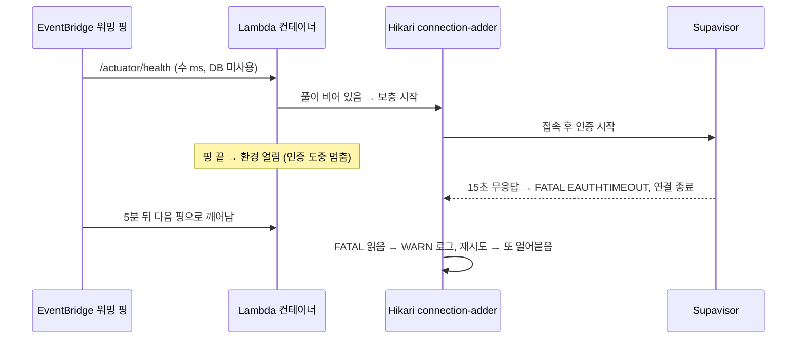

# AWS Lambda SnapStart 배포 가이드

> 마지막 검토: 2026-10-16

## 아키텍처 개요

### 배포 파이프라인
```
GitHub push (main)
  → GitHub Actions
    → shadowJar 빌드 (fat JAR, 모든 의존성 포함)
    → S3 업로드
    → Lambda 코드 업데이트
    → 버전 발행 (SnapStart 스냅샷 생성)
    → 새 버전을 직접 5회 연속 호출 검증 (하나라도 실패하면 여기서 중단)
    → 전부 통과하면 prod alias 자동 승격
```

> ℹ️ **2026-08-13부터 자동 승격(검증 게이트 포함)으로 전환했다.** 이전엔 CI가
> 발행까지만 하고 사람이 직접 연속 호출로 검증한 뒤 수동으로 `update-alias`를
> 실행해야 했는데, 이 수동 단계에 알림이 전혀 없어 2026-08-10~08-12 사이 발행된
> 버전 68~71이 **6일간 미승격 상태로 방치**된 사례가 있었다(CloudTrail로 확인,
> 2026-08-13). "사람이 잊지 않고 매번 승격한다"에 의존하는 구조 자체가 근본
> 문제였다고 판단해, 검증과 승격을 CI 안으로 옮겼다.
>
> **수동 승격을 처음 도입한 이유(2026-07-25 502 장애)는 여전히 유효하고, 그대로
> 자동화 안에 반영돼 있다** — 그 장애는 "복원 후 첫 요청은 성공, 이후 실패" 패턴이라
> 배포 직후 헬스체크 1번으로는 못 잡았다(`docs/PERFORMANCE.md` 5장). 그래서 이번
> 게이트도 **1번이 아니라 5번 연속 호출**해서 전부 성공해야만 승격한다 — "검증 없이
> 자동으로 넘어가지 않는다"는 원칙은 그대로고, 그 검증을 사람이 하던 걸 CI가
> 대신하게 됐을 뿐이다.

### Lambda 실행 구조
```
API 요청 (linksphere.click, HTTPS)
  → CloudFront (오리진 요청 정책: /api/* 는 관리형 Managed-AllViewerExceptHostHeader,
    Lambda 오리진에 OAC가 SigV4로 서명)
    → Lambda Function URL (AuthType: AWS_IAM — CloudFront를 거치지 않은 직접
      호출은 IAM 인가 단계에서 403, §5-1 참고)
      → LambdaHandler.handleRequest()
        → linksphereJob 필드로 분기: 없으면 아래 HTTP 요청 경로, 있으면
          ai-analysis/comment-postprocess/feed-crawl/feed-item/account-purge/orphan-image-gc
          내부 작업(self-invoke·EventBridge, 목록 정본은 docs/BE-ARCHITECTURE.md §1)을 MockMvc 없이 바로 처리
        → (HTTP 요청 경로) FunctionUrlOriginGuard 검사 — 지금은 ORIGIN_VERIFY_SECRET이
          미설정이라 fail-open(항상 통과)이며, OAC가 사실상 이 자리를 대신한다(§5-1
          "Phase 0 관련 정정" 참고)
        → MockMvc.perform()
          → Spring DispatcherServlet (Tomcat은 8080을 열지 않음 — `--server.port=-1`)
            → 응답
```

---

## 핵심 동작 원리

> **2026-07-25 — Lambda Web Adapter 레이어를 제거했다.**
> 그전까지 함수에는 `LambdaAdapterLayerArm64:24` 레이어가 붙어 있었고, Tomcat이 8080에 떠서
> 실트래픽을 처리하고 있었다(즉 아래 "MockMvc 방식" 서술과 실제가 달랐다).
> 이 레이어는 `AWS_LAMBDA_EXEC_WRAPPER`가 설정되지 않아 익스텐션으로만 떠 있었고,
> `127.0.0.1:8080` 접속에 실패하면 panic하면서 **호출 전체를 502로 실패시켰다**
> (2026-07-25 장애의 직접 원인 — [PERFORMANCE.md](./PERFORMANCE.md) 5장).
> 제거 후 요청은 `LambdaHandler`(MockMvc)가 처리하며, 응답 본문은 제거 전과 동일함을 확인했다
> (헤더명 케이싱만 `vary`→`Vary`로 바뀌는데 HTTP 헤더명은 대소문자를 구분하지 않아 무해).

### MockMvc 방식을 사용하는 이유

SnapStart는 Lambda init phase를 스냅샷으로 저장해 cold start를 단축한다. 그런데 일반적인 Spring Boot + Tomcat 방식은 두 가지 문제가 있다.

1. **CRaC 체크포인트 실패**: Tomcat이 8080 소켓을 열고 있는 상태에서 SnapStart 체크포인트를 시도하면 열린 소켓이 있어서 `State:Failed`가 된다.
2. **restore 후 rebind 실패**: 체크포인트를 통과하더라도 복원 후 Tomcat이 8080 포트에 재바인딩하지 못해 요청을 처리할 수 없다.

**해결책**: 요청을 Tomcat 소켓이 아니라 `MockMvc`로 `DispatcherServlet`에 직접 넣는다. 서블릿 웹 컨텍스트에 필요한 내장 Tomcat
컨텍스트는 만들지만 `LambdaHandler`가 `--server.port=-1`로 기동해 8080에 바인딩하지 않는다 — 기동·복원 때 커넥터가 임시
포트(0)에 잠깐 bind했다가 바로 멈추므로(spring-boot 3.5.16 `TomcatWebServer.start`의 `stopProtocolHandler`) 요청을 처리하는
동안에는 리스닝 소켓이 없다.
2026-10-26 전에는 이 인자가 없어 실제로 8080에 바인딩했다 — 운영 로그에 `Tomcat started on port 8080`이 14일간 1,703회
찍혔고, Spring의 SnapStart 수명주기 처리가 체크포인트 전에 커넥터를 멈췄다가 복원 때 다시 열었다(spring-framework 6.2
`DefaultLifecycleProcessor` `beforeCheckpoint`·`afterRestore`). 문서는 그동안 "Tomcat 없음"이라고 잘못 적고 있었다.

### SnapStart 동작 흐름

```
1. Init phase:
   - LambdaHandler.companion.init { } 실행
   - Spring Boot 시작 (MockMvc 초기화 포함)
   - warmUp() 실행 — 읽기 전용 엔드포인트로 실제 요청을 흘려보냄
   - SnapStart가 이 상태를 스냅샷으로 저장

2. 요청 수신 (cold start):
   - 스냅샷에서 JVM 복원 (Spring 재시작 없음)
   - handleRequest() 호출
   - MockMvc → DispatcherServlet → 응답

3. 요청 수신 (warm start):
   - 동일 컨테이너 재사용, 즉시 handleRequest() 호출
```

### init 단계에서 워밍업을 실행하는 이유

`companion object init`은 체크포인트 **이전**에 실행되므로, 여기서 수행한 초기화가 전부 스냅샷에 포함된다. 워밍업이 없으면 아래가 모두 복원 이후 첫 요청으로 밀린다.

- `DispatcherServlet` 최초 초기화
- Spring Security 필터 체인 첫 통과
- Hibernate 메타모델·쿼리플랜 캐시 생성
- HikariCP 실제 커넥션 확보
- JIT 미적용 상태(인터프리터) 실행

실측상 restore 자체는 약 0.65초인데 그 뒤 첫 요청이 약 2.9초였던 원인이 이것이다. 자세한 측정·분석은 [PERFORMANCE.md](./PERFORMANCE.md) 참고.

주의사항:
- 워밍업은 **읽기 전용·`permitAll` 엔드포인트만** 사용한다 (부작용 방지)
- 실패해도 부팅은 계속한다 — 배포 시점에 DB가 닿지 않아도 Lambda는 기동되어야 한다
- HikariCP 풀은 Spring Boot의 `HikariCheckpointRestoreLifecycle`이 체크포인트 직전에 멈추고 커넥션을 닫으므로(복원 때 다시 연다) init 단계의 DB 워밍업과 충돌하지 않는다. **순서를 바꾸지 말 것** — 워밍업은 체크포인트 전에 끝나야 한다

### Shadow JAR에서 spring.factories를 append하는 이유

Shadow JAR 플러그인의 `mergeServiceFiles()`는 `META-INF/services/**` 파일만 병합한다. Spring Boot의 `ApplicationContextFactory` 구현체들은 `META-INF/spring.factories`에 등록되어 있는데, 이 파일은 `mergeServiceFiles()` 대상이 아니다.

이 파일이 누락되면:
- `DefaultApplicationContextFactory.getFromSpringFactories()` → 구현체 없음
- 폴백: `AnnotationConfigApplicationContext` 생성 (웹 컨텍스트가 아님)
- `MockMvcBuilders.webAppContextSetup(ctx as WebApplicationContext)` → **ClassCastException**

따라서 `append("META-INF/spring.factories")`를 명시적으로 추가해야 한다. 추가로, `LambdaHandler`에서 `createApplicationContext()`를 오버라이드해 spring.factories 조회 자체를 우회하는 이중 방어도 적용되어 있다.

---

## AWS 초기 설정 (최초 1회)

### 1. GitHub Actions용 IAM 역할 (OIDC)

`deploy.yml`·`prod-alias-drift-check.yml`은 IAM 사용자의 영구 키가 아니라, GitHub OIDC로 맡는 역할
`link-sphere-be-deploy`로 AWS에 접근한다(2026-10-13 전환 — 그 전엔 `AWS_ACCESS_KEY_ID`/`SECRET` 시크릿).
job마다 임시 자격증명을 받아 기본 1시간 뒤 만료되므로 교체할 키가 없다.

- **신뢰 조건**: 제공자 `token.actions.githubusercontent.com`, `aud`=`sts.amazonaws.com`,
  `sub`=`repo:BAECHAN/link-sphere_BE_NEW:ref:refs/heads/main` — 이 레포 main 브랜치의 job만(push·수동 실행·예약 실행
  모두 해당). 다른 브랜치를 골라 수동 실행하면 역할을 못 맡아 실패한다.
- **역할 ARN**: 레포 Secret `AWS_ROLE_ARN`.
- **만든 방법**: 콘솔 CloudShell 스크립트로 OIDC 제공자와 FE·BE 역할을 함께 만들었다(스크립트 원문:
  [`docs/plans/2026-10-13-github-oidc-aws.md`](./plans/2026-10-13-github-oidc-aws.md) 부록 A — 여러 번 실행해도
  안전하니 권한을 바꿀 때 고쳐서 다시 돌린다). 로컬 IAM 사용자(`link-sphere-user`)에는 IAM 권한이 없어 콘솔에서 한다.
- **전제 — 도쿄 리전 STS 활성화**: IAM → Account settings → Security Token Service (STS) → Endpoints에서
  Asia Pacific (Tokyo)가 Active여야 한다. 꺼져 있으면 역할 맡기가 _"이 리전에서 STS가 활성화돼 있지 않다"_ (번역)
  에러로 실패한다 — 2026-10-13 FE 첫 전환 때 실제로 이걸로 실패해 켰다. AWS 문서는 _"기본으로 켜진 리전은 임시
  자격증명이 만들어지는 계정에서 그 리전의 STS 창구를 활성화해야 한다"_ (번역,
  [Manage AWS STS in an AWS Region](https://docs.aws.amazon.com/IAM/latest/UserGuide/id_credentials_temp_enable-regions.html))고
  쓴다. IAM 사용자의 신원 조회(`aws sts get-caller-identity`)는 임시 자격증명을 만들지 않아 이 설정과 무관하게 된다.

권한 정책(인라인 `deploy`):
```json
{
  "Version": "2012-10-17",
  "Statement": [
    {
      "Effect": "Allow",
      "Action": ["s3:PutObject", "s3:GetObject"],
      "Resource": "arn:aws:s3:::link-sphere-lambda-deploy/*"
    },
    {
      "Effect": "Allow",
      "Action": [
        "lambda:UpdateFunctionCode",
        "lambda:PublishVersion",
        "lambda:CreateAlias",
        "lambda:UpdateAlias",
        "lambda:GetAlias",
        "lambda:GetFunction",
        "lambda:GetFunctionConfiguration",
        "lambda:InvokeFunction",
        "lambda:GetFunctionUrlConfig",
        "lambda:ListVersionsByFunction"
      ],
      "Resource": [
        "arn:aws:lambda:ap-northeast-1:<계정 ID>:function:link-sphere-api",
        "arn:aws:lambda:ap-northeast-1:<계정 ID>:function:link-sphere-api:*"
      ]
    }
  ]
}
```

> ⚠️ **`lambda:InvokeFunction`은 2026-08-13 자동 승격 게이트 도입 시 추가됐다.**
> 그 이전엔 CI가 발행만 하고 사람이 로컬 자격증명으로 직접 호출했기 때문에 이
> 권한이 필요 없었다. `lambda:GetFunctionUrlConfig`(deploy.yml 마지막 "Function URL 출력"
> 스텝)와 `lambda:ListVersionsByFunction`(prod-alias-drift-check.yml)은 옛 IAM 사용자 정책
> 문서에서 빠져 있던 것을 OIDC 역할로 옮기면서 채웠다.

### 2. S3 버킷 생성

```bash
aws s3 mb s3://link-sphere-lambda-deploy --region ap-northeast-1
```
- 퍼블릭 액세스: 모두 차단
- 버전 관리: 활성화 권장

### 3. Lambda 함수 생성

```bash
aws lambda create-function \
  --function-name link-sphere-api \
  --runtime java17 \
  --handler com.example.linksphere.LambdaHandler \
  --role arn:aws:iam::ACCOUNT_ID:role/lambda-execution-role \
  --code S3Bucket=link-sphere-lambda-deploy,S3Key=initial.jar \
  --memory-size 2048 \
  --timeout 120 \
  --architectures arm64 \
  --snap-start ApplyOn=PublishedVersions
```

Lambda 실행 역할 필요 권한: `AWSLambdaBasicExecutionRole`

> **메모리 2048MB인 이유**: Lambda는 메모리에 비례해 vCPU를 준다(1024MB ≈ 0.58 vCPU → 2048MB ≈ 1.15 vCPU). 콜드스타트 첫 요청은 클래스 로딩·JIT 위주의 CPU 바운드라 메모리를 올리면 거의 선형으로 빨라진다. 실사용 메모리는 460MB 수준이므로 메모리 자체가 목적이 아니다. `GB × 초` 과금이라 실행 시간이 줄어 **비용은 거의 중립**이다. ([PERFORMANCE.md](./PERFORMANCE.md))

기존 함수의 메모리를 바꿀 때는 설정 변경 후 새 버전을 발행해야 스냅샷에 반영된다.

```bash
aws lambda update-function-configuration \
  --function-name link-sphere-api --memory-size 2048 --region ap-northeast-1
```

### 4. Lambda 환경변수 설정

Lambda 콘솔 → Configuration → Environment variables:

| 키 | 설명 |
|----|------|
| `SPRING_DATASOURCE_URL` | `jdbc:postgresql://...supabase.com:6543/postgres?prepareThreshold=0` |
| `SPRING_DATASOURCE_USERNAME` | Supabase DB 사용자명 |
| `SPRING_DATASOURCE_PASSWORD` | Supabase DB 비밀번호 |
| `GEMINI_API_KEY` | Gemini API 키 |
| `YOUTUBE_API_KEY` | YouTube Data API v3 키 (영상 설명 추출용, `docs/AI-ASYNC-PROCESSING.md` §5.7 참고) |
| `SUPABASE_BUCKET` | Supabase 스토리지 버킷명 |
| `SUPABASE_KEY` | Supabase service role key |
| `SUPABASE_URL` | `https://<project>.supabase.co` |
| `ORIGIN_VERIFY_SECRET` | CloudFront가 오리진 커스텀 헤더로 붙이는 값(§5-1 참고). 미설정 시 그 검사는 건너뛴다(fail-open) |
| `APP_MAIL_FROM` | SES에서 검증된 발신 주소(§9-1 참고). 현재 `noreply@linksphere.click`로 설정돼 있다(2026-09-29, 도메인 검증 완료 후) - 비어있으면 메일 발송을 건너뛴다(fail-open) |
| `APP_FRONTEND_URL` | 비밀번호 재설정·이메일 인증 링크에 쓸 프론트엔드 도메인. 커스텀 도메인(`linksphere.click`)이 `application.yml` 기본값에 이미 반영돼 있어(2026-09-29) 지금은 미설정이 정상이다 - 도메인이 다시 바뀌면 이 환경변수로 덮어쓴다 |
| `APP_CORS_ALLOWED_ORIGINS` | CORS 허용 오리진 목록(쉼표 구분, 예: `https://a.com,https://b.com`). `application.yml`의 `app.cors.allowed-origins` 기본값에 이미 도메인이 반영돼 있어 지금은 미설정이 정상이다. **새 도메인을 붙일 때 이 목록에 추가하는 걸 빠뜨리면 브라우저가 로그인 요청 자체를 403 `Invalid CORS request`로 막는다** - 2026-09-29 `linksphere.click` 연결 때 실제로 겪은 장애, 원인 파악까지 시간이 걸렸다(에러가 CORS 문제라고 바로 드러나긴 했으나 어디에 도메인을 등록해야 하는지 소스를 찾아야 했음) |

> Spring Boot는 `SPRING_DATASOURCE_URL` → `spring.datasource.url` 형식으로 환경변수를 자동 바인딩한다.
> `APP_MAIL_FROM`/`APP_FRONTEND_URL`도 같은 규칙으로 각각 `app.mail.from`/`app.frontend.url`에 매핑된다.
> `APP_CORS_ALLOWED_ORIGINS`처럼 `List<String>` 타입 속성(`app.cors.allowed-origins`)은 Spring Boot의
> relaxed binding이 쉼표로 구분된 값 하나를 리스트로 변환해준다 - 배열 인덱스 문법(`_0`, `_1`) 없이도 된다.

### 5. Function URL 생성

> **지금 프로덕션은 이미 `AuthType: AWS_IAM` + CloudFront OAC 상태다** (2026-09-29
> 적용 완료 — `aws lambda get-function-url-config`로 실측, `docs/plans/2026-09-28-auth-hardening.md`
> Phase 7). 아래 5·5-1은 **신규 환경을 처음부터 구축할 때 따라갈 절차**로 정리해둔
> 것이다 — 지금 새로 환경을 만드는 상황이 아니라면 참고만 하고, 실제 상태는 이
> 문서 서술을 믿지 말고 반드시
> `aws lambda get-function-url-config --function-name link-sphere-api --qualifier prod`로
> 직접 확인한다(이 문서가 과거 한 번 실제 상태와 다른 "적용 완료" 표기를 갖고
> 있었던 사고 사례가 있다, 아래 5-1 "Phase 0 관련 정정" 참고).

```bash
# prod alias에 Function URL 생성 (AWS_IAM — 직접 호출엔 IAM 인가가 필요하다)
aws lambda create-function-url-config \
  --function-name link-sphere-api \
  --qualifier prod \
  --auth-type AWS_IAM
```

이 상태만으로는 아직 아무도(CloudFront조차) 이 Function URL을 호출할 수 없다 —
5-1에서 CloudFront 서비스 프린시펄에 호출 권한을 주고 OAC를 연결해야 실제로
트래픽을 받는다.

#### 5-1. Function URL 직접 호출 완전 차단 (CloudFront OAC) — 적용 완료 (2026-09-29)

Function URL이 `AWS_IAM`이고 CloudFront 오리진에 Origin Access Control(OAC,
`link-sphere-api-lambda-oac`)이 연결돼 있어, CloudFront를 거치지 않고 직접
두드리면 Lambda의 IAM 인가 단계에서 즉시 403을 받는다(WAF 경유 없이도 차단 —
WAF보다 앞단에서 막히므로 §2 WAF와는 독립적인 방어선이다).

**전환 전 체크리스트였음 — 이미 반영 완료, 재구축 시에도 그대로 확인**:

- [x] FE가 `Authorization` 대신 `X-Access-Token` 헤더로 토큰을 보내는지 확인
  (OAC `SigningBehavior: Always`가 `Authorization`을 CloudFront 자신의 SigV4
  서명으로 덮어쓴다)
- [x] FE의 모든 POST/PUT/PATCH/DELETE(로그인·글쓰기·댓글·multipart 업로드 포함)가
  본문의 SHA256을 계산해 `x-amz-content-sha256` 헤더로 보내는지 확인 — [AWS 공식
  문서](https://docs.aws.amazon.com/AmazonCloudFront/latest/DeveloperGuide/private-content-restricting-access-to-lambda.html)에
  따르면 CloudFront는 바디를 오리진으로 스트리밍만 할 뿐 이 해시를 대신 계산해주지
  않는다 — Lambda는 서명되지 않은 페이로드(unsigned payload)를 지원하지 않으므로
  헤더가 없는 요청은 이 단계에서 거절된다

신규 구축 절차(이미 적용된 지금 환경을 다시 만들 때만 필요):

```bash
# 1. CloudFront에 Function URL 호출 권한 부여 (공식 문서: 두 액션 모두 필요 -
#    https://docs.aws.amazon.com/AmazonCloudFront/latest/DeveloperGuide/private-content-restricting-access-to-lambda.html)
aws lambda add-permission --function-name link-sphere-api --qualifier prod \
  --statement-id AllowCloudFrontServicePrincipal \
  --action lambda:InvokeFunctionUrl --principal cloudfront.amazonaws.com \
  --source-arn arn:aws:cloudfront::<account-id>:distribution/<distribution-id>

aws lambda add-permission --function-name link-sphere-api --qualifier prod \
  --statement-id AllowCloudFrontServicePrincipalInvokeFunction \
  --action lambda:InvokeFunction --principal cloudfront.amazonaws.com \
  --source-arn arn:aws:cloudfront::<account-id>:distribution/<distribution-id>

# 2. OAC 생성 (SigningBehavior=always 권장값)
aws cloudfront create-origin-access-control --origin-access-control-config \
  Name=link-sphere-api-lambda-oac,SigningProtocol=sigv4,SigningBehavior=always,OriginAccessControlOriginType=lambda

# 3. CloudFront 콘솔(또는 get-distribution-config → OriginAccessControlId 채워서
#    update-distribution) → 이 오리진(Function URL)의 Origin access control에 위에서
#    만든 OAC 연결

# 4. Function URL은 5장에서 이미 AWS_IAM으로 생성했으므로 별도 전환이 필요 없다.
#    (NONE으로 만들어진 기존 환경을 전환하는 경우에만:
#    aws lambda update-function-url-config --function-name link-sphere-api \
#      --qualifier prod --auth-type AWS_IAM)
```

**현재 Lambda 리소스 정책에 남아있는 statement**(`aws lambda get-policy
--function-name link-sphere-api --qualifier prod` 실측, 2026-09-29):

| Sid | Action | Principal | 비고 |
|-----|--------|-----------|------|
| `FunctionURLAllowInvokeAction` | `lambda:InvokeFunction` | `*` | 조건 `InvokedViaFunctionUrl=true` |
| `FunctionURLAllowPublicAccess2` | `lambda:InvokeFunctionUrl` | `*` | 조건 `FunctionUrlAuthType=NONE` — 지금 AuthType이 `AWS_IAM`이라 이 조건은 매치되지 않아 무력한 상태로 남아있음. 정리하려면 아래로 제거할 수 있지만 지금 당장 위험하지는 않다 |
| `AllowCloudFrontServicePrincipal` / `AllowCloudFrontServicePrincipalInvokeFunction` | `lambda:InvokeFunctionUrl` / `lambda:InvokeFunction` | `cloudfront.amazonaws.com` | `source-arn`이 배포된 distribution(`E1ZZPXFS3GSVZ6`)으로 제한 |
| `EventBridgeWarmup` / `EventBridgeFeedCrawl` | `lambda:InvokeFunction` | `events.amazonaws.com` | 6장·8장 EventBridge 룰 전용 |

무력해진 공개 권한을 정리하려면:

```bash
aws lambda remove-permission --function-name link-sphere-api --qualifier prod \
  --statement-id FunctionURLAllowPublicAccess2
```

**롤백**: `aws lambda update-function-url-config --function-name link-sphere-api
--qualifier prod --auth-type NONE` 한 줄로 즉시 공개 상태로 되돌릴 수 있다(OAC가
오리진에 붙어 있어도 Function URL이 `NONE`이면 서명을 무시하므로 무해 — 게다가
`FunctionURLAllowPublicAccess2` 권한이 아직 남아있어 이 롤백만으로 바로 공개
호출이 재개된다, 별도 `add-permission` 불필요) — 자세한 장애 대응은
`docs/LAMBDA-CONFIG-ROLLBACK.md` 참고.

**Phase 0(오리진 시크릿 헤더, `FunctionUrlOriginGuard.kt`) 관련 정정**: 이 문서는
한때 Phase 0가 "적용 완료"라고 적어뒀으나, Phase 7 작업 중 직접 조회해보니
`ORIGIN_VERIFY_SECRET` 환경변수가 실제로는 설정된 적이 없었다(fail-open 상태로
계속 공개돼 있었음, `AuthType: NONE`·CloudFront에 `CustomHeaders` 없음을 CLI로
확인) — 표기 오류였다. 위 5-1의 OAC 전환이 2026-09-29 완료되면서 이 임시 잠금은
실질적으로 대체됐다 — `ORIGIN_VERIFY_SECRET`은 지금도 미설정 상태로 남아
`FunctionUrlOriginGuard`는 계속 fail-open(항상 통과)이지만, CloudFront 없이
Function URL을 직접 두드리는 시도는 그보다 앞단인 Lambda IAM 인가 단계에서
이미 403으로 막힌다. `FunctionUrlOriginGuard.kt` 코드 자체는 유지하되(제거는
별도 판단), 새로 `ORIGIN_VERIFY_SECRET`을 설정할 필요는 없다.

#### 5-2. 실제 요청자 IP 전달 (CloudFront-Viewer-Address) — 적용 완료, 별도 설정 불필요

로그인 실패·가입 레이트리밋(`RateLimitService`, `ClientIpResolver.kt`)이 IP별 버킷을
나누려면 오리진(Lambda)이 실제 요청자 IP를 알아야 한다.

> **정정(2026-09-29)**: 이 절은 한때 `CloudFront-Viewer-Address`를 오리진 요청
> 정책의 헤더 목록에 명시적으로 추가해야 한다고 적어뒀으나 틀렸다. 실제 `/api/*`
> 오리진 요청 정책은 **관리형** `Managed-AllViewerExceptHostHeader`
> (ID `b689b0a8-53d0-40ab-baf2-68738e2966ac`, `aws cloudfront get-distribution-config`로
> 확인)이고, AWS 공식 문서(docs.aws.amazon.com)를 재확인한 결과 이 관리형 정책
> 자체가 device type·viewer location 헤더 전체를 이미 포함하며
> `CloudFront-Viewer-Address`도 거기 포함된다. 관리형 정책은 헤더 목록을 편집할
> 수도 없다 — 즉 **이 정책을 쓰는 이상 아무 설정도 하지 않아도 자동으로 전달된다.**

- 값 형식은 `ip:port`(IPv6는 `[::1]:port`) — `ClientIpResolver`가 포트를 잘라낸다.
- 헤더가 없으면(합성 이벤트 등 CloudFront를 거치지 않은 호출) `ClientIpResolver`가
  `null`을 반환하고 `RateLimitService`는 그 축의 레이트리밋만 건너뛴다(fail-open
  원칙) — 헤더 누락으로 로그인·가입 자체가 막히지 않는다.

### 6. 워밍 핑 (EventBridge 스케줄 룰) — 적용 완료 (2026-07-25)

콜드스타트 발생 비율을 낮추기 위해 5분마다 `prod` alias를 호출해 컨테이너 1개를 살려둔다.

> **타겟은 반드시 `prod` alias여야 한다.** `$LATEST`를 호출하면 SnapStart 스냅샷이 없는
> 별개 컨테이너가 데워질 뿐, 실제 사용자 트래픽이 가는 `prod` 컨테이너는 여전히 콜드다.
> EventBridge 콘솔의 Lambda 타겟 선택 UI는 alias 지정이 노출되지 않을 수 있으므로
> 아래처럼 CLI로 ARN에 `:prod`를 명시해 연결한다.

> **IAM**: 이 셋업에는 `events:PutRule`, `events:PutTargets`, `lambda:AddPermission`이
> 필요하다. `link-sphere-user`에는 원래 없어서 인라인 정책 `ops-warmup-and-diagnostics`로 부여했다.
> **1회성 셋업 권한이므로 규칙 생성 후 회수해도 규칙은 그대로 동작한다** (롤백 시 다시 필요).

```bash
# 5분마다 실행되는 규칙 생성
aws events put-rule \
  --name link-sphere-api-warmup \
  --schedule-expression "rate(5 minutes)" \
  --region ap-northeast-1

# Lambda가 EventBridge 호출을 허용하도록 권한 부여
aws lambda add-permission \
  --function-name link-sphere-api \
  --qualifier prod \
  --statement-id EventBridgeWarmup \
  --action lambda:InvokeFunction \
  --principal events.amazonaws.com \
  --source-arn arn:aws:events:ap-northeast-1:ACCOUNT_ID:rule/link-sphere-api-warmup \
  --region ap-northeast-1

# 대상 지정 — LambdaHandler가 rawPath/requestContext.http.method를 읽으므로
# 합성 이벤트를 constant input으로 넘겨야 정상 라우팅된다 (빈 이벤트면 GET / 로 404)
aws events put-targets \
  --rule link-sphere-api-warmup \
  --region ap-northeast-1 \
  --targets '[{
    "Id": "warmup",
    "Arn": "arn:aws:lambda:ap-northeast-1:ACCOUNT_ID:function:link-sphere-api:prod",
    "Input": "{\"rawPath\":\"/api/actuator/health\",\"requestContext\":{\"http\":{\"method\":\"GET\"}}}"
  }]'
```

- `/actuator/health`는 `management.health.db.enabled: true`라 커넥션을 하나 빌려 `SELECT 1`로 확인한다
  (2026-10-16부터, 그전에는 DB를 건드리지 않았다). 핑을 받는 컨테이너의 DB 연결을 데워 두는 역할을
  겸하며, HikariCP `minimum-idle: 0`과 짝이다 — 이유는 시행착오 9 참고. DB 장애 때는 핑이
  `connection-timeout`(30초)까지 기다렸다가 503을 받지만, EventBridge는 응답 코드를 보지 않으므로 핑은 계속 돈다
- **한계**: 컨테이너 1개만 유지한다. 동시 요청이 늘면 초과분은 여전히 콜드다
- classic 스케줄 룰은 호출 과금 대상이 아니다

### 7. S3 배포 버킷 수명 주기 — 적용 완료 (2026-07-25)

배포마다 85MB jar가 `deployments/`에 쌓이는데 정리 규칙이 없으면 계속 증가한다(실측: 39개 / 3.31GB). Lambda 컴퓨트보다 큰 비용 항목이 되므로 30일 만료 규칙을 건다.

```bash
aws s3api put-bucket-lifecycle-configuration \
  --bucket link-sphere-lambda-deploy \
  --lifecycle-configuration '{
    "Rules": [{
      "ID": "expire-old-deployments",
      "Status": "Enabled",
      "Filter": { "Prefix": "deployments/" },
      "Expiration": { "Days": 30 }
    }]
  }'
```

- Lambda는 코드를 자체 복사해 보관하므로 S3에서 과거 jar가 지워져도 기존 버전·스냅샷은 정상 동작한다
- 최근 한 달치가 남아 롤백 능력은 유지된다
- 버킷 버전 관리가 켜져 있으면 `NoncurrentVersionExpiration`도 함께 걸어야 실제로 줄어든다

### 8. RSS 피드 자동 수집 (EventBridge 스케줄 룰) — 적용 완료 (2026-09-03, 2026-09-06 주기 축소)

`domain/feed/`가 4일에 1회 RSS/Atom 피드를 수집해 봇 계정 명의로 게시글을 등록한다.
6장 워밍 핑과 동일한 형식의 규칙을 하나 더 만들었다. 적용 순서
(`CHANGELOG.md` `[0.9.0] > Migration` 참고):

1. `sql/create_feed_sources.sql`을 코드 배포 **전에** 먼저 실행 (`members.is_bot` 컬럼 +
   봇 계정 + `feed_sources`/`feed_items` 테이블 + 피드 시딩)
2. 코드가 `prod`로 배포되고 5회 연속 invoke 게이트를 통과한 뒤,
3. 아래 EventBridge 룰을 만들기 **전에** Stage A를 수동으로 한 번 트리거해 검증한다:
   ```bash
   echo '{"linksphereJob":"feed-crawl"}' > /tmp/feed-event.json
   aws lambda invoke --function-name link-sphere-api:prod --log-type Tail \
     --payload fileb:///tmp/feed-event.json /tmp/out.json \
     --query 'LogResult' --output text | base64 -d
   ```
   `feed_items`/`posts` 카운트가 늘었는지, 같은 명령을 한 번 더 실행해도 늘지 않는지
   (멱등성)까지 확인한 뒤에만 다음 단계로 진행한다.

> **타겟은 반드시 `prod` alias여야 한다** — 이유는 6장 워밍 핑과 동일(`$LATEST`엔
> SnapStart 스냅샷이 적용되지 않음).

```bash
# 4일마다 UTC 22:00(KST 07:00) 실행되는 규칙 생성
# day-of-month에 */4를 써서 월 경계(예: 1/29 → 2/1)에서 실제 간격이 3~4일로
# 흔들릴 수 있다 - rate(4 days)는 정확히 4일 간격이지만 실행 시각을 07:00으로
# 고정할 수 없어 이쪽을 택했다 (docs/RSS-FEED-BOT.md §8)
aws events put-rule \
  --name link-sphere-feed-crawl \
  --schedule-expression "cron(0 22 */4 * ? *)" \
  --region ap-northeast-1

# Lambda가 EventBridge 호출을 허용하도록 권한 부여
aws lambda add-permission \
  --function-name link-sphere-api \
  --qualifier prod \
  --statement-id EventBridgeFeedCrawl \
  --action lambda:InvokeFunction \
  --principal events.amazonaws.com \
  --source-arn arn:aws:events:ap-northeast-1:ACCOUNT_ID:rule/link-sphere-feed-crawl \
  --region ap-northeast-1

# 대상 지정 — LambdaHandler가 linksphereJob 필드로 일반 HTTP 이벤트와 구분한다
aws events put-targets \
  --rule link-sphere-feed-crawl \
  --region ap-northeast-1 \
  --targets '[{
    "Id": "feed-crawl",
    "Arn": "arn:aws:lambda:ap-northeast-1:ACCOUNT_ID:function:link-sphere-api:prod",
    "Input": "{\"linksphereJob\":\"feed-crawl\"}"
  }]'
```

- 피드 소스 추가/제거는 재배포 없이 `feed_sources` 테이블에 직접 SQL로 한다
  (관리자 API 없음 — `tools/OrphanImageCleanupRunner.kt`와 같은 이유, 이 코드베이스에
  admin/role 개념이 없어 REST로 노출하면 SSRF 게이트가 된다)
- 결과 확인: `SELECT p.title, p.ai_status FROM posts p JOIN members m ON m.id = p.user_id
  WHERE m.is_bot ORDER BY p.created_at DESC LIMIT 20;`
- `ai_status = FAILED`가 절반 이상이면 Gemini RPM 초과 — `FeedCrawlService`의
  `MAX_ITEMS_PER_SOURCE`(소스당 최대 건수, 기본 1)를 줄여 전체 발행량 자체를
  낮춘다. **chunk 크기(`CHUNK_SIZE`, 기본 5)는 줄이지 말 것** — chunk를 줄이면
  병렬 chunk 수(전체 건수 / `CHUNK_SIZE`)가 오히려 늘어 같은 건수가 더 짧은
  시간에 몰리므로 RPM 초과를 악화시킨다(2026-09-06 정정)
- 발행 주기·상한을 더 낮추려면 `FeedCrawlService`의 `MAX_ITEMS_TOTAL`도 함께
  확인한다 — `MAX_ITEMS_TOTAL`을 소스 수 미만으로 낮추면 소스 순회 순서 셔플과
  맞물려 실행마다 다른 소스가 잘리므로 특정 소스가 영구히 배제되지는 않는다
  (`docs/RSS-FEED-BOT.md` §8 2026-09-06 항목)

### 9. SES 설정 (비밀번호 찾기·이메일 인증 메일 발송) — 적용 완료, 프로덕션 액세스 승인 완료 (GRANTED, 2026-09-30 확인)

`MailService`가 AWS SES로 비밀번호 재설정·이메일 인증 메일을 보낸다. 처음엔
도메인이 미확정이라 개별 이메일 주소 검증(샌드박스 모드)으로 시작했는데, 도메인
(`linksphere.click`)이 정해진 뒤 **도메인 전체를 Easy DKIM으로 검증**하는 쪽으로
바꿨다 - 개별 주소 검증과 달리 그 도메인의 어떤 발신 주소든(`noreply@`,
`support@` 등) 추가 작업 없이 바로 쓸 수 있다.

**프로덕션 액세스(샌드박스 해제) 신청은 2026-09-29에 제출했으나 첫 심사에서는
거절(DENIED)됐다**(당시 도메인 DKIM 검증이 막 끝난 직후 신청해, 심사 시점에
도메인이 아직 제대로 검증되지 않은 것으로 보였을 가능성이 있다 - 확정된 사유는
AWS가 안 알려줘서 추정이다). **같은 케이스(CaseId `179066564000784`)가 이후
승인(GRANTED)으로 바뀌었다**(`aws sesv2 get-account`로 실측,
`Details.ReviewDetails`: `{"Status":"GRANTED","CaseId":"179066564000784"}`,
`ProductionAccessEnabled: true`). 발송 한도도 샌드박스(`Max24HourSend: 200`·
`MaxSendRate: 1`)에서 프로덕션 기본값(`Max24HourSend: 50000`·`MaxSendRate: 14`)으로
올라갔고, 이제 수신자 주소를 미리 검증하지 않아도 실제 메일함으로 도착한다.

**영향(해소됨)**: 승인 전에는 검증되지 않은 수신자에게 비밀번호 재설정·이메일
인증 메일이 실제로 전달되지 않아(API 호출 자체는 200으로 끝나므로 겉으로는
성공처럼 보였다 - 9-1 마지막 문단 참고), `PostService`(46번째 줄 부근)·
`CommentService`(202·264번째 줄 부근)가 `member.emailVerified`를 확인해
막는 글쓰기·댓글쓰기가 신규 가입자에게 사실상 영구히 막혀 있는 상태였다.
지금은 인증 메일이 정상 도착하므로 이 문제는 해소됐다.

#### 9-1. 발신 도메인 검증 (Easy DKIM)

```bash
# 도메인 통째로 검증 - Easy DKIM이 CNAME 3개(토큰)를 발급한다
aws sesv2 create-email-identity --email-identity linksphere.click --region ap-northeast-1
# 응답의 DkimAttributes.Tokens 3개 각각을:
#   <token>._domainkey.linksphere.click → CNAME → <token>.dkim.amazonses.com
# 로 FE가 관리하는 Route 53 호스팅 존에 추가한다(FE `docs/DEPLOY.md`의 "커스텀
# 도메인" 절 - 도메인 자체가 FE 배포 도메인과 같으므로 같은 호스팅 존을 쓴다).
# 검증 완료까지 보통 1~2분:
aws sesv2 get-email-identity --email-identity linksphere.click --region ap-northeast-1 \
  --query 'VerifiedForSendingStatus'
```

**프로덕션 액세스 신청**(샌드박스 해제) - `sesv2:PutAccountDetails`로 콘솔 없이도
제출 가능하다:

```bash
aws sesv2 put-account-details --mail-type TRANSACTIONAL \
  --website-url https://linksphere.click --contact-language EN \
  --use-case-description "<용도 설명 - 트랜잭션 메일만, 예상 발송량 등>" \
  --production-access-enabled --region ap-northeast-1
# 상태 확인
aws sesv2 get-account --region ap-northeast-1 --query 'Details.ReviewDetails'
# PENDING(심사 중) → REVIEWING → 최종적으로 GRANTED 또는 DENIED로 정착한다.
# 2026-09-29 첫 신청은 DENIED였다가, 이후 같은 케이스(CaseId 179066564000784)가
# GRANTED로 바뀌었다(2026-09-30 확인) - 별도 재신청 없이 같은 케이스가 재심사된
# 것으로 보인다. **주의**: 승인돼도 Details.ReviewDetails 필드 자체는 사라지지
# 않고 Status만 GRANTED로 남는다 - "ReviewDetails가 없어지면 승인"이라고
# 예상했던 이전 서술은 실측과 달라 정정한다. 최상위 ProductionAccessEnabled가
# true인지로 판단하는 편이 더 정확하다.
```

#### 9-2. Lambda 실행 역할에 SES 발송 권한 부여

§1의 GitHub Actions IAM 정책과 달리, 이건 **Lambda 함수 자신의 실행 역할**
(§3에서 만든 `AWSLambdaBasicExecutionRole` 기반 역할)에 인라인 정책으로 추가한다:

```json
{
  "Version": "2012-10-17",
  "Statement": [
    {
      "Effect": "Allow",
      "Action": ["ses:SendEmail", "ses:SendRawEmail"],
      "Resource": "*"
    }
  ]
}
```

```bash
aws iam put-role-policy \
  --role-name <Lambda 실행 역할 이름> \
  --policy-name link-sphere-ses-send \
  --policy-document file://ses-send-policy.json
```

#### 9-3. Lambda 환경변수

§4 표의 `APP_MAIL_FROM`에 9-1에서 검증한 도메인 위의 발신 주소를 설정한다
(현재 `noreply@linksphere.click`). 미설정이면 `MailService`가 발송을 건너뛴다
(fail-open) - 로그인·가입 등 나머지 인증 흐름은 이 값과 무관하게 정상 동작한다.

### 10. 탈퇴 유예 만료 계정 정리 (기존 EventBridge 룰에 타겟 추가) — 적용 완료 (2026-09-29)

`AccountPurgeService`가 회원탈퇴 신청 후 14일이 지난 계정을 익명화한다
(`docs/plans/2026-09-29-account-deletion-grace-period.md`). `link-sphere-feed-crawl`
룰(4일마다 실행, 8장)에 `account-purge` 타겟이 실제로 등록돼 있다
(`aws events list-targets-by-rule --rule link-sphere-feed-crawl` 실측, 2026-09-29 -
`feed-crawl`·`account-purge` 두 타겟이 함께 조회됨). 아래는 그때 실행한 절차
그대로이며, 같은 방식을 다른 배치에도 적용할 때 참고할 수 있다. 실제 발생 빈도가
낮을 것으로 예상돼(탈퇴 자체가 드문 액션 + 14일 유예 중 로그인 복구까지
거치고 남는 경우만 대상) 전용 규칙을 새로 만드는 대신 **8장 RSS 피드 수집
규칙(`link-sphere-feed-crawl`, 4일마다 실행)에 타겟을 하나 추가**하는 방식을
택했다 - 새 `put-rule`·`add-permission` 없이 `put-targets` 한 번으로 끝난다.

**왜 권한을 새로 부여하지 않아도 되는가**: Lambda의 EventBridge 호출 허용
권한(`add-permission`)은 타겟이 아니라 **규칙(rule ARN) 단위**로 부여된다 -
"이 규칙에서 오는 호출은 허용"이라는 조건이지 "이 타겟에서 오는 호출"이
아니다. 이미 `EventBridgeFeedCrawl` 권한 문(`source-arn`이 `link-sphere-feed-crawl`
룰 ARN)이 있으므로, 같은 룰에 타겟을 추가하면 그 권한을 그대로 쓴다.
`LambdaHandler`는 어느 룰이 호출했는지는 보지 않고 페이로드의 `linksphereJob`
값으로만 분기하므로(`"feed-crawl"` vs `"account-purge"`) 코드 쪽 영향도 없다.

적용 순서(`CHANGELOG.md` `[Unreleased] > Migration` 참고):

1. `sql/add_member_deletion_requested_at.sql`을 코드 배포 **전에** 먼저 실행
   (`members.deletion_requested_at` 컬럼 + 만료 조회용 부분 인덱스)
2. 코드가 `prod`로 배포되고 5회 연속 invoke 게이트를 통과한 뒤,
3. 아래 타겟을 추가하기 **전에** 수동으로 한 번 트리거해 검증한다:
   ```bash
   echo '{"linksphereJob":"account-purge"}' > /tmp/account-purge-event.json
   aws lambda invoke --function-name link-sphere-api:prod --log-type Tail \
     --payload fileb:///tmp/account-purge-event.json /tmp/out.json \
     --query 'LogResult' --output text | base64 -d
   ```
   로그의 `[AccountPurge] 완료 - purged=N, skipped=N, failed=N` 요약을 확인하고,
   같은 명령을 한 번 더 실행해도 `purged`가 늘지 않는지(멱등성)까지 확인한
   뒤에만 다음 단계로 진행한다. 배포 직후에는 유예 만료 대상이 없어 보통
   `purged=0`이다 - 그 자체로는 실패가 아니다.

```bash
# link-sphere-feed-crawl 룰(8장, 4일마다 UTC 22:00)에 두 번째 타겟을 추가한다.
# put-targets는 Id로 추가·갱신만 하고 기존 타겟(feed-crawl)은 건드리지 않으므로
# 기존 타겟을 다시 나열할 필요가 없다.
aws events put-targets \
  --rule link-sphere-feed-crawl \
  --region ap-northeast-1 \
  --targets '[{
    "Id": "account-purge",
    "Arn": "arn:aws:lambda:ap-northeast-1:ACCOUNT_ID:function:link-sphere-api:prod",
    "Input": "{\"linksphereJob\":\"account-purge\"}"
  }]'
```

- `aws events list-targets-by-rule --rule link-sphere-feed-crawl --region
  ap-northeast-1`로 타겟이 `feed-crawl`·`account-purge` 둘 다 남아있는지 2026-09-29
  확인했다(권한 재사용 여부는 AWS 문서 근거로 판단한 뒤 타겟 등록 자체로 간접
  확인한 것이고, 다음 정기 실행 시각에 CloudWatch Logs에서 `[AccountPurge]` 로그가
  실제로 찍히는지는 아직 별도로 확인하지 않았다 - 완전한 end-to-end 검증은 그때까지
  남은 단계다).
- **4일마다 실행되므로 최악의 경우 유예가 끝나고 최대 4일이 더 지나야 실제
  익명화된다**(14일 유예 + 최대 4일 = 최대 18일). 늦어져도 유예가 끝난 계정은
  이미 "탈퇴한 사용자"로 숨겨져 있어 데이터 손상은 없다 - 실제 익명화·개인
  데이터 삭제만 미뤄진다.
- 회원별로 별도 트랜잭션이라(`AccountPurgeService.purgeExpired`) 한 명이 실패해도
  나머지는 그대로 처리된다 - 실패 건은 다음 실행에 재시도된다(claim 조건이
  다시 통과하므로 별도 재처리 코드가 필요 없다).
- 결과 확인: `SELECT count(*) FROM members WHERE deletion_requested_at IS NOT NULL
  AND deleted_at IS NULL AND deletion_requested_at < now() - interval '18 days';`가
  0에 가깝게 유지되는지 주기적으로 확인한다(0이 아니면 타겟이 안 돌고 있거나
  실패가 누적되는 신호).

### 11. 고아 이미지 정리 (기존 EventBridge 룰에 타겟 추가) — 적용 완료 (2026-10-05)

적용 결과(2026-10-05, BE #67 배포 후 아래 절차 그대로):

- 운영 dry-run: `전체=76, 참조=31, 후보=45` - 로컬 dry-run과 같았다.
- 실삭제: `삭제요청=45`, CloudWatch에 `Failed to delete storage objects` 0건.
- 재 dry-run: `전체=31, 참조=31, 후보=0`.
- `put-targets` 후 `list-targets-by-rule`에 `account-purge`·`feed-crawl`·`orphan-image-gc` 세 타겟이
  조회됨. 다음 정기 실행에서 `[OrphanImageGc]` 로그가 찍히는지는 아직 확인하지 않았다.

`OrphanImageGcService`가 아무도 쓰지 않는 업로드 이미지(버킷 객체 중 댓글 본문·회원 아바타
어디에도 없는 것)를 업로드 24시간 뒤부터 지운다. 업로드는 클라이언트가 Supabase에 직접 하므로,
업로드는 성공했는데 저장이 실패하거나 커밋 후 스토리지 삭제가 실패한 파일은 이 정리가 최종적으로
회수한다. Supabase Storage에는 현재 객체를 자동 만료하는 규칙이 없어 직접 정리한다(근거·대안
비교는 `docs/plans/2026-10-05-image-upload-lifecycle.md`). 10장과 같은 이유로 새 룰 없이
`link-sphere-feed-crawl` 룰(4일마다)에 타겟만 추가한다 - 권한도 그대로 재사용된다.

안전장치(코드 상수, `OrphanImageGcService.kt` companion):

| 파라미터 | 값 | 이유 |
| --- | --- | --- |
| `MIN_AGE` | 24시간 | 업로드는 제출 직전에 일어나고 서명 업로드 URL은 2시간 유효 - 진행 중인 제출을 건드리지 않는다 |
| `MAX_DELETE_PER_RUN` | 500 | 판정 버그가 있어도 한 번에 지우는 양을 제한한다 |
| 마감 | 90초 | `AccountPurgeService`와 같다. 남은 후보는 다음 실행으로 미룬다 |
| 안전 중단 | 참조 0건인데 후보가 있으면 삭제 안 함 | DB 조회 이상이 대량 삭제로 번지는 것을 막는다 |

적용 순서:

1. 코드가 `prod`로 배포되고 5회 연속 invoke 게이트를 통과한 뒤,
2. **dry-run**으로 한 번 실행해 후보를 확인한다(삭제하지 않고 로그에 요약과 후보 20개만 남긴다):
   ```bash
   echo '{"linksphereJob":"orphan-image-gc","dryRun":true}' > /tmp/orphan-gc-event.json
   aws lambda invoke --function-name link-sphere-api:prod --log-type Tail \
     --payload fileb:///tmp/orphan-gc-event.json /tmp/out.json \
     --query 'LogResult' --output text | base64 -d
   ```
   로그의 `[OrphanImageGc] 완료 - dryRun=true, 전체=N, 참조=N, 후보=N` 요약과 후보 URL 몇 개를
   DB(`comments.content`·`members.image`·`posts`)에서 찾아 정말 안 쓰이는지 대조한다. 2026-10-05
   로컬 dry-run 실측은 전체 76, 참조 31, 후보 45였고, 후보 45개 모두 댓글·회원·게시글 어디에서도
   참조되지 않음을 읽기 전용 SQL로 확인했다. 정정(2026-10-20): 그 확인은 앱 계정으로 6543에 붙어 세션 수준
   `SET default_transaction_read_only = on`을 건 스크립트로 했고, 그 설정이 앱과 같은 풀에 남아 약 1분간 Lambda
   쓰기 요청 6건이 500이 났다. 이 대조는 이제 [12장](#12-운영-db-임시-조회-전용-읽기-계정-supabase--적용-완료-2026-10-20)
   계정으로 한다.
3. 확인되면 같은 명령에서 `"dryRun":true`를 빼고 한 번 실행한 뒤, 다시 dry-run해 후보가 0인지 본다.
4. 타겟을 추가한다:
   ```bash
   aws events put-targets \
     --rule link-sphere-feed-crawl \
     --region ap-northeast-1 \
     --targets '[{
       "Id": "orphan-image-gc",
       "Arn": "arn:aws:lambda:ap-northeast-1:ACCOUNT_ID:function:link-sphere-api:prod",
       "Input": "{\"linksphereJob\":\"orphan-image-gc\"}"
     }]'
   ```
   `aws events list-targets-by-rule --rule link-sphere-feed-crawl --region ap-northeast-1`로
   `feed-crawl`·`account-purge`·`orphan-image-gc` 세 타겟이 다 남아있는지 확인한다.

- 스토리지 삭제 실패는 `SupabaseStorageService.deleteObjectsByPublicUrls`가 로그만 남기므로,
  다음 실행에서 같은 파일이 다시 후보로 잡혀 재시도된다(별도 재처리 코드 없음).
- 로컬에서 같은 판정을 미리 보려면 `tools/OrphanImageCleanupRunner.kt` 머리말의 명령을 쓴다.

### 12. 운영 DB 임시 조회 전용 읽기 계정 (Supabase) — 적용 완료 (2026-10-20)

사람이나 Claude 세션이 운영 DB를 **임시로 조회**할 때는 SELECT만 되는 `adhoc_readonly` 계정을 쓴다. 앱 계정
(`application-secret.yml`의 `postgres.<ref>`)이나 트랜잭션 풀러 6543으로 임시 조회하지 않는다. 쓰기(마이그레이션,
`tools/*Runner`의 `--commit`·`--delete`)는 지금처럼 사용자가 기존 계정으로 직접 한다(`docs/ACCOUNT-DELETION.md` §10-3).

```bash
/opt/homebrew/opt/libpq/bin/psql "service=linksphere-ro" -c "select count(*) from posts"
```

접속 정보는 저장소 밖 두 파일에 있다 — 워크트리마다 복사할 필요가 없고 커밋될 일도 없다.

| 파일 | 내용 |
| --- | --- |
| `~/.pg_service.conf` | `[linksphere-ro]` 서비스: 풀러 호스트, **세션 모드 5432**, `dbname=postgres`, `user=adhoc_readonly.<ref>`, `sslmode=require` |
| `~/.pgpass` (권한 600) | 같은 호스트·포트·DB·사용자의 비밀번호 한 줄. [PostgreSQL 문서](https://www.postgresql.org/docs/current/libpq-pgpass.html)는 그룹·기타 사용자 접근을 막아야 한다며 _"권한이 이보다 느슨하면 파일을 무시한다"_ (번역)고 쓴다 |

**왜 따로 두나 — 2026-10-05 사건.** 11장의 고아 이미지 대조를 하던 세션이 앱 계정으로 6543에 붙어
`SET default_transaction_read_only = on`을 건 뒤 조회했다(04:58 UTC). Supavisor 트랜잭션 모드는 서버 커넥션을
여러 클라이언트가 돌려 쓰고 세션 상태를 초기화하지 않아, 이 설정이 앱과 같은 풀의 커넥션에 남았다. 1분 뒤부터
Lambda 두 인스턴스가 그 커넥션을 받아 게시글 상세(조회수 증가) 5건과 토큰 갱신 1건이 `cannot execute UPDATE in a
read-only transaction`으로 500이 났다. "읽기 전용으로 하려던" 장치가 오히려 앱 쓰기를 막았다.

[Supabase 트러블슈팅 문서](https://supabase.com/docs/guides/troubleshooting/resolving-cannot-execute-update-in-a-read-only-transaction-on-transaction-pooler-connections-ef582c)가
이 증상을 그대로 설명한다:

> 트랜잭션 풀링 모드에서는 성능을 위해 초기화 동작을 의도적으로 제한하므로, 명시적으로 되돌리지 않으면 세션
> 상태가 남을 수 있다. (...) 스크립트에 특정 세션 상태가 필요하면(오래 걸리는 읽기 전용 내보내기 등) 트랜잭션
> 풀러(6543) 대신 데이터베이스에 직접(5432) 연결하라. (번역)
>
> — Supabase Docs, "Resolving 'cannot execute UPDATE in a read-only transaction' on transaction pooler connections"

전용 계정은 이 문제를 권한으로 끊는다. Supavisor는 계정이 다르면 풀을 따로 만든다 — [Supavisor FAQ](https://supabase.com/docs/guides/troubleshooting/supavisor-faq-YyP5tI)는
_"서로 다른 조합(사용자+데이터베이스+모드)이 연결하면 새 커넥션 풀이 만들어진다"_ (번역)고 쓴다. 그래서 이 계정으로
무엇을 `SET`해도 앱 커넥션에 닿지 않고, 실수로 쓰기를 해도 권한에서 막힌다.

| 설정 | 값 | 이유 |
| --- | --- | --- |
| 권한 | `public` 전 테이블 SELECT, 단 `members.password`·`fcm_tokens.token` 제외(두 테이블은 컬럼 단위) | 조회 결과가 세션 기록에 남는다 — 비밀번호 해시와 기기 토큰 원문은 임시 조회에 필요 없다 |
| `BYPASSRLS` | 켬 | 공개 테이블 전부 RLS가 켜져 있고 정책이 0개라(`src/test/resources/db/schema.sql`) 없으면 0행이다. Supabase [Prisma 가이드](https://supabase.com/docs/guides/database/prisma)의 전용 계정도 `bypassrls` |
| `default_transaction_read_only` | `on`(계정 기본값) | 보조 장치 — `SET`으로 끌 수 있어 실제 차단은 권한이 한다 |
| `statement_timeout` | `30s`(계정 기본값) | 무거운 임시 조회가 운영 DB를 오래 잡지 않게 |
| 접속 모드 | 풀러 세션 모드 5432 | 위 문서는 직접 연결(5432)을 권하지만 직접 연결(`db.<ref>`)은 IPv4 애드온 없이 IPv6 전용이다(시행착오 9장). [Supavisor 용어 설명](https://supabase.com/docs/guides/troubleshooting/supavisor-and-connection-terminology-explained-9pr_ZO)은 세션 모드가 _"풀러가 실제 커넥션 하나를 클라이언트 연결 하나에만 내주도록 강제한다"_ (번역)고 쓴다 — 계정 분리와 함께 세션 설정이 남의 요청에 섞이지 않는다 |

생성 SQL(Supabase SQL Editor에서 `postgres`로 실행, 비밀번호는 `openssl rand -hex 24`처럼 따옴표·콜론이 없는 값):

```sql
create role adhoc_readonly with login password '<비밀번호>' bypassrls;
alter role adhoc_readonly set default_transaction_read_only = on;
alter role adhoc_readonly set statement_timeout = '30s';
grant usage on schema public to adhoc_readonly;
grant select on all tables in schema public to adhoc_readonly;
alter default privileges for role postgres in schema public grant select on tables to adhoc_readonly;
revoke select on public.members, public.fcm_tokens from adhoc_readonly;
grant select (id, email, nickname, image, created_at, updated_at, role, is_bot, deleted_at, email_verified, deletion_requested_at)
  on public.members to adhoc_readonly;
grant select (id, user_id, platform, created_at, updated_at, session_family_id) on public.fcm_tokens to adhoc_readonly;
```

- **새 테이블**은 `alter default privileges` 덕분에 `postgres`로 만들면 SELECT가 자동으로 붙는다.
- **`members`·`fcm_tokens`에 컬럼을 추가하는 마이그레이션**에는 `grant select (<새 컬럼>) on public.<테이블> to
  adhoc_readonly;`를 같이 넣는다. 빠뜨리면 이 계정에서 그 컬럼만 안 보인다(쓰기·앱에는 영향 없음).
- **되돌리기:** `alter default privileges for role postgres in schema public revoke select on tables from adhoc_readonly;
  drop owned by adhoc_readonly; drop role adhoc_readonly;` 후 로컬 두 파일에서 해당 줄을 지운다.

---

## GitHub 설정

### Secrets (암호화 저장)

| Secret 이름 | 설명 |
|-------------|------|
| `AWS_ROLE_ARN` | OIDC로 맡을 IAM 역할 ARN (위 "AWS 초기 설정" 1번) |
| `FIREBASE_SERVICE_ACCOUNT_JSON` | Firebase 서비스 계정 JSON 전문 |
| `HISTORY_DISPATCH_TOKEN` | `history-dispatch.yml`이 FE 레포에 `repository_dispatch`(`be-history-update`)를 보낼 때 쓰는 개인 액세스 토큰 — 기본 `GITHUB_TOKEN`은 다른 레포에 쓸 수 없어서 따로 둔다. classic 토큰이면 `repo` 범위가 필요하다([GitHub REST 문서](https://docs.github.com/en/rest/repos/repos#create-a-repository-dispatch-event)) |

### Variables (평문 저장)

| Variable 이름 | 예시 값 |
|---------------|---------|
| `AWS_REGION` | `ap-northeast-1` |
| `AWS_S3_BUCKET` | `link-sphere-lambda-deploy` |
| `LAMBDA_FUNCTION_NAME` | `link-sphere-api` |

### 액션 버전 관리 (SHA 고정 + Dependabot)

모든 워크플로의 `uses:`는 태그(`@v4`)가 아니라 커밋 SHA로 고정하고 버전은 같은 줄 주석으로 단다
(2026-10-13 도입, 예: `actions/checkout@3d3c42e… # v7.0.1`). 고정한 SHA는 저절로 안 올라가므로
[`.github/dependabot.yml`](../.github/dependabot.yml)이 한 달에 한 번 액션 업데이트를 PR 하나로 묶어 올린다.
근거(태그 바꿔치기 사고, GitHub 보안 가이드)와 SHA를 손으로 바꿀 때의 확인법은 FE 레포와 같아 FE
[`docs/DEPLOY.md`](https://github.com/BAECHAN/link-sphere_FE_NEW/blob/main/docs/DEPLOY.md) "액션 버전 관리"에 한 번만 적었다.

**Dependabot PR이 오면** — `ci.yml`은 시크릿을 쓰지 않아 Dependabot PR에서도 그대로 돈다. 통과를 보고
squash 병합한 뒤 워크플로별로 확인한다:

| 워크플로 | 새 액션이 처음 도는 때 |
|---|---|
| `ci.yml` | 그 PR의 CI |
| `deploy.yml` | 병합 직후 자동(자기 파일이 경로 필터에 있음) — 같은 코드로 새 버전 발행·검증·prod 승격까지 한 번 돈다 |
| `prod-alias-drift-check.yml` | 6시간 예약 실행, 또는 `gh workflow run prod-alias-drift-check.yml --ref main` |
| `history-dispatch.yml`·`release.yml` | 수동 실행이 없어 다음 실제 이벤트(소스 변경 push·`CHANGELOG.md` 갱신) 때 |

### Gradle 의존성 업데이트 (Dependabot)

[`.github/dependabot.yml`](../.github/dependabot.yml)의 `gradle` 항목이 한 달에 한 번 minor·patch 업데이트를 PR 하나로 묶어
올린다. Spring Boot·springdoc 메이저(Boot 4·springdoc 3)는 무시해 따로 계획하고, 그 밖의 메이저는 그룹 밖 개별 PR로 온다. 2026-10-26에 추가했다: Spring Boot 3.5.8·springdoc
2.7.0이 Spring Security CVE-2026-22732(critical)·springdoc GHSA-rhhx-6j8h-8cvw(high)·Boot CVE-2026-40973(high)에 걸린 채
지나간 것을 그때 처음 알았다.

`build.gradle.kts`는 `deploy.yml` 경로 필터에 있어 **병합이 곧 운영 배포·prod 승격**이다. 그래서 PR이 오면:

1. CI(`check` — 단위·통합 테스트)가 녹색인지 본다.
2. Spring Boot 패치가 들었으면 그 릴리스 노트의 "Attention Required"·회귀 항목을 읽는다(예: 3.5.12의 설정 덮어쓰기 회귀
   #49724는 3.5.13에서 고쳐졌다).
3. springdoc이 올랐으면 병합·배포 뒤 FE에서 `pnpm codegen:fetch`로 스펙 차이를 확인한다 — 바뀌었으면 FE 스냅샷 동기화 PR.
4. 배포 뒤 운영 스모크: `GET /api/post` 200, `POST /api/auth/logout`(+ `x-amz-content-sha256`)의 `set-cookie`,
   `GET /api/v3/api-docs` 200.

`hibernate-vector`는 버전 숫자 대신 BOM의 `hibernate.version`을 읽어서(`build.gradle.kts`) Boot를 올리면 hibernate-core와
함께 따라간다.

---

## 배포 흐름 (deploy.yml 단계별)

| 단계 | 설명 |
|------|------|
| 1. Checkout | 소스 체크아웃 |
| 2. JDK 17 | Amazon Corretto 설치 (Lambda 런타임과 동일 계열) |
| 3. Gradle 캐시 | 의존성 캐시로 빌드 시간 단축 |
| 4. Firebase JSON | GitHub Secret → `src/main/resources/firebase-service-account.json` (classpath 포함) |
| 5. shadowJar 빌드 | `./gradlew ktlintCheck test shadowJar` → 스타일 검사·테스트 통과 후 모든 의존성 포함된 fat JAR |
| 6. JAR 검증 | 파일 존재 및 `LambdaHandler` 클래스 포함 여부 확인 |
| 7. AWS 자격증명 | GitHub Secrets로 AWS 인증 |
| 8. S3 업로드 | `deployments/YYYYMMDD-HHMMSS.jar` 키로 업로드 |
| 9. 코드 업데이트 | Lambda가 새 JAR를 참조하도록 변경 |
| 10. 업데이트 대기 | `function-updated` waiter로 완료 확인 |
| 11. 버전 발행 | `publish-version` → SnapStart 스냅샷 생성 트리거 |
| 12. SnapStart 대기 | `published-version-active` waiter (1~5분, 스냅샷 완성까지) |
| 13. 연속 호출 검증 | 방금 발행한 **버전 번호를 직접 지정**해 `GET /post`를 5회 연속 호출. 하나라도 `statusCode != 200`이면 워크플로우 실패, 아래 승격 스텝은 실행 안 됨(`prod`는 이전 버전 유지) |
| 14. prod alias 승격 | 13번을 전부 통과했을 때만 `update-alias`로 `prod`를 이 버전으로 이동 |
| 15. Function URL 출력 | 승격된(=현재 서빙 중인) `prod` URL을 로그에 표시 |

**CI가 발행부터 승격까지 전부 자동으로 처리한다** — 사람이 매번 기억해서 승격할
필요가 없다. 13번 검증 게이트가 2026-07-25 502 장애의 교훈("복원 후 첫 요청은
성공, 이후 실패" 패턴은 단발 확인으로 못 잡는다)을 그대로 반영한다 — 1번이 아니라
5번 연속 성공해야 승격되므로, 검증 없이 자동으로 넘어가는 게 아니라 **검증을 CI가
대신 수행**하는 것이다.

### 수동 개입이 필요한 경우 (예외 상황)

정상 배포는 위 파이프라인이 전부 처리하므로 아래 명령은 **롤백이나 CI 우회가
필요한 예외 상황에만** 쓴다.

```bash
# 특정 버전으로 직접 호출 검증 (단발 확인 금지 — docs/LAMBDA-CONFIG-ROLLBACK.md 참고)
aws lambda invoke --function-name link-sphere-api:<VERSION> --payload fileb://event.json /tmp/out.json
# 응답이 안정적으로 나올 때까지 3~5회 반복

# 검증 통과 후 승격 (예: 문제 있는 최신 버전에서 이전 정상 버전으로 되돌릴 때)
aws lambda update-alias --function-name link-sphere-api --name prod --function-version <VERSION>

# 승격 후에도 CloudFront 경유로 다시 연속 호출해 확인
```

`.github/workflows/prod-alias-drift-check.yml`이 6시간마다 `prod`와 최신 발행
버전을 비교해 2시간 이상 벌어지면 GitHub Issue(`deploy-drift` 라벨)를 연다.
**자동 승격 체제에서 이 Issue가 뜬다는 건 정상 배포 흐름이 아니라, 대부분 13번
검증 게이트가 실패해서 승격이 안 된 상황이라는 뜻이다** — 먼저 해당 배포의 Actions
로그에서 어느 호출이 실패했는지 확인하고, 원인을 고친 뒤 재배포(또는 위 수동
명령으로 개입)한다.

---

## 배포 트리거 조건

`main` 브랜치 push 시, 아래 경로에 변경이 있을 때만 실행:
- `src/**`
- `build.gradle.kts`
- `settings.gradle.kts`
- `gradle/**`
- `.github/workflows/deploy.yml`

### GitHub Actions 수동 재실행

push 트리거 외 `workflow_dispatch`도 열려 있다 — GitHub Actions push 이벤트
전달 장애(2026-08-06, 실제로 fbd32eb 커밋의 배포를 놓친 사례 있음) 등으로
자동 트리거가 안 될 때 Actions 탭 또는 아래 명령으로 재실행한다.

```bash
gh workflow run deploy.yml --repo BAECHAN/link-sphere_BE_NEW --ref main
```

---

## 배포 후 검증

```bash
# health check — Function URL을 직접 호출하면 403이 정상이다(AuthType: AWS_IAM +
# CloudFront OAC, §5-1 참고). 아래는 직접 호출 시 기대 결과를 보여주는 예시다:
curl https://<function-url>/actuator/health
# 응답: 403 (IAM 서명 없는 요청은 CloudFront를 거치지 않았다는 뜻이므로 거절)

# 실제 헬스체크는 반드시 CloudFront 경유로 한다:
curl https://linksphere.click/api/actuator/health
# 응답: {"status":"UP"}

# SnapStart 동작 확인 (CloudWatch Logs)
# RESTORE_START / RESTORE_END 로그가 보이면 SnapStart 정상 동작

# CloudFront를 거쳐도 403/404가 그대로 오는지 확인 (존재하지 않는 ID로)
# 아래처럼 200 + server: AmazonS3 가 나오면 CloudFront가 에러를 index.html로 가리고 있는 것 —
# CustomErrorResponses에 403/404가 다시 들어갔는지 확인할 것 (FE docs/SYSTEM-ARCHITECTURE.md 참고)
curl -sD - -o /dev/null https://<cloudfront-domain>/api/post/00000000-0000-0000-0000-000000000000
# 기대: HTTP/2 404, body에 POST_NOT_FOUND, server: AmazonS3 헤더 없음
```

403 응답 body가 JSON(`{"code":"..."}`)이 아니라 HTML(`Request blocked.` 등)이면 CloudFront WAF가
Lambda에 닿기도 전에 차단한 것이다 — 앱 예외 처리와 무관하다. 원인·현재 룰 구성·재적용 절차는
FE `docs/DEPLOY.md`의 "CloudFront WAF (수동 관리)" 절 참고.

---

## 로컬 개발 환경

로컬에서는 `src/main/resources/application-secret.yml` 파일로 설정값을 관리한다 (gitignore).

```yaml
# application-secret.yml 예시 구조 (README.md "환경 설정"과 동일하게 맞춤 - jwt 설정은
# 코드에서 사라져 application.yml에 jwt 키 자체가 없다)
spring:
  datasource:
    url: jdbc:postgresql://<HOST>:<PORT>/<DATABASE>
    username: <USERNAME>
    password: <PASSWORD>

gemini:
  api:
    key: <YOUR_GEMINI_API_KEY>

youtube:
  api:
    key: <YOUR_YOUTUBE_DATA_API_V3_KEY>

supabase:
  url: https://<PROJECT>.supabase.co
  key: <SUPABASE_SERVICE_ROLE_KEY>
  bucket: <BUCKET_NAME>
```

Lambda에서는 이 파일 없이 환경변수로 동일한 값을 주입한다. Spring Boot가 `SPRING_DATASOURCE_URL` 형식의 환경변수를 자동으로 `spring.datasource.url`에 바인딩한다.

---

## 시행착오 기록

### 1. Docker 방식 시도 → 폐기

초기에는 `Dockerfile` + ECR + Lambda 컨테이너 이미지 방식을 시도했다. 문제 없이 동작하지만 이미지 빌드 시간이 길고, SnapStart는 zip 배포 방식에서만 지원된다. Shadow JAR 직접 배포 방식으로 전환.

### 2. Tomcat 소켓 문제 (SnapStart State:Failed)

일반 Spring Boot 내장 Tomcat은 8080 포트 소켓을 유지한다. SnapStart의 CRaC 체크포인트는 열린 소켓이 있으면 `State:Failed`를 반환한다. HikariCP도 DB 연결 소켓을 유지하므로 동일한 문제가 발생한다.

**해결**: `org.crac:crac` 의존성 추가. Spring Boot 3.x가 CRaC를 인식해 체크포인트 전 Tomcat/HikariCP 소켓을 자동으로 닫고, 복원 후 재연결한다.

### 3. Tomcat restore 후 rebind 실패

crac로 체크포인트는 통과했지만, 복원 후 Tomcat이 8080 포트에 다시 바인딩하지 못하는 문제가 발생했다. Lambda 환경의 네트워크 제약으로 인한 것으로 추정.

**해결**: 요청을 Tomcat 소켓 대신 MockMvc로 `DispatcherServlet`에 직접 넣는 방식으로 전환. (정정 2026-10-26: 그 뒤로도 내장
Tomcat 커넥터는 8080에 계속 바인딩하고 있었다 — 위 "핵심 동작 원리"와 `LambdaHandler`의 `--server.port=-1` 참고.)

### 4. WebApplicationType.NONE 감지 문제

Lambda 런타임의 thread context classloader(시스템 클래스로더)에는 shadow JAR 내부의 `jakarta.servlet.Servlet`이 없다. `WebApplicationType.deduceFromClasspath()`가 `null` classloader로 클래스를 탐색하면 Servlet을 찾지 못해 `NONE`으로 판단, 서블릿 컨텍스트 없이 Spring이 시작되었다.

**해결**:
```kotlin
Thread.currentThread().contextClassLoader = LambdaHandler::class.java.classLoader
```
shadow JAR의 classloader로 교체해 Servlet 클래스를 찾을 수 있게 함.

### 5. spring.factories 미병합 → ClassCastException (핵심 문제)

Shadow JAR 빌드 후 Lambda 배포 시 다음 에러 반복:
```
ClassCastException: AnnotationConfigApplicationContext cannot be cast to WebApplicationContext
```

**원인**: Shadow JAR의 `mergeServiceFiles()`는 `META-INF/services/**`만 병합. Spring Boot의 `ApplicationContextFactory` 구현체 목록이 담긴 `META-INF/spring.factories`는 병합되지 않아 누락. 결과적으로 Spring이 `AnnotationConfigApplicationContext`(비웹)로 폴백.

**해결 1 — 빌드 레벨**:
```kotlin
// build.gradle.kts
append("META-INF/spring.factories")
```

**해결 2 — 코드 레벨 (이중 방어)**:
```kotlin
// LambdaHandler.kt - spring.factories 조회 자체를 우회
val app = object : SpringApplication(LinkSphereBeApplication::class.java) {
    override fun createApplicationContext(): ConfigurableApplicationContext =
        AnnotationConfigServletWebServerApplicationContext()
}
```

### 6. SpringApplication.applicationContextFactory setter 접근 불가

Spring Boot 3.5.x에서 `applicationContextFactory` 필드가 `private`으로 변경되어 다음 코드가 컴파일 에러 발생:
```kotlin
app.applicationContextFactory = ApplicationContextFactory.ofContextClass(...)
// Error: Cannot access 'applicationContextFactory': it is private in 'SpringApplication'
```

**해결**: `createApplicationContext()`를 익명 서브클래스로 오버라이드.

### 7. MockMvc에 Spring Security 필터 미적용 → 500 + CORS 에러

`MockMvcBuilders.webAppContextSetup(ctx).build()`만으로는 `FilterChainProxy`(Spring Security 전체 필터 체인)가 MockMvc에 자동 포함되지 않는다.

**증상**:
- `GET /auth/account` → `NullPointerException: Parameter specified as non-null is null: method AuthController.getAccount, parameter principal` → 500
- 배포 환경(CloudFront → Lambda URL)에서 CORS 헤더 미설정 → 브라우저 CORS 에러

**원인 분석**: CloudWatch 로그에서 MockMvc 요청(메인 스레드)에 `JwtAuthenticationFilter` 로그가 없음을 확인. `FilterChainProxy`가 없으니 `CorsFilter`, `JwtAuthenticationFilter`, `SecurityContextHolderAwareRequestFilter` 모두 미실행 → `request.getUserPrincipal()` = null → Kotlin non-null 파라미터 NPE.

**해결**:
```kotlin
val securityFilter = ctx.getBean("springSecurityFilterChain") as jakarta.servlet.Filter
val builder = MockMvcBuilders.webAppContextSetup(ctx as WebApplicationContext)
builder.addFilters<DefaultMockMvcBuilder>(securityFilter)
mockMvc = builder.build()
```

> `spring-security-test`의 `springSecurity()` configurer를 쓰면 더 간결하지만, 해당 라이브러리가 `testImplementation`이므로 `springSecurityFilterChain` 빈을 직접 가져와 `addFilters`로 등록하는 방식 사용.

### 8. SnapStart 복원 후 HikariCP 연결 문제

**증상**: SnapStart 복원 직후 DB 쿼리 실패. CloudWatch 로그에서 두 가지 경고 확인:
```
HikariPool-1 - Failed to validate connection (This connection has been closed.)
HikariDataSource is not configured to allow pool suspension.
HikariPool-1 - Thread starvation or clock leap detected (housekeeper delta=1m11s...)
```

**원인**: 스냅샷 저장 시점의 DB 연결이 복원 후 죽어 있음(PgBouncer가 유휴 연결 종료). `keepalive-time`만으로는 이미 죽은 연결을 복원 직후 즉시 감지하지 못함.

**해결**:
```yaml
hikari:
  keepalive-time: 30000       # 유휴 중 연결 끊김 사전 예방
  connection-test-query: SELECT 1  # pool에서 꺼낼 때 즉시 검증 → 죽은 연결 교체
  allow-pool-suspension: true # 체크포인트 전 pool 중단 허용 (경고 제거)
```

**후속 (2026-10-16)**: 같은 시기(`cb45a3c`, 2026-03-14)에 넣은 자체 CRaC 훅 `DataSourceCracHook`(체크포인트 전
`suspendPool()`, 복원 후 `resumePool()`)을 삭제했다. Spring Boot 3.2+는 `org.crac`가 클래스패스에 있으면
[`HikariCheckpointRestoreLifecycle`](https://docs.spring.io/spring-boot/api/java/org/springframework/boot/jdbc/HikariCheckpointRestoreLifecycle.html)을
자동 등록해(3.5.8 `DataSourceCheckpointRestoreConfiguration`) 체크포인트 직전에 풀을 멈추고 커넥션을 닫고, 복원 때
다시 연다. 공식 Javadoc의 설명은 _"정지되면 풀을 중단해 대여 시도를 막고, 열린 커넥션과 유휴 커넥션을 제거한다"_ (번역)이다.
자체 훅은 이와 겹쳤을 뿐이고, 주석은 "suspend해 커넥션을 닫는다"고 했지만 HikariCP의 `suspendPool()`은 대여만 막는다.
운영 로그로 겹침을 확인했다(2026-09-16~10-16): 체크포인트의 `Suspending Hikari pool`(내장 기능) 769건, 복원 1,123건
중 내장 기능의 `Resuming Hikari pool` 0건. 자체 훅이 먼저 풀을 다시 열어 내장 기능은 할 일이 없었다는 뜻이다. 삭제 뒤에는
복원 때마다 `Resuming Hikari pool`이 찍혀야 한다. `allow-pool-suspension: true`와 `org.crac` 의존성은 내장 기능이 쓰므로 남긴다.

### 9. 워밍 핑 사이 HikariCP 백그라운드 보충이 얼어붙어 `EAUTHTIMEOUT` 반복 (2026-10-16)

**증상**: 2026-07-25부터 아래 로그가 하루 15~47건(10-15까지 82일간 2,425건) 찍혔다. 시각은 거의 모두
매시 x2분·x7분 49초, 즉 워밍 핑(§6) 시각이다.
```
WARN [onnection-adder] com.zaxxer.hikari.pool.PoolBase : HikariPool-1 - Pool is empty, failed to create/setup connection (...)
org.postgresql.util.PSQLException: FATAL: (EAUTHTIMEOUT) timeout while waiting for message
```
사용자 요청 실패는 없었다 — 로그 전체 기간(2026-03~)에 대여 타임아웃(`Connection is not available`)과 DB 연결
계열 예외가 0건이고, 2026-10-14~15 48시간 동안 `Url5xxCount`·`Errors`도 0이었다(URL 요청 5,240건). 다만 조용한
시간 뒤 첫 DB 요청이 0.3초가량 늦었다(실측 339ms·395ms, 같은 시기 일반 요청 60~80ms).

**원인**:
- `EAUTHTIMEOUT`은 Supabase 풀러(Supavisor)가 클라이언트의 인증 메시지를 기다리다 시간이 넘으면 보내는 에러다
  ([정의](https://github.com/supabase/supavisor/blob/5df5caf10694bb68ddd3eca14ac005832de40427/lib/supavisor/errors/auth_timeout_error.ex)).
  대기 시간은 15초다([`client_handler.ex:347`](https://github.com/supabase/supavisor/blob/a7a1903616c7badce754b4f00195a17240f97103/lib/supavisor/client_handler.ex#L347),
  main 브랜치 기준 — 우리가 붙는 배포 버전의 값은 확인하지 않았다). 즉 커넥션을 **새로 맺는 도중에만** 난다.
- Lambda는 호출이 끝나면 실행 환경을 얼린다. AWS 문서는 _"함수가 끝날 때 완료되지 않은 백그라운드 프로세스나
  콜백은 Lambda가 실행 환경을 재사용할 때 재개된다"_ (번역, [실행 환경 수명 주기](https://docs.aws.amazon.com/lambda/latest/dg/lambda-runtime-environment.html))고 쓴다.
- `minimum-idle: 1`일 때는 풀이 비면 Hikari의 `connection-adder` 스레드가 요청과 무관하게 혼자 커넥션을 만든다.
  워밍 핑은 DB를 건드리지 않아 수 ms 만에 끝나므로 이 보충이 인증 도중에 얼어붙었고, 15초 뒤 풀러가 끊었다.
  다음 핑에 깨어나 FATAL을 읽고 재시도하지만 또 얼어붙어, 핑만 받는 컨테이너는 풀이 몇 시간씩 빈 채로 남았다.
- 풀이 비는 계기는 SnapStart다. 스냅샷 직전에 Spring Boot의
  [`HikariCheckpointRestoreLifecycle`](https://docs.spring.io/spring-boot/api/java/org/springframework/boot/jdbc/HikariCheckpointRestoreLifecycle.html)이
  커넥션을 닫으므로(로그 `Suspending Hikari pool`), 복원된 컨테이너는 늘 빈 풀로 시작하고 복원 순간 시작된 보충이
  곧바로 얼어붙는다. Lambda는 몇 시간마다 컨테이너를 새로 복원한다(실측 약 2시간).
- 2026-10-14~15 48시간의 51건은 복원 뒤 첫 호출 8건, 핑만 받은 컨테이너 40건, 사용자 요청 중 3건이었다(마지막
  3건은 재시도로 흡수). 핑 도입(2026-07-25 11:13 KST, CloudTrail `PutTargets`) 전 4.5개월은 2건뿐이었다.
- `Pool is empty` WARN은 풀이 비어 있고 실패가 1분 넘게 이어질 때만 찍힌다([`PoolBase.java:387-389`](https://github.com/brettwooldridge/HikariCP/blob/HikariCP-6.3.3/src/main/java/com/zaxxer/hikari/pool/PoolBase.java#L387-L389)) —
  그래서 핑마다가 아니라 10~30분 간격으로 보였고, 실제 실패 시도는 로그보다 많다.



**해결** (`src/main/resources/application.yml`):
```yaml
spring.datasource.hikari:
  minimum-idle: 0             # 풀이 혼자 커넥션을 미리 만들지 않음
management.health.db:
  enabled: true               # 워밍 핑이 커넥션을 빌려 SELECT 1 → 연결을 데워 둠
```
- `minimum-idle: 0`: HikariCP 6.3.3은 보충(`fillPool`)을 유휴 수가 `minimum-idle`보다 적을 때만 하고, 수명 만료
  교체와 `resumePool` 뒤에는 커넥션을 기다리는 스레드가 있을 때만 새로 만든다([`HikariPool.java`](https://github.com/brettwooldridge/HikariCP/blob/HikariCP-6.3.3/src/main/java/com/zaxxer/hikari/pool/HikariPool.java)).
  그래서 커넥션 생성이 요청이 기다리는 동안, 즉 환경이 깨어 있는 동안에만 일어난다.
- 핑이 DB를 확인하므로 핑이 연결 완료까지 기다려 주고, 핑을 받는 컨테이너는 연결이 데워진 채 유지된다.
- 트레이드오프: 핑을 받지 않는 컨테이너는 `idle-timeout`(10분) 넘게 쉰 뒤 첫 DB 요청에서 연결을 새로 맺는다.
  DB 장애 때는 핑이 `connection-timeout`(30초)까지 기다렸다가 503을 받는다(§6).

**채택하지 않은 대안**:
- pgjdbc `connectTimeout`·`socketTimeout` 추가 — 얼어 있는 동안은 클라이언트 코드가 돌지 않아 효과가 없다
- 세션 모드(5432)나 직접 연결 — Postgres도 인증 대기 제한 `authentication_timeout`(기본 1분,
  [PostgreSQL 문서](https://www.postgresql.org/docs/current/runtime-config-connection.html))이 있어 5분 간격 핑이면
  똑같이 끊긴다. 직접 연결은 IPv4 애드온이 없으면 IPv6 전용이다([Supabase 문서](https://supabase.com/docs/guides/database/connecting-to-postgres))
- `PoolBase` 로그 레벨 올리기 — 실제 DB 장애도 가린다

**확인 방법**: CloudWatch Logs Insights(`/aws/lambda/link-sphere-api`)에서
`filter @message like /EAUTHTIMEOUT/ | stats count() by bin(1d)` — 배포 다음 날부터 0건이어야 한다.
