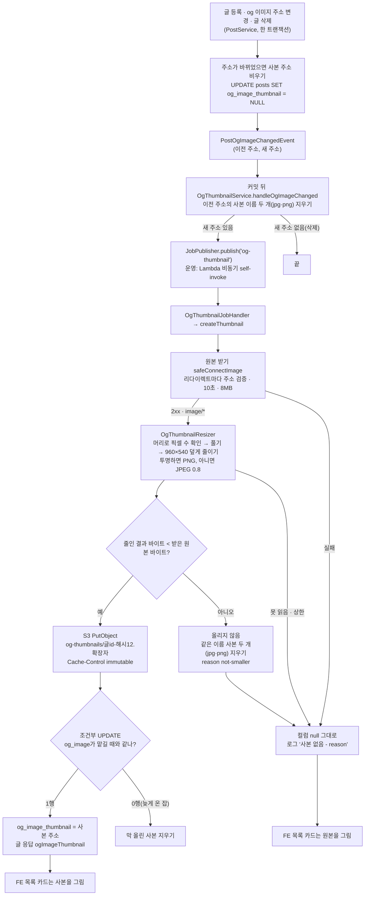

# Link-Sphere BE — 피드 카드용 og 이미지 사본 (2026-11-25)

> **문서 성격**: 서사형(설명) — 글을 쓸 때 서버가 og 이미지를 받아 작은 사본을 만들어 두는 흐름을 기록한다. 운영에 들이는 순서와
> 소급 명령은 [`DEPLOY.md`](./DEPLOY.md) 14장이 정본이다.
>
> **대상 독자**: 이 레포 BE를 처음 보거나, 사본 크기·형식·상한을 바꾸거나 사본이 안 생긴 글을 조사하려는 개발자.
>
> **읽고 나면**: 사본이 언제 생기고 지워지는지 말할 수 있고, 크기·상한 값을 바꾸거나 사본이 없는 글의 이유를 로그로 찾고, 기존 글
> 소급을 다시 돌릴 수 있다(§8).
>
> **마지막 검토**: 2026-11-26 (원본보다 작을 때만 사본을 두는 규칙, 2026-11-25 운영 소급 결과)

## 1. 쉬운 설명

신문 기사를 스크랩할 때 큰 포스터를 통째로 끼워 두면 스크랩북이 무거워진다. 그래서 스크랩할 때 한 번 축소 복사해 끼워 두고,
원본은 기사를 펼쳤을 때만 본다.

피드 카드의 미리보기 그림이 그 포스터였다. 카드마다 원본 사이트의 og 이미지(링크를 붙이면 뜨는 대표 그림, `og:image`)를 그대로
받아 그렸고, 큰 것은 5MB에 가까웠다. 이제 글이 저장되면 서버가 그 그림을 한 번 받아 줄인 사본을 우리 저장소(사이트와 같은 주소)에
올려 둔다. 목록 카드는 사본을, 상세 화면은 원본을 그린다. 사본을 못 만들거나, 줄여 봐도 원본보다 작지 않으면 카드도 원본을
그린다.

## 2. 전제 지식

- **가정한다**: Spring Boot·JPA 기본기, 커밋 뒤 잡을 맡기는 구조(`JobPublisher`·`JobHandler`, [`BE-ARCHITECTURE.md`](./BE-ARCHITECTURE.md)
  §7-5), 링크 미리보기의 주소 검증(`SafeUrlValidator`, SSRF 방어).
- **가정하지 않는다**: 왜 이 크기·이 방식인지(세 방식 비교, 실제 크기 비교로 고른 960px)는 계획 FE `docs/plans/2026-11-25-og-thumbnail.md`
  "결정"에 있다 — 여기에 옮기지 않는다. `og-thumbnails/` 경로를 CloudFront가 FE 버킷으로 보내는 것과 Lambda 역할의 버킷 권한은
  infra 저장소(infra #47), FE 배포가 이 경로를 지우지 않게 하는 제외는 FE `deploy.yml`(FE #689)에 있다.

## 3. 사용한 도구·기술

**기능 자체**

- JDK ImageIO·Java2D(`BufferedImage`, `Graphics2D`) — 새 이미지 라이브러리를 들이지 않았다. 화면 없이(headless) 돈다.
- AWS SDK for Java v2 `s3`(`build.gradle.kts`, 기존 `lambda`·`ses`와 같은 HTTP 클라이언트 제외 설정, `UrlConnectionHttpClient`).
- Jsoup 연결(링크 미리보기와 같은 `UrlMetadataExtractor`의 리다이렉트 검증 루프를 함께 씀).
- Postgres 조건부 UPDATE(`WHERE id = :id AND og_image = :ogImage`).

**구현·검증 과정에서 쓴 도구**

- JDK `HttpServer`로 띄운 로컬 원본 서버(단위 테스트, 리다이렉트·느린 응답·큰 본문 재현).
- Testcontainers pgvector Postgres 17(`@PostgresIntegrationTest`, 조건부 UPDATE·소급 대상 조회).
- macOS `sips`로 줄인 파일(계획 단계에서 만든 비교 기준).

## 4. 왜 만들었나

피드 목록은 카드마다 외부 사이트의 원본 og 이미지를 받았다. 원본은 사이트가 정한 크기라 가로 2,000px이 넘는 PNG도 흔했고, 그
바이트가 첫 화면 이미지 합계의 대부분이었다. 브라우저가 받는 크기는 우리가 정할 수 없어서, 서버가 한 번 받아 줄인 사본을 우리
주소에 두기로 했다. 측정·비교와 사용자 결정은 계획 문서에 있다.

## 5. 구조

### 5-1. 잡이 생기는 때와 사본을 지우는 때

| 일 | 같은 트랜잭션 | 커밋 뒤 |
| --- | --- | --- |
| 글 등록(og 이미지 있음) | — | 잡 `og-thumbnail` |
| 글 수정에서 og 이미지 주소가 바뀜(빈 값 → 채움, 바뀜, 비워짐) | 사본 주소 비우기 | 이전 주소의 사본 지우기, 새 주소가 있으면 잡 |
| 글 삭제(og 이미지 있음) | (행이 지워짐) | 이전 주소의 사본 지우기 |
| 비공개 전환, og 이미지가 그대로인 수정 | — | 없음 |

"바뀜"은 앞뒤 공백 값을 null로 보고 비교한다(`PostService.kt:364`). 사본 지우기 실패는 로그만 남기고 요청을 막지 않는다 — 남은
파일은 아무 글도 가리키지 않을 뿐이다.

### 5-2. 늦게 끝난 잡을 버리는 방법

잡은 요청과 떨어져 돌아서, 주소를 A → B로 바꾼 뒤에 A의 잡이 끝날 수 있다. 두 장치로 A의 사본이 B 글에 붙지 않게 한다.

- **이름에 원본 주소가 들어간다**: `<글 id>-<원본 주소 SHA-256 앞 12자>.<jpg|png>`. 원본이 바뀌면 이름도 바뀌어, 한 번 올린 이름의
  내용은 바뀌지 않는다(그래서 `immutable` 캐시를 단다). 같은 잡이 두 번 돌아도 같은 이름을 덮어쓴다.
- **저장 직전에 원본을 다시 본다**: 컬럼은 `UPDATE … WHERE id = :id AND og_image = :ogImage`(`PostRepository.kt:111`)로만 채운다.
  0행이면 그 사이 주소가 바뀌었거나 글이 지워진 것이라 막 올린 사본을 지운다(`OgThumbnailService.kt:121`). 수정 트랜잭션이 사본
  주소를 비우는 UPDATE가 행 잠금을 잡고 있으면 잡의 UPDATE는 기다렸다가 커밋된 새 `og_image`로 조건을 다시 본다(Postgres READ
  COMMITTED의 UPDATE 재확인 — 이 문서에서 원문을 인용하지 않았다).
- 옛 사본은 컬럼 값이 아니라 이전 주소로 이름을 다시 계산해 지운다. 수정이 글을 읽은 뒤 커밋하기 전에 A 잡이 사본을 올렸으면
  컬럼으로는 그 사본을 모르기 때문이다. 확장자는 원본을 받아 봐야 알아서 둘 다 지운다.
- 엔티티(`TablePost.kt:53`)의 이 컬럼은 `insertable = false, updatable = false`다. 글 수정이 엔티티를 저장해도 잡이 채운 값을 옛
  값으로 덮지 않는다(`embedding`과 같은 이유).

### 5-3. 받기와 줄이기 규칙

- **받기**(`UrlMetadataExtractor.safeConnectImage`): 리다이렉트를 직접 따라가며 매번 `SafeUrlValidator`로 검증한다. 공개 주소가 응답으로
  내부 주소를 가리키는 우회를 막는다. 본문은 8MB+1바이트까지만 읽고 8MB를 넘으면 버린다. 2xx이고 `Content-Type`이 `image/`로
  시작할 때만 다음으로 간다.
- **읽기**(`OgThumbnailResizer`): 머리(헤더)의 가로×세로로 픽셀 수를 먼저 보고 5천만을 넘으면 풀지 않는다(작은 파일이 거대한
  그림으로 풀리는 압축 폭탄 방어). WBMP 읽기는 건너뛴다 — 머리가 0 두 바이트와 크기뿐이라 0으로 시작하는 아무 바이트나 WBMP로
  받아들인다(§10). JDK ImageIO에는 WebP 읽기가 없어 WebP는 사본을 만들지 않는다.
- **크기**: 배율 `min(1, max(960/가로, 540/세로))`. 카드가 16:9 가운데를 잘라 그리므로 960×540을 덮는 가장 작은 크기이고, 작은 원본은
  키우지 않는다. 절반씩 여러 번 줄여 한 번에 크게 줄일 때의 계단 현상을 줄인다.
- **형식**: 실제로 투명한 픽셀이 하나라도 있으면 PNG, 아니면 JPEG 품질 0.8. 원본 형식과 상관없이 늘 다시 인코딩한다. GIF는 첫 장면만 쓴다.
- **크기 비교**(`OgThumbnailService.kt:113`, 2026-11-26): 줄인 결과가 받은 원본보다 작을 때만 올린다. 같거나 크면 올리지 않고
  `not-smaller`로 끝내며, 그 글·그 원본 주소의 사본 이름 두 개(jpg·png)를 지운다 — 다시 판단받는 글(§8)에 남은 옛 사본이다.
  원본을 그대로 올리지는 않는다(늘 다시 인코딩한 JPEG·PNG만 올린다).
  - 커지는 이유: 줄일 픽셀이 없는 작은 원본(YouTube `hqdefault.jpg` 480×360 등)은 다시 인코딩만 남는데, 이미 잘 압축된 원본보다
    작게 만들 수 없다. 원본 15,119바이트인 YouTube 썸네일을 libjpeg-turbo 품질 80으로 다시 저장하면 우리 사본과 같은 21,849바이트,
    품질 60 + 허프만 최적화로도 15,695바이트였다(2026-11-26, `djpeg`·`cjpeg`로 직접 실행).
  - 같은 규칙을 쓰는 도구: [mod_pagespeed](https://www.modpagespeed.com/doc/reference-image-optimize)의 JPEG 재압축은 _"다시
    인코딩한 결과가 원본보다 `ImageLimitOptimizedPercent`가 정한 만큼 작을 때만 남긴다(기본 100: 조금이라도 줄면)"_ (번역),
    [jpegoptim](https://github.com/tjko/jpegoptim/blob/master/jpegoptim.1)은 `-f, --force`가 _"결과가 원본보다 커지더라도 최적화를
    강제한다"_ (번역)라 기본은 원본을 둔다. [Cloudflare Polish](https://developers.cloudflare.com/images/polish/compression/)는
    _"변환하면 파일이 커질 때는 AVIF·WebP로 바꾸지 않는다"_ (번역). 셋 다 2026-11-26에 원문을 읽었다.

### 5-4. 저장

`ThumbnailStorage`(`global/storage`) 인터페이스 뒤에 구현 둘이 있고 `app.og-thumbnail.storage`가 고른다.

| 값 | 구현 | 쓰는 곳 |
| --- | --- | --- |
| `skip` | `SkippingThumbnailStorage` — 원본도 받지 않고 `storage-off`로 끝낸다 | 로컬·테스트 기본값(`application.yml`) |
| `s3` | `S3ThumbnailStorage`(`infra/aws`) — FE 버킷(서울)의 `og-thumbnails/`에 올리고 지운다 | 운영. `LambdaHandler`가 init에서 넣는다 |

Lambda는 도쿄, 버킷은 서울이라 리전을 설정으로 따로 받는다. 클라이언트는 SnapStart 때문에 처음 쓸 때 만들고(`by lazy`), SDK 초기화는
`LambdaHandler.warmUpAwsSdk`가 스냅샷 전에 한다. 한 번의 호출(재시도 포함)은 10초에서 끊는다 — 지우기는 글 수정·삭제 요청 안에서
돌기 때문이다.

### 5-5. 기존 글 소급

`og-thumbnail-backfill`은 사람이 CloudShell에서 부른다(명령은 [`DEPLOY.md`](./DEPLOY.md) 14장). 사본이 없고 og 이미지가 있는 글을 id
순으로 `cursor` 뒤부터 `limit`개 읽어 하나씩 `createThumbnail`을 부른다([`BE-ARCHITECTURE.md`](./BE-ARCHITECTURE.md) §7-7 배치 형태).

- 90초 마감(`BatchJobLimits`)은 글 하나를 시작하기 전에 본다. 넘었으면 `deadlineReached=true`로 끝낸다.
- 글 하나의 예외는 `runCatching`으로 잡아 `exception-<예외 이름>`으로 센다. 다음 글은 계속 돈다.
- 못 만든 글은 표시하지 않는다(null이면 원본, 아니면 사본이라는 뜻 하나만 둔다). 대신 cursor가 지나간 글은 다시 읽지 않아 영구
  실패가 있어도 소급은 끝난다. cursor 없이 부르면 실패한 글을 처음부터 다시 시도한다.
- 결과는 잡이 응답으로 돌려줄 수 없어(`LambdaHandler`는 잡에 `"ok"`만 낸다) 마지막 요약 로그 한 줄로 남긴다:
  `[OgThumbnailBackfill] 완료 - processed=…, stored=…, failed=…, failures={이유@사이트=건수, …}, remaining=…, nextCursor=…, deadlineReached=…`.
  `--log-type Tail`이 돌려주는 마지막 4KB에 들어간다.
- 차례로 하나씩 처리한다. 계정의 Lambda 동시 실행 10칸([`TRAFFIC-MANAGEMENT.md`](./TRAFFIC-MANAGEMENT.md)) 가운데 이 호출 하나만 쓴다.

## 6. 데이터 모델

`posts`에 `og_image_thumbnail TEXT NULL` 하나를 더했다. DDL은 [`sql/add_posts_og_image_thumbnail.sql`](../src/main/resources/sql/add_posts_og_image_thumbnail.sql).

| 값 | 뜻 |
| --- | --- |
| null | 사본이 없다(아직 안 만듦, 못 만듦, 줄여도 원본보다 작지 않음, 저장 꺼짐). FE는 `og_image` 원본을 그린다 |
| `https://linksphere.click/og-thumbnails/…` | 지금 `og_image`로 만든 사본의 절대 주소 |

글 응답(`PostResponse`)은 `ogImage` 옆에 `ogImageThumbnail`(null 허용)을 낸다(`PostResponseAssembler.kt:107`). 공유 미리보기(`/og/post/{id}`),
댓글의 링크 카드, 링크 미리보기는 계속 `og_image`를 쓴다.

## 7. 운영 파라미터

| 값 | 실제 위치 |
| --- | --- |
| 덮을 크기 960×540 | `OgThumbnailResizer.kt:30-31`(`TARGET_WIDTH`·`TARGET_HEIGHT`) |
| 픽셀 수 상한 5천만 | `OgThumbnailResizer.kt:34`(`MAX_PIXELS`) |
| JPEG 품질 0.8 | `OgThumbnailResizer.kt:36`(`JPEG_QUALITY`) |
| 원본 상한 8MB | `OgThumbnailService.kt:46`(`MAX_SOURCE_BYTES`) |
| 원본 받기 한도 10초(Jsoup `timeout`, 조금씩 흘리는 서버면 더 걸릴 수 있다 §10) | `OgThumbnailService.kt:49`(`FETCH_TIMEOUT_MILLIS`) |
| 사본 캐시 헤더 `public, max-age=31536000, immutable` | `OgThumbnailService.kt:52`(`CACHE_CONTROL`) |
| S3 호출 한도 10초 | `S3ThumbnailStorage.kt:48`(`apiCallTimeout`) |
| 저장 구현·버킷·리전·접두어·공개 주소 | `application.yml:100-110`(`app.og-thumbnail`), 운영의 `s3`는 `LambdaHandler.kt:103` |
| 소급 한 번의 건수(기본 1)·시작점 | 잡 입력 `limit`·`cursor`(`OgThumbnailBackfillJobHandler.kt:19-20`) |
| 소급 마감 90초 | `BatchJobLimits.kt:10`(`DEADLINE_MILLIS`, 예약 배치와 공용) |

로그의 못 만든 이유(`reason`):

| reason | 뜻 |
| --- | --- |
| `storage-off` | 저장이 `skip`이다(로컬·테스트) |
| `url-rejected` | 주소 검증 실패(내부 주소로 가는 리다이렉트 포함) |
| `timeout` · `fetch-error` · `redirect-error` | 받기 시간 초과 · 그 밖의 입출력 오류 · 리다이렉트가 너무 많거나 `Location` 없음 |
| `status-<코드>` · `not-image` · `too-large` | 2xx 아님 · `image/*` 아님 · 8MB 초과 |
| `unsupported-format` · `too-many-pixels` · `decode-failed` | 읽을 수 없는 형식(WebP 등) · 픽셀 상한 초과 · 풀다 실패 |
| `not-smaller` | 줄인 결과가 받은 원본보다 작지 않다. 같은 이름의 사본을 지운다(§5-3) |
| `post-changed` | 저장 직전에 원본 주소가 바뀌었거나 글이 지워졌다(§5-2) |
| `exception-<이름>` | 소급 중 예외(저장소 오류 등), 소급 요약에만 나온다 |

## 8. 코드 지도와 자주 하는 수정

| 순서도 단계 | 파일 | 재배포 필요 |
| --- | --- | --- |
| 등록 때 이벤트 | `domain/post/PostService.kt:148` | 예 |
| 수정 때 비교·사본 주소 비우기·이벤트 | `domain/post/PostService.kt:364-366`, `:386-387` | 예 |
| 삭제 때 이벤트 | `domain/post/PostService.kt:422` | 예 |
| 커밋 뒤 옛 사본 지우기·잡 맡기기 | `domain/post/OgThumbnailService.kt:68`(`handleOgImageChanged`) | 예 |
| 잡 처리기 | `domain/post/OgThumbnailJobHandler.kt` | 예 |
| 받기·줄이기·크기 비교·저장·조건부 UPDATE | `domain/post/OgThumbnailService.kt:82`(`createThumbnail`), `:113`(크기 비교), `:135`(`fetch`) | 예 |
| 안전 연결(이미지용) | `domain/linkpreview/UrlMetadataExtractor.kt:318`(`safeConnectImage`), `:347`(리다이렉트 검증 루프) | 예 |
| 줄이기·형식 | `domain/post/OgThumbnailResizer.kt:44`(`resize`) | 예 |
| 저장 | `global/storage/ThumbnailStorage.kt`, `infra/aws/S3ThumbnailStorage.kt` | 예 |
| 조회·갱신 쿼리 | `domain/post/PostRepository.kt:103-123` | 예 |
| 소급 | `domain/post/OgThumbnailBackfillService.kt:44`, `OgThumbnailBackfillJobHandler.kt` | 예 |
| 응답 필드 | `domain/post/PostDTO.kt:71`, `PostResponseAssembler.kt:107` | 예 |
| FE가 사본을 고르는 곳 | FE `PostCard`(FE 계획 PR 4) | FE 별도 배포 |

**이렇게 고치려면**

- **사본을 더 크게(예: 1,280px)**: `TARGET_WIDTH`·`TARGET_HEIGHT`만 바꾼다. 이미 만든 사본은 그대로라, 모두 바꾸려면 컬럼을 비우는
  SQL(사용자가 실행)을 돌린 뒤 소급을 처음부터 다시 돌린다. 이름은 원본 주소로만 정해져 같은 이름을 덮어쓴다 — 캐시가
  `immutable`이라 브라우저·CloudFront가 옛 크기를 계속 낼 수 있으니 이름 규칙(`thumbnailName`)에 크기를 넣는 것도 함께 검토한다.
- **일부 글만 다시 판단받게 하기**(예: 규칙이 바뀌어 사본이 원본보다 큰 글): 그 글들의 `og_image_thumbnail`만 비우는 SQL(사용자가
  실행, `WHERE og_image_thumbnail IS NOT NULL AND id IN (…)`)을 돌린 뒤 소급을 cursor 없이 처음부터 돌린다. 소급은 사본이 없는
  글만 고르므로 비운 글과 전부터 실패하던 글만 다시 본다. 다시 판단에서 `not-smaller`가 나오면 같은 이름의 옛 사본을 지운다.
  명령은 [`DEPLOY.md`](./DEPLOY.md) 14장.
- **WebP 원본도 줄이기**: ImageIO WebP 플러그인(새 의존성)이 필요하다. `OgThumbnailResizerTest`의 `unsupported-format` 기대가 바뀐다.
- **로컬에서 실제로 S3에 올려 보기**: 하지 않는다. 로컬 실행은 운영 DB에 붙고 버킷도 운영 버킷이다. 줄이기는 단위 테스트와
  `OgThumbnailResizer.resize`를 직접 부르는 임시 실행기로 본다(§9).
- **사본이 없는 글의 이유 찾기**: CloudWatch에서 `[OgThumbnail] 사본 없음 - postId: <id>`를 찾아 `reason`을 본다(§7 표).

## 9. 검증 결과

- 실패하는 테스트를 먼저 쓰고(줄이기·받기 상한·리다이렉트 검증·늦게 온 잡·지우기·소급 마감과 cursor·잡 이름·응답 필드·엔티티 보호·
  조건부 UPDATE), 구현 뒤 통과를 확인했다. 새 테스트마다 구현을 한 번 깨 실패하는 것을 확인했다(단위 43개, 통합 5개 모두 실패).
- 실제 원본 23개(계획 단계에서 내려받은 500KB 초과 og 이미지, 합계 34,093,757바이트)를 `OgThumbnailResizer`로 줄인 결과(2026-11-25,
  로컬 JDK 17 headless):

| | 원본 | `sips` 가로 960px(비교 기준 22개) | 새 코드 |
| --- | --- | --- | --- |
| 합계 | 34,093,757바이트 | 2,479,101바이트(22개) | 1,498,879바이트(23개), 22개만 1,464,190바이트 |
| 가장 큰 파일 | 4,934,060바이트 | — | 140,877바이트(1024×1024 → 960×960) |
| 형식 | 확장자 기준 PNG 22, JPEG 1 | JPEG | 모두 JPEG(투명 픽셀 있는 원본 없음) |
| 한 장 처리 시간 | — | — | 최대 296ms(처음 처리한 4.9MB 원본, 클래스 로딩 포함) |

  `sips` 파일은 가로를 960px로 맞춘 것이라 크기가 다르다(1200×630 원본이면 `sips` 960×504, 새 코드는 540을 덮는 1029×540). `sips`의
  품질 설정은 이 문서에서 확인하지 않았다. 가장 큰 출력 한 장(2048×1536 → 960×720)을 눈으로 확인했다.

- 운영 Lambda(java17 arm64)에서도 ImageIO·`BufferedImage`가 headless로 돌아 사본이 만들어졌다. 2026-11-25 소급은 8번 호출(1건,
  50건씩 6번, 13건)이었고, 모든 호출이 요약 로그를 남기고 `deadlineReached=false`로 끝났다(CloudShell 출력의 요약 줄).
- 크기 비교 규칙(2026-11-26)도 실패하는 테스트를 먼저 썼다. 비교를 뒤집거나(`<`) 옛 사본 지우기를 빼면 새 테스트가 실패하는 것을
  확인했다. 이 규칙 때문에 "늦게 온 잡" 테스트의 원본을 단색 PNG(너무 작게 압축돼 새 규칙에 걸림)에서 고정 시드 잡음 PNG로 바꿨고
  기대값은 그대로다.
- 운영 결과(소급에서 못 만든 글의 이유·사이트, 사본 전후 Lighthouse, 사본이 원본보다 컸던 글과 정리 전후)는 FE
  [`docs/PERFORMANCE.md`](https://github.com/BAECHAN/link-sphere_FE_NEW/blob/main/docs/PERFORMANCE.md) "피드 썸네일 사본"이 정본이다.

## 10. 시행착오

- **Jsoup 한도는 정확히 그 시간에 끊지 않는다**: 한도 1초에 200ms마다 조금씩 보내는 서버를 붙이면 2.9초 만에 `SocketTimeoutException`으로
  끝났다(`SafeConnectTest`). 끝없이 붙잡히지는 않지만 한도보다 늦을 수 있다. 소급 마감(90초)과 Lambda 타임아웃(120초) 사이의 여유는
  이 점을 안고 있다(§11).
- **본문을 읽다 난 입출력 오류는 감싸져 나온다**: Jsoup은 응답 본문을 읽는 중 난 `IOException`을 `UncheckedIOException`으로 감싼다.
  `safeConnectImage`가 본문을 미리 읽고(`bufferUp`) 감싼 것을 벗겨 던져야 `timeout`·`fetch-error`로 나눌 수 있다.
- **JPEG 쓰기는 알파 채널을 받지 않는다**: 투명하지 않은 ARGB 그림을 그대로 JPEG로 쓰면 실패하거나 색이 틀어진다. 그래서 형식을 정한
  뒤 늘 RGB(또는 ARGB) 새 그림에 다시 그린다.
- **WBMP 읽기가 아무 바이트나 받는다**: `00 00 10 10 …`처럼 0으로 시작하는 바이트를 넣으면 ImageIO가 WBMP 읽기를 내준다(로컬 JDK 17로
  확인). og 이미지가 WBMP일 일은 없어 그 읽기를 건너뛴다.

## 11. 남은 것

- **마지막 한 건이 최악이면 120초를 넘을 수 있다**: 마감 직전에 시작한 글이 받기(10초, 실제로는 더 길 수 있음 §10) + 줄이기 + 올리기
  (10초) + 늦은 잡 지우기(10초)를 모두 꽉 채우면 Lambda 타임아웃에 걸린다. 그러면 요약 로그가 없다 — 같은 cursor로 다시 부르면 이미
  사본이 생긴 글은 조회에서 빠지므로 이어서 처리된다. 2026-11-25 운영 소급(8번 호출)에서는 일어나지 않았다.
- **EXIF 방향을 반영하지 않는다**: 휴대폰 사진처럼 EXIF 회전값이 있는 JPEG는 사본이 원본과 다르게 누워 보일 수 있다. og 이미지에서 본
  적은 없다.
- **CMYK JPEG**: 테스트하지 않았다. ImageIO가 못 읽으면 `decode-failed`로 원본을 쓴다.
- **로컬 도구 `tools/OgImageBackfillRunner`는 사본 주소를 비우지 않는다**: 이 도구로 `og_image`를 바꾸면 옛 사본이 남아 카드에 옛 그림이
  보인다. 다시 쓸 일이 생기면 `clearOgImageThumbnail`을 함께 부르게 고친다.

## 12. 용어 사전

- **og 이미지**: 페이지가 `<meta property="og:image">`로 알리는 대표 그림. 글의 `og_image` 컬럼에 원본 주소가 있다.
- **사본**: 이 기능이 만든 줄인 그림. `og-thumbnails/` 아래에 있고 주소는 `og_image_thumbnail`에 있다.
- **소급(backfill)**: 기능이 생기기 전에 쓴 글에 사본을 채우는 일. 잡 `og-thumbnail-backfill`.
- **cursor**: 소급이 어디까지 봤는지 가리키는 글 id. 그 id보다 큰 글부터 읽는다.
- **조건부 UPDATE**: 조건이 맞을 때만 바꾸고 바뀐 행 수로 결과를 아는 UPDATE([`BE-ARCHITECTURE.md`](./BE-ARCHITECTURE.md) §7-2).
- **headless**: 모니터·창 없이 그래픽 API를 쓰는 모드. Spring Boot가 시작할 때 `java.awt.headless=true`를 넣는다.

## 13. 관련 문서

- FE `docs/plans/2026-11-25-og-thumbnail.md` — 이 기능의 계획(세 방식 비교, 크기 결정, PR 순서)
- [`DEPLOY.md`](./DEPLOY.md) 14장 — 컬럼 추가 순서와 소급 명령
- [`BE-ARCHITECTURE.md`](./BE-ARCHITECTURE.md) §1 잡 표, §7-5 커밋 뒤 비동기 잡, §7-7 배치 잡 형태
- [`AI-ASYNC-PROCESSING.md`](./AI-ASYNC-PROCESSING.md) — 커밋 뒤 self-invoke를 쓰는 이유
