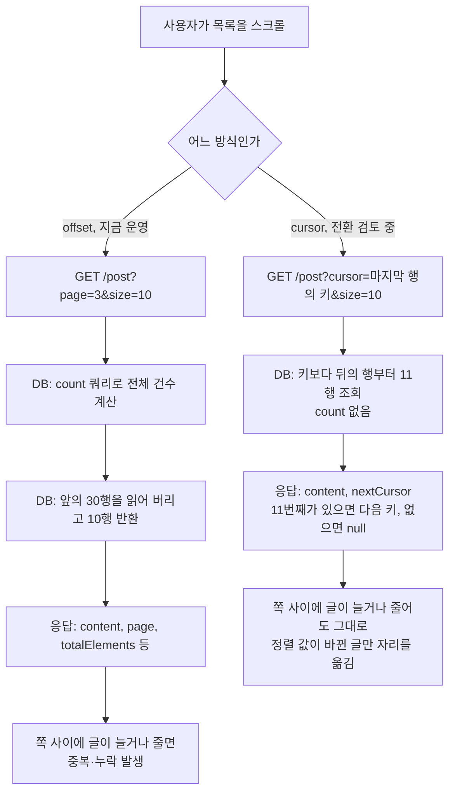

# Link-Sphere BE — 목록 페이지네이션: offset과 cursor 비교

> **문서 성격**: 서사형(설명) — offset을 cursor로 바꿀지 판단하려고 잰 실험과 그 결과를 기록한다. 지금 운영 코드는 아직 offset이다.
>
> **대상 독자**: 이 레포 BE를 처음 보거나, 무한 스크롤 목록을 새로 설계할 때 참고하려는 개발자.
>
> **읽고 나면**: 어떤 목록에서 cursor가 이득인지 수치로 말할 수 있고, 실험을 다시 돌리거나 조건을 바꿔 잴 수 있다.
>
> **마지막 검토**: 2026-11-05 (Phase 1 실험 결과 기록)

## 1. 쉬운 설명

긴 목록을 10개씩 나눠 읽는 일을 책 읽기에 비유할 수 있다.

- **offset**은 "앞에서 100번째 줄부터 읽어 줘"다. 줄 번호로 찾는다.
- **cursor**는 "책갈피 다음 줄부터 읽어 줘"다. 마지막으로 읽은 줄의 내용으로 찾는다. keyset이라고도 부른다.

읽는 사이에 누가 맨 앞에 줄을 끼워 넣으면 offset은 같은 줄을 또 읽고, 앞쪽 줄을 지우면 한 줄을 건너뛴다. 책갈피는 줄 번호에 기대지 않아서 끼워 넣거나 지워도 흔들리지 않는다. 대신 "37쪽으로 바로 가기"는 못 한다. 이 서비스의 목록은 쪽 번호 없이 이어 붙이는 무한 스크롤이라 그 기능을 쓰지 않는다.

## 2. 전제 지식

- **가정한다**: SQL `ORDER BY`·`LIMIT`, B-tree 인덱스의 기본 개념, 실행 계획을 읽는 법.
- **가정하지 않는다**:
  - FE 무한 스크롤 동작 → FE 레포 `docs/POST.md`
  - 검색 점수를 만드는 방식 → [`PostSearchQuery.kt`](../src/main/kotlin/com/example/linksphere/domain/post/PostSearchQuery.kt) 머리 주석
  - 임베딩 호출 제한과 강등 → [`TRAFFIC-MANAGEMENT.md`](TRAFFIC-MANAGEMENT.md)

## 3. 사용한 도구·기술

**기능 자체** (전환하면 쓰는 것)

- PostgreSQL B-tree 복합 인덱스와 keyset 조건식
- Base64url로 감싼 불투명 cursor 문자열

**실험에 쓴 것**

- Docker `pgvector/pgvector:pg17` 임시 컨테이너(PostgreSQL 17.11, 기본 설정, `work_mem` 4MB)
- `EXPLAIN (ANALYZE, BUFFERS, SERIALIZE)` — `SERIALIZE`가 있어야 TOAST에 있는 `embedding`을 꺼내는 비용까지 잡힌다
- 운영 읽기 전용 계정(글 평균 크기), CloudWatch Logs Insights(검색 로그)

## 4. 왜 만들었나

사용자 결정(2026-11-05)이다. 학습용 프로젝트라 비슷한 제품을 나중에 설계할 때 참고할 근거가 필요하다. 판단 기준은 지금의 체감이 아니라 "큰 규모에서 offset의 빈틈이 문제가 되는가, cursor가 정말 이득인가"다.

**지금 규모에서는 체감 이득이 없다.** 공개 글 328개, 최근 30일 등록은 하루 평균 3.7건이다(2026-11-05 운영 조회). 이 절의 숫자는 지금 서비스의 문제가 아니라 규모가 커졌을 때의 판단 재료다.

조사 중 offset과 직접 관련된 결함도 찾았다.

- **북마크 조회수순 누락**: 조회수순에는 고유 키가 없어 쪽 경계에서 순서가 흔들린다. 북마크가 가장 많은 계정으로 재 보니 75행 중 서로 다른 글이 74개였다(운영 읽기 계정, 1회).
- **피드에서 글을 지운 뒤 1개 건너뜀**: 삭제가 글 목록을 다시 받지 않아 다음 쪽 offset이 한 칸 밀린다(`bookmark-folder.keys.ts`, 코드 추적만 했고 실행 재현은 안 했다).

외부 자료도 같은 방향을 가리키지만, 이 실험의 조건과 똑같지는 않다.

- Slack은 _"데이터에 쓰기가 잦으면 페이지 구간을 믿을 수 없게 되어 결과를 건너뛰거나 중복으로 돌려줄 수 있다"_ (번역, [Slack Engineering](https://slack.engineering/evolving-api-pagination-at-slack/))고 쓴다.
- PostgreSQL 문서는 OFFSET이 건너뛰는 행도 서버 안에서 계산되므로 큰 OFFSET은 비효율적일 수 있다고 설명한다([PostgreSQL 7.6](https://www.postgresql.org/docs/17/queries-limit.html)).
- Use The Index, Luke는 keyset이 쪽을 건너뛰지 못하는 한계를 두고 _"무한 스크롤을 쓸 때는 문제가 되지 않는다"_ (번역, [no-offset](https://use-the-index-luke.com/no-offset))고 쓴다.

## 5. 구조

### 5.1 지금

세 목록 모두 `page`·`size`를 받아 `OFFSET`으로 읽고 쪽마다 count를 함께 돌린다. 정렬 키 `created_at`에는 인덱스가 없어 전 행을 읽어 정렬한다.

| 목록 | 위치 |
| --- | --- |
| 피드·검색 | [`PostRepositoryImpl.kt`](../src/main/kotlin/com/example/linksphere/domain/post/PostRepositoryImpl.kt) `findPosts` |
| 북마크 | [`BookmarkRepositoryImpl.kt`](../src/main/kotlin/com/example/linksphere/domain/interaction/BookmarkRepositoryImpl.kt) `findBookmarkedPosts` |
| 내 댓글 | [`CommentRepository.kt:28-37`](../src/main/kotlin/com/example/linksphere/domain/comment/CommentRepository.kt#L28-L37) |

### 5.2 keyset 조건식은 정렬 키에 인덱스가 있느냐로 갈린다

이 실험의 핵심 결론이다. 같은 keyset이어도 조건을 어떻게 쓰느냐로 결과가 정반대가 된다. 아래는 측정에서 나온 제안이고, 검색의 서브쿼리 형태를 Hibernate로 만들 수 있는지는 아직 돌려 보지 않았다(§9.7).

| 경우 | 맞는 형태 | 이유(§9.1·§9.3) |
| --- | --- | --- |
| 첫 키에 인덱스가 있음(최신순) | `k1 <= x AND (k1 < x OR (k1 = x AND k2 < y))` | 앞의 상한이 없으면 인덱스를 처음부터 훑어 offset과 똑같이 느리다 |
| 첫 키가 계산식(검색 점수) | 서브쿼리에서 한 번 계산하고 바깥에서 비교 | 식을 WHERE에 쓰면 행마다 다시 계산해 offset의 2배가 걸린다. 인덱스가 없어 상한의 이득도 없다 |

`(k1, k2) < (x, y)` 행 비교가 가장 간단하지만, 이 레포가 쓰는 Hibernate 6.6.53의 `tuple()`은 `JpaCompoundSelection`을 돌려줘 `lessThan`에 넣을 수 없다(javap 확인). 그래서 OR로 펼친 형태를 쓴다. 전환 계획의 정렬 키 전체는 [`plans/2026-11-05-cursor-pagination.md`](plans/2026-11-05-cursor-pagination.md)에 있다.

### 5.3 cursor로도 못 막는 빈틈

- **정렬 값이 바뀐 글**은 cursor에서도 자리를 옮겨 놓치거나 다시 보인다. Solr 문서는 _"색인 변경으로 문서가 건너뛰어지거나 두 번 반환될 수 있는 유일한 경우는 그 문서의 정렬 값이 바뀔 때다"_ (번역, [Apache Solr](https://solr.apache.org/guide/solr/latest/query-guide/pagination-of-results.html))라고 쓰고, §9.4의 측정도 그렇게 나왔다. 막으려면 결과 스냅샷이 필요하다.
- **쪽마다 전체를 계산하는 검색 비용**은 페이지 방식으로 줄지 않는다(§9.3). 규모가 커지면 전용 검색 엔진이나 미리 계산한 색인이 필요하다.

## 6. 데이터 모델

새 표는 없다. 전환하면 정렬 키 인덱스가 필요하고, SQL은 전환 단계에서 `src/main/resources/sql/`에 추가한다. 큰 표에서는 쓰기를 막지 않도록 `CREATE INDEX CONCURRENTLY`를 써야 한다.

## 7. 운영 파라미터

| 값 | 현재 | 위치 |
| --- | --- | --- |
| 쪽 크기 기본값 | 10 | [`PostController.kt:73`](../src/main/kotlin/com/example/linksphere/domain/post/PostController.kt#L73) |
| 쪽 크기 상한 | 50 | [`Paging.kt:12`](../src/main/kotlin/com/example/linksphere/global/common/Paging.kt#L12) |
| 임베딩 호출 제한 | IP당 10분 60회 | [`PostController.kt:34-35`](../src/main/kotlin/com/example/linksphere/domain/post/PostController.kt#L34-L35) |
| 질의 임베딩 읽기 제한 시간 | 1,500ms | [`GeminiService.kt:39`](../src/main/kotlin/com/example/linksphere/infra/ai/GeminiService.kt#L39) |
| 쿼리 문자열 크기 한도 | 2,048바이트 | AWS WAF `SizeRestrictions_QUERYSTRING`, 콘솔 관리. AWS 문서는 _"2,048바이트를 넘는 URI 쿼리 문자열을 검사한다"_ (번역, [AWS](https://docs.aws.amazon.com/waf/latest/developerguide/aws-managed-rule-groups-baseline.html))고 쓴다. cursor가 이 안에 들어야 한다 |

## 8. 코드 지도와 자주 하는 수정

| 단계 | 파일 |
| --- | --- |
| 컨테이너 실행·순서 | [`scripts/pagination-experiment/run.sh`](../scripts/pagination-experiment/run.sh) |
| 조회 시간 측정 | [`performance.sql`](../scripts/pagination-experiment/performance.sql) |
| 조회 시간 표 출력 | [`performance-report.sql`](../scripts/pagination-experiment/performance-report.sql) |
| 중복·누락 측정 | [`gaps.sql`](../scripts/pagination-experiment/gaps.sql) |
| 이 문서가 쓴 원본 출력 | [`results/2026-11-05.md`](../scripts/pagination-experiment/results/2026-11-05.md) |

| 하고 싶은 일 | 방법 | 재배포 |
| --- | --- | --- |
| 실험 전체 다시 돌리기(약 25분) | `./scripts/pagination-experiment/run.sh > results.md` | 불필요 |
| 빠른 확인(약 30초) | `PERF_SIZES="10000" SKIP_GAPS=1 ./scripts/pagination-experiment/run.sh` | 불필요 |
| 행 수 바꾸기 | `PERF_SIZES`에 원하는 행 수를 공백으로 나열 | 불필요 |
| 쪽 사이 쓰기 건수·대상 범위 바꾸기 | `gaps.sql`의 `array[0, 1, 10, 100]`, `init_rank <= 5000` | 불필요 |

Docker만 있으면 되고, 운영 DB에는 연결하지 않는다.

## 9. 검증 결과

모두 직접 측정했다(2026-11-05, 합성 데이터, 개발 PC의 Docker). 절대값보다 방식 사이의 비율을 보는 것이 맞다. 글 크기는 운영 평균(제목 74, 설명 167, AI 요약 1,024, 태그 66, 임베딩 3,076바이트)에 맞췄고, 공개 글 92.9%, 임베딩 보유 96%다. 시간은 첫 회를 버린 5회의 중앙값이다. 같은 위치에서 offset과 keyset이 같은 행을 돌려주는지 10만 행 이하에서 39건 대조했고 다른 건은 0건이었다.

재현성은 전체 실행 2회로 확인했다. 첫 실행에는 검색의 상한 없음·서브쿼리 형태가 없었다. 공통 시나리오 74개의 시간 차이는 중앙값 약 3%이고, 25%를 넘은 것은 2개로 모두 디스크 정렬을 쓰는 100만 행 인덱스 없는 offset이다(최대 1.64배). §9.4의 중복·누락 표는 두 번 모두 같았다. 원본 출력은 두 번째 실행이다.

### 9.1 최신순

단위 ms. "위치"는 앞에서 몇 번째 행부터 읽었는지다. 위치 1,000은 쪽당 10개로 100쪽을 넘긴 지점이다.

| 행 수 | 위치 | offset, 인덱스 없음(지금) | offset + 인덱스 | keyset 상한 있음 | keyset 상한 없음 |
| ---: | ---: | ---: | ---: | ---: | ---: |
| 1만 | 50 | 3.29 | 0.12 | 0.14 | 0.13 |
| 1만 | 1,000 | 6.96 | 0.24 | 0.12 | 0.25 |
| 1만 | 4,643 | 9.46 | 0.86 | 0.11 | 0.95 |
| 10만 | 50 | 18.37 | 0.13 | 0.15 | 0.13 |
| 10만 | 1,000 | 54.67 | 0.24 | 0.13 | 0.25 |
| 10만 | 46,429 | 73.58 | 13.68 | 0.13 | 12.33 |
| 100만 | 50 | 159.04 | 0.13 | 0.13 | 0.14 |
| 100만 | 1,000 | 1,099.96 | 0.25 | 0.14 | 0.24 |
| 100만 | 464,286 | 1,122.04 | 206.80 | 0.12 | 191.97 |

- **가장 큰 이득은 keyset이 아니라 인덱스다.** 100만 행 위치 1,000에서 인덱스만으로 1,100ms가 0.25ms가 된다. 인덱스가 없으면 정렬이 디스크로 넘친다(487MB).
- **keyset의 속도 이득은 아주 깊은 곳에서만 보인다.** 100쪽까지는 0.1ms 차이다. 절반 위치에서 비로소 207ms 대 0.12ms가 된다.
- **상한을 빼면 keyset도 offset만큼 느리다.** 100만 행 절반 위치에서 192ms이고, 계획에 `Index Cond`가 없고 50만 행을 버렸다. "cursor로 바꾸면 빨라진다"는 말은 조건식을 맞게 썼을 때만 참이다.

### 9.2 쪽마다 도는 count

offset 경로는 쪽마다 전체 건수를 센다. 화면에서 이 값을 읽는 곳은 없다. 최신순 count는 정렬 키 인덱스를 만들기 전에 쟀다. 이 인덱스가 count를 줄일 것으로 보지는 않지만 확인한 것은 아니다.

| 행 수 | 최신순 count | 검색 count |
| ---: | ---: | ---: |
| 1만 | 3.37ms | 130.29ms |
| 10만 | 42.91ms | 454.25ms |
| 100만 | 452.48ms | 4,579.17ms |

인덱스를 둔 최신순에서는 **count가 조회 자체보다 훨씬 비싸다.** 위치 1,000의 offset과 견주면 1만 행 약 14배, 10만 행 약 180배, 100만 행 약 1,800배다. cursor 전환의 실제 성능 이득은 keyset보다 count를 없애는 쪽이 크다. 다만 count 제거는 offset에서도 할 수 있으니, 이 이득을 cursor만의 장점으로 세면 안 된다.

### 9.3 검색

토큰 1개, 후보는 전체의 약 17%, 의미 매칭 후보 30개(K=30). 점수 식은 `PostSearchQuery.relevanceScore`를 SQL로 그대로 옮겼다. 위치 1,000 기준이고, 다른 위치도 같은 경향이다(원본 출력 참고).

| 행 수 | offset | keyset 상한 있음 | keyset 상한 없음 | keyset 서브쿼리 | 정렬 메모리(offset → 서브쿼리) |
| ---: | ---: | ---: | ---: | ---: | --- |
| 1만 | 260.57ms | 236.79ms | 195.43ms | 262.46ms | 3,449kB → 65kB |
| 10만 | 863.84ms | 1,662.19ms | 1,274.49ms | 859.58ms | 디스크 8,592kB → 63kB |
| 100만 | 8,972.80ms | 17,540.17ms | 13,510.79ms | 8,794.15ms | 디스크 81,512kB → 67kB |

- **공용 형태를 그대로 쓰면 10만 행부터 offset의 약 2배가 걸린다.** 점수 식이 WHERE에 3번 나와 후보 행마다 다시 계산하기 때문이다. 1만 행에서는 keyset 쪽만 병렬로 실행돼 이 차이가 드러나지 않는다.
- **서브쿼리로 한 번만 계산하면 offset과 같은 속도이고, 정렬 부담이 크게 준다.** 100만 행에서 디스크 81MB를 쓰던 정렬이 메모리 67kB로 끝난다. 앞쪽 행을 들고 있을 필요 없이 위치 뒤의 상위 11개만 남기면 되기 때문이다.
- **어느 형태든 인덱스로 건너뛰지 못해 전 행을 읽는다.** 버퍼 읽기는 네 방식 모두 비슷하다(100만 행 약 20만 블록).
- 의미 매칭 후보가 늘면 식을 다시 계산하는 형태가 더 나빠진다. 10만 행 K=1,000에서 offset 947ms, 상한 있음 3,393ms, 서브쿼리 925ms였다.

쪽마다 먼저 도는 의미 후보 사전 쿼리도 페이지 방식과 무관하게 전 행을 계산한다.

| 행 수 | 사전 쿼리 | 데이터 쿼리(서브쿼리) | 검색 한 쪽 합계(추정) |
| ---: | ---: | ---: | ---: |
| 1만 | 11.43ms | 262.46ms | 약 0.3초 |
| 10만 | 227.36ms | 859.58ms | 약 1.1초 |
| 100만 | 2,784.61ms | 8,794.15ms | 약 11.6초 |

**100만 행의 검색은 offset이든 cursor든 쪽당 10초가 넘는다.** 이 규모의 문제는 페이지 방식이 아니라 쪽마다 전체를 계산하는 구조다.

### 9.4 쪽 사이에 쓰기가 있을 때의 빈틈

10만 행에서 50쪽(500개)을 읽고, 쪽 사이마다 쓰기를 넣었다. 두 방식 모두 고유 키까지 넣은 같은 정렬을 쓰고, 시드 5개로 같은 쓰기를 받은 평균이다. 쓰기가 0건이면 모두 0이었다.

읽는 법은 다음과 같다.

- **중복**: 같은 글을 다시 보여 준 횟수. FE는 id로 중복을 걸러 화면에는 같은 글이 안 나오지만, 그만큼 쪽이 짧아진다.
- **안 바뀐 글 누락**: 값이 그대로인데 건너뛴 글 수.
- **바뀐 글 누락**: 값이 바뀌어 자리를 옮기는 바람에 못 본 글 수.
- **도달**: 처음 목록 기준으로 어디까지 읽었나. 50쪽을 읽었으니 정상이면 500 근처다.

칸은 `중복 / 안 바뀐 글 누락 / 바뀐 글 누락 / 도달`이다. "인기 구간"은 처음 상위 5,000개 안에서 대상을 고른 경우다.

| 정렬 | 쓰기 | 쪽 사이 건수 | offset | keyset |
| --- | --- | ---: | --- | --- |
| 최신순 | 새 글 | 1 | 49.0 / 0 / 0 / 451 | 0 / 0 / 0 / 500 |
| 최신순 | 새 글 | 10 | 490.0 / 0 / 0 / 10 | 0 / 0 / 0 / 500 |
| 최신순 | 새 글 | 100 | 0 / 0 / 0 / 10 | 0 / 0 / 0 / 500 |
| 최신순 | 삭제(인기 구간) | 1 | 0 / 3.2 / 0 / 505 | 0 / 0 / 0 / 502 |
| 최신순 | 삭제(인기 구간) | 10 | 0 / 27.4 / 0 / 553 | 0 / 0 / 0 / 524 |
| 최신순 | 삭제(인기 구간) | 100 | 0 / 437.4 / 0 / 5,400 | 0 / 0 / 0 / 2,331 |
| 최신순 | 삭제(전체) | 10 | 0 / 0.8 / 0 / 502 | 0 / 0 / 0 / 501 |
| 검색 | 새 글 | 100 | 12.2 / 0 / 0 / 478 | 0 / 0 / 0 / 489 |
| 검색 | 삭제(인기 구간) | 10 | 0 / 22.8 / 0 / 549 | 0 / 0 / 0 / 523 |
| 검색 | 점수 변경(인기 구간) | 1 | 0 / 3.0 / 2.0 / 505 | 0 / 0 / 2.0 / 502 |
| 검색 | 점수 변경(인기 구간) | 10 | 1.0 / 22.6 / 25.4 / 547 | 0 / 0 / 23.0 / 523 |
| 검색 | 점수 변경(인기 구간) | 100 | 2.8 / 161.4 / 4,446.4 / 5,105 | 2.8 / 0 / 925.2 / 1,397 |
| 최근 열람순 | 열람(인기 구간) | 1 | 47.8 / 0 / 2.8 / 455 | 0 / 0 / 2.8 / 503 |
| 최근 열람순 | 열람(인기 구간) | 10 | 489.6 / 0 / 0 / 10 | 0 / 0 / 28.2 / 528 |

- **keyset의 "안 바뀐 글 누락"은 측정한 모든 경우에 0이다.** offset은 삭제와 값 변경이 앞쪽에서 일어나면 그만큼 건너뛴다.
- **offset은 새 글이 들어오면 앞으로 못 나간다.** 쪽 사이 10건이면 같은 10개만 계속 받아 500개를 읽고도 10번째까지밖에 못 간다. 100건이면 새 글만 보다가 끝난다.
- **값이 바뀐 글은 keyset도 놓치고, 드물게 다시 보여 준다**(§5.3). 측정에서 keyset 중복이 나온 곳은 점수 변경 100건 한 줄뿐이다. 최근 열람순 10건에서 keyset이 28.2로 offset의 0보다 많아 보이지만, 이때 offset은 10번째까지밖에 못 갔으니 놓칠 글 자체가 없었던 것이다.
- **쓰기가 어디에 일어나는지가 크게 좌우한다.** 삭제 10건을 전체에 고르게 넣으면 offset 누락은 0.8로, 인기 구간일 때(27.4)의 약 34분의 1이다.

**이 건수를 현실로 옮기면 다음과 같다.** 한 쪽을 넘기는 데 10초가 걸린다고 가정한 내 계산이고, 스크롤 속도를 잰 값은 아니다.

| 쪽 사이 건수 | 그 목록의 쓰기 |
| ---: | ---: |
| 0.0004 | 지금 서비스(하루 평균 3.7건) |
| 1 | 하루 약 8,600건 |
| 10 | 하루 약 8만 6,000건 |
| 100 | 하루 약 86만 건 |

최근 열람순은 그 사용자 자신의 열람으로만 값이 바뀌므로, 쪽 사이 10건은 현실에서 거의 일어나지 않는다.

### 9.5 임베딩 벡터 안정성

점수를 cursor에 담으려면 같은 검색어의 점수가 호출마다 같아야 한다. 검색어 3개를 2회씩 호출해 비교했더니 벡터가 완전히 같았다(최대 차이 0.0, `gemini-embedding-2`, 호출 6회). 표본이 작아 보장은 아니다. 값이 달라지는 사례가 나오면 의미 점수를 반올림해 작은 차이를 흡수한다(계획의 위험 관리).

### 9.6 판단

| 질문 | 답 |
| --- | --- |
| 최신순 목록에 cursor가 이득인가 | **예.** 정확성 이득이 분명하다. 속도 이득의 대부분은 인덱스와 count 제거에서 온다 |
| 검색에 cursor가 이득인가 | **정확성은 예, 속도는 형태에 달렸다.** 서브쿼리 형태면 같은 속도에 정렬 메모리가 줄고, 공용 형태면 2배 느리다 |
| 규모가 커지면 무엇이 먼저 터지나 | 최신순은 인덱스 부재, 검색은 쪽마다 전체를 계산하는 구조. 둘 다 페이지 방식보다 먼저다 |

### 9.7 이 실험이 말해 주지 않는 것

- Hibernate가 만드는 SQL이 아니라 손으로 쓴 SQL을 쟀다. 바인드 파라미터 때문에 식이 더 계산될 수 있어 전환 단계에서 실제 SQL을 다시 봐야 한다. 서브쿼리 형태를 Hibernate로 만들 수 있는지도 API(`JpaSelectCriteria.from(Subquery)`)만 확인했고 돌려 보지 않았다.
- 개발 PC의 Docker이고 운영 Supabase가 아니다. 동시 접속도 없다.
- 쓰기 위치와 빈도는 가정이다. 실제 서비스의 쓰기 분포를 잰 값이 아니다.
- 북마크·내 댓글의 조회 시간은 재지 않았다. 북마크 최신순·오래된순과 내 댓글은 키 형태가 최신순과 같아 비슷할 것으로 보지만 추론이다. 북마크 제목순(`left(title, 200)`)과 최근 열람순(`coalesce` 서브쿼리)은 첫 키가 계산식이라 검색처럼 식을 다시 계산하는 비용이 생길 수 있는데, 재지 않아 모른다.

## 10. 시행착오

- **"검색 cursor는 위험하다"는 초기 판단은 근거가 없었다.** 처음에는 의미 점수가 쪽 사이에 바뀌면 cursor가 더 많이 놓칠 거라고 봤다. 공개 글 328개로 시뮬레이션하니 offset과 비슷했고, 운영 로그 30일에서 같은 검색어의 상태가 바뀐 경우는 16쌍 중 0건이었다(표본이 작다).
- **"정렬 메모리만 줄고 속도는 같을 것"도 틀렸다.** 첫 실행에서 공용 형태의 검색이 offset의 2배로 나왔다. 식을 WHERE에서 다시 계산하는 탓이라는 가설을 세우고 상한 없음·서브쿼리 형태를 추가해 확인했다. 10만·100만 행에서 계산 횟수가 3 → 2 → 1번으로 줄수록 시간이 줄었다(1만 행은 병렬 실행 여부가 달라 이 순서가 아니다).
- **처음 정한 누락 지표는 공정하지 않았다.** "시작 시점 상위 500개 중 못 본 글"로 시작했는데, 새 글 때문에 아직 도달하지 못한 글까지 누락으로 셌다. 쪽 사이 100건에서 offset이 "중복 0, 고유 500"으로 멀쩡해 보이기도 했는데, 실제로는 새 글만 보고 있었다. 그래서 "도달"을 재고 누락을 값 변경 여부로 나눴다.

## 11. 남은 것

- 전환 여부와 검색 형태 결정 — [계획](plans/2026-11-05-cursor-pagination.md) Phase 2 이후는 이 결과를 본 뒤 정한다.
- 앞에서 찾은 결함 2건(§4)은 전환하면 함께 해결되고, 전환하지 않으면 따로 고쳐야 한다.
- 범위 밖: 결과 스냅샷, 전용 검색 엔진, 임베딩 캐시, 목록 조회에서 쓰지 않는 `embedding` 컬럼 제외.

## 12. 용어 사전

| 용어 | 뜻 |
| --- | --- |
| keyset | 마지막으로 읽은 행의 정렬 키 값으로 다음 행을 찾는 방식 |
| cursor | keyset의 키 값을 담아 클라이언트에 건네는 불투명 문자열. API 계약 쪽 이름이다 |
| 상한 | `k1 <= x`처럼 OR 조건 앞에 덧붙이는 중복 조건. 논리상 없어도 되지만 인덱스 범위 탐색을 가능하게 한다 |
| 동점 해소 키 | 정렬 값이 같을 때 순서를 정하는 고유 키(`id` 등). 없으면 쪽 경계에서 순서가 흔들린다 |
| K | 의미 매칭 임계값 안에 든 후보 글 수. SQL에 `CASE`·`IN` 목록으로 실린다 |
| top-N heapsort | 상위 N개만 메모리에 유지하는 정렬. N이 작으면 메모리를 거의 안 쓴다 |
| external merge | `work_mem`을 넘어 디스크를 쓰는 정렬 |
| TOAST | PostgreSQL이 큰 값을 별도 저장소에 두는 방식. `embedding`이 여기 있다 |

## 13. 관련 문서

- [`plans/2026-11-05-cursor-pagination.md`](plans/2026-11-05-cursor-pagination.md) — 전환 계획과 판단 근거
- [`scripts/pagination-experiment/results/2026-11-05.md`](../scripts/pagination-experiment/results/2026-11-05.md) — 실험 원본 출력(실행 계획 포함)
- [`TRAFFIC-MANAGEMENT.md`](TRAFFIC-MANAGEMENT.md) — 검색 호출 제한과 강등
- FE 레포 `docs/POST.md` — 무한 스크롤 동작
