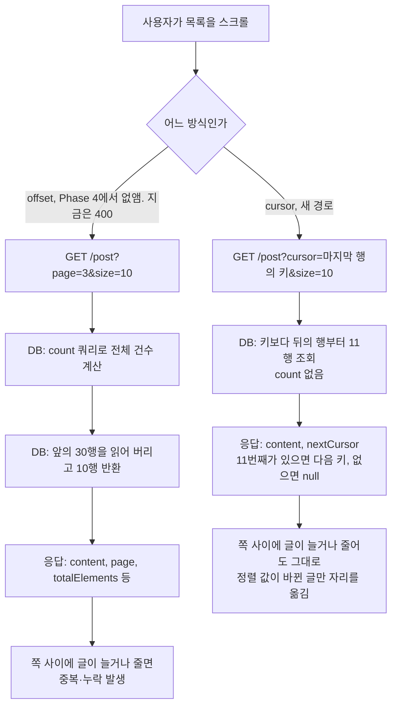
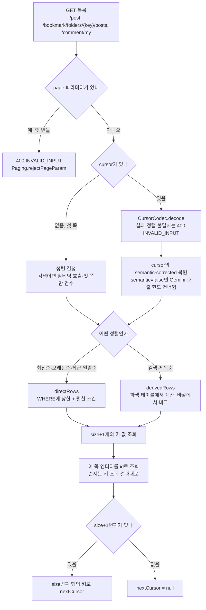
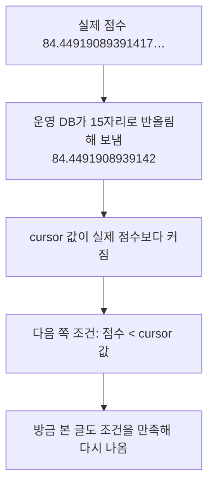

# Link-Sphere BE — 목록 페이지네이션: offset과 cursor 비교

> **문서 성격**: 서사형(설명) — offset을 cursor로 바꾸게 한 실험과 전환된 구조를 기록한다. 지금 BE는 cursor로만 읽는다. FE는 [FE #549](https://github.com/BAECHAN/link-sphere_FE_NEW/pull/549)(2026-11-05 배포)부터 cursor로 요청하고, 그 전에 연 옛 탭이 보내는 `page`는 400으로 끝낸다(Phase 4, 2026-11-12). offset 경로는 실험과 비교 기록으로만 남는다.
>
> **대상 독자**: 이 레포 BE를 처음 보거나, 무한 스크롤 목록을 새로 설계할 때 참고하려는 개발자.
>
> **읽고 나면**: 어떤 목록에서 cursor가 이득인지 수치로 말할 수 있고, 새 정렬을 추가하거나 cursor 형식을 바꿀 수 있으며, 실험을 다시 돌리거나 조건을 바꿔 잴 수 있다.
>
> **마지막 검토**: 2026-11-12 (Phase 4 옛 경로 제거 반영). 2026-11-05 (Phase 3 FE 전환 반영)

## 1. 쉬운 설명

긴 목록을 10개씩 나눠 읽는 일을 책 읽기에 비유할 수 있다.

- **offset**은 "앞에서 100번째 줄부터 읽어 줘"다. 줄 번호로 찾는다.
- **cursor**는 "책갈피 다음 줄부터 읽어 줘"다. 마지막으로 읽은 줄의 내용으로 찾는다. keyset이라고도 부른다.

읽는 사이에 누가 맨 앞에 줄을 끼워 넣으면 offset은 같은 줄을 또 읽고, 앞쪽 줄을 지우면 한 줄을 건너뛴다. 책갈피는 줄 번호에 기대지 않아서 끼워 넣거나 지워도 흔들리지 않는다. 대신 "37쪽으로 바로 가기"는 못 한다. 이 서비스의 목록은 쪽 번호 없이 이어 붙이는 무한 스크롤이라 그 기능을 쓰지 않는다.

## 2. 전제 지식

- **가정한다**: SQL `ORDER BY`·`LIMIT`, B-tree 인덱스의 기본 개념, 실행 계획을 읽는 법.
- **가정하지 않는다**:
  - FE 무한 스크롤 동작 → FE 레포 `docs/POST.md`
  - 검색 점수를 만드는 방식 → [`PostSearchQuery.kt`](../src/main/kotlin/com/example/linksphere/domain/post/PostSearchQuery.kt) 머리 주석
  - 임베딩 호출 제한과 강등 → [`TRAFFIC-MANAGEMENT.md`](TRAFFIC-MANAGEMENT.md)

## 3. 사용한 도구·기술

**기능 자체**

- PostgreSQL B-tree 복합 인덱스와 keyset 조건식
- Base64url로 감싼 불투명 cursor 문자열
- Hibernate 6.6 `JpaSelectCriteria.from(Subquery)` 파생 테이블(`offset 0`으로 합쳐지지 않게 막음)
- Spring Data `Limit`(내 댓글 JPQL)

**실험에 쓴 것**

- Docker `pgvector/pgvector:pg17` 임시 컨테이너(PostgreSQL 17.11, 기본 설정, `work_mem` 4MB)
- `EXPLAIN (ANALYZE, BUFFERS, SERIALIZE)` — `SERIALIZE`가 있어야 TOAST에 있는 `embedding`을 꺼내는 비용까지 잡힌다
- 운영 읽기 전용 계정(글 평균 크기), CloudWatch Logs Insights(검색 로그)

## 4. 왜 만들었나

사용자 결정(2026-11-05)이다. 학습용 프로젝트라 비슷한 제품을 나중에 설계할 때 참고할 근거가 필요하다. 판단 기준은 지금의 체감이 아니라 "큰 규모에서 offset의 빈틈이 문제가 되는가, cursor가 정말 이득인가"다.

**지금 규모에서는 체감 이득이 없다.** 공개 글 328개, 최근 30일 등록은 하루 평균 3.7건이다(2026-11-05 운영 조회). 이 절의 숫자는 지금 서비스의 문제가 아니라 규모가 커졌을 때의 판단 재료다.

조사 중 offset과 직접 관련된 결함도 찾았다.

- **북마크 조회수순 누락**: 조회수순에는 고유 키가 없어 쪽 경계에서 순서가 흔들린다. 북마크가 가장 많은 계정으로 재 보니 75행 중 서로 다른 글이 74개였다(운영 읽기 계정, 1회).
- **피드에서 글을 지운 뒤 1개 건너뜀**: 삭제가 글 목록을 다시 받지 않아 다음 쪽 offset이 한 칸 밀린다(`bookmark-folder.keys.ts`, 코드 추적만 했고 실행 재현은 안 했다).

두 결함은 FE 전환([FE #549](https://github.com/BAECHAN/link-sphere_FE_NEW/pull/549))으로 새 화면에서 사라졌다. 조회수순은 정렬 메뉴에서 뺐고(옛 탭의 `page` 경로에 남아 있던 것도 Phase 4에서 지웠다), 삭제 뒤 다음 쪽은 지운 글과 상관없이 키 값으로 이어 읽는다(모킹 녹화로 확인).

외부 자료도 같은 방향을 가리키지만, 이 실험의 조건과 똑같지는 않다.

- Slack은 _"데이터에 쓰기가 잦으면 페이지 구간을 믿을 수 없게 되어 결과를 건너뛰거나 중복으로 돌려줄 수 있다"_ (번역, [Slack Engineering](https://slack.engineering/evolving-api-pagination-at-slack/))고 쓴다.
- PostgreSQL 문서는 OFFSET이 건너뛰는 행도 서버 안에서 계산되므로 큰 OFFSET은 비효율적일 수 있다고 설명한다([PostgreSQL 7.6](https://www.postgresql.org/docs/17/queries-limit.html)).
- Use The Index, Luke는 keyset이 쪽을 건너뛰지 못하는 한계를 두고 _"무한 스크롤을 쓸 때는 문제가 되지 않는다"_ (번역, [no-offset](https://use-the-index-luke.com/no-offset))고 쓴다.

## 5. 구조

### 5.1 요청 흐름

| 목록 | cursor 경로 | Phase 4에서 지운 옛 경로 |
| --- | --- | --- |
| 피드·검색 | [`PostRepositoryImpl.kt:21`](../src/main/kotlin/com/example/linksphere/domain/post/PostRepositoryImpl.kt#L21) `findPostsAfter`, [`PostService.kt:176`](../src/main/kotlin/com/example/linksphere/domain/post/PostService.kt#L176) | `findPosts`, `getAllPosts` |
| 북마크 | [`BookmarkRepositoryImpl.kt:21`](../src/main/kotlin/com/example/linksphere/domain/interaction/BookmarkRepositoryImpl.kt#L21) `findBookmarkedPostsAfter`, [`BookmarkFolderService.kt:227`](../src/main/kotlin/com/example/linksphere/domain/interaction/BookmarkFolderService.kt#L227) | `findBookmarkedPosts`, `getBookmarkedPosts` |
| 내 댓글 | [`CommentRepository.kt:34`](../src/main/kotlin/com/example/linksphere/domain/comment/CommentRepository.kt#L34) `findMyCommentsFirst`·`findMyCommentsAfter`, [`CommentService.kt:124`](../src/main/kotlin/com/example/linksphere/domain/comment/CommentService.kt#L124) | `findMyComments`, `getMyComments` |

`page`는 세 컨트롤러가 스펙에서 숨긴 파라미터로 받아 [`Paging.rejectPageParam`](../src/main/kotlin/com/example/linksphere/global/common/Paging.kt)이 400으로 끝낸다. 그냥 없애면 옛 번들이 다음 쪽에 보내는 `page=NaN`이 무시돼 매번 첫 쪽을 받고, 자동 다음 쪽 요청이 멈추지 않는다. 400이면 FE가 재시도 화면을 띄우고 새로고침으로 복구된다. 이 400 코드를 언제 지울지는 정하지 않았다. 옛 탭 요청 수를 셀 방법이 없어서다(§11).

**정렬 키**(마지막 키가 동점을 끊는 고유 값)

| 목록 | 정렬 | 키 | 조회 형태 |
| --- | --- | --- | --- |
| 피드 | 최신순 | `p.created_at DESC, p.id DESC` | WHERE(인덱스) |
| 피드 | 검색 | `점수 DESC, p.created_at DESC, p.id DESC` | 파생 테이블 |
| 북마크 | 최신순 | `b.created_at DESC, b.post_id DESC` | WHERE(인덱스) |
| 북마크 | 오래된순 | `b.created_at ASC, b.post_id ASC` | WHERE(인덱스를 거꾸로 읽음) |
| 북마크 | 제목순 | `left(p.title,200) ASC, b.created_at DESC, b.post_id DESC` | 파생 테이블 |
| 북마크 | 최근 열람순 | `coalesce(열람 시각, 1970) DESC, b.created_at DESC, b.post_id DESC` | WHERE |
| 북마크 | 검색(`sort=latest`일 때만) | `점수 DESC, b.created_at DESC, b.post_id DESC` | 파생 테이블 |
| 내 댓글 | 최신순 | `c.created_at DESC, c.id DESC` | WHERE(인덱스, JPQL) |

**키와 엔티티를 나눠 읽는다.** 파생 테이블은 스칼라만 돌려줘 엔티티를 함께 받을 수 없다. 그래서 키 값을 먼저 읽고 이 쪽 id로 엔티티를 불러온다([`KeysetQuery.kt`](../src/main/kotlin/com/example/linksphere/global/common/KeysetQuery.kt)). WHERE 형태도 같은 길로 맞췄다. 내 댓글만 `JOIN FETCH` + `Limit` 한 번이다. 쪽마다 조회가 2번이지만 offset도 count + 본 쿼리로 2번이었다.

### 5.2 keyset 조건식은 첫 키가 무엇이냐로 갈린다

이 실험의 핵심 결론이다. 같은 keyset이어도 조건을 어떻게 쓰느냐로 결과가 정반대가 된다. "계산식이면 파생 테이블"처럼 단순하지 않아서, 첫 키마다 재서 정했다(§9.8).

| 첫 키 | 맞는 형태 | 이유 |
| --- | --- | --- |
| 인덱스가 있음(최신순·오래된순) | WHERE: `k1 <= x AND (k1 < x OR (k1 = x AND k2 < y))` | 앞의 상한이 없으면 인덱스를 처음부터 훑어 offset과 똑같이 느리다(§9.1) |
| 비싼 계산식(검색 점수) | 파생 테이블에서 한 번 계산하고 바깥에서 비교 | 식을 WHERE에 쓰면 행마다 다시 계산해 offset의 2배가 걸린다(§9.3) |
| 조인한 표의 컬럼(제목 앞부분) | 파생 테이블 | WHERE에 쓰면 조건이 글 표 전체 탐색으로 내려가 앞쪽 위치일수록 느리다. 50번째 1.8배, 9,000번째는 근소하게 빠르다(§9.8) |
| 조인 전에 계산되는 싼 식(열람 시각) | WHERE | 조인 전에 행을 걸러 글 표를 읽을 행이 준다. 파생 테이블은 이걸 막는다(§9.8) |

파생 테이블에 붙는 `offset 0`은 양날이다. Postgres가 안쪽을 합쳐 식을 다시 계산하는 일을 막지만, 바깥 조건을 안쪽 조인 아래로 내리는 것도 함께 막는다.

코드는 [`KeysetQuery.kt`](../src/main/kotlin/com/example/linksphere/global/common/KeysetQuery.kt)의 `directRows`(WHERE)와 `derivedRows`(파생 테이블)다.

`(k1, k2) < (x, y)` 행 비교가 가장 간단하지만, 이 레포가 쓰는 Hibernate 6.6.53의 `tuple()`은 `JpaCompoundSelection`을 돌려줘 `lessThan`에 넣을 수 없다(javap 확인). 그래서 OR로 펼친 형태를 쓴다([`SeekPredicate.kt`](../src/main/kotlin/com/example/linksphere/global/common/SeekPredicate.kt)). 정렬 키 전체는 §5.1 표다.

### 5.3 cursor로도 못 막는 빈틈

- **정렬 값이 바뀐 글**은 cursor에서도 자리를 옮겨 놓치거나 다시 보인다. Solr 문서는 _"색인 변경으로 문서가 건너뛰어지거나 두 번 반환될 수 있는 유일한 경우는 그 문서의 정렬 값이 바뀔 때다"_ (번역, [Apache Solr](https://solr.apache.org/guide/solr/latest/query-guide/pagination-of-results.html))라고 쓰고, §9.4의 측정도 그렇게 나왔다. 막으려면 결과 스냅샷이 필요하다.
- **쪽마다 전체를 계산하는 검색 비용**은 페이지 방식으로 줄지 않는다(§9.3). 규모가 커지면 전용 검색 엔진이나 미리 계산한 색인이 필요하다.

### 5.4 검색 상태를 cursor에 담는 이유

쪽마다 후보 집합이 달라지면 점수 비교의 기준이 흔들려 글을 놓친다. 그래서 첫 쪽의 상태를 cursor로 이어 간다.

| 상황 | 동작 |
| --- | --- |
| 첫 쪽이 키워드로 시작(`semantic=false`) | 뒤쪽도 키워드만. Gemini를 부르지 않고 IP당 호출 한도도 쓰지 않는다. 키워드로 시작한 뒤 의미 점수가 켜지는 경우가 시뮬레이션에서 누락이 가장 컸다 |
| 의미 검색으로 시작했는데 뒤쪽에서 임베딩 실패·한도 초과 | 그 쪽부터 키워드로 내려가 유지하고 로그를 남긴다. Gemini 장애로 검색이 실패하지 않게 한 기존 원칙과 같다. 점수 기준이 바뀌는 그 쪽에서는 누락이 생길 수 있다 |
| 첫 쪽이 0건이고 자판 보정 후보가 있음 | 보정어로 재검색하고 `corrected=true`를 담는다. 뒤쪽도 보정어로 읽고 응답에 `correctedSearch`를 유지한다 |
| 뒤쪽이 0건 | 보정을 시도하지 않는다. 쪽마다 건수를 세지 않으니 빈 마지막 쪽을 0건 검색으로 오인하면 안 된다 |

건수는 검색 첫 쪽에서만 센다. `[Search]` 로그의 `total`에만 쓰고 화면에서 읽는 곳이 없어서다. 뒤쪽 로그는 `total=-1`이다.

## 6. 데이터 모델

새 표는 없다. [`sql/add_cursor_pagination_indexes.sql`](../src/main/resources/sql/add_cursor_pagination_indexes.sql)이 정렬 키 인덱스 3개를 만들고 `posts.created_at`을 `NOT NULL`로 바꾼다. 값이 NULL이면 비교에서 빠져 그 글을 다시는 읽지 못한다. 지금 표가 작아 일반 `CREATE INDEX`를 쓰고, 큰 표에서는 쓰기를 막지 않도록 `CREATE INDEX CONCURRENTLY`를 써야 한다.

**cursor 내용**은 Base64url로 감싼 JSON이다([`CursorCodec.kt`](../src/main/kotlin/com/example/linksphere/global/common/CursorCodec.kt)).

| 필드 | 뜻 |
| --- | --- |
| `v` | 형식 버전. 지금 1 |
| `sort` | 정렬 이름(`LATEST`, `RELEVANCE`, `TITLE` 등). 지금 요청의 정렬과 다르면 키를 해석할 수 없어 400 |
| `keys` | 마지막 행의 정렬 키 값(문자열). 시각은 ISO, 점수는 10,000을 곱한 정수(§9.9) |
| `semantic` | 검색일 때만. 첫 쪽이 의미 검색이었는가 |
| `corrected` | 자판 보정으로 시작했을 때만 `true` |

서명은 하지 않는다. 공개 범위 조건을 요청마다 적용해 조작해도 볼 수 없는 글은 나오지 않고 위치만 달라진다. 검색어·필터가 cursor와 달라도 막지 않는다. FE 쿼리 키가 이미 분리하고, 어긋나도 위치만 달라진다.

## 7. 운영 파라미터

| 값 | 현재 | 위치 |
| --- | --- | --- |
| 쪽 크기 기본값 | 10 | [`PostController.kt:96`](../src/main/kotlin/com/example/linksphere/domain/post/PostController.kt#L96) |
| 쪽 크기 상한 | 50 | [`Paging.kt:12`](../src/main/kotlin/com/example/linksphere/global/common/Paging.kt#L12) |
| 임베딩 호출 제한 | IP당 10분 60회. `semantic=false` cursor면 쓰지 않음 | [`PostController.kt:37-38`](../src/main/kotlin/com/example/linksphere/domain/post/PostController.kt#L37-L38) |
| 점수 키 단위 | 10,000(소수 넷째 자리까지 본다) | [`PostSearchQuery.kt:61`](../src/main/kotlin/com/example/linksphere/domain/post/PostSearchQuery.kt#L61) |
| 제목 키 길이 | 앞 200자 | [`BookmarkRepositoryImpl.kt:88`](../src/main/kotlin/com/example/linksphere/domain/interaction/BookmarkRepositoryImpl.kt#L88) |
| 열람 기록 없는 글의 키 | 1970-01-01 | [`BookmarkRepositoryImpl.kt:89`](../src/main/kotlin/com/example/linksphere/domain/interaction/BookmarkRepositoryImpl.kt#L89) |
| cursor 형식 버전 | 1 | [`CursorCodec.kt:41`](../src/main/kotlin/com/example/linksphere/global/common/CursorCodec.kt#L41) |
| 질의 임베딩 읽기 제한 시간 | 1,500ms | [`GeminiService.kt:39`](../src/main/kotlin/com/example/linksphere/infra/ai/GeminiService.kt#L39) |
| 쿼리 문자열 크기 한도 | 2,048바이트 | AWS WAF `SizeRestrictions_QUERYSTRING`, 콘솔 관리. AWS 문서는 _"2,048바이트를 넘는 URI 쿼리 문자열을 검사한다"_ (번역, [AWS](https://docs.aws.amazon.com/waf/latest/developerguide/aws-managed-rule-groups-baseline.html))고 쓴다. cursor가 이 안에 들어야 한다 |

## 8. 코드 지도와 자주 하는 수정

| 단계 | 파일 |
| --- | --- |
| 컨테이너 실행·순서 | [`scripts/pagination-experiment/run.sh`](../scripts/pagination-experiment/run.sh) |
| 조회 시간 측정 | [`performance.sql`](../scripts/pagination-experiment/performance.sql) |
| 조회 시간 표 출력 | [`performance-report.sql`](../scripts/pagination-experiment/performance-report.sql) |
| 중복·누락 측정 | [`gaps.sql`](../scripts/pagination-experiment/gaps.sql) |
| 이 문서가 쓴 원본 출력 | [`results/2026-11-05.md`](../scripts/pagination-experiment/results/2026-11-05.md) |
| cursor 인코딩·검증 | [`CursorCodec.kt`](../src/main/kotlin/com/example/linksphere/global/common/CursorCodec.kt) |
| "이 키 다음부터" 조건식 | [`SeekPredicate.kt`](../src/main/kotlin/com/example/linksphere/global/common/SeekPredicate.kt) |
| WHERE 형태·파생 테이블 형태 조회 | [`KeysetQuery.kt`](../src/main/kotlin/com/example/linksphere/global/common/KeysetQuery.kt) |
| 정렬별 키 구성 | [`PostRepositoryCustom.kt:29`](../src/main/kotlin/com/example/linksphere/domain/post/PostRepositoryCustom.kt#L29) `PostListSort`, [`BookmarkRepositoryCustom.kt:36`](../src/main/kotlin/com/example/linksphere/domain/interaction/BookmarkRepositoryCustom.kt#L36) `BookmarkListSort` |
| 검색 상태 이어 가기 | [`PostService.kt:176`](../src/main/kotlin/com/example/linksphere/domain/post/PostService.kt#L176), [`BookmarkFolderService.kt:227`](../src/main/kotlin/com/example/linksphere/domain/interaction/BookmarkFolderService.kt#L227) |
| 끝까지 읽기·SQL 형태 테스트 | [`CursorPaginationIntegrationTest.kt`](../src/test/kotlin/com/example/linksphere/domain/post/CursorPaginationIntegrationTest.kt) |

| 하고 싶은 일 | 방법 | 재배포 |
| --- | --- | --- |
| 정렬 추가 | `BookmarkListSort`에 키 구성을 추가하고 `findBookmarkedPostsAfter`의 첫 키를 만든다. 첫 키에 따라 `directRows`나 `derivedRows`를 고른다(§5.2 표). 애매하면 두 형태를 같은 실행에서 재 본다(§9.8). 마지막 키는 고유해야 하고 NULL이면 안 된다 | 필요 |
| cursor 형식 변경 | `VERSION`을 올리되 옛 값도 계속 읽는다. 열려 있는 탭이 옛 cursor를 들고 있고, 400이면 재시도해도 같은 값을 보낸다 | 필요 |
| 쪽 크기 상한 변경 | `Paging.MAX_PAGE_SIZE` | 필요 |
| 실험 전체 다시 돌리기(약 25분) | `./scripts/pagination-experiment/run.sh > results.md` | 불필요 |
| 빠른 확인(약 30초) | `PERF_SIZES="10000" SKIP_GAPS=1 ./scripts/pagination-experiment/run.sh` | 불필요 |
| 행 수 바꾸기 | `PERF_SIZES`에 원하는 행 수를 공백으로 나열 | 불필요 |
| 쪽 사이 쓰기 건수·대상 범위 바꾸기 | `gaps.sql`의 `array[0, 1, 10, 100]`, `init_rank <= 5000` | 불필요 |

Docker만 있으면 되고, 운영 DB에는 연결하지 않는다.

## 9. 검증 결과

모두 직접 측정했다(2026-11-05, 합성 데이터, 개발 PC의 Docker). 절대값보다 방식 사이의 비율을 보는 것이 맞다. 글 크기는 운영 평균(제목 74, 설명 167, AI 요약 1,024, 태그 66, 임베딩 3,076바이트)에 맞췄고, 공개 글 92.9%, 임베딩 보유 96%다. 시간은 첫 회를 버린 5회의 중앙값이다. 같은 위치에서 offset과 keyset이 같은 행을 돌려주는지 10만 행 이하에서 39건 대조했고 다른 건은 0건이었다.

재현성은 전체 실행 2회로 확인했다. 첫 실행에는 검색의 상한 없음·서브쿼리 형태가 없었다. 공통 시나리오 74개의 시간 차이는 중앙값 약 3%이고, 25%를 넘은 것은 2개로 모두 디스크 정렬을 쓰는 100만 행 인덱스 없는 offset이다(최대 1.64배). §9.4의 중복·누락 표는 두 번 모두 같았다. 원본 출력은 두 번째 실행이다.

### 9.1 최신순

단위 ms. "위치"는 앞에서 몇 번째 행부터 읽었는지다. 위치 1,000은 쪽당 10개로 100쪽을 넘긴 지점이다.

| 행 수 | 위치 | offset, 인덱스 없음(전환 전) | offset + 인덱스 | keyset 상한 있음 | keyset 상한 없음 |
| ---: | ---: | ---: | ---: | ---: | ---: |
| 1만 | 50 | 3.29 | 0.12 | 0.14 | 0.13 |
| 1만 | 1,000 | 6.96 | 0.24 | 0.12 | 0.25 |
| 1만 | 4,643 | 9.46 | 0.86 | 0.11 | 0.95 |
| 10만 | 50 | 18.37 | 0.13 | 0.15 | 0.13 |
| 10만 | 1,000 | 54.67 | 0.24 | 0.13 | 0.25 |
| 10만 | 46,429 | 73.58 | 13.68 | 0.13 | 12.33 |
| 100만 | 50 | 159.04 | 0.13 | 0.13 | 0.14 |
| 100만 | 1,000 | 1,099.96 | 0.25 | 0.14 | 0.24 |
| 100만 | 464,286 | 1,122.04 | 206.80 | 0.12 | 191.97 |

- **가장 큰 이득은 keyset이 아니라 인덱스다.** 100만 행 위치 1,000에서 인덱스만으로 1,100ms가 0.25ms가 된다. 인덱스가 없으면 정렬이 디스크로 넘친다(487MB).
- **keyset의 속도 이득은 아주 깊은 곳에서만 보인다.** 100쪽까지는 0.1ms 차이다. 절반 위치에서 비로소 207ms 대 0.12ms가 된다.
- **상한을 빼면 keyset도 offset만큼 느리다.** 100만 행 절반 위치에서 192ms이고, 계획에 `Index Cond`가 없고 50만 행을 버렸다. "cursor로 바꾸면 빨라진다"는 말은 조건식을 맞게 썼을 때만 참이다.

### 9.2 쪽마다 도는 count

offset 경로는 쪽마다 전체 건수를 센다. 화면에서 이 값을 읽는 곳은 없다. 최신순 count는 정렬 키 인덱스를 만들기 전에 쟀다. 이 인덱스가 count를 줄일 것으로 보지는 않지만 확인한 것은 아니다.

| 행 수 | 최신순 count | 검색 count |
| ---: | ---: | ---: |
| 1만 | 3.37ms | 130.29ms |
| 10만 | 42.91ms | 454.25ms |
| 100만 | 452.48ms | 4,579.17ms |

인덱스를 둔 최신순에서는 **count가 조회 자체보다 훨씬 비싸다.** 위치 1,000의 offset과 견주면 1만 행 약 14배, 10만 행 약 180배, 100만 행 약 1,800배다. cursor 전환의 실제 성능 이득은 keyset보다 count를 없애는 쪽이 크다. 다만 count 제거는 offset에서도 할 수 있으니, 이 이득을 cursor만의 장점으로 세면 안 된다.

### 9.3 검색

토큰 1개, 후보는 전체의 약 17%, 의미 매칭 후보 30개(K=30). 점수 식은 `PostSearchQuery.relevanceScore`를 SQL로 그대로 옮겼다. 위치 1,000 기준이고, 다른 위치도 같은 경향이다(원본 출력 참고).

| 행 수 | offset | keyset 상한 있음 | keyset 상한 없음 | keyset 서브쿼리 | 정렬 메모리(offset → 서브쿼리) |
| ---: | ---: | ---: | ---: | ---: | --- |
| 1만 | 260.57ms | 236.79ms | 195.43ms | 262.46ms | 3,449kB → 65kB |
| 10만 | 863.84ms | 1,662.19ms | 1,274.49ms | 859.58ms | 디스크 8,592kB → 63kB |
| 100만 | 8,972.80ms | 17,540.17ms | 13,510.79ms | 8,794.15ms | 디스크 81,512kB → 67kB |

- **공용 형태를 그대로 쓰면 10만 행부터 offset의 약 2배가 걸린다.** 점수 식이 WHERE에 3번 나와 후보 행마다 다시 계산하기 때문이다. 1만 행에서는 keyset 쪽만 병렬로 실행돼 이 차이가 드러나지 않는다.
- **서브쿼리로 한 번만 계산하면 offset과 같은 속도이고, 정렬 부담이 크게 준다.** 100만 행에서 디스크 81MB를 쓰던 정렬이 메모리 67kB로 끝난다. 앞쪽 행을 들고 있을 필요 없이 위치 뒤의 상위 11개만 남기면 되기 때문이다.
- **어느 형태든 인덱스로 건너뛰지 못해 전 행을 읽는다.** 버퍼 읽기는 네 방식 모두 비슷하다(100만 행 약 20만 블록).
- 의미 매칭 후보가 늘면 식을 다시 계산하는 형태가 더 나빠진다. 10만 행 K=1,000에서 offset 947ms, 상한 있음 3,393ms, 서브쿼리 925ms였다.

쪽마다 먼저 도는 의미 후보 사전 쿼리도 페이지 방식과 무관하게 전 행을 계산한다.

| 행 수 | 사전 쿼리 | 데이터 쿼리(서브쿼리) | 검색 한 쪽 합계(추정) |
| ---: | ---: | ---: | ---: |
| 1만 | 11.43ms | 262.46ms | 약 0.3초 |
| 10만 | 227.36ms | 859.58ms | 약 1.1초 |
| 100만 | 2,784.61ms | 8,794.15ms | 약 11.6초 |

**100만 행의 검색은 offset이든 cursor든 쪽당 10초가 넘는다.** 이 규모의 문제는 페이지 방식이 아니라 쪽마다 전체를 계산하는 구조다.

### 9.4 쪽 사이에 쓰기가 있을 때의 빈틈

10만 행에서 50쪽(500개)을 읽고, 쪽 사이마다 쓰기를 넣었다. 두 방식 모두 고유 키까지 넣은 같은 정렬을 쓰고, 시드 5개로 같은 쓰기를 받은 평균이다. 쓰기가 0건이면 모두 0이었다.

읽는 법은 다음과 같다.

- **중복**: 같은 글을 다시 보여 준 횟수. FE는 id로 중복을 걸러 화면에는 같은 글이 안 나오지만, 그만큼 쪽이 짧아진다.
- **안 바뀐 글 누락**: 값이 그대로인데 건너뛴 글 수.
- **바뀐 글 누락**: 값이 바뀌어 자리를 옮기는 바람에 못 본 글 수.
- **도달**: 처음 목록 기준으로 어디까지 읽었나. 50쪽을 읽었으니 정상이면 500 근처다.

칸은 `중복 / 안 바뀐 글 누락 / 바뀐 글 누락 / 도달`이다. "인기 구간"은 처음 상위 5,000개 안에서 대상을 고른 경우다.

| 정렬 | 쓰기 | 쪽 사이 건수 | offset | keyset |
| --- | --- | ---: | --- | --- |
| 최신순 | 새 글 | 1 | 49.0 / 0 / 0 / 451 | 0 / 0 / 0 / 500 |
| 최신순 | 새 글 | 10 | 490.0 / 0 / 0 / 10 | 0 / 0 / 0 / 500 |
| 최신순 | 새 글 | 100 | 0 / 0 / 0 / 10 | 0 / 0 / 0 / 500 |
| 최신순 | 삭제(인기 구간) | 1 | 0 / 3.2 / 0 / 505 | 0 / 0 / 0 / 502 |
| 최신순 | 삭제(인기 구간) | 10 | 0 / 27.4 / 0 / 553 | 0 / 0 / 0 / 524 |
| 최신순 | 삭제(인기 구간) | 100 | 0 / 437.4 / 0 / 5,400 | 0 / 0 / 0 / 2,331 |
| 최신순 | 삭제(전체) | 10 | 0 / 0.8 / 0 / 502 | 0 / 0 / 0 / 501 |
| 검색 | 새 글 | 100 | 12.2 / 0 / 0 / 478 | 0 / 0 / 0 / 489 |
| 검색 | 삭제(인기 구간) | 10 | 0 / 22.8 / 0 / 549 | 0 / 0 / 0 / 523 |
| 검색 | 점수 변경(인기 구간) | 1 | 0 / 3.0 / 2.0 / 505 | 0 / 0 / 2.0 / 502 |
| 검색 | 점수 변경(인기 구간) | 10 | 1.0 / 22.6 / 25.4 / 547 | 0 / 0 / 23.0 / 523 |
| 검색 | 점수 변경(인기 구간) | 100 | 2.8 / 161.4 / 4,446.4 / 5,105 | 2.8 / 0 / 925.2 / 1,397 |
| 최근 열람순 | 열람(인기 구간) | 1 | 47.8 / 0 / 2.8 / 455 | 0 / 0 / 2.8 / 503 |
| 최근 열람순 | 열람(인기 구간) | 10 | 489.6 / 0 / 0 / 10 | 0 / 0 / 28.2 / 528 |

- **keyset의 "안 바뀐 글 누락"은 측정한 모든 경우에 0이다.** offset은 삭제와 값 변경이 앞쪽에서 일어나면 그만큼 건너뛴다.
- **offset은 새 글이 들어오면 앞으로 못 나간다.** 쪽 사이 10건이면 같은 10개만 계속 받아 500개를 읽고도 10번째까지밖에 못 간다. 100건이면 새 글만 보다가 끝난다.
- **값이 바뀐 글은 keyset도 놓치고, 드물게 다시 보여 준다**(§5.3). 측정에서 keyset 중복이 나온 곳은 점수 변경 100건 한 줄뿐이다. 최근 열람순 10건에서 keyset이 28.2로 offset의 0보다 많아 보이지만, 이때 offset은 10번째까지밖에 못 갔으니 놓칠 글 자체가 없었던 것이다.
- **쓰기가 어디에 일어나는지가 크게 좌우한다.** 삭제 10건을 전체에 고르게 넣으면 offset 누락은 0.8로, 인기 구간일 때(27.4)의 약 34분의 1이다.

**이 건수를 현실로 옮기면 다음과 같다.** 한 쪽을 넘기는 데 10초가 걸린다고 가정한 내 계산이고, 스크롤 속도를 잰 값은 아니다.

| 쪽 사이 건수 | 그 목록의 쓰기 |
| ---: | ---: |
| 0.0004 | 지금 서비스(하루 평균 3.7건) |
| 1 | 하루 약 8,600건 |
| 10 | 하루 약 8만 6,000건 |
| 100 | 하루 약 86만 건 |

최근 열람순은 그 사용자 자신의 열람으로만 값이 바뀌므로, 쪽 사이 10건은 현실에서 거의 일어나지 않는다.

### 9.5 임베딩 벡터 안정성

점수를 cursor에 담으려면 같은 검색어의 점수가 호출마다 같아야 한다. 검색어 3개를 2회씩 호출해 비교했더니 벡터가 완전히 같았다(최대 차이 0.0, `gemini-embedding-2`, 호출 6회). 표본이 작아 보장은 아니다. 지금은 점수 키를 소수 넷째 자리까지 본 정수로 쓰므로(§9.9) 그 아래의 차이는 같은 값이 된다. 반올림 경계에 걸린 값은 여전히 갈릴 수 있다.

### 9.6 판단

| 질문 | 답 |
| --- | --- |
| 최신순 목록에 cursor가 이득인가 | **예.** 정확성 이득이 분명하다. 속도 이득의 대부분은 인덱스와 count 제거에서 온다 |
| 검색에 cursor가 이득인가 | **정확성은 예, 속도는 형태에 달렸다.** 서브쿼리 형태면 같은 속도에 정렬 메모리가 줄고, 공용 형태면 2배 느리다 |
| 규모가 커지면 무엇이 먼저 터지나 | 최신순은 인덱스 부재, 검색은 쪽마다 전체를 계산하는 구조. 둘 다 페이지 방식보다 먼저다 |

### 9.7 이 실험이 말해 주지 않는 것

- Hibernate가 만드는 SQL이 아니라 손으로 쓴 SQL을 쟀다. 정정: Phase 2에서 실제 코드로 다시 쟀고 §9.8에 적었다.
- 개발 PC의 Docker이고 운영 Supabase가 아니다. 동시 접속도 없다.
- 쓰기 위치와 빈도는 가정이다. 실제 서비스의 쓰기 분포를 잰 값이 아니다.
- 북마크·내 댓글의 조회 시간은 재지 않았다. 정정: §9.8에서 쟀다. 다만 그 측정도 10만 행 1회이고 쪽 사이 쓰기가 없다.

### 9.8 실제 코드 경로 측정 (Phase 2)

앞 절들은 손으로 쓴 SQL이다. 전환 뒤 저장소 메서드를 그대로 불러 다시 쟀다(직접 측정, 2026-11-05, 1회 실행). 글 10만 건(30%가 검색어 포함), 내 북마크·댓글 각 1만 건, 열람 5천 건이고, 위치는 1,000번째이며 Hibernate 시간까지 포함한다. 첫 회를 버린 5회의 중앙값이다. 운영과 같게 `jit=off`, `prepareThreshold=0`으로 맞췄다. 임베딩 컬럼은 비웠고 인덱스는 전환 뒤 상태라 §9.1의 "인덱스 없는 offset"과 다르다. 재현 소스는 [`CursorMeasureIntegrationTest.kt.txt`](../scripts/pagination-experiment/CursorMeasureIntegrationTest.kt.txt)이고 offset 쪽을 부르므로 Phase 4 이전 커밋(예: `2d5a49f`)에서만 돈다. 원본은 [`results/2026-11-05-code-path.md`](../scripts/pagination-experiment/results/2026-11-05-code-path.md)다.

| 목록 | offset(본 쿼리 + count, ms) | cursor(ms) |
| --- | --- | --- |
| 피드 최신순 | 35.4 | 1.8 |
| 피드 검색 | 928 | 566 |
| 북마크 최신순 | 35.0 | 2.0 |
| 북마크 제목순 | 453 | 40 |
| 북마크 최근 열람순 | 75 | 27 |
| 내 댓글 | 32.1 | 1.0 |

- **Hibernate가 만든 SQL도 서브쿼리 형태 그대로다.** 바깥 WHERE·ORDER BY에 점수 식이 다시 나오지 않고 `offset 0 rows`가 붙는다. `CursorPaginationIntegrationTest`가 이 형태를 단정한다.
- **검색의 차이 대부분은 count다.** count를 세는 검색 첫 쪽은 920ms, 세지 않는 뒤쪽은 566ms로 약 354ms 차이다. 이를 offset의 928ms에서 빼면 offset 본 쿼리는 약 574ms로 cursor와 비슷하다(따로 재지 않고 뺄셈으로 얻은 값). §9.3의 서브쿼리 형태와 같은 결과다.
- **인덱스를 타는 목록은 인덱스 조건으로 시작 지점을 찾는다.** 같은 테스트가 `EXPLAIN`에 인덱스 이름과 `Index Cond`가 있고 `Sort`가 없는지 본다. 표가 작아 순차·비트맵 탐색을 끄고 확인하므로 "쓸 수 있는 형태"라는 뜻이다. 운영 계획은 배포 뒤 읽기 계정으로 본다.

**제목순·최근 열람순의 형태 비교.** 같은 실행·같은 데이터에서 두 형태를 번갈아 쟀다(`BookmarkRepositoryImpl`의 `fetchRows`를 임시로 바꿔 측정, 조건은 위와 같다). 앞선 실행(`jit`·`prepareThreshold` 기본값)에서 두 형태가 돌려준 행이 네 위치 모두 같은 것을 확인했다.

| 정렬 | 위치 | 파생 테이블(ms) | WHERE(ms) |
| --- | --- | --- | --- |
| 제목순 | 50 | 150.8 | 267.7 |
| 제목순 | 1,000 | 41.2 | 51.4 |
| 제목순 | 5,000 | 37.9 | 40.2 |
| 제목순 | 9,000 | 36.3 | 33.7 |
| 최근 열람순 | 50 | 36.9 | 29.5 |
| 최근 열람순 | 1,000 | 36.9 | 27.0 |
| 최근 열람순 | 5,000 | 36.0 | 17.9 |
| 최근 열람순 | 9,000 | 35.7 | 13.9 |

- **최근 열람순은 WHERE가 모든 위치에서 빠르다.** 키가 북마크 행과 열람 기록만으로 계산돼, `EXPLAIN`에서 조건이 `bookmarks` 탐색에 붙고 5,000번째 위치의 `posts` 조회가 5,000회로 준다. 파생 테이블은 1만 행을 전부 조인한다(`posts` 10만 행 순차 탐색, 약 24ms). 위치가 깊을수록 차이가 커진다.
- **제목순은 파생 테이블이 대체로 빠르다.** `left(p.title, 200)`이 글 표의 컬럼이라 WHERE의 조건이 `posts` 탐색 전체로 내려간다. 맨 뒤쪽(9,000번째)만 WHERE가 근소하게 빠르다.
- **제목순 50번째가 유독 느린 이유는 찾지 못했다.** 두 형태 모두 느리고, 파생 테이블 계획에서는 필터 단계에 시간이 몰린다(1,000번째 약 11ms, 50번째 약 76ms). 문자열 비교로 보이지만 확인하지 못했다. 테스트 DB는 libc 콜레이션이고 운영은 ICU라 운영의 값은 다를 수 있다.
- 글 표와 북마크 표의 비율이 달라지면 조인 방식이 바뀌어 숫자도 달라질 수 있다. 이 표는 글 10만·북마크 1만 조건의 결과다.

### 9.9 배포 뒤 운영 확인

Phase 2를 배포한 뒤 운영에서 확인했다(2026-11-05, 직접 측정). 표가 작아(글 355, 북마크 99, 댓글 144) 시간은 뜻이 없고 어떤 인덱스를 타는지만 본다. 원본은 [`results/2026-11-05-code-path.md`](../scripts/pagination-experiment/results/2026-11-05-code-path.md).

| 확인 | 결과 |
| --- | --- |
| 피드 최신순 뒤쪽 `EXPLAIN` | `idx_posts_created_at_id`, `Index Cond`에 상한 |
| 북마크 최신순 뒤쪽 `EXPLAIN` | `idx_bookmarks_user_created_at_post`, `Index Cond`에 회원·상한 |
| 내 댓글 첫 쪽 `EXPLAIN` | `idx_comments_user_created_at_id` |
| 비로그인 최신순 3쪽(5개씩) | 15행 모두 고유, 읽기 계정 SQL의 정렬과 같음 |
| `page=0` 옛 경로 | 200, 옛 필드 채워짐, 첫 쪽이 cursor 첫 쪽과 같음 |
| 잘못된 cursor | 400 `INVALID_INPUT` |
| 비로그인 의미 검색 2쪽(5개씩) | **10행 중 고유 9개**. 1쪽 마지막 글이 2쪽 첫 글로 다시 나왔다 |

**마지막 줄이 결함이었다.** 쪽 사이에 쓰기가 없는데 같은 글이 다시 나왔고, 같은 자리에서 재현됐다. 그때 FE는 아직 `page`를 써서 사용자 영향은 없었다.

(위 그림의 실제 점수는 설명용 예시다. 운영에서 관측한 것은 cursor의 `84.4491908939142`뿐이다.)

- **원인.** 운영 `extra_float_digits`는 설정 파일 값 `0`이고(`pg_settings`), 이 값이면 `float8`을 글자로 낼 때 유효숫자 15자리로 반올림한다. cursor에 담긴 소수 점수 4개가 모두 정확히 15자리였다.
- **드라이버가 막아 주지 못한 이유.** pgjdbc 42.7.11은 연결을 열 때 `SET extra_float_digits = 3`을 한 번 보낸다(`ConnectionFactoryImpl.runInitialQueries`, `javap`로 확인). 앱은 트랜잭션 풀러(6543)에 붙으므로 다음 쿼리가 다른 서버 연결로 가서 이 `SET`이 남지 않는 것으로 본다. 풀러 내부는 확인하지 못했고, 위의 15자리 관측이 근거다. `prepareThreshold=0`이라 결과는 항상 글자로 온다.
- **재현.** 테스트에서 `SET LOCAL extra_float_digits = 0`과 `prepareThreshold=0`을 걸고 의미 점수가 모두 다른 글 40개를 3개씩 읽으면 46행이 나왔다. 중복 6건이 모두 쪽 경계였고 누락은 0이었다. 값만 `3`으로 바꾸면 통과했다. 아래로 반올림되면 점수가 똑같은 글을 놓칠 수 있지만 이 경우는 재현하지 않았다.
- **수정.** 점수 키를 `cast(점수 * 10000 as bigint)`로 바꿨다. 정수는 출력 설정과 무관하게 정확히 왕복한다. 소수 넷째 자리 아래만 다른 글은 동점으로 보고 시각과 id로 정렬한다. 의미 점수 0.0001은 코사인 거리 0.000005라 순서가 체감될 차이가 아니다.
- **기각한 대안.** DB 역할이나 연결 옵션으로 `extra_float_digits`를 올리면 키 형식은 그대로지만 정확성이 코드 밖 설정에 달린다. 설정이 바뀌거나 풀러가 옵션을 넘기지 않으면 이 결함이 조용히 돌아온다. 실수를 소수 넷째 자리로 반올림해 실수로 두는 안도 가능하지만, 15자리 표현과 왕복이 맞는다는 성질에 기대야 해 정수보다 따질 것이 많다.
- **cursor 형식 버전은 올리지 않았다.** 형식은 바뀌었지만(`84.44…` → `844492`) 이 값을 쓰는 클라이언트가 그때는 없었다. FE가 전환하기 전이라 옛 버전을 읽어 줄 상대가 없었다. FE가 전환한 지금은 §8의 형식 변경 규칙을 따른다.
- **재측정.** 같은 소스로 다시 재니 피드 검색 cursor는 566.54ms, 건수를 세는 첫 쪽은 920.89ms로 §9.8과 차이가 없었다.

### 9.10 FE 전환 뒤 운영 확인 (Phase 3)

[FE #549](https://github.com/BAECHAN/link-sphere_FE_NEW/pull/549)를 배포한 뒤 확인했다(2026-11-05, 사용자 확인 행 말고는 직접 측정). 운영 `version.json`의 sha가 배포 커밋 `f69f55d5`와 같은 것을 먼저 봤다.

| 확인 | 결과 |
| --- | --- |
| 운영 사이트 피드 스크롤(비로그인) | 5쪽 50건이 모두 다름, 요청에 `page=` 없음, 모두 200 |
| 전환한 FE를 로컬에서 운영 BE로 띄워 피드 스크롤(배포 전, 비로그인) | 7쪽 70건이 모두 다름 |
| 같은 환경에서 `react` 검색 스크롤 | 3쪽 22건이 모두 다름, 마지막 쪽 `nextCursor` 없음 |
| 글 삭제 뒤 다음 쪽 | 모킹 녹화로만 확인 |
| 북마크 폴더, 내 댓글을 로그인 계정으로 끝까지 스크롤 | 사용자 확인, 문제없음 |

**북마크와 내 댓글의 운영 확인은 사용자 보고다.** 녹화에 쓸 로그인 쿠키가 없어 자동 확인은 모킹으로만 했고, 쪽 수와 건수 기록은 없다.

## 10. 시행착오

- **"검색 cursor는 위험하다"는 초기 판단은 근거가 없었다.** 처음에는 의미 점수가 쪽 사이에 바뀌면 cursor가 더 많이 놓칠 거라고 봤다. 공개 글 328개로 시뮬레이션하니 offset과 비슷했고, 운영 로그 30일에서 같은 검색어의 상태가 바뀐 경우는 16쌍 중 0건이었다(표본이 작다).
- **"정렬 메모리만 줄고 속도는 같을 것"도 틀렸다.** 첫 실행에서 공용 형태의 검색이 offset의 2배로 나왔다. 식을 WHERE에서 다시 계산하는 탓이라는 가설을 세우고 상한 없음·서브쿼리 형태를 추가해 확인했다. 10만·100만 행에서 계산 횟수가 3 → 2 → 1번으로 줄수록 시간이 줄었다(1만 행은 병렬 실행 여부가 달라 이 순서가 아니다).
- **Hibernate 파생 테이블은 스파이크로 먼저 확인했다.** `offset(Number)`는 `offset ? rows`를 만들고 `offset(cb.literal(0))`이 측정한 형태인 `offset 0 rows`를 만든다. `MATERIALIZED` CTE(`query.with(sub)`)는 `Already registered a copy` 오류로 실패해 쓰지 않았다(둘 다 Hibernate 6.6.53).
- **상관 서브쿼리의 경로를 바꿨다.** 열람 시각 서브쿼리에서 옛 코드처럼 `postJoin.get("id")`를 쓰면 Hibernate가 서브쿼리 안에 `posts`를 한 번 더 조인했다. `bookmarkRoot.get("postId")`로 바꿔 없앴다.
- **"계산식이면 파생 테이블"은 틀린 일반화였다.** 검색 점수의 결과를 제목순·최근 열람순에도 적용해 구현했는데, 계획 대조에서 "직접 잰 값이 없다"는 지적을 받고 재 보니 최근 열람순은 WHERE가 최대 2.6배 빨랐다. 싼 식은 재계산 비용보다 조인 전에 걸러지는 이득이 크다(§5.2).
- **형태를 비교하기 전에 운영 설정부터 맞춰야 했다.** 테스트 기본값(`jit=on`, `prepareThreshold=5`)으로 재면 JIT 비용이 더해지고 5회 뒤 계획을 재사용해, 같은 쿼리가 실행 순서에 따라 35ms와 44ms로 갈렸다. 운영의 `jit=off`, `prepareThreshold=0`으로 맞추니 분산이 사라졌다. JIT가 제목순 50번째를 느리게 한다는 가설도 세웠지만, 계획에 JIT가 없고 꺼도 같아서 틀렸다.
- **통합 테스트와 측정을 모두 통과한 결함이 운영 순회에서만 드러났다.** 형태 비교 때 `jit`·`prepareThreshold`는 운영에 맞췄지만 `extra_float_digits`는 보지 않았다. 테스트 DB는 드라이버의 `SET`이 그대로 남아 실수가 정확히 왕복했다. 그래서 운영 설정을 흉내 낸 테스트를 추가했고, 배포 뒤 3쪽 순회를 계획에 넣어 둔 덕에 FE 전환 전에 찾았다(§9.9).
- **테스트 DB와 운영의 콜레이션이 다르다.** 테스트 컨테이너는 libc `en_US.utf8`이라 `'힣' > '제목 3'`이 거짓이고, 운영은 ICU라 참이다. cursor 비교와 `ORDER BY`가 같은 콜레이션을 쓰므로 어느 쪽에서든 일관되지만, 한글 제목 순서를 단정하는 테스트는 테스트 DB에서 어긋난다. 그래서 제목 순서 테스트는 ASCII로 쓴다.
- **처음 정한 누락 지표는 공정하지 않았다.** "시작 시점 상위 500개 중 못 본 글"로 시작했는데, 새 글 때문에 아직 도달하지 못한 글까지 누락으로 셌다. 쪽 사이 100건에서 offset이 "중복 0, 고유 500"으로 멀쩡해 보이기도 했는데, 실제로는 새 글만 보고 있었다. 그래서 "도달"을 재고 누락을 값 변경 여부로 나눴다.

## 11. 남은 것

- `page`를 받아 400으로 끝내는 코드를 언제 지울지 — 계획은 운영 로그의 `page=` 요청이 사라지는 것을 보고 정한다고 했지만, Lambda 로그에 요청 주소가 남지 않고(2026-11-06 확인) 옛 경로에 로그를 더하는 안은 2026-11-07 하지 않기로 했다. 셀 방법이 없어 정하지 않고 남겨 둔다. 지우면 그때까지 남은 옛 탭이 첫 쪽을 거듭 받으며 다음 쪽 요청을 멈추지 않는다(§5.1).
- 범위 밖: 결과 스냅샷, 전용 검색 엔진, 임베딩 캐시, 목록 조회에서 쓰지 않는 `embedding` 컬럼 제외.

## 12. 용어 사전

| 용어 | 뜻 |
| --- | --- |
| keyset | 마지막으로 읽은 행의 정렬 키 값으로 다음 행을 찾는 방식 |
| cursor | keyset의 키 값을 담아 클라이언트에 건네는 불투명 문자열. API 계약 쪽 이름이다 |
| 상한 | `k1 <= x`처럼 OR 조건 앞에 덧붙이는 중복 조건. 논리상 없어도 되지만 인덱스 범위 탐색을 가능하게 한다 |
| 동점 해소 키 | 정렬 값이 같을 때 순서를 정하는 고유 키(`id` 등). 없으면 쪽 경계에서 순서가 흔들린다 |
| 파생 테이블 | `FROM (SELECT ...) x`처럼 FROM에 쓴 서브쿼리. `offset 0`을 붙이면 Postgres가 바깥 쿼리로 합치지 못해 안쪽 식을 한 번만 계산한다 |
| K | 의미 매칭 임계값 안에 든 후보 글 수. SQL에 `CASE`·`IN` 목록으로 실린다 |
| `extra_float_digits` | `float8`을 글자로 낼 때의 자릿수 설정. 0이면 유효숫자 15자리로 반올림하고, 1 이상이면 정확히 되돌릴 수 있는 형태로 낸다([PostgreSQL 문서](https://www.postgresql.org/docs/17/runtime-config-client.html#GUC-EXTRA-FLOAT-DIGITS), 동작은 §9.9에서 직접 재현) |
| top-N heapsort | 상위 N개만 메모리에 유지하는 정렬. N이 작으면 메모리를 거의 안 쓴다 |
| external merge | `work_mem`을 넘어 디스크를 쓰는 정렬 |
| TOAST | PostgreSQL이 큰 값을 별도 저장소에 두는 방식. `embedding`이 여기 있다 |

## 13. 관련 문서

- [`plans/2026-11-05-cursor-pagination.md`](plans/2026-11-05-cursor-pagination.md) — 전환 계획과 판단 근거
- [`scripts/pagination-experiment/results/2026-11-05.md`](../scripts/pagination-experiment/results/2026-11-05.md) — 실험 원본 출력(실행 계획 포함)
- [`scripts/pagination-experiment/results/2026-11-05-code-path.md`](../scripts/pagination-experiment/results/2026-11-05-code-path.md) — 실제 코드 경로 측정 원본
- [`TRAFFIC-MANAGEMENT.md`](TRAFFIC-MANAGEMENT.md) — 검색 호출 제한과 강등
- FE 레포 `docs/POST.md` — 무한 스크롤 동작
