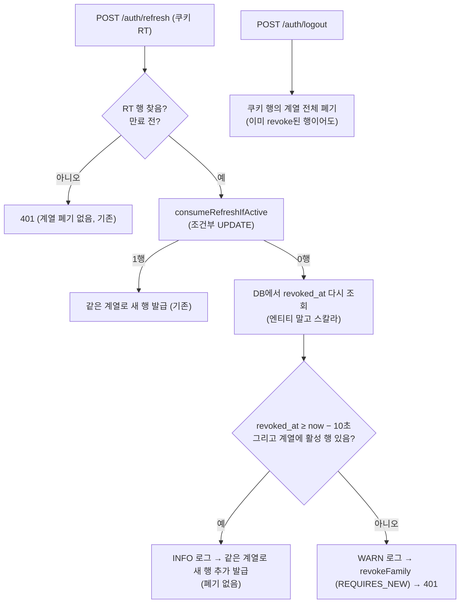

# refresh 토큰 회전 유예(reuse leeway) 도입

## Context

같은 브라우저에서 refresh 요청 2개가 겹치면(링크 여러 개를 연달아 새 탭으로 열기, 탭 복원 등) BE가
늦게 온 쪽을 "탈취된 토큰 재사용"으로 판정해 그 로그인 계열 전체를 폐기한다 — 모든 탭이 로그인
화면으로 튕긴다. FE #333(같은 탭 안의 늦은 401)은 해결했지만 탭 간 충돌은 FE 큐로 막을 수 없고,
Web Locks만으로는 "뒤 탭의 refresh가 앞 탭의 방금 받은 토큰을 폐기"하는 문제가 남는다(대화에서 검토).

업계는 서버에 짧은 유예를 두는 쪽이다:

- Okta: _"회전 후에도 이전 토큰이 설정된 시간 동안 유효하게 남아, 클라이언트가 새 토큰을 받을 수
  있게 한다"_ (번역), 기본 30초 — [Okta 문서](https://developer.okta.com/docs/guides/refresh-tokens/main/)
- Supabase: _"기본값은 10초이고 이 값을 바꾸는 것을 권장하지 않는다"_ (번역) —
  [Supabase 문서](https://supabase.com/docs/guides/auth/sessions). 최신 auth-js는 브라우저 락을
  deprecated하고 탭 간 충돌을 서버에서 푼다 —
  [lockless coordination](https://cdn.jsdelivr.net/npm/@supabase/auth-js@2.110.0/migrations/lockless-coordination.md)
- Auth0: _"이 겹치는 기간은 회전하는 refresh 토큰을 정해진 시간 안에 여러 번 교환할 때 생기는
  동시성 문제를 피하게 해준다"_ (번역), 기본 꺼짐 —
  [Auth0 문서](https://auth0.com/docs/secure/tokens/refresh-tokens/configure-refresh-token-rotation)

목표: 방금 회전된 refresh 토큰이 **10초 안에** 다시 오면 계열을 폐기하지 않고 같은 계열로 새 토큰
쌍을 발급한다. 로그아웃은 계열 전체를 폐기하도록 바꾼다.

## 0. 현재 상황 (코드 추적으로 확인)

- `MemberSessionService.rotate`(`MemberSessionService.kt:84-116`): 조건부 UPDATE
  `consumeRefreshIfActive`가 0행이면 무조건 `revokeFamily` + 401. KDoc(76-83행)이 "경합과 재사용을
  구분할 안전한 방법이 없다"며 두 탭 동시 로그아웃을 감수한다고 명시.
- 한 행이 access·refresh를 함께 가진다(`TableMemberSession.kt`). `revoked_at`은 회전·로그아웃·재사용
  폐기에 공용.
- 로그아웃 `revokeByRefreshToken`(`:118-127`)은 쿠키가 가리키는 **행 1개만** 폐기하고, 이미 revoke된
  행이면 아무것도 안 한다.
- FCM은 계열에 `revoked_at IS NULL AND refresh_expires_at > now` 행이 있으면 살아있다고 본다
  (`FcmTokenRepository.kt:48-53`).
- 테스트는 Mockito 단위 테스트뿐(`MemberSessionServiceTest.kt`), DB 통합 테스트 인프라 없음.
- refresh·logout의 `@Operation` 설명(`AuthController.kt:73-95`)이 FE `src/shared/api/generated/openapi.json`
  에 복사돼 있고, FE `openapi-drift-check.yml`이 매일 비교한다.

## 1. 전체 계획



배포 흐름: BE PR(코드·테스트·문서·계획 파일) → 머지·배포 확인 → 운영 검증 → FE PR(openapi 동기화·
`docs/AUTH.md`) → 머지·배포 확인. 스키마 변경이 없어 배포 순서 위험은 없다.

## 2. 세부 계획

### 2-1. BE (`link-sphere_BE_NEW`, 워크트리 `refresh-reuse-leeway`)

1. **`MemberSessionRepository.kt`** — 쿼리 3개 추가(파라미터는 기존 관례대로 nullable):
   - `findRevokedAtById(id): Instant?` — `SELECT s.revokedAt ... WHERE s.id = :id`. 소비에 진 요청이
     처음 읽은 `current` 엔티티는 상대 커밋 전 값일 수 있고, 같은 영속성 컨텍스트에서 엔티티로 다시
     찾으면 갱신 없이 같은 인스턴스가 돌아오므로 스칼라로 읽는다.
   - `countActiveInFamily(familyId, now): Long` — `revokedAt IS NULL AND refreshExpiresAt > :now`.
   - `revokeActiveInFamily(familyId, now): Int` — 로그아웃용 일반 전파 bulk UPDATE(`revokeFamily`와 SQL은
     같지만 독립 커밋이 필요 없다).
   - `revokeFamily` 주석 갱신: 계열당 활성 행이 둘 이상일 수 있음, READ COMMITTED 전제.
2. **`MemberSessionService.rotate`** — 0행 분기를 판정(읽기만) → 거부(`revokeFamily` + throw) 또는 허용
   (새 행 발급)으로 나눈다. 기존 101-115행 발급 코드를 `issueInFamily(current, now)`로 추출해 정상
   회전과 유예 발급이 같은 만료 규칙(절대 수명 유지, access 상한)을 쓰게 한다.
   - `REUSE_LEEWAY = Duration.ofSeconds(10)`(companion).
   - 판정은 **한쪽 경계만**: `revokedAt.isBefore(now.minus(REUSE_LEEWAY))`면 거부. 소비에 진 요청의
     `now`는 락 대기 전에 찍히고 Lambda 간 시계 오차도 있어 `revokedAt`이 `now`보다 미래일 수 있다.
   - 순서 규칙(주석으로 남김): member_sessions에 쓰기 전에만 REQUIRES_NEW(`revokeFamily`)를 부른다 —
     바깥 트랜잭션이 행 락을 쥔 채 REQUIRES_NEW가 같은 행을 건드리면 PG가 감지 못하는 교착이 된다.
   - 로그(`LoggerFactory`, `MailService.kt:26` 형태): 유예 발급 INFO, 재사용 탐지 WARN. familyId와
     경과 ms만 남기고 토큰·해시는 남기지 않는다(10초 조정 근거).
   - KDoc 76-83행의 "구분할 안전한 방법이 없다" 서술을 유예 판정으로 고쳐 쓴다.
3. **`revokeByRefreshToken`(로그아웃)** — 행을 찾으면 `revokedAt` 가드 없이
   `revokeActiveInFamily(session.familyId, now)`. 엔티티 `save` 제거. 같은 계열 = 같은 브라우저 로그인이라
   다른 기기는 영향 없음.
4. **주석·설명** — `TableMemberSession` KDoc, `create_member_sessions.sql`의 `revoked_at` 주석(설명만,
   재실행 불필요), `AuthController` refresh·logout `@Operation` 설명(10초 유예, 로그아웃=같은 로그인 전체).
5. **테스트(`MemberSessionServiceTest.kt`)** — MockitoExtension strict stubs라 호출되지 않을 쿼리는
   stub하지 않는다.

   | 시나리오 | 기대 |
   |---|---|
   | 정상 회전(기존) | 유지 + `never().findRevokedAtById` |
   | 0행 + revokedAt = now−11s | `revokeFamily(familyId)`, throw, `never().save`, `never().countActiveInFamily` |
   | 0행 + now−3s + 활성 1 (`current.revokedAt`은 null인 낡은 엔티티) | 새 행 저장(같은 member·family·만료 규칙), `never().revokeFamily` |
   | 0행 + now−3s + 활성 0 (로그아웃·탐지 이후) | `revokeFamily`, throw, `never().save` |
   | 0행 + revokedAt null | `revokeFamily`, throw |
   | 0행 + revokedAt = now+500ms | 유예 발급 |
   | 로그아웃: 활성 행 | `revokeActiveInFamily(familyId)`, `never().save` |
   | 로그아웃: 이미 revoke된 행 | 그래도 `revokeActiveInFamily(familyId)` (기존 "다시 저장 안 함" 테스트 대체) |
   | 로그아웃: 토큰 없음·못 찾음(기존) | 유지 |

6. **문서** — `CHANGELOG.md` `[Unreleased]` `### Fixed`(`auth`) 2항목: ① 여러 탭 동시 갱신 시 전부
   로그아웃되던 문제(10초 유예, 보안 트레이드오프 명시) ② 로그아웃해도 같은 로그인의 다른 세션 행이
   살아 FCM 등이 유지될 수 있던 문제. `### Migration` 없음. 이 계획을
   `docs/plans/2026-10-12-refresh-reuse-leeway.md`로 같은 PR에 커밋.

### 2-2. FE (`link-sphere_FE_NEW`, BE 운영 배포 확인 후, 새 워크트리)

1. `pnpm codegen:fetch && pnpm codegen` → `openapi.json`·`openapi.gen.ts` 동기화(설명 문자열만 바뀜).
2. `docs/AUTH.md` §11 항목 8: 동시 refresh는 BE 유예로 해소, Web Locks 서술 정정, 남는 것(다른 탭이
   회전한 순간 이 탭의 재시도가 상한에 걸리는 좁은 창)만 유지. "마지막 검토" 갱신.
3. 사용자 동작 변화 없음 → FE CHANGELOG 항목 없음(docs·생성 파일).

## 결정 사항과 트레이드오프 (승인 대상)

- **유예 10초, 시간 창 방식.** Supabase 기본값. 지연의 대부분은 Lambda 콜드스타트(수 초)라 여유가 있다.
  "직전 토큰만 허용"(Auth0)은 parent 링크가 없어 정확히 구현할 수 없고, 10초 안 두 번 회전은 드물다.
- **`rotated_at` 컬럼을 만들지 않는다.** 로그아웃을 계열 단위로 바꾸면 "계열은 살리고 한 행만 폐기"하는
  경로는 회전뿐이라 `revoked_at`(최근) + 계열 활성 행 존재 = "방금 회전됨"이다. 이 불변식은 리포지토리
  주석과 로그아웃 테스트로 고정한다. 나중에 단일 행 폐기 경로가 생기면 그때 컬럼을 도입한다.
- **보안 트레이드오프:** 정상 회전 후 10초 안에 공격자가 탈취한 직전 토큰을 쓰면 계열이 두 갈래가 되고,
  이후 양쪽 다 자기 최신 토큰만 쓰므로 재사용 탐지가 걸리지 않은 채 절대 수명(최대 7일)까지 유지될 수
  있다. Okta·Auth0·Supabase의 유예도 같은 성질이다. 로그아웃·전체 로그아웃·비밀번호 변경은 두 갈래를
  모두 끊는다.
- **PG 동작 근거:** _"첫 번째 갱신자가 커밋하면 두 번째 갱신자는 (...) 갱신된 버전의 행에 연산을
  적용하려 한다. 명령의 검색 조건(WHERE 절)을 다시 평가해 갱신된 행이 여전히 조건에 맞는지 본다"_ /
  _"Read Committed는 각 명령을 그 순간까지 커밋된 모든 트랜잭션을 포함한 새 스냅샷으로 시작한다"_
  (번역, [PostgreSQL 13.2.1](https://www.postgresql.org/docs/current/transaction-iso.html)) — 진 요청은
  0행을 받고, 이어지는 조회는 이긴 쪽의 커밋을 본다. 격리 수준을 올리면 이 전제가 깨지므로 주석에 남긴다.

## 실행 전략

1. BE 워크트리 생성(`git log origin/main..main` 확인, 부트스트랩 `application-secret.yml`·
   `firebase-service-account.json` 복사).
2. **배포 전 재현**: 테스트 계정으로 로그인한 탭 콘솔에서 동시 refresh 2개 → `[200, 401]` 확인(그 계정은
   로그아웃됨). 테스트 계정은 실행 시점에 사용자에게 받는다.
3. 테스트 먼저 작성(유예 케이스 실패 확인) → 구현 → `./gradlew test ktlintCheck`.
4. 계획 파일 커밋 → fresh Explore 서브에이전트로 계획 대비 diff 대조 → PR 본문 `## 계획 대비 구현`.
5. PR → CI → squash 머지 → `deploy.yml`의 해당 SHA 성공 확인 → 운영 검증(아래).
6. FE PR(2-2) → CI → 머지 → FE 배포 성공 확인.

## 검증 방법

- `./gradlew test ktlintCheck` 통과, 위 테스트 표 전부 포함.
- **운영 수정 확인**(테스트 계정 콘솔):
  ```js
  const H = { 'x-amz-content-sha256': 'e3b0c44298fc1c149afbf4c8996fb92427ae41e4649b934ca495991b7852b855' };
  const r = () => fetch('/api/auth/refresh', { method: 'POST', credentials: 'include', headers: H }).then((x) => x.status);
  await Promise.all([r(), r()]); // 배포 전 [200, 401] → 배포 후 [200, 200]
  ```
  이어서 새로고침해 로그인 유지 확인, 로그아웃 후 새로고침 시 로그인 화면 확인.
- 실제 시나리오: 피드에서 글 3개를 연달아 휠 클릭으로 새 탭 열기 → 모든 탭 로그인 유지.
- CloudWatch Logs Insights로 `[MemberSession]` INFO(유예 발급)·WARN(재사용 탐지) 로그와 경과 ms 확인.

## 남은 것

- 탭 간 access 토큰 번갈아 폐기(한 탭의 회전이 다른 탭 access를 Expired로 만듦)는 그대로 — 지금처럼
  `TOKEN_EXPIRED` → refresh로 회복. 다른 탭이 회전한 순간 이 탭에서 재시도 중이던 요청이 상한에 걸리는
  좁은 창도 남는다.
- 기존부터 있는 경합: 회전·유예의 INSERT가 동시에 실행된 bulk 폐기(전체 로그아웃 등) 문장의 스냅샷
  이후에 커밋되면 그 행이 살아남는다. 근본 해결(계열 단위 advisory lock)은 이번 범위 밖.
- 10초 값은 로그의 경과 ms 분포를 보고 조정.

## 핵심 파일

- BE `src/main/kotlin/com/example/linksphere/domain/auth/MemberSessionService.kt`
- BE `src/main/kotlin/com/example/linksphere/domain/auth/MemberSessionRepository.kt`
- BE `src/test/kotlin/com/example/linksphere/domain/auth/MemberSessionServiceTest.kt`
- BE `src/main/kotlin/com/example/linksphere/domain/auth/AuthController.kt`(설명), `TableMemberSession.kt`(KDoc),
  `src/main/resources/sql/create_member_sessions.sql`(주석), `CHANGELOG.md`
- FE `src/shared/api/generated/openapi.json`·`openapi.gen.ts`, `docs/AUTH.md`
