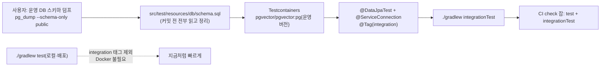

# BE 저장소 쿼리를 실제 Postgres로 검증하는 통합 테스트 도입(Testcontainers)

> BE 테스트는 모두 mock이라 네이티브 SQL·일괄 DELETE·FK cascade를 검증하지 못한다. 운영 스키마 덤프를 기준으로
> Testcontainers Postgres에서 도는 `integrationTest` 태스크를 만들고, 북마크·좋아요 저장소부터 덮는다
> (2026-10-14 사용자 선택: 운영 스키마 덤프·사용자가 직접 실행, 별도 태스크, 북마크·좋아요부터).

## Context

### 왜 필요한가

- **BE 테스트 47개 클래스 중 실제 DB를 쓰는 것이 0개다.**
  - `@SpringBootTest`·`@DataJpaTest`가 없고, 저장소는 모두 mock이다(`CommentServiceTest.kt:747-750`이 이 공백을 적어 둠).
  - 그래서 네이티브 SQL 16개와 `@Modifying` JPQL 약 25개는 테스트로 검증되지 않는다.
- **이 공백 때문에 실제로 손이 갔다.**
  - 좋아요 500(#79)의 동시성은 CI로 재현할 수 없었다(`docs/plans/2026-10-13-like-concurrency.md:224,254`).
  - 어제 추가한 `deleteIfNoFolderItems`(#89)는 로컬 컨테이너로 따로 한 번 확인했다(`docs/plans/2026-10-14-last-folder-keeps-others.md:116,132`).
  - CHANGELOG에도 "실 DB 없이 검증 못 함" 기록이 여러 번 있다(`:323`, `:356`, `:1440`).

### 사전 조사

- **스키마 기준이 레포에 없다.**
  - `ddl-auto: none`(`application.yml:30`)이고 Flyway·Liquibase가 없다.
  - `posts`·`members`·`bookmarks`·`comments`의 CREATE TABLE이 레포 어디에도 없다.
  - FK `ON DELETE CASCADE`는 손으로 돌린 `src/main/resources/sql/*.sql`에만 있다(엔티티에 `@OnDelete`·`cascade` 없음).
  - 그래서 엔티티로 만든 스키마(`ddl-auto=create`)는 운영과 다르다.
  - `posts.embedding`은 pgvector 타입이라(`TablePost.kt:48-50`) pgvector 이미지가 필요하다.
  - 운영 Postgres 버전은 기록이 없다(Supabase).
- **Spring Boot 3.5.8**: `@DataJpaTest`는 JPA 쪽만 띄우므로 Supabase·Gemini 같은 외부 설정 없이 뜬다.
  - 3.4부터 `@ServiceConnection` Testcontainers DB는 _"테스트 데이터베이스로 보고 교체하지 않는다"_ (번역, [AutoConfigureTestDatabase.Replace.NON_TEST](https://docs.spring.io/spring-boot/3.5/api/java/org/springframework/boot/test/autoconfigure/jdbc/AutoConfigureTestDatabase.Replace.html)).
  - `spring-boot-testcontainers`와 Testcontainers 버전은 Boot BOM이 관리하는 것으로 보인다(구현 때 `./gradlew dependencies`로 확인).
- **Supabase 덤프 연결**
  - 운영 앱은 Transaction 모드 6543 포트를 쓴다(`docs/DEPLOY.md:223`).
  - Supabase 문서는 Transaction 모드가 `SET` 같은 세션 기능을 지원하지 않고, 직접 연결이 `pg_dump`에 가장 적합하다고 안내한다([Supabase: Accessing Postgres](https://supabase.com/docs/guides/self-hosting/accessing-postgres), self-hosting 문서라 플랫폼과 다를 수 있음).
  - 그래서 세션 모드(5432)나 직접 연결로 덤프한다.
- **CI**
  - 필수 체크 `check` 잡이 `ubuntu-latest`에서 `./gradlew ktlintCheck test`를 돌린다(`ci.yml:19-57`, 타임아웃 없음).
  - GitHub 러너에 Docker가 있다는 건 일반 지식이라 첫 CI 실행으로 확인한다.
  - `deploy.yml:69-70`은 `ktlintCheck test shadowJar`이고, `shadowJar`는 운영 클래스패스만 담는다(`build.gradle.kts:28-30`). 테스트 의존성은 Lambda JAR에 들어가지 않는다.
- **기존 원칙:** "모든 테스트가 네트워크 없이 돈다"(`docs/plans/2026-09-09-youtube-data-api.md:206`). 단위 테스트(`test`)에는 그대로 남긴다.



## 판단이 필요했던 항목

| 항목 | 결정 | 근거·기각한 대안 |
| --- | --- | --- |
| 스키마 기준 | 운영 DB 스키마 덤프를 커밋 (2026-10-14 사용자 선택) | 운영과 정확히 같고, 처음으로 "현재 전체 스키마" 기록이 생긴다. 기각: 필요한 테이블만 손으로(기본 테이블 CREATE가 레포에 없어 추정이 된다), `ddl-auto=create`(cascade가 빠져 운영과 다르다) |
| 덤프 실행 | 사용자가 직접 실행하고 파일만 넘김 (2026-10-14 사용자 선택) | 운영 접속 정보가 대화나 내 명령에 오가지 않는다 |
| 실행 위치 | JUnit `@Tag("integration")` + 별도 Gradle 태스크 `integrationTest`. 기존 `test`는 이 태그를 제외한다 (2026-10-14 사용자 선택) | 로컬·배포의 `test`는 Docker 없이 지금처럼 돈다. CI `check` 잡에서 둘 다 돌린다. 별도 source set 대신 태그를 쓰는 건 설정이 가장 작아서다 |
| 배포 워크플로 | `deploy.yml`은 `test`만 그대로 둔다 | `check`가 PR과 main 직접 push의 필수 체크라 병합 전에 이미 돈다. 배포 시간을 늘리지 않는다 |
| 첫 범위 | 북마크·좋아요 저장소 (2026-10-14 사용자 선택) | 최근 바꾼 쿼리이고 사고(#79)가 난 곳이다. 나머지(인증 세션 등)는 같은 틀로 나중에 늘린다 |
| 컨테이너 이미지 | `pgvector/pgvector:pg{N}`, N은 덤프 헤더의 운영 서버 버전 | `posts.embedding`(vector)을 읽으려면 pgvector가 필요하다. 운영 버전에 맞춘다 |
| 컨테이너 수명 | 클래스 간 공유하는 싱글턴 컨테이너 하나(공통 베이스 클래스) | 테스트 클래스마다 컨테이너를 띄우면 CI 시간이 늘어난다 |

### 위험 관리

- **덤프 안의 운영 정보**
  - 스키마만 받는다(`--schema-only --no-owner --no-privileges`). 데이터는 없다.
  - 그래도 함수 본문·기본값에 키처럼 보이는 값이 있을 수 있어, 커밋 전에 파일을 전부 읽는다. 그런 값이 있으면 커밋 전에 묻는다.
- **Supabase 전용 구문**
  - `public` 스키마에 RLS 정책·`auth.uid()` 참조·Supabase 역할(`anon`·`authenticated`) 같은 것이 섞여 있으면 평범한 Postgres에서 실패한다.
  - 지운 구문은 파일 머리 주석에 목록으로 남긴다.
  - `extensions` 스키마의 `vector`는 테스트 전용 앞부분에서 만든다.
- **운영 스키마와의 어긋남**
  - 덤프는 그 시점의 스냅샷이다. 이후 SQL 파일로 스키마를 바꾸면 이 파일도 함께 고쳐야 한다.
  - 파일 머리에 덤프 날짜와 갱신 방법을 적는다(자동 검사는 이번 범위 밖, "남은 것").
- **CI 시간:** 이미지 받기와 컨테이너 기동 시간이 늘어난다. 도입 전후 `check` 잡 시간을 재서 PR 본문에 남긴다.

## 세부 계획

### 0단계 — 사용자가 운영 스키마 덤프

Docker의 `postgres` 이미지 안 `pg_dump`를 쓰면 로컬에 Postgres 클라이언트를 설치하지 않아도 된다. 접속 문자열은 Supabase 대시보드 Connect의 **Session pooler(5432)** 또는 **Direct connection**이다(6543 Transaction 모드 아님).

```bash
# 1) 서버 버전 확인 (헤더 한 줄만 필요)
docker run --rm -i postgres:17 psql "<세션 모드 접속 문자열>" -Atc "show server_version"

# 2) public 스키마만, 소유자·권한 없이 스키마 덤프
docker run --rm -i postgres:17 pg_dump "<세션 모드 접속 문자열>" \
  --schema-only --schema=public --no-owner --no-privileges \
  > /Users/baechan/project/link-sphere/link-sphere_BE_NEW/.claude/worktrees/integration-test/schema-dump.sql
```

- `pg_dump`는 자기보다 낮은 서버 버전을 덤프할 수 있어 17 이미지를 쓴다. 서버가 17보다 높으면 그 버전 이미지로 바꾼다.
- 결과 파일만 워크트리에 두면 된다. 접속 문자열은 대화에 붙이지 않는다.

### 1단계 — BE PR `test(infra)`(가칭)

| 위치 | 변경 내용 |
| --- | --- |
| `build.gradle.kts` | 테스트 의존성 `spring-boot-testcontainers`, `org.testcontainers:postgresql`, `org.testcontainers:junit-jupiter`를 추가한다. `test`는 `excludeTags("integration")`, 새 `integrationTest`(Test 태스크, 같은 test source set)는 `includeTags("integration")`이다 |
| `src/test/resources/db/schema.sql`(신규) | 머리 주석(덤프 날짜·운영 버전·덤프 명령·지운 구문 목록·갱신 방법) + 테스트 전용 앞부분(`CREATE SCHEMA IF NOT EXISTS extensions; CREATE EXTENSION IF NOT EXISTS vector WITH SCHEMA extensions;` 등) + 정리한 덤프 |
| `src/test/kotlin/.../support/PostgresIntegrationTest.kt`(신규) | 공통 베이스: 싱글턴 `PostgreSQLContainer(pgvector 이미지)` + `@ServiceConnection` + `withInitScript("db/schema.sql")`, `@DataJpaTest` + `@Tag("integration")` |
| `src/test/kotlin/.../domain/interaction/BookmarkRepositoryIntegrationTest.kt`(신규) | `deleteIfNoFolderItems`(소속 없음 1행 / 다른 소속 남음 0행·유지 / 북마크 없음 0행 / 다른 사용자 유지), `insertIgnoreConflict` 두 번 → 1행, 북마크 삭제 시 소속 cascade, `countUncategorizedByUserId`, `BookmarkFolderItemRepository`의 `insertIgnoreConflict`·일괄 DELETE |
| `src/test/kotlin/.../domain/interaction/ReactionRepositoryIntegrationTest.kt`(신규) | `PostReactionRepository`·`CommentReactionRepository`의 `insertIgnoreConflict` 멱등, 일괄 DELETE 0행 무예외. 같은 좋아요를 두 트랜잭션이 동시에 지우는 #79 재현: 둘 다 예외 없이 합계 1행이다(이 테스트만 트랜잭션 밖에서 돌고 끝나면 지운다) |
| `.github/workflows/ci.yml` `check` 잡 | `./gradlew ktlintCheck test integrationTest --no-daemon` |
| `README.md` | 테스트 실행 절(단위 `test`는 Docker 불필요, `integrationTest`는 Docker 필요, 스키마 파일 갱신 방법) |
| `docs/plans/2026-10-14-integration-test.md`(신규) | 이 계획 스냅샷 |

- 시드 데이터(회원·글 등 FK 대상)는 덤프에서 확인한 NOT NULL 컬럼에 맞춰 각 테스트가 `JdbcTemplate`로 최소한만 넣는다.

## 영향 범위

### CRUD 실패 지점

운영 데이터와 운영 코드는 바뀌지 않는다(테스트·빌드 설정·CI만). 테스트 DB는 컨테이너라 운영 DB에 쓰지 않는다. 운영 DB에는 0단계의 스키마 읽기만 한다.

### 기존 기능 회귀

| 깨질 수 있는 것 | 소유 파일 |
| --- | --- |
| 기존 단위 테스트 실행(로컬·CI·배포) | `build.gradle.kts` `test` — 통합 태그만 제외한다. 기존 테스트는 태그가 없어 그대로 돈다 |
| 배포 JAR | `shadowJar`는 운영 클래스패스만 담아 테스트 의존성이 들어가지 않는다 |
| ArchUnit 규칙 | 테스트 클래스는 분석에서 빠진다(`ImportOption.DoNotIncludeTests`) |
| CI 필수 체크 `check` 시간 | `ci.yml` — 늘어난다. 도입 전후로 측정한다 |
| ktlint | 새 테스트 파일도 `ktlintCheck` 대상이다 |

## 검증 방법

1. **로컬**
   - Docker를 켠 상태에서 `./gradlew ktlintCheck test integrationTest`를 돌린다.
   - Docker 없이 `./gradlew test`만 돌려도 통과하는지 본다(통합 태그 제외 확인).
2. **테스트가 실제로 잡는지**
   - `deleteIfNoFolderItems`의 `NOT EXISTS` 조건을 잠시 빼면 "다른 소속 남음" 테스트가 실패하는지 확인하고 되돌린다.
   - 동시 해제 테스트는 일괄 DELETE를 옛 derived delete로 잠시 바꾸면 실패하는지 확인할 수 있으면 확인한다(재현이 불안정하면 그 사실을 기록한다).
3. **CI:** PR에서 `check` 잡이 통과하는지 보고, 도입 전후 잡 시간을 PR 본문에 적는다.
4. **계획 대비 구현:** PR 전에 fresh general-purpose 서브에이전트로 대조한다.

## 남은 것

- 인증 세션(`consumeRefreshIfActive` 등 경쟁 가드)·피드·검색 쿼리로 통합 테스트를 넓힌다.
- 스키마 파일과 운영의 어긋남을 자동으로 잡는 방법(정기 덤프 비교 등)은 이번 범위 밖이다.
- Flyway 같은 마이그레이션 도구 도입 여부: 이번 덤프가 기준점(baseline)이 될 수 있지만 별도 결정이다.
