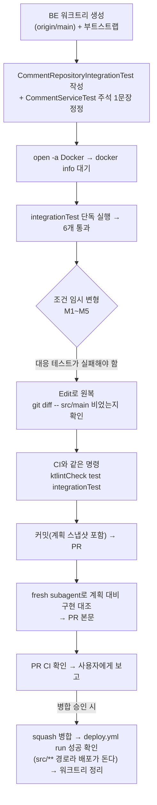

# findMyComments 통합 테스트 추가 (BE)

> 내 댓글 목록 쿼리(`CommentRepository.findMyComments`)의 가시성 게이트·톰스톤 제외·정렬·count를 실제 Postgres로 검증한다.

## Context (Motivation)

- FE `docs/plans/2026-09-14-my-comments.md` "가시성 게이트가 이 단계의 핵심 리스크"(63행): 게이트를 빠뜨리면
  남의 글에 댓글을 단 뒤 그 글이 비공개로 바뀌었을 때 제목이 유출된다. 당시엔 실 DB 테스트 인프라가 없어 수동 확인만 했다.
- BE #91이 `@PostgresIntegrationTest`(Testcontainers + pgvector:pg17, 운영 스키마 덤프)를 도입했고, #95가
  `CommentServiceTest.kt:750`에 "findMyComments 통합 테스트는 아직 없다"고 적었다. 이 공백을 메운다.
- 대상 쿼리(`CommentRepository.kt`, origin/main): 본문 쿼리와 `countQuery`에 같은 WHERE가 **따로** 적혀 있다
  — `c.userId = :userId AND c.isDeleted = false AND (p.isPrivate = false OR p.userId = :userId)`, 정렬 `c.createdAt DESC, c.id DESC`.
- 상황: BE 로컬 `main`이 origin보다 25커밋 뒤(#69 vs #95), 미푸시 커밋 없음 → `origin/main` 기준 워크트리. Docker Desktop은 설치돼 있으나 꺼져 있음.

## 판단이 필요했던 항목

| 항목 | 결정 | 근거·기각한 대안 |
| --- | --- | --- |
| count 검증용 페이지 크기 | 보이는 댓글 3개를 `PageRequest.of(0, 2)`로 조회 | Spring Data는 첫 페이지 결과가 페이지 크기보다 적으면 count 쿼리를 생략하고 결과 수를 total로 쓴다(spring-data-commons 3.5.6 `PageableExecutionUtils.getPage` 바이트코드로 직접 확인). 크기 20으로는 `countQuery`의 게이트가 실행조차 안 된다 |
| 동점 정렬 대상 id | 동점 쌍만 고정 UUID(`…0001`, `…0002`), 나머지는 `UUID.randomUUID()` | Postgres uuid는 바이트 단위 비교, Java `UUID.compareTo`는 부호 있는 long 비교라 무작위 UUID로 기대 순서를 계산하면 어긋날 수 있다(기존 지식, 이번에 실측 안 함). 롤백되는 테스트라 고정 id 충돌 없음 |
| 테스트 단위 | ①~⑤를 테스트 하나씩(⑤는 정렬·count 둘로) | 변형 확인(M1~M5)에서 어느 조건이 깨졌는지 테스트 이름으로 바로 대응된다. 선례 `PostRepositoryIntegrationTest`도 동작별 테스트 |
| 검증 방법 | 로컬 실행 + 조건 임시 변형으로 실패 확인 (사용자 선택) | "처음부터 통과만 하는 테스트"를 배제한다. CI만으로는 실패 버전을 push해야 해 불가 |
| 주석 정정 범위 | 마지막 한 문장만 교체 | 사용자가 지정한 문장. 앞 문장(작성 당시 수동 검증 이력)은 사실이라 유지 |

## 세부 계획

선례: `src/test/kotlin/.../domain/post/PostRepositoryIntegrationTest.kt`(구조·`insertPost(owner, isPrivate)`),
`.../domain/interaction/BookmarkRepositoryIntegrationTest.kt`(`@BeforeEach seed()`·`jdbc.update` 헬퍼).

| 위치 | 변경 내용 |
| --- | --- |
| `src/test/kotlin/com/example/linksphere/domain/comment/CommentRepositoryIntegrationTest.kt` (신규) | `@PostgresIntegrationTest`, `JdbcTemplate`·`CommentRepository` 주입, 아래 시드와 테스트 6개, `insertMember`/`insertPost`/`insertComment` 헬퍼 |
| `src/test/kotlin/com/example/linksphere/domain/comment/CommentServiceTest.kt:750` | 변경 전 "지금은 @PostgresIntegrationTest(#91)가 있지만 findMyComments 통합 테스트는 아직 없다." → 변경 후 "필터 자체는 지금 CommentRepositoryIntegrationTest가 실제 Postgres에서 검증한다." |
| `docs/plans/2026-10-15-my-comments-integration-test.md` (신규) | 이 계획 파일 스냅샷(BE CLAUDE.md §8) |

### 시드 (`@BeforeEach`)

회원 `me`, `other`. 글 `myPublic`(me, 공개), `myPrivate`(me, 비공개), `othersPublic`(other, 공개), `othersPrivate`(other, 비공개).
`comments`는 `INSERT INTO comments (id, post_id, user_id, content, is_deleted, created_at) VALUES (...)`로 넣는다.

| 댓글 | 작성자 | 원글 | is_deleted | created_at | 기대 |
| --- | --- | --- | --- | --- | --- |
| `mineOnOthersPublic` | me | othersPublic | false | 10:00 | 포함 (3번째) |
| `mineOnMyPrivate` (`…0001`) | me | myPrivate | false | 11:00 | 포함 (2번째) — ③ |
| `mineOnMyPublic` (`…0002`) | me | myPublic | false | 11:00 | 포함 (1번째) |
| `mineOnOthersPrivate` | me | othersPrivate | false | 12:00 | 제외 — ② |
| `myTombstone` | me | othersPublic | true | 12:00 | 제외 — ④ |
| `othersComment` | other | myPublic | false | 12:00 | 제외 — ① |

제외 대상을 가장 최신(12:00)에 둬 조건이 깨지면 맨 앞에 끼어들게 한다.

### 테스트

| # | 이름(백틱, 선례처럼 한글) | 단언 |
| --- | --- | --- |
| ① | `findMyComments 는 내가 쓴 댓글만 돌려준다` | `othersComment` 없음, 결과 전부 `userId == me` |
| ② | `남의 비공개 글에 단 내 댓글은 빠진다` | `mineOnOthersPrivate` 없음 |
| ③ | `내 비공개 글에 단 내 댓글은 나온다` | `mineOnMyPrivate` 있음 |
| ④ | `삭제된 댓글(톰스톤)은 빠진다` | `myTombstone` 없음 |
| ⑤a | `최신순으로, 작성 시각이 같으면 id 역순으로 정렬한다` | 크기 20, id 목록 == `[mineOnMyPublic, mineOnMyPrivate, mineOnOthersPublic]` |
| ⑤b | `count 쿼리도 본문과 같은 조건으로 센다` | `of(0, 2)`: content 2개·`totalElements == 3`·`totalPages == 2`, `of(1, 2)`: `[mineOnOthersPublic]` |

## 영향 범위

- **CRUD**: 읽기 쿼리 테스트만 추가. 데이터 계약·운영 코드 변경 없음. 쓰기는 테스트 트랜잭션 안의 시드뿐이고 `@DataJpaTest`가 롤백한다.
- **기존 기능 회귀**: 운영 코드 무변경. 통합 테스트 클래스끼리 컨테이너를 공유하지만(컨텍스트 캐시) 테스트마다 롤백돼 고정 UUID가 다른 클래스와 겹치지 않는다. `CommentServiceTest`는 주석만 바뀐다. CI `integrationTest` 시간이 조금 는다.
- **배포**: `deploy.yml` 경로 필터가 `src/**`라 병합하면 Lambda 배포가 돈다(내용은 테스트뿐). 병합 후 run 성공을 확인한다.
- CHANGELOG: `test` 커밋이라 대상 아님(BE CLAUDE.md "릴리즈노트 관리").

## 검증 방법

1. 워크트리: `EnterWorktree({ name: "my-comments-integration-test" })` 후 `git rev-parse --show-toplevel`이 BE 워크트리인지 확인
   (FE에 만들어지면 나와서 `git -C <BE> worktree add`로 BE에 만든다). 부트스트랩: `application-secret.yml`·`firebase-service-account.json` 복사.
2. Docker: `open -a Docker` → Monitor로 `docker info` 성공까지 대기.
3. `./gradlew integrationTest --tests 'com.example.linksphere.domain.comment.CommentRepositoryIntegrationTest' --no-daemon` → 6개 통과.
4. 조건 임시 변형(커밋 안 함, 각각 적용 → 실행 → 원복):

   | 변형 | 실패해야 하는 테스트 |
   | --- | --- |
   | M1 본문·count에서 `c.userId = :userId AND` 제거 | ① |
   | M2a 본문 쿼리에서만 가시성 게이트 제거 | ② |
   | M2b `countQuery`에서만 가시성 게이트 제거 | ⑤b (total 4) |
   | M3 게이트를 `p.isPrivate = false`로만 축소 | ③ |
   | M4 본문·count에서 `c.isDeleted = false` 제거 | ④ |
   | M5 `c.id DESC` → `c.id ASC` | ⑤a |

   끝나면 `git diff -- src/main`이 비어 있는지 확인. 결과(변형별 실패한 테스트 이름)를 PR 본문에 남긴다.
5. CI와 같은 명령: `./gradlew ktlintCheck test integrationTest --no-daemon`.
6. 커밋 `test(comment): 내 댓글 목록 쿼리를 실제 Postgres로 검증하는 통합 테스트 추가`(`.gitmessage` 형식, 경로 지정 커밋, 새 파일은 `git add -- <파일>`) → push → PR.
7. fresh general-purpose subagent에게 `docs/plans/2026-10-15-my-comments-integration-test.md`와 diff를 주고 대조 → PR 본문 `## 계획 대비 구현`.
8. PR CI(`integrationTest` 포함) 성공 확인 후 보고. 병합은 사용자 승인 후 → `deploy.yml` run 성공 확인 → `ExitWorktree(remove)`.

## 남은 것

- Docker는 이번 작업을 위해 켜는 것이라 끝난 뒤 그대로 둔다(끌지 여부는 사용자 몫).
