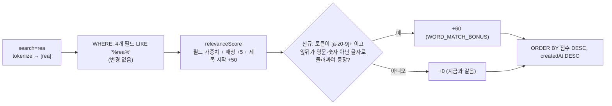

# 검색어가 "단어"로 들어간 글을 단어 일부로만 걸린 글보다 위로

> 영문·숫자 검색어가 글에 한 단어로 들어 있으면 관련도 점수에 +60을 준다. 결과에서 빠지는 글은 없고, 순서만 바뀐다(BE `PostSearchQuery.relevanceScore`만 수정).

## Context

- **발단** — 사용자가 "rea"로 검색했는데 REA 소개 글(`/post/fa47a3ca-…`, 제목 `GitHub - morluto/rea: Reverse engineer anything…`)이 안 보였다.
- **실측(2026-10-19, 운영 API)** — `GET /post?search=rea`는 45건이고, 그 글은 **11번째**다. FE 페이지 크기가 `POST_PAGE_SIZE = 10`(FE `src/entities/post/config/post.const.ts:1`)이라 2페이지로 밀려 있다. 즉 검색에는 걸리고 순위만 낮다.
- **근본 원인** — BE `PostSearchQuery.kt:97-112`는 공백을 뺀 필드에 `LIKE '%token%'`로 부분 문자열을 찾는다. 점수(`:118-165`)는 제목 3, 태그 2, 설명 1, 요약 1, 매칭 +5, 제목 시작 일치 +50이다. 이 점수는 "rea라는 단어"와 "Th**rea**ds·**Rea**ct 속의 rea"를 구분하지 못한다.
- **점수 재현** — 같은 공식을 브라우저에서 계산했고, 결과는 실제 순서와 완전히 일치했다.

| 순위 | 글 | 점수 |
| --- | --- | --- |
| 1 | react 성능 이슈… | 58 |
| 2~5, 9~10 | React 관련 글 | 11~12 |
| 6~8 | Threads ×3 | 11 |
| 11 | REA 글 | 10 |

## 판단이 필요했던 항목

| 항목 | 결정 | 근거·기각한 대안 |
| --- | --- | --- |
| 보너스 크기 | **+60** (2026-10-19 사용자 선택 A) | 제목 시작 부분 일치(+50)보다 커야 "rea"에서 REA 글이 1위가 된다. 시뮬레이션 결과는 ① REA 글 ② 요약에 REA가 있는 YouTube 영상 ③ react 성능…이다. 기각한 B(+20)에서는 REA 글이 2위에 머문다. 기각한 C(+60에 단어 시작 +5)는 점수 항목이 하나 더 늘어난다. |
| 적용 대상 토큰 | 영문 소문자·숫자로만 된 토큰(`[a-z0-9]+`) | 한글은 조사("리액트를")나 붙여 쓴 복합어("전역상태관리") 때문에 단어 경계가 관련도를 뜻하지 않는다. `node.js`·`c++`처럼 기호가 섞인 토큰은 지금과 같이 보너스 없이 둔다. 덤으로 토큰을 정규식 이스케이프할 필요도 없어진다. |
| 단어 경계 정의 | 영문 소문자·숫자가 **아닌** 모든 글자, 그리고 문자열 끝 | 한글이 경계 역할을 하므로 "React로"도 단어 일치가 된다. 경계는 `\m`·`\y` 같은 로케일 의존 클래스 대신 문자 목록 `[^abcdefghijklmnopqrstuvwxyz0123456789]`로 명시한다. 기존 `STRIP_CHARS`와 같은 방어 원칙이다(Supabase 로케일 미확인, `PostSearchQuery.kt:44-48` 주석). |
| WHERE(결과 집합) | 변경 없음 | 부분 일치를 빼면 `script`로 `javascript`를 못 찾는다. 결과가 줄어드는 방향의 변경이라 기각했다. |
| 선례 | Meilisearch exactness 규칙은 _"질의한 것과 정확히 같은 단어를 담은 문서를 먼저 돌려준다"_ (번역, [Meilisearch 랭킹 규칙](https://www.meilisearch.com/docs/capabilities/full_text_search/relevancy/built_in_ranking_rules#7-exactness)) | Meilisearch는 단어 단위 엔진이라 단어 중간 일치가 애초에 없다. LIKE를 쓰는 우리와 똑같은 상황은 아니고, "정확한 단어 우선"이라는 순서 원칙만 빌린다. |

## 세부 계획

작업 위치는 BE 레포다. 워크트리는 FE 세션에서 `git -C <BE> worktree add`로 만든다(메모리 `cross-repo-be-worktree-from-fe-session`: EnterWorktree는 BE에 안 된다, BE 비밀 파일을 복사한다). 워크트리를 만들기 전에 BE `git log origin/main..main`이 비어 있는지 확인한다(2026-10-19 기준 비어 있음).

| 위치 | 변경 내용 |
| --- | --- |
| `src/main/kotlin/com/example/linksphere/domain/post/PostSearchQuery.kt:32-42` | `private const val WORD_MATCH_BONUS = 60`을 추가하고, 경계 문자 목록 상수 `internal const val NON_WORD_CHARS = "[^abcdefghijklmnopqrstuvwxyz0123456789]"`를 추가한다. |
| 같은 파일 `relevanceScore` (`:118-165`) | 토큰 루프 안에서 토큰이 `[a-z0-9]+`이면 `caseInt(cb, fields.wordMatches(cb, "% $token %"), WORD_MATCH_BONUS)`를 더한다. |
| 같은 파일 `SearchableFields` (`:200-219`) | 필드 4개(제목·설명·태그(`array_to_string(tags, ',')`)·요약) 각각에 단어 비교용 식 `' ' \|\| regexp_replace(lower(field), NON_WORD_CHARS, ' ', 'g') \|\| ' '`을 하나씩 만들고, `wordMatches(cb, like)` = 넷 중 하나라도 `LIKE`인지를 추가한다. 공백 제거본(`norm`)이 아니라 원문 소문자를 쓴다. 이미 쓰는 `regexpReplace` 헬퍼를 재사용하고 `cb.concat`을 쓴다. |
| 같은 파일 머리 KDoc (`:10-27`) | 단어 일치 보너스와 적용 조건(영문·숫자 토큰만)을 한 줄 추가한다. |
| `src/test/.../domain/post/PostSearchQueryTest.kt` | `NON_WORD_CHARS`를 Java Regex로 검증한다(`STRIP_CHARS` 테스트와 같은 방식): `morluto/rea:` → `morluto rea `, `React로` → `react `, 한글 → 공백. |
| `src/test/.../domain/post/` 통합 테스트(`@PostgresIntegrationTest`, 선례 `PostRepositoryIntegrationTest.kt`) | 실제 Postgres 17에서 `findPosts(search="rea")`를 실행한다. 시드는 "Threads"(태그 `threads.com`), "react 성능…", "GitHub - morluto/rea: …" 세 글이다. 첫 결과가 REA 글이고 3건 모두 결과에 남는지 단정한다. 추가 케이스: `react`로 "React로 만든…"(한글 경계)이 "reactive…"보다 위, 태그 경계(`a,rea,b`)도 단어 일치, 한글 토큰 `리액트`는 보너스가 없음. 지금은 검색 SQL이 실제 Postgres에서 한 번도 돌지 않으므로 이 테스트가 첫 실측이 된다. |
| `CHANGELOG.md` `[Unreleased]` | "수정" 항목을 추가한다: 영문 검색어가 단어로 들어간 글이 다른 단어 속 일부로만 걸린 글보다 뒤에 나오던 문제. |
| `docs/plans/2026-10-19-search-word-match-bonus.md` (신규) | 이 계획 파일의 스냅샷(append-only). |

## 영향 범위

- **CRUD** — 읽기(검색 정렬)만 바뀐다. 등록·수정·삭제와 스키마·DTO·API 응답 형태는 바뀌지 않는다. 카운트(`totalElements`)는 WHERE를 건드리지 않아 그대로다. 새 점수도 행 데이터만으로 정해지고 동점은 기존처럼 `createdAt DESC`로 가르므로, 페이지 사이에 중복·누락이 새로 생기지 않는다.
- **회귀 후보**
  - 피드 검색 순서가 바뀐다. 시뮬레이션에서 `ai`·`react`·`mcp`·`claude`는 상위 10개가 원래 모두 단어 일치라 변화가 없었다. `css`는 단어가 아닌 일치가 상위 10개 중 7건에서 4건으로 줄었다.
  - 북마크 검색도 `PostSearchQuery`를 공유해(`BookmarkRepositoryImpl.kt:80-86, 164-167`) 같이 바뀐다. 의도된 변경이다.
  - 의미 검색 배지(`matchesKeywordLiterally`, `PostResponseAssembler.kt:101`)는 WHERE와 같은 판정이라 영향이 없다.
  - 성능: 공개 글 수백 건 규모에서 행마다 `regexp_replace`가 토큰당 4회 늘어난다. 기존에도 필드당 `regexp_replace`를 쓰고 있다. 배포 후 `[Search]` 로그의 응답 시간을 본다.
- **FE** — 코드 변경이 없다. FE `docs/SEARCH.md:589-593`·`DECISIONS.md:655`는 "부분 일치 + 의미 검색"까지만 서술하고 순위 공식은 BE 계획이 정본이라고 가리키므로, 여전히 사실이다. 수정하지 않는다.

## 검증 방법

1. BE 워크트리에서 `./gradlew ktlintCheck test`를 돌리고, 통합 테스트 실행 방법(`@Tag("integration")`)은 BE 문서·빌드 스크립트에서 확인해 실행한다 → 새 통합 테스트를 포함해 통과해야 한다.
2. PR 전에 fresh general-purpose 서브에이전트로 이 계획과 diff를 대조하고, PR 본문 `## 계획 대비 구현`에 남긴다(BE CLAUDE.md §8).
3. 병합 후 BE 배포 워크플로가 그 SHA에서 success인지 `gh run list`로 확인한다.
4. 운영에서 `/post?q=rea`를 브라우저로 열어 REA 글이 1위인지 확인한다. `ai`·`react`·`mcp`·`claude` 상위 10개는 배포 전 시뮬레이션과 비교한다.

## 남은 것

- 단어 중간 일치 노이즈(예: "rea"의 Threads)는 결과에 그대로 남는다. 단어 시작 보너스(기각한 C안)는 필요해지면 따로 검토한다.
- 기호가 섞인 토큰(`node.js`, `c++`)과 한글 토큰에는 단어 일치 보너스가 없다.
