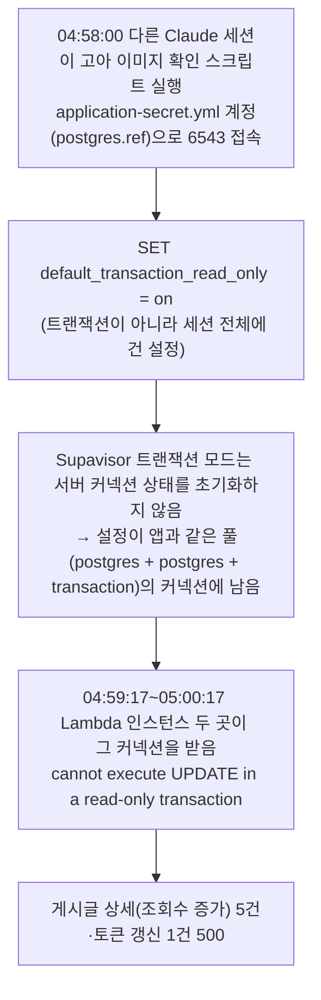
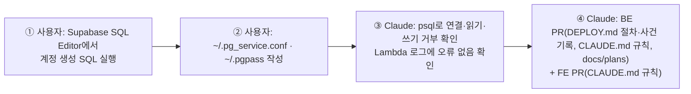

# 운영 DB 임시 조회 전용 읽기 계정

> 사람·Claude 세션이 운영 DB를 임시로 조회할 때 앱과 같은 계정·같은 풀(6543)을 쓰지 않게, SELECT만 되는 전용 계정과
> 저장소 밖 접속 설정을 만들고 규칙·문서로 고정한다.

## Context

### 왜 필요한가 — 2026-10-05 사건



- 확인한 사실: 그 세션 기록에 `SET default_transaction_read_only = on`과 `node check-orphans.js` 실행(04:58:00.856Z)이 있다. 접속 대상은
  BE `application-secret.yml`의 `…pooler.supabase.com:6543`, Lambda 로그 오류 원문은 위와 같다.
- 메커니즘은 Supabase 공식 문서가 그대로 설명한다. [트러블슈팅 문서](https://supabase.com/docs/guides/troubleshooting/resolving-cannot-execute-update-in-a-read-only-transaction-on-transaction-pooler-connections-ef582c)는
  _"트랜잭션 풀링 모드에서는 성능을 위해 초기화 동작을 의도적으로 제한하므로, 명시적으로 되돌리지 않으면 세션 상태가 남을 수 있다"_ (번역)고 쓰고,
  `SET default_transaction_read_only = on;`이 _"메인 애플리케이션이 쓰는 풀을 오염시킨다"_ (번역)고 명시한다. 같은 문서의 권고는 트랜잭션 단위
  `BEGIN TRANSACTION READ ONLY;`, 그리고 _"세션 상태가 필요한 스크립트는 트랜잭션 풀러(6543) 대신 5432로 연결하라"_ (번역)이다.

### 지금 상황 (저장소 조사)

- 운영 DB 임시 조회는 모두 앱과 같은 계정 `postgres.<ref>`로 6543에 붙었다 — psql(09-03·04·06), psycopg2(09-06), JDBC(09-27), node `pg`(09-28·10-05). 읽기 전용 장치를 건 건 10-05 한 번뿐이고, 그게 오히려 사고를 냈다.
- 이 작업을 다루는 규칙이 BE·FE·전역 CLAUDE.md, claude-base 어디에도 없다(claude-base `안전·권한` 절은 빈 자리).
- `bash-guard.mjs`는 `Bash(git *)`·`Bash(rm *)`에만 걸리고 명령 문자열만 본다 — 파일로 쓴 스크립트(`node x.js`) 안의 SQL은 볼 수 없다.
- 공개 테이블 18개 모두 RLS가 켜져 있고 정책이 0개다(`schema.sql:866-974`) — SELECT만 준 새 계정은 행을 하나도 못 본다.
- 쓰기가 필요한 흐름(사용자가 직접 돌리는 마이그레이션, `--commit` 러너, Lambda)은 기존 계정이 그대로 맡는다.
- `psql` 18.6이 `/opt/homebrew/opt/libpq/bin/psql`에 있다(keg-only, PATH 밖).

## 판단이 필요했던 항목

| 항목 | 결정 | 근거·기각한 대안 |
| --- | --- | --- |
| 막는 수단 | **DB 권한으로 막는다**(전용 계정) | 문서 규칙만: 10-05 세션도 "읽기 전용"을 의도했지만 방법이 틀렸다 — 지키려 해도 틀릴 수 있다. 훅: 스크립트 파일 안 SQL을 못 본다. 권한은 실수해도 쓰기·오염이 불가능하다 |
| 앱 풀과의 분리 | 계정이 다르면 풀이 다르다 | [Supavisor FAQ](https://supabase.com/docs/guides/troubleshooting/supavisor-faq-YyP5tI): _"서로 다른 조합(사용자+데이터베이스+모드)이 연결하면 새 커넥션 풀이 만들어진다"_ (번역). 전용 계정의 세션 설정이 앱 커넥션에 닿지 않는다 |
| 접속 모드 | 풀러 **세션 모드 5432** | 위 트러블슈팅 문서 권고. 직접 연결(db.<ref>)은 IPv4 애드온 없이는 IPv6 전용(BE `DEPLOY.md:1004-1068` 기록) |
| RLS | `BYPASSRLS` | 정책 0개라 없으면 0행. Supabase 공식 [Prisma 가이드](https://supabase.com/docs/guides/database/prisma)도 전용 계정을 `bypassrls`로 만든다 |
| 쓰기 차단 | SELECT 권한만 + 계정 기본값 `default_transaction_read_only = on` + `statement_timeout = '30s'` | 계정 기본값은 `SET`으로 끌 수 있어 보조다 — 실제 차단은 권한. 타임아웃은 무거운 조회가 운영 DB를 잡지 않게 |
| 접속 정보 보관 | `~/.pg_service.conf`(호스트·포트·사용자) + `~/.pgpass`(비밀번호, 600) — 저장소 밖 | libpq 표준이라 `psql "service=linksphere-ro"`로 끝난다. 워크트리마다 복사할 필요 없고 커밋될 일이 없다. 비밀번호는 사용자가 직접 만들고 적어 Claude 대화에 나오지 않는다 |
| 기존 계정 | 유지 | 마이그레이션·러너·Lambda가 쓴다 |
| 조회 범위 | **`members.password`·`fcm_tokens.token`만 제외**, 나머지 전부 SELECT (2026-10-20 사용자 결정) | 조회 결과가 세션 기록 파일에 남는다. 두 값은 임시 조회에 거의 필요 없다. 그 두 테이블만 컬럼 단위 권한이라 `select *`는 거부된다. `members`에 컬럼을 추가하면 권한 한 줄을 같이 넣어야 하지만, 빠뜨려도 안 보일 뿐이다(안전한 쪽으로 실패). 기각: 전부 SELECT(해시·토큰이 기록에 남음), 이메일까지 제외(디버깅에 필요할 때가 있음) |

## 세부 계획



### ① 사용자 — 계정 생성 (Supabase SQL Editor, `postgres`로 실행)

```sql
create role adhoc_readonly with login password '<직접 만든 비밀번호>' bypassrls;
alter role adhoc_readonly set default_transaction_read_only = on;
alter role adhoc_readonly set statement_timeout = '30s';
grant usage on schema public to adhoc_readonly;
grant select on all tables in schema public to adhoc_readonly;
alter default privileges for role postgres in schema public grant select on tables to adhoc_readonly;
-- 비밀번호 해시·FCM 토큰 원문 제외: 두 테이블은 컬럼 단위로만
revoke select on public.members, public.fcm_tokens from adhoc_readonly;
grant select (id, email, nickname, image, created_at, updated_at, role, is_bot, deleted_at, email_verified, deletion_requested_at)
  on public.members to adhoc_readonly;
grant select (id, user_id, platform, created_at, updated_at, session_family_id) on public.fcm_tokens to adhoc_readonly;
```

컬럼 목록은 BE `src/test/resources/db/schema.sql:179-187`·`:270-283`(2026-10-14 덤프, 이후 마이그레이션 없음) 기준이다. 운영과 다르면 ③-3에서 드러난다.

### ② 사용자 — 접속 설정 (저장소 밖)

| 파일 | 내용 |
| --- | --- |
| `~/.pg_service.conf` | `[linksphere-ro]` `host=aws-1-ap-northeast-1.pooler.supabase.com` `port=5432` `dbname=postgres` `user=adhoc_readonly.<ref>` `sslmode=require` |
| `~/.pgpass` (`chmod 600`) | `aws-1-ap-northeast-1.pooler.supabase.com:5432:postgres:adhoc_readonly.<ref>:<비밀번호>` |

### ③ Claude — 검증 (운영 DB, 읽기만)

`P=/opt/homebrew/opt/libpq/bin/psql`
1. `$P "service=linksphere-ro" -c "select current_user, current_setting('default_transaction_read_only'), (select count(*) from posts)"` → `adhoc_readonly`, `on`, 0보다 큰 수
2. `$P "service=linksphere-ro" -c "begin; set transaction read write; update posts set view_count = view_count where false; rollback"` → `permission denied for table posts` (권한이 막는지 — 0행 대상이라 실행돼도 바뀌는 것 없음)
3. 제외 확인: `select password from members limit 1`·`select token from fcm_tokens limit 1` → permission denied,
   `select id, email from members limit 1` → 성공. 그리고 `information_schema.columns`와 `information_schema.column_privileges`를
   대조해 두 테이블에서 권한이 없는 컬럼이 정확히 `password`·`token` 하나씩인지 확인(덤프와 운영 컬럼 차이 검출)
4. Lambda 로그(`ap-northeast-1` `/aws/lambda/link-sphere-api`)에서 ③ 이후 `read-only transaction`·`Unhandled exception` 0건

### ④ Claude — 문서·규칙

**백엔드** (`link-sphere_BE_NEW`, 워크트리)

| 위치 | 변경 내용 |
| --- | --- |
| `docs/DEPLOY.md` (신규 절 "운영 DB 임시 조회") | 전용 계정·접속 설정·사용 명령, 쓰기는 사용자가 기존 계정으로(ACCOUNT-DELETION §10-3), 10-05 사건 경위와 공식 문서 인용, 계정 생성·되돌리기 SQL, "`members`·`fcm_tokens`에 컬럼을 추가하는 마이그레이션에는 `grant select (<새 컬럼>) on … to adhoc_readonly` 한 줄을 같이 넣는다" |
| `docs/DEPLOY.md:698-702` (§11 고아 GC) | "읽기 전용 SQL로 확인했다" 뒤에 그 방법이 앱 풀을 오염시켰다는 사실과 새 절 링크 |
| `.claude/CLAUDE.md` Critical Rules | **Never** 운영 DB 임시 조회에 `application-secret.yml` 계정·6543을 쓰거나 세션 수준 `SET`을 건다 → `psql "service=linksphere-ro"`. 같은 절에 `members`·`fcm_tokens` 컬럼 추가 시 권한 한 줄 규칙 |
| `docs/plans/2026-10-20-adhoc-readonly-db-role.md` (신규) | 이 계획 스냅샷 |

**프론트엔드** (`link-sphere_FE_NEW`, 워크트리) — 10-05 사건은 FE 세션에서 났다

| 위치 | 변경 내용 |
| --- | --- |
| `.claude/CLAUDE.md` Critical Rules | BE와 같은 한 줄 + BE `DEPLOY.md` 새 절 링크 |

CHANGELOG는 쓰지 않는다 — 앱 코드·동작 변화가 없는 문서·운영 절차 변경이다.

## 영향 범위

- **앱:** 영향 없음. 계정 추가뿐이고, 계정이 다르면 Supavisor 풀이 달라 앱 커넥션과 섞이지 않는다.
- **연결 수:** 조회하는 동안 세션 모드 커넥션 1개가 늘어난다.
- **마이그레이션:** `alter default privileges for role postgres`라서 이후 마이그레이션이 `postgres`로 만든 테이블에도 SELECT가 자동으로 붙는다.
- **되돌리기:** `alter default privileges for role postgres in schema public revoke select on tables from adhoc_readonly; drop owned by adhoc_readonly; drop role adhoc_readonly;` + 두 로컬 파일 삭제.

## 검증 방법

위 ③ 1~4. 문서 PR은 BE `./gradlew ktlintCheck`(문서만이라 영향 없음 확인), FE `pnpm check:docs`.

## 남은 것

- `application-secret.yml`(DB 쓰기 계정·service_role 키 포함)을 모든 Claude 세션이 읽을 수 있다(`~/.claude/settings.json` deny 대상 아님). 이번 범위 밖 — 별도 판단.
- 09-04·09-06 세션 일부 명령이 비밀번호를 명령줄에 직접 넣은 것으로 보인다(조사 에이전트의 휴리스틱, 값은 열어보지 않음). 사실이면 그 세션 기록 파일에 DB 비밀번호가 남아 있다 — 확인 후 비밀번호 교체 여부는 별도 판단.
- `storage.objects` 조회 권한은 넣지 않는다(스토리지 스키마 소유자가 다름). 필요해지면 추가.
- claude-base `안전·권한` 절에 일반화할지는 5라운드에서.
