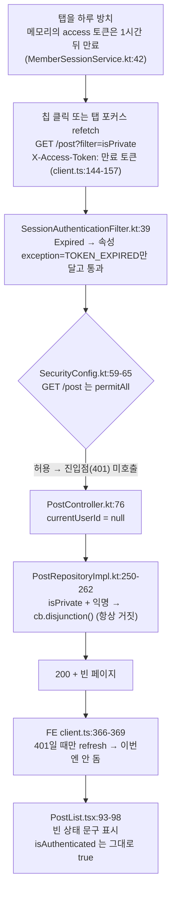
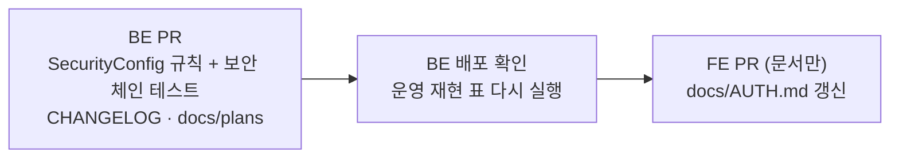

# 피드 "나만 볼 수 있는" 필터가 오래 둔 탭에서 빈 목록으로 뜨는 문제

> 만료된 access 토큰을 달고 온 `GET /post` 계열 요청을 BE가 익명으로 조용히 처리해(200) FE의 토큰 갱신이
> 한 번도 돌지 않는다. 공개 GET 경로에서도 "토큰을 냈는데 유효하지 않으면 401"로 바꿔 기존 FE 갱신 경로에 태운다.

## Context

### 증상

새로고침 없이 하루쯤 둔 `/post` 탭에서 "나만 볼 수 있는" 칩(`?filter=isPrivate`)을 누르면, 비공개 글이 있는데도
"등록된 링크가 없거나 검색 결과가 없어요."가 뜬다. 새로고침하면 정상. 당시 네트워크 응답은 없음.

### 가설

토큰이 만료된 채 요청이 나갔는데 401이 오지 않아 갱신이 안 되고, 익명 결과가 그대로 화면에 그려졌다.

### 재현 절차 (2026-10-20, 운영, 읽기 전용 GET)

| 요청 | 헤더 | 결과 |
| --- | --- | --- |
| `GET /api/post?filter=isPrivate` | 없음 | 200, `content: []` |
| `GET /api/post?filter=isPrivate` | `X-Access-Token: bogus…` | 200, `content: []` (3/3회) |
| `GET /api/auth/account` | `X-Access-Token: bogus…` | 401 `NOT_LOGGED_IN` |

가짜 토큰은 `Invalid` 경로지만 BE 필터에서 `Expired`와 같은 분기(속성만 달고 통과)를 탄다. 실제 만료 토큰으로는
재현하지 못했다(가진 토큰이 없음). 첫 시도 1회만 500(빈 바디)이 나왔고 이후 재현되지 않았다 → "남은 것".

### 근본 원인 (코드 추적)

- FE는 만료를 미리 확인하지 않고 401에만 반응한다(`docs/AUTH.md:190` "사전(proactive) 재검증이 없습니다").
  `docs/AUTH.md:916`의 전제("그 요청이 401을 받으면 인터셉터가 조용히 refresh")가 **공개 GET 경로에서는 성립하지 않는다**.
- 새로고침하면 `useAppInitialization`이 7일짜리 refresh 쿠키로 새 토큰을 받아 정상으로 돌아온다.
- 같은 상태에서 함께 틀어지는 것(추적한 사실): 다른 칩 `isBookmarked`·`isLiked`·`isMyPosts`는 익명이면 조건이
  무시돼(`PostRepositoryImpl.kt:193-249`) **전체 공개 피드**가 뜨고, 기본 피드에서 내 비공개 글이 빠지며, 좋아요·북마크
  표시가 꺼진다. 다른 탭이 refresh를 돌려 이 탭의 토큰이 폐기된 경우(`MemberSessionService.kt:224`)도 같은 경로다.
- 캐시는 원인이 아니다: Spring 캐시 없음, `/api/*` CloudFront는 CachingDisabled(`infra/cloudfront/snapshot.json:135`).

## 판단이 필요했던 항목

| 항목 | 결정 | 근거·기각한 대안 |
| --- | --- | --- |
| 어디서 고치나 | **BE**: 공개 GET 경로에서 "토큰을 냈는데 유효하지 않으면" 401 | FE는 이미 모든 경로의 `TOKEN_EXPIRED`를 갱신·재시도로 처리한다(`client.ts:366-394`, `client.test.ts` Case 1). 401만 오면 FE 코드 변경 없이 풀린다. 기각: ① FE 사전 갱신(만료 시각 응답 추가 = 계약 변경, 다른 탭의 회전으로 폐기된 토큰은 시각으로 못 잡음) ② 쿼리 키에 인증 상태 추가·갱신 뒤 목록 무효화(만료 토큰 요청 자체가 계속 익명 결과를 만든다) |
| BE 어디에 두나 | `SecurityConfig`의 `GET /post`·`/post/*`·`/post/*/comment` 규칙을 `permitAll()` → "속성 `exception`이 없으면 허용" 규칙으로 | 필터에서 일괄 401로 바꾸면 `/auth/refresh`(만료 토큰을 `X-Access-Token`으로 일부러 받음, `AuthController.kt:79-89`)·`/auth/logout`이 깨진다. 응답이 "누가 보느냐"에 따라 달라지는 경로는 이 셋뿐이라 범위를 여기로 좁힌다. 거부되면 401이 되는 근거: spring-security-web **6.5.7** `ExceptionTranslationFilter.handleAccessDeniedException`이 익명 인증이면 `sendStartAuthentication`(진입점)을 부른다(설치본 jar를 `javap -c`로 확인). 진입점 `CustomAuthenticationEntryPoint.kt:20-26`이 같은 속성을 읽어 `TOKEN_EXPIRED`/`INVALID_TOKEN` 401을 쓴다 — `/auth/account`가 지금 401을 내는 것과 같은 경로 |
| `INVALID_TOKEN`도 401로 | 포함 | 보호 경로와 같은 규칙. 세션 행은 지워지지 않아(`MemberSessionService.kt:211-226`) 실제로는 위조·DB 초기화 때만 생긴다 |
| 표준 근거 | [RFC 6750 §3.1](https://www.rfc-editor.org/rfc/rfc6750#section-3.1) | `invalid_token`을 _"제시된 access 토큰이 만료·폐기·손상됐거나 다른 이유로 유효하지 않음. 리소스는 401로 응답해야 한다(SHOULD). 클라이언트는 새 access 토큰을 요청해 다시 시도할 수 있다"_ (번역)로 정의한다. 이 RFC는 "보호된 리소스" 기준이라 로그인이 선택인 경로를 정확히 다루지는 않는다 — "토큰을 냈으면 그 토큰의 상태를 알려준다"는 논리만 빌린다 |
| access 만료(1시간)의 체감 | 변화 없음 | 401 → FE가 refresh 쿠키로 조용히 갱신 → 재요청(`client.ts:200-305`). 로그인 화면은 refresh까지 실패할 때만 뜬다. 로그인 빈도는 지금과 같다 |
| **refresh도 만료된 경우(로그인 후 7일)의 체감 변화** | **로그인 화면 이동을 받아들임**(2026-10-20 사용자 결정) | refresh 만료는 로그인 시점 기준 고정(`MemberSessionService.kt:180-181`, 회전해도 안 늘어남). 지금은 그 탭이 피드를 익명으로 조용히 보여주고, 좋아요 등을 누를 때 로그인 화면으로 간다. 수정 뒤에는 **피드 재조회 시점에 바로 로그인 화면으로 이동**한다(`AuthUtil.clearAll`). 진짜 비로그인 방문자(토큰 없음)는 영향 없음. 7일 고정 정책 자체는 이번 범위 밖 |

## 세부 계획

### 백엔드 (`link-sphere_BE_NEW`, 워크트리에서)

| 위치 | 변경 내용 |
| --- | --- |
| `global/config/SecurityConfig.kt:59-65` | 세 GET 매처의 `.permitAll()`을 `request.getAttribute("exception") == null`이면 허용하는 `AuthorizationManager`로 교체. 주석에 이유와 `/auth/refresh`를 건드리지 않는 이유를 남긴다 |
| `src/test/.../post/PostSecurityTest.kt` (신규) | 실제 `SecurityConfig`·`SessionAuthenticationFilter`·진입점을 로드하는 첫 테스트(기존 컨트롤러 테스트는 전부 `SecurityFilterChain`을 제외함). `MemberSessionService`·`PostService`는 목. 케이스: ① `Expired` + `GET /post?filter=isPrivate` → 401 `TOKEN_EXPIRED` ② `Invalid` → 401 `INVALID_TOKEN` ③ 토큰 없음 → 200 ④ `Valid` → 200 ⑤ `GET /post/{id}`·`/post/{id}/comment` + `Expired` → 401 ⑥ `POST /auth/refresh` + 만료 `X-Access-Token` → 필터 단계 401 아님(회귀 가드) |
| `CHANGELOG.md` `[Unreleased]` | Fixed 항목 1줄 |
| `docs/plans/2026-10-20-public-get-expired-token-401.md` (신규) | 이 계획 스냅샷 |

### 프론트엔드 (`link-sphere_FE_NEW`, 문서만, BE 배포 뒤)

| 위치 | 변경 내용 |
| --- | --- |
| `docs/AUTH.md` §10 `:916` 근처 | "401을 받으면" 전제가 2026-10-20까지 공개 GET에선 성립하지 않았다는 시행착오 추가 |
| `docs/AUTH.md` §11 항목 2 | "필터가 만료 토큰을 삼킨다"는 그대로지만 공개 GET 3경로는 이제 401이라는 점 반영 |

FE 코드 변경 없음 — 기존 인터셉터가 그대로 처리한다.

## 영향 범위

**CRUD**: 읽기만 바뀐다. 생성·수정·삭제 경로는 원래 `authenticated()`라 변화 없음.

**회귀 가능성**

| 기존 동작 | 소유 파일 | 확인 |
| --- | --- | --- |
| 비로그인 피드·상세·댓글 조회 | `SecurityConfig.kt` | 토큰이 없으면 속성이 없어 허용 — 테스트 ③ |
| refresh의 계정 일치 확인(만료 토큰 헤더) | `AuthController.kt:85-96` | 매처 범위 밖 — 테스트 ⑥ |
| Lambda 워밍업 `GET` | `LambdaHandler.kt:106-117` | 토큰 없이 호출 → 허용 |
| 로그아웃 직후 늦게 도착한 요청 | FE `client.ts`, `AUTH.md:262-265` | 이제 401로 오지만 인증 세대가 바뀐 401은 FE가 조용히 끝낸다(보호 API와 같은 경로) |
| 익명 필터 의미(`isLiked` 등 무시) | BE `PostRepositoryIntegrationTest.kt:57-63` | 진짜 익명 요청은 그대로라 유지 |

**배포 순서**: BE만 배포해도 완결(FE는 이미 401을 처리, 캐시된 옛 FE 번들도 같은 인터셉터). 데이터 계약 변화 없음.

## 검증 방법

1. BE `./gradlew test` — 신규 테스트 6건 포함 전체 통과.
2. BE 배포 성공을 워크플로 run으로 확인.
3. 운영 재현 표 다시 실행: 가짜 토큰 + `GET /api/post?filter=isPrivate`가 401 `INVALID_TOKEN`, 토큰 없음은 200.
4. 브라우저: 로그인한 탭을 1시간 넘게 둔 뒤 "나만 볼 수 있는" 칩 → Network에
   `GET /post 401 → POST /auth/refresh 200 → GET /post 200(비공개 글 표시)` 순서 확인.

## 남은 것

- 첫 재현 시도에서 가짜 토큰 + `GET /post`가 1회 500(빈 바디)을 냈다. 이후 6회는 정상. 원인 미조사(콜드 스타트 의심, 확인 안 됨).
- `isBookmarked`·`isLiked`·`isMyPosts`가 진짜 익명이면 조건을 무시하는 동작은 의도된 것(테스트로 고정)이라 이번 범위 밖.
