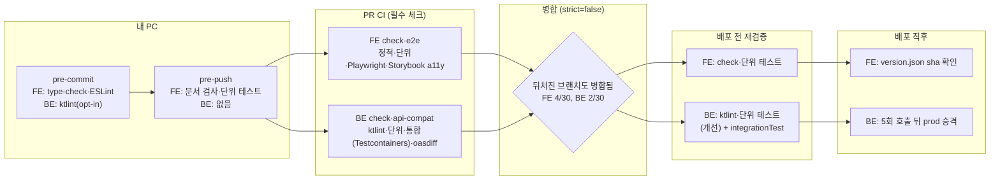

# FE·BE 테스트 프로세스: 공통 원칙 하나 + 레포별 구성

> 업계 표준대로 "원칙은 하나, 테스트 구성과 도구는 레포마다"를 확정한다. 실측으로 드러난 빈틈(BE 배포가
> 통합 테스트 없이 나가는 경로)만 막는다. 진행 전에 지금 구조와 개선 후 구조를 아티팩트로 먼저 보여주고,
> 질문 4개는 근거와 함께 받는다.

## Context

### 왜 하나

사용자가 면접 준비 자료에서 "link-sphere 배포 과정에 테스트 단계가 없음"을 약점으로 적었다. 확인해 보니
FE·BE 모두 배포 전에 테스트가 돈다(FE `deploy.yml:54-58`, BE `deploy.yml:69-70`). 사용자는 이어서 두 가지를
물었다.
- FE와 BE에 어떤 테스트 프로세스를 채용할지, 같게 해도 되는지 따로 해야 하는지
- 업계 표준은 어떤지

사용자는 아키텍처를 익히는 중이라, 결정마다 업계 표준과 우리 구조를 나란히 보여줘야 한다(2026-10-31 요청).

### 업계 표준의 답 (원문 확인)

**원칙과 분류는 하나로 두고, 어느 층에 테스트를 몰지와 도구는 스택마다 다르게 둔다.**

- Microsoft는 테스트 분류(L0~L4)를 조직 전체에 같게 적용한다. 같은 기대치를 모든 팀에 적용하라고 쓴다
  ([shift-left](https://learn.microsoft.com/en-us/devops/develop/shift-left-make-testing-fast-reliable)).
- GitLab은 테스트 단계 문서 한 곳에서 FE(Jest)와 BE(RSpec)를 같은 피라미드로 설명한다
  ([Testing levels](https://docs.gitlab.com/development/testing_guide/testing_levels/)).
- FE는 통합 테스트를 가장 두껍게 둔다(Kent C. Dodds
  [Testing Trophy](https://kentcdodds.com/blog/write-tests), Testing Library
  [원칙](https://testing-library.com/docs/guiding-principles)).
- BE는 단위 테스트를 가장 두껍게 둔다(Google
  [SWE 11장](https://abseil.io/resources/swe-book/html/ch11.html) 80/15/5). 서비스라면 통합 테스트를 두껍게
  두는 모양도 있다(Spotify
  [honeycomb](https://engineering.atspotify.com/2018/01/testing-of-microservices)).
- 공통 규칙: 테스트는 최대한 낮은 층으로 내린다(Fowler·Vocke
  [Practical Test Pyramid](https://martinfowler.com/articles/practical-test-pyramid.html)).

### 우리 상태 (조사로 확인)

- **공통 원칙은 이미 있다.** claude-base `CLAUDE.md:47-61` `## 테스트` 8개 항목(도구 이름 없음, 2026-10-13
  3라운드에서 결정, 6라운드에 세션 연결 예정).
- **레포별 구성도 문서로 있다.** FE `docs/TESTING.md:134-186`, BE `docs/BE-ARCHITECTURE.md:599-613`.
- FE는 트로피 모양이다. 정적 검사, Vitest + RTL + MSW 1,605개, Playwright 67 spec, Storybook a11y가 있다.
- BE는 피라미드 모양이다. ktlint·ArchUnit, Mockito 345개, `@WebMvcTest` 69개, Testcontainers 38개가 있다.
- 두 레포의 계약은 OpenAPI가 잇는다. FE는 codegen과 drift cron, BE는 `api-compat`(oasdiff)를 쓴다.

### 실측으로 드러난 빈틈

- 두 레포 규칙셋 모두 `strict_required_status_checks_policy: false`다(`gh api …/rules/branches/main`). 그래서
  뒤처진 브랜치에서 통과한 결과로도 병합된다.
  - GitHub 문서는 이 모드에 대해 _"브랜치를 병합한 뒤, 기준 브랜치와 호환되지 않는 변경이 있으면 상태 검사가
    실패할 수 있다"_ 고 쓴다(번역,
    [About protected branches](https://docs.github.com/en/repositories/configuring-branches-and-merges-in-your-repository/managing-protected-branches/about-protected-branches)).
- BE 최근 병합 30개 중 2개(#117, #119)가 그렇게 병합됐다. #119는 `build.gradle.kts` 의존성을 1.44.2→2.2.0으로
  올렸다. 그런데 BE `deploy.yml`은 `integrationTest`를 돌리지 않아, 통합 테스트 없이 배포됐다.
  - 측정 방법: PR head SHA의 마지막 CI 실행과 병합 사이에 끼어든 main 커밋을 셌다. 서브에이전트 측정이다.
- FE는 4/30(#437, #438, #440, #447)이다. FE 배포는 단위 테스트를 다시 돌리지만 e2e는 다시 돌리지 않는다.
- 업계 표준 해법인 merge queue는 우리 레포에서 쓸 수 없다. _"merge queue는 조직이 소유한 공개 저장소, 또는
  GitHub Enterprise Cloud를 쓰는 조직의 비공개 저장소에서 쓸 수 있다"_ (번역,
  [Managing a merge queue](https://docs.github.com/en/repositories/configuring-branches-and-merges-in-your-repository/configuring-pull-request-merges/managing-a-merge-queue)).
  두 레포는 개인(User) 소유 공개 저장소다(`gh api repos/BAECHAN/…` `owner.type: User`).

### 전체 흐름 (지금 → 개선 후)

## 판단이 필요했던 항목

### 사용자 결정 대기 (아티팩트에서 근거를 본 뒤 답을 받는다)

| 항목 | 추천 | 근거·기각한 대안 |
| --- | --- | --- |
| Q1. 결정 기록 위치 | FE `docs/TESTING.md`에 "FE·BE 테스트 구성" 절 + BE `BE-ARCHITECTURE.md` §8에서 절대 URL로 링크 | GitLab이 FE·BE 테스트 단계를 한 문서에 둔 선례. BE→FE 링크 선례(BE `README.md:475`, `BE-ARCHITECTURE.md:12-13`). claude-base에만 두기: 원격 저장소가 없어 FE·BE 문서가 링크할 수 없고 공개되지 않음. 새 공통 문서: claude-base와 정본이 둘로 갈림 |
| Q2. BE 배포에 `integrationTest` | 추가 | 실측 2/30 노출. 비용은 BE CI 5회 실측 24.7~40.8초(배포 4분 11초~5분 2초의 약 10~15%). merge queue는 개인 소유라 불가. strict 켜기: 병합 전 매번 rebase하고 CI를 다시 돌려야 하고(Dependabot PR 포함), 그래도 배포 시점 검증은 아님. 유지: 2026-10-26 판단(`BE-ARCHITECTURE.md:750-752`)이 실측 전 결론이었음 |
| Q3. FE 배포에 e2e | 추가 안 함, 재검토 조건을 남김 | e2e 잡 실측 3분 27초(CI run 2026-10-31 06:50:42→06:54:09)로 배포가 거의 두 배. Microsoft는 _"UI 테스트는 불안정하기 쉬우니 쓰지 말라"_ 고 권함(번역). FE e2e는 API를 목으로 대체해 FE 코드끼리의 조합만 검증. 단위 테스트는 이미 배포 때 다시 돈다 |
| Q4. BE 커버리지 | JaCoCo로 레포 밖에서 한 번 측정한 뒤 CI 여부 결정 | Google은 팀이 값을 고르라고 하고 커밋 단위 목표를 권함([Coverage Best Practices](https://testing.googleblog.com/2020/08/code-coverage-best-practices.html)). Fowler는 _"테스트되지 않은 곳을 찾는 도구"_ 로만 씀(번역). JaCoCo는 0.8.13~0.8.15에서 Kotlin 생성 코드 필터를 계속 보강([changes](https://www.jacoco.org/jacoco/trunk/doc/changes.html)), Gradle 내장. Kover는 Beta이고 Kotlin 2.4.21 호환은 확인하지 못함. 바로 CI: 측정 전에 비용(테스트 시간, Mockito 인라인 목과의 충돌)을 모름. FE 뮤테이션 "1회 측정 후 결정" 선례(claude-base `METRICS.md:76`) |

### 뒤집힌 전제

| 발견 | 그래서 바뀐 것 |
| --- | --- |
| 지난 답변의 "FE fix 테스트 동반 59%"는 08-01 이후 값이다. 3라운드 이후(10-14~10-31)는 FE 30/33, BE 10/12이고, 테스트 없던 4건은 모두 테스트로 잡을 수 없는 변경이었다 | "fix인데 테스트 없음" 경고 검사를 계획에서 뺐다 |
| `/fix-bug`·`/code-review`는 로컬 대화 기록 303개(08-31~10-31)에서 호출 0회다 | 두 명령에 테스트 항목을 넣거나 BE로 복사하는 일을 뺐다 |
| 공통 원칙이 claude-base에 이미 있다 | 새 공통 문서를 만들지 않는다. 레포 문서에는 "원칙은 같고 구성이 다른 이유"만 적는다 |
| 지난 답변의 "실제로 문제가 된 기록은 찾지 않았다"는 틀렸다. BE 2/30이 통합 테스트 없이 배포됐다 | Q2를 추천으로 올렸다 |
| merge queue는 개인 소유 레포에서 쓸 수 없다 | 업계 표준 해법 대신 배포 전 재검증으로 막는다 |

### 하지 않는 것

- FE 커버리지 CI 리포트: 뮤테이션 리포트가 바뀐 `.ts`의 "테스트 안 닿음"을 이미 보여준다.
- BE 뮤테이션(PIT): Kotlin은 상용 Arcmutate 플러그인이 필요하다(PIT FAQ). 기존 결정(claude-base
  `DECISIONS.md:58`)을 유지한다.
- 커버리지 목표치 강제: claude-base `## 테스트` "커버리지 비율은 목표가 아니다"를 유지한다.

## 세부 계획

### Phase 0. 아티팩트와 메모리 (plan mode를 벗어난 직후, 레포 변경 없음)

| 위치 | 변경 내용 |
| --- | --- |
| `~/.claude/projects/-Users-baechan-project-link-sphere-link-sphere-FE-NEW/memory/` (신규 `user-learning-architecture.md` + `MEMORY.md` 한 줄) | 사용자는 아키텍처를 익히는 중이다. 설계 설명마다 업계 표준과 우리 구조를 나란히 그림으로 보여주고 근거를 붙인다 |
| scratchpad `test-architecture.html` → Artifact 게시(비공개) | `artifact-design` skill을 먼저 로드한다. ① 업계 모델 3개(피라미드·트로피·허니콤) 그림과 출처 ② 지금 구조: 단계(내 PC→PR→병합→배포→배포 직후) × 층(정적·단위·통합·E2E·계약·스모크), FE·BE 나란히, 필수/정보용 구분 ③ 개선 후 구조: 질문마다 선택지를 바꾸면 그림이 바뀌는 토글 ④ 질문 카드 4개: 용어 풀이 → 선택지별 결과 → 근거(번역 인용·링크·실측) → 추천 ⑤ 용어 사전 |
| 대화 | 아티팩트를 보여준 뒤 AskUserQuestion으로 Q1~Q4를 받는다. 답을 받기 전에는 Phase 1 이후를 시작하지 않는다 |

### Phase 1. BE PR `ci(deploy): 배포 전에도 integrationTest 실행` (Q2 = 추가일 때)

| 위치 | 변경 내용 |
| --- | --- |
| BE `.github/workflows/deploy.yml:69-70` | 스텝 이름과 명령을 `ktlintCheck test integrationTest shadowJar`로(PR CI `ci.yml:60`과 같은 명령) |
| BE `docs/BE-ARCHITECTURE.md:612`, `:750-752` | 배포가 통합 테스트를 돌린다는 서술로 갱신, 위험 후보 항목에 실측(2/30)과 해결을 기록 |
| BE `.claude/CLAUDE.md:340`, `docs/CI-CHECK-GATE.md:140`, `docs/DEPLOY.md:904`, `README.md:429` | 옛 명령(`ktlintCheck test shadowJar`)을 서술한 곳 갱신 |
| BE `docs/plans/2026-10-31-test-process.md` (신규) | 이 계획 스냅샷(§11). Q2가 "유지"면 Phase 2 PR에 커밋 |

### Phase 2. FE 문서 PR `docs(test): FE·BE 테스트 구성과 업계 기준` (Q1 = 추천일 때)

| 위치 | 변경 내용 |
| --- | --- |
| FE `docs/TESTING.md` (신규 절, `:134` "무엇에 테스트를 쓰는가" 앞) | 층 × 단계 표(FE·BE 도구), 원칙은 같고 구성이 다른 이유, 출처 인용(번역), 개수는 적지 않고 종류와 도구만 |
| BE `docs/BE-ARCHITECTURE.md` §8 첫머리 | 위 절로 가는 절대 URL 한 줄(Phase 1과 같은 PR이면 거기서) |
| FE `docs/SYSTEM-ARCHITECTURE.md:145,172` | BE 배포 명령 서술 갱신(Phase 1 병합 뒤, BE `CLAUDE.md:235` 규칙) |

### Phase 3. BE 커버리지 1회 측정 (Q4 = 추천일 때, 레포에 커밋하지 않음)

| 위치 | 변경 내용 |
| --- | --- |
| scratchpad의 BE 임시 클론 | JaCoCo(Gradle 내장)를 붙여 `test integrationTest`를 돌리고 두 실행 데이터를 합친 리포트를 만든다 |
| 대화 + claude-base `docs/METRICS.md` | 계층별 line·branch 커버리지, 테스트 시간 증가, Mockito 충돌 여부를 보고한다. CI에 넣을지는 다시 묻는다 |

## 영향 범위

- **Phase 1 (BE `deploy.yml`)**: 런타임 코드 변경이 없어 CRUD 영향은 없다.
  - 배포가 25~41초 늘어난다.
  - flaky 통합 테스트나 Docker Hub pgvector 이미지 pull 실패가 배포를 막는다. PR CI는 이미 같은 위험을 지고
    있다. 10-14 이후 첫 실행 실패율은 1/52였다(서브에이전트 측정).
  - BE `deploy.yml`에는 실패 알림 잡이 없다(FE에는 `notify-failure`가 있다). 그래서 막히면 사람이 Actions에서
    확인해야 한다.
  - 배포 잡의 Firebase JSON이 `@DataJpaTest` 슬라이스에 영향을 줄지는 확인하지 못했다.
  - 옛 명령을 서술한 문서 6곳은 같은 PR에서 고친다.
- **Phase 2 (문서)**: 코드 영향은 없다. `pnpm check:docs`가 경로와 줄 번호를 검사한다.
- **Phase 3**: 레포 밖에서만 진행한다.

## 검증 방법

- **Phase 0**: 아티팩트를 열어 라이트·다크 모드와 폰 폭에서 그림·토글·인용 링크가 보이는지 확인한다.
  메모리 파일이 `MEMORY.md`에 한 줄로 걸렸는지 확인한다.
- **Phase 1**:
  - 병합 전에 `workflow_dispatch`로 배포하지 않는다(운영 배포가 된다).
  - 병합이 트리거한 `deploy.yml` 실행에서 `> Task :integrationTest`가 찍히는지, gradle 스텝이 약 150~165초인지,
    prod 승격까지 success인지 `gh run watch`로 확인한다.
  - 두 레포 문서에서 `grep -rn 'ktlintCheck test shadowJar'` 결과가 없어야 한다.
- **Phase 2**: `pnpm check:docs`가 통과해야 한다. 링크된 외부 URL을 한 번씩 열어 인용 문장이 원문에 있는지
  확인한다.
- **Phase 3**: 저장소(repository) 클래스의 커버리지가 0이 아니어야 한다(통합 테스트 데이터가 합쳐졌다는 증거).
  테스트 시간이 기준선(test 28~30초, integrationTest 25~41초)과 비교해 얼마나 늘었는지 본다.
- **PR 공통**: §11에 따라 fresh general-purpose 서브에이전트가 계획 대비 구현을 대조하고, PR 본문
  `## 계획 대비 구현`에 남긴다.

## 남은 것

- **FE 배포 e2e**: 재검토 조건은 뒤처진 병합에서 e2e로 잡을 수 있었던 회귀가 실제로 한 번이라도 운영에 나가는
  것이다.
- **strict 모드**: 지금은 끄고 배포 재검증으로 막는다. 협업자가 생기거나 레포가 조직으로 옮겨가면 merge queue를
  다시 본다.
- **커버리지 목표치**: Phase 3 측정 결과를 본 뒤, 변경 줄 기준 목표를 둘지 다시 묻는다(Google 권고와 claude-base
  "목표가 아니다"의 충돌).
- **claude-base `## 테스트` 세션 연결**: 6라운드 일정대로 둔다.
- **FE 뮤테이션 대상 선택 빈틈**: `scripts/mutation-report.js:45-48`의 `.test` → 소스 짝짓기가 시나리오 이름
  테스트 28개(`x.scenario.test.ts`)를 놓친다(서브에이전트 추정, 미확인). 별도 작업으로 확인한다.
- **BE PR 템플릿 문구**: 계획 대조를 "fresh subagent(Explore)"로 적어 FE와 다르다. claude-base 5라운드로 넘긴다.
