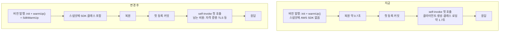
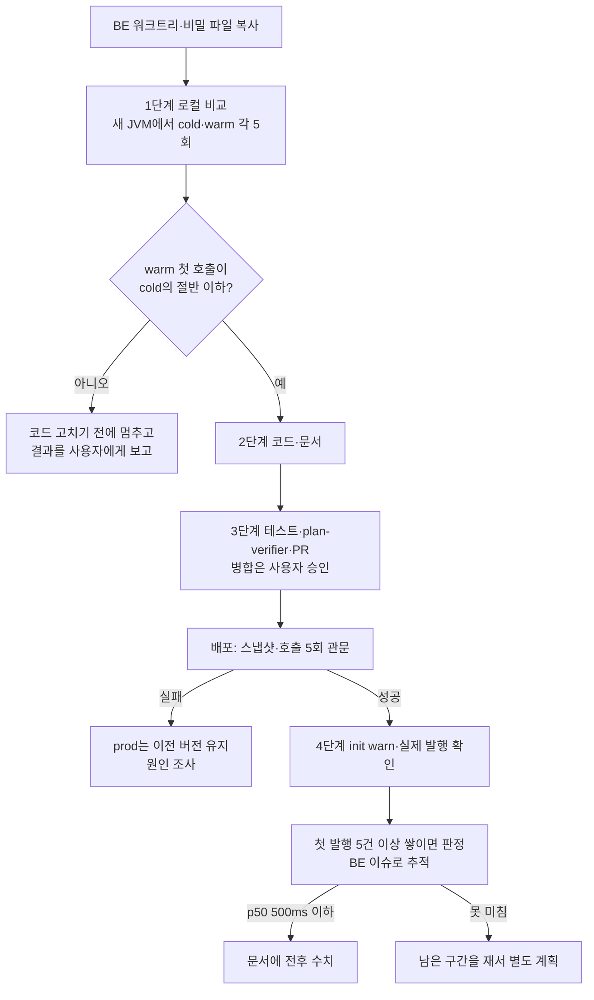

# AWS SDK 첫 호출을 스냅샷 전에 데워 등록 응답 줄이기

<!-- plan-result:start — 이 블록만 병합 뒤에도 고칠 수 있다(CLAUDE.md §11). 아래는 승인된 계획 원문 -->

## 구현 결과

> #166 · 2026-11-05 대조 · 이탈 1 · 미구현 0 — 판정 근거(파일:줄)는 PR 본문 "계획 대비 구현"

- 이탈(구현 중 판단): 1단계 로컬 비교의 `warm`을 `LambdaClient` 하나가 아니라 `LambdaClient`·`SesClient` 두 인자로 돌렸다. 메일을 같이 데우기로 한 사용자 결정에 맞춰 실제 코드와 같게 쟀다. 그래서 `SdkWarmUp` 자체 시간 682ms는 두 클라이언트 몫이다.
- 1단계 결과: 첫 호출 p50이 499ms에서 188ms로 줄어(직접 측정, 새 JVM 각 5회) 기준을 통과했다. 같은 비율이면 운영 첫 발행은 약 650ms라 목표 500ms에 못 미칠 수 있다(단순 환산, 측정 아님).
- 계획에 없던 변경: `docs/PERFORMANCE.md` §4.6에 1단계 결과 표와 위 환산을, §7에 판정에 쓰는 Restore Duration 쿼리를 넣었다.
- 계획에 없던 변경: `docs/DEPLOY.md`와 `docs/BE-ARCHITECTURE.md`에 새 AWS SDK 클라이언트는 `warmUpAwsSdk` 인자에 더한다는 안내를 넣었다. 빠뜨리면 같은 지연이 그 클라이언트에 남기 때문이다.
- 병합 뒤 판정과 후속 문서 정리는 #167에서 추적한다.

<!-- plan-result:end -->

> 복원된 Lambda 인스턴스가 처음으로 작업을 발행하면 약 1.7초가 걸려 댓글·글 등록 응답이 늦어진다. AWS SDK의 공식 API `SdkWarmUp`을 init 단계에서 호출해 그 비용을 스냅샷으로 옮기고, 운영 로그로 효과를 확인한다. BE만 고친다.

## Context

**문제(직접 측정, 2026-11-05, Logs Insights 최근 30일).** 커밋 뒤 위임 로그에서 `작업 발행` 로그까지의 간격이다. 측정 대상은 위임 로그를 찍는 AI·댓글 발행뿐이고, 피드 발행은 빠져 있다.

| 구분 | 인스턴스 첫 발행 | 이후 발행 |
| --- | --- | --- |
| 전체 | n=80, p50 1,713ms, p90 2,007ms, 최대 2,364ms | n=46, p50 42ms, p90 68ms, 최대 83ms |
| 댓글(10-26 이후 JSON 로그만) | n=8, p50 1,928ms, 최대 2,143ms | n=5, p50 61ms, 최대 80ms |
| AI(10-26 이후 JSON 로그만, 봇 글 포함 가능) | n=23, p50 1,426ms, 최대 2,364ms | n=9, p50 41ms, 최대 49ms |

같은 날 댓글 POST의 Lambda Duration은 첫 발행이 낀 요청 2,521ms·2,250ms, 같은 인스턴스의 다음 등록 99ms였다.

**원인(코드 추적 + 추정).** `LambdaSelfInvoker.kt:30-36`의 `LambdaClient`가 `by lazy`라 복원 뒤 첫 호출에서 만들어지고, 그 호출은 커밋 뒤 요청 스레드에서 동기로 돌아 응답을 잡고 있다. 첫 호출과 이후 호출의 차이로 클래스 로딩·초기화가 대부분이라고 추정하지만, 구간별로 재지는 않았다.

**업계 자료.** AWS 문서는 SnapStart에서 이 API를 권한다.

> `SdkWarmUp`은 HTTP 클라이언트를 데우려 네트워크 호출을 1번 하고, 서비스 클라이언트는 로컬의 준비된 응답으로 데운다. AWS 자격 증명이나 IAM 권한이 필요 없고 요금도 들지 않는다. Lambda는 핸들러 생성자가 끝난 뒤 스냅샷을 찍으므로 생성자에서 호출하면 스냅샷이 데워진 클라이언트를 포함한다. (번역, 요약)
>
> — AWS SDK for Java 2.x 개발자 안내서, https://docs.aws.amazon.com/sdk-for-java/latest/developer-guide/sdk-warmup.html

[AWS의 SDK 시작 시간 안내](https://docs.aws.amazon.com/sdk-for-java/latest/developer-guide/lambda-optimize-starttime.html)도 SnapStart의 이점을 온전히 얻으려면 스냅샷 전에 `SdkWarmUp`으로 데우라고 쓴다. [SnapStart 모범 사례](https://docs.aws.amazon.com/lambda/latest/dg/snapstart-best-practices.html)는 지연을 만드는 의존성을 핸들러가 아니라 초기화 코드에서 미리 불러오라고 쓴다. 다만 이 문서들은 일반 안내이고 줄어드는 시간을 약속하지 않는다.

**`SdkWarmUp`이 실제로 하는 일(설치본 2.57.4를 `javap`로 확인).**

- `LambdaWarmUpProvider.warmUpClient`: `CannedResponseHttpClient` + `AnonymousCredentialsProvider` + `endpointOverride("http://localhost")`로 `listEventSourceMappings()`를 로컬에서 돈다.
- `SyncHttpClientWarmer.warmClient`: 발견한 동기 HTTP 클라이언트로 `https://sts.<AWS_REGION>.amazonaws.com/`에 GET 1번. 실패는 debug 로그만 남기고 무시한다. 프로덕션 함수는 VPC 밖이다(`get-function-configuration`).
- `WarmUpDiscovery.runSafely`: `RuntimeException`·`LinkageError`를 잡아 warn(`Warm-up failed for X and was skipped.`)으로 남긴다.
- `lambda`·`ses` 두 jar 모두 `META-INF/services/.../SdkWarmUpProvider`가 있다. fat JAR 병합 누락은 `verifyShadowJar`(`build.gradle.kts:97~`)가 빌드에서 잡는다.

**덮지 못하는 것.** 실제 `invoke` 호출은 돌지 않고, 자격 증명은 anonymous라 실제 체인(복원 뒤 자격 증명 읽기)을 지나지 않으며, 복원 뒤 Lambda API로 가는 새 TLS 연결도 그대로다. 그래서 **얼마나 줄지는 지금 모른다.** 코드를 고치기 전에 로컬에서 먼저 비교한다(세부 계획 1단계).

**전체 흐름**



### 만들 코드

`src/main/kotlin/com/example/linksphere/LambdaHandler.kt`. `warmUp()` 뒤에 한 줄, 함수 하나를 더한다. 실패해도 부팅을 계속하는 형태는 같은 파일의 `warmUp()`을 따른다.

```diff
             mockMvc = builder.build()

             warmUp()
+            warmUpAwsSdk()
         }
```

```kotlin
/**
 * 복원 뒤 첫 self-invoke·메일 발송이 AWS SDK 초기화를 떠안지 않게 스냅샷 전에 데운다.
 *
 * 서비스 호출은 로컬의 준비된 응답으로 돌고 HTTP 클라이언트만 네트워크를 1번 쓴다. 자격 증명·IAM 권한이
 * 필요 없다(https://docs.aws.amazon.com/sdk-for-java/latest/developer-guide/sdk-warmup.html). 실제
 * 클라이언트는 그대로 by lazy라 복원 뒤에 만들어진다. 효과 측정은 docs/PERFORMANCE.md 참고.
 */
private fun warmUpAwsSdk() {
    try {
        SdkWarmUp.warmUp(LambdaClient::class.java, SesClient::class.java)
    } catch (e: Exception) {
        logger.warn("AWS SDK warm-up failed: {}", e.message)
    }
}
```

## 판단이 필요했던 항목

| 항목 | 결정 | 근거·기각한 대안 |
| --- | --- | --- |
| 방법 | `SdkWarmUp` 지정 호출(Claude 제안) | AWS가 SnapStart용으로 문서화한 API이고 코드가 적다. 기각: 인자 없는 `warmUp()` — 비동기 클라이언트까지 데우는데 우리는 비동기를 안 쓴다. `DryRun` 실제 호출 — 자격 증명이 스냅샷에 남을 수 있고 IAM 권한이 필요하다. 발행을 응답 뒤로 — Lambda가 응답 뒤 프로세스를 멈춰 `@Async`를 이미 제거했다(`docs/AI-ASYNC-PROCESSING.md`). outbox·큐 — 인프라가 늘고 알림 시점이 바뀐다 |
| `by lazy` | 유지(Claude 제안) | 실제 클라이언트와 자격 증명을 복원 뒤에 만든다. `SdkWarmUp`은 별도 임시 클라이언트로 돈다 |
| 메일(SES)도 데우기 | 같이 데운다(사용자 결정, 11-05) | 구조가 같고(`MailService.kt:28-36`, `PasswordResetService.kt:87-88`) 인자 하나만 늘며 HTTP 워밍은 클라이언트 종류당 1번이라 네트워크 호출이 늘지 않는다. 대가: 성공 로그가 없어 효과를 잴 수 없다. 기각: self-invoke만 — 첫 메일 요청의 지연이 남는다 |
| 목표 | 첫 발행 p50 1,713ms → 500ms 이하(우리 판단, 외부 기준 아님) | 이후 발행(42ms)까지 내리기는 복원 뒤 새 연결·자격 증명 때문에 어렵다고 봤다 |

### 사용자가 체감하는 변화

| 상황 | 지금 | 바뀐 뒤 |
| --- | --- | --- |
| 복원된 인스턴스의 첫 댓글·글 등록 | 응답이 약 1.7초 더 걸림 | 목표는 0.5초 이하 추가(배포 후 확인) |
| 같은 인스턴스의 이후 등록 | 영향 없음 | 그대로 |
| 복원 시간 | p50 684ms, p90 944ms(직접 측정, 최근 14일 n=499) | 스냅샷이 조금 커질 수 있어 배포 뒤 비교 |

### 위험 관리

- **스냅샷에 소켓이 남을 수 있다.** 워밍 GET의 연결이 keep-alive로 남을 수 있다(추정). `LambdaHandler.kt:43` 주석은 열린 소켓을 체크포인트 실패 원인으로 적어 뒀는데, AWS 문서는 SnapStart 생성자에서 호출하라고 쓰고, 파일 디스크립터 제약은 독립 CRaC 절에서만 말한다. 실제로 어떤지는 배포에서 드러난다.
- **그래도 운영은 안전하다.** `deploy.yml:134-205`는 스냅샷 완성(`published-version-active`)과 새 버전 직접 호출 5회가 통과해야 `prod` alias를 옮긴다. 실패하면 이전 버전이 유지되고 배포가 빨갛게 끝난다.
- **그 관문은 self-invoke를 지나지 않는다.** `GET /api/post`만 부른다. 그래서 배포 뒤 실제 발행의 `statusCode`를 로그로 따로 확인한다.
- **한 배포에 인프라 변경을 섞지 않는다.** `docs/PERFORMANCE.md` §5의 2026-07-25 502 사후 분석 교훈이다.

## 세부 계획



**시작 전.** FE 세션이라 `EnterWorktree`가 안 된다. `git -C <BE> worktree add`로 `origin/main`에서 갈라 BE 비밀 파일을 복사한다(`cross-repo-be-worktree-from-fe-session`).

**1단계 — 로컬 비교(커밋 안 함).** 스크래치패드의 단일 파일 `Bench.java`를 `shadowJar` 결과물 위에서 돌린다. 새 JVM마다 한 번씩, `warm`은 `SdkWarmUp.warmUp(LambdaClient.class)` 뒤에, `cold`는 바로 `LambdaClient`를 만들어 첫 `invoke`의 시간을 잰다. 가짜 자격 증명(`AWS_ACCESS_KEY_ID=test`)이라 AWS가 403으로 거절하고 아무것도 실행되지 않는다. 한계: 노트북은 Lambda가 아니고 복원 뒤 자격 증명 경로를 재현하지 못한다. 그래서 비율만 본다.

**2단계 — 코드·문서**

| 위치 | 변경 내용 |
| --- | --- |
| `LambdaHandler.kt` | 위 "만들 코드" |
| `infra/mail/MailService.kt:28-30`, `infra/aws/LambdaSelfInvoker.kt:30` | `by lazy` 주석에 "SDK 클래스는 `LambdaHandler.warmUpAwsSdk`가 스냅샷 전에 데운다" 추가. `MailService` 주석의 소켓 우려는 배포 결과에 맞춰 고친다 |
| `docs/PERFORMANCE.md` | §4에 SDK 워밍 절(측정·근거·덮지 못하는 것), §7에 첫 발행 측정 쿼리, 마지막 검토 날짜 |
| `docs/DEPLOY.md:84-86,98-113` | init 순서와 워밍업 주의사항에 추가 |
| `docs/BE-ARCHITECTURE.md:623` | `by lazy` 서술에 `SdkWarmUp` 언급 |
| `CHANGELOG.md` | `[Unreleased]` `perf` 항목 |
| `docs/plans/2026-11-05-sdk-warmup.md`(신규) | 이 계획의 스냅샷, `구현 결과` 블록 |

**3단계 — PR.** `./gradlew ktlintCheck test integrationTest shadowJar`(배포와 같은 명령) 통과, `plan-verifier` 대조, PR 열기, 병합은 사용자에게 묻는다.

**4단계 — 병합 뒤.** 아래 "검증 방법"대로 확인하고 BE 이슈로 판정 시점을 남긴다.

## 영향 범위 (§5)

BE는 `pnpm graph`가 없어 grep으로 확인했다. `LambdaHandler`를 불러오는 테스트는 없고(테스트 파일 4곳은 주석 언급), AWS SDK 사용을 제한하는 아키텍처 규칙도 없다. SDK 클라이언트는 `LambdaSelfInvoker`·`MailService` 2곳뿐이다.

**CRUD 실패 지점**

| 동작 | 깨질 수 있는 것 | 대응 |
| --- | --- | --- |
| 등록(글·댓글) | 첫 발행이 실패로 바뀜 | 실제 클라이언트 코드는 안 바뀐다. 배포 뒤 `작업 발행 … statusCode`로 확인 |
| 등록(가입·메일 요청) | 첫 메일 발송 실패 | 실제 클라이언트 코드는 안 바뀐다. 배포 뒤 `[MailService] 발송 실패` 로그가 늘지 않는지 확인 |
| 읽기 | 복원이 느려짐 | Restore Duration을 전후 비교 |
| 수정·삭제 | 해당 없음 | 발행 경로를 지나는 요청만 빨라진다 |
| 멱등성·중복 | 해당 없음 | 워밍은 준비된 응답만 쓰고 운영 함수를 호출하지 않는다 |
| 동시 요청 | `by lazy` 경합 | 그대로다 |

**기존 기능 회귀**

| 대상 | 소유 파일 | 확인 |
| --- | --- | --- |
| 스냅샷 생성 | `LambdaHandler.kt`, `deploy.yml` | 관문 통과, 실패하면 prod 유지 |
| 기존 워밍업 | `LambdaHandler.warmUp()` | 그대로 호출, 경고 로그 없음 |
| HikariCP 체크포인트 | `HikariCheckpointRestoreLifecycle` | 건드리지 않는다. 복원 뒤 DB 요청은 관문 호출 5회가 지난다 |
| fat JAR | `build.gradle.kts`, `verifyShadowJar` | 빌드에서 확인, gradle 변경 없음 |
| 알람 | 안전망 알람(BE #148) | Init·Duration 변화로 오탐이 없는지 배포 뒤 확인 |

**배포 순서.** BE만 바뀌고 API 계약 변경이 없다. FE는 그대로다.

## 검증 방법

- **로컬(1단계):** `warm` 첫 호출 p50이 `cold`의 절반 이하.
- **빌드:** `./gradlew ktlintCheck test integrationTest shadowJar`, `verifyShadowJar` 통과.
- **배포:** run 성공, `prod` alias가 새 버전을 가리킴.
- **init 로그:** 새 버전 로그에 `Warm-up failed`, `No warm-up provider matched`, `AWS SDK warm-up failed`가 0건. HTTP 워밍 실패는 debug라 로그로 안 보이므로 아래 수치로 판단한다.
- **실제 발행:** 새 버전의 `작업 발행 … statusCode`가 정상. 매일 22:00 UTC 무렵 AI 발행이 몰려 사용자 조작 없이 다음 날까지 쌓인다(같은 클라이언트라 AI 수치로 판단 가능).
- **판정:** 새 버전 첫 발행 5건 이상에서 p50 500ms 이하이고 이후 발행이 그대로면 달성(지난 30일 하루 평균 약 2.7건이라 2일 안팎 예상). Restore Duration p50이 684ms에서 200ms 넘게 늘면 득실을 사용자에게 보고한다.
- **되돌리기:** 운영이 나빠지면 `aws lambda update-alias --function-name link-sphere-api --name prod --function-version <직전 버전>`(`docs/DEPLOY.md:1020`), 코드는 PR revert. 데이터 변경이 없어 쉽게 되돌린다.

## 남은 것

- **덮지 못하는 비용:** 복원 뒤 자격 증명 읽기와 새 TLS 연결은 남는다. 목표에 못 미치면 구간 로그로 재고 별도 계획을 세운다.
- **복원 시간 자체:** p50 684ms는 그대로 사용자가 겪는다. 이번 범위가 아니다.
- **첫 발행이 느린 인스턴스의 비율:** AI에는 봇 글이 섞여 있어 사용자 체감 비율은 재지 못했다.
- **메일 쪽 효과:** `MailService`는 실패 때만 로그를 남겨 전후 수치를 낼 수 없다. 측정을 위한 로그는 이번에 넣지 않는다.
