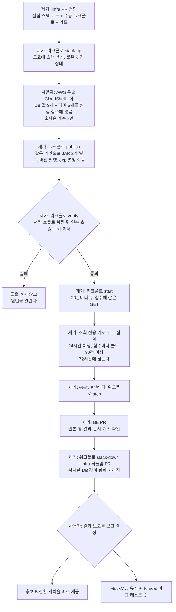

# 운영 요청 경로 비교 Phase 2: 후보 B 콜드 스타트 측정

<!-- plan-result:start — 이 블록만 병합 뒤에도 고칠 수 있다(CLAUDE.md §11). 아래는 승인된 계획 원문 -->

## 구현 결과

> #189 · 2026-11-10 대조 · 이탈 4 · 미구현 0 — 판정 근거(파일:줄)는 PR 본문 "계획 대비 구현"

- 나눠 구현: 실험 스택·`Experiment` 워크플로·가드는 infra #43, 결과 문서·원본 행·`DEPLOY.md`·이 계획 파일은 BE #189에 있다.
- 결과: 함수마다 콜드 205건(205/205 콜드), 콜드 p50은 MockMvc 1,746ms·후보 B 1,713ms로 차이 −33.6ms(허용치 +500ms). 복원 실패·함수 오류·앱 500은 0건이고 시작·끝 `verify`도 통과해 ①~④를 모두 통과했다. 기준과 표본 수는 결과를 본 뒤 바꾸지 않았다.
- 이탈(공개 저장소): 이 파일은 승인된 원문에서 공개 저장소에 없는 이름 4종(권한 경계 상수, 실험 함수 실행 역할, 실험 배포 역할, infra 배포 역할)을 `<…>` 표기로 바꿔 커밋했다. 나머지는 원문과 같다.
- 이탈(범위 좁힘): `verify`의 헤더 비교는 모든 헤더 이름 대신 정해 둔 7개 헤더의 이름과 값만 봤다. 요청마다 달라지는 값을 빼려던 것이다. 목록 밖 헤더가 한쪽에만 있으면 잡지 못한다.
- 이탈(대상 없음): 판정 기간의 룰 호출이 모두 콜드라 웜 p50·p90은 내지 않았다.
- 이탈(확인 수단 없음): S3 `deployments/experiment/` 목록은 조회 전용 키와 실험 배포 역할 모두 목록 권한이 없어 직접 보지 못했다. 대신 JAR을 올린 발행 실행이 한 번뿐이고, 그 실행이 코드 반영 직후 두 JAR을 `aws s3 rm`으로 지운 단계까지 성공한 것(실패하면 멈추는 셸)을 근거로 삼았다.
- 계획에 없던 변경: 판정 기간 경계를 결과 문서에서 정했다(측정 시작 실행이 끝난 시각 ~ 끝 `verify` 시작, 약 68.5시간). 워크플로는 룰을 켜기 전 별칭이 발행 버전인지 확인하고 발행 요약에 코드 크기·SnapStart 상태를 남긴다. 가드에 함수·URL·룰 개수 단언을 더했다. 결과 문서에 Restore·Duration·메모리 분포, 날짜별 건수, 부호 검정, `Set-Cookie` `Expires` 형식 차이, 재현 스크립트를 더했고 CSV에 과금 시간·최대 메모리 열을 더했다.
- 대조 결과 고친 것: 재현 절이 실제로 CSV를 만든 방법(원문을 받아 로컬에서 나눔)과 달랐고 스크립트가 표 일부만 다시 냈다. "같은 수준"이라는 단정을 부호 검정 값(p 0.0502)으로 바꿨다. 실패 검색 범위를 룰을 켠 시각부터로 넓혔고, Boot 4 문장에 출처를 달았다.
- 이 PR 뒤에 할 일: `stack-down`, infra 되돌림 PR, 결과 보고. 끝나면 이 줄을 결과로 바꾼다.

<!-- plan-result:end -->

> MockMvc와 후보 B(serverless-java-container)를 같은 조건의 실험 함수에 올려, 실제 SnapStart에서 콜드 스타트와 복원 뒤 동작을 잰다. 운영 함수·운영 코드는 바꾸지 않는다. 운영을 옮길지는 결과를 본 뒤 따로 정한다.

## Context

**왜 하나.** 사용자가 _"mockmvc는 테스트 제품이잖아 저렇게 냅둬도 되냐"_ 고 물어 비교 실험을 시작했다. Phase 1(BE #180, 로컬 Docker)은 동작을 비교했고, 후보 B가 기대값 실패 0건으로 통과했다. 로컬 에뮬레이터에는 SnapStart가 없어 아래는 아직 모른다.

| 아직 모르는 것 | 왜 중요한가 |
| --- | --- |
| 후보 B의 콜드 스타트 | 지금 콜드 합계 p50은 3,523ms다(2026-07-25 직접 측정, BE `docs/PERFORMANCE.md`). 더 느려지면 사용자가 체감한다 |
| 실제 복원 뒤 연속 호출 | 2026-07의 어댑터 구조는 "첫 요청만 성공"하고 502가 났다. 후보 B는 다른 방식이지만 실제 스냅샷에서 돌려 본 적이 없다 |
| 실제 Function URL의 쿠키·헤더 | 에뮬레이터에는 이 변환이 없다 |

**사용자 결정(2026-11-07):** 구조는 후보 B로 Phase 2, 허용치는 콜드 중앙값 MockMvc 대비 +500ms까지, 복원 실패 0건과 복원 뒤 연속 호출 정상은 별도 필수. 깨진 주소 처리는 #181→#182로 끝나 이번 범위가 아니다.

**콜드 스타트 수치의 정의.** _"콜드 스타트 시간은 `Restore Duration`과 `Duration`의 합이다"_ (번역, [SnapStart 모니터링](https://docs.aws.amazon.com/lambda/latest/dg/snapstart-monitoring.html)). BE `docs/PERFORMANCE.md` §7도 같은 기준이다. `REPORT`에 `Restore Duration`이 있으면 콜드다.

### 전체 흐름



### 만드는 것

```text
EventBridge 룰 rate(20 minutes), 고정 입력 GET /api/post?size=5
   ├──> link-sphere-exp-mockmvc:exp   기준 커밋 a963e6b 그대로
   └──> link-sphere-exp-sjc:exp       기준 커밋 + poc/candidate-b.patch
두 함수 공통: 도쿄, java17, arm64, 2048MB, 120초, SnapStart, Function URL은 AWS_IAM(공개 안 함)
운영 함수 link-sphere-api: 건드리지 않음
```

## 판단이 필요했던 항목

| 항목 | 결정 | 근거·기각한 대안 |
| --- | --- | --- |
| 실험 위치 | 운영 스택과 분리한 스택 `link-sphere-exp`(도쿄) | CloudFormation이 함수를 갱신하면 코드에 없는 환경변수가 지워진다(infra `guards.test.ts`의 T5). 별도 스택은 운영 스택을 안 건드린다. 기각: 운영 함수의 새 버전으로 재기 — `$LATEST`를 바꾸는 동안 다른 세션 BE 배포가 실험 코드를 `prod`로 승격할 수 있다 |
| 비교 대상 코드 | 두 함수 모두 `poc/BASE`(`a963e6b`), B만 `poc/candidate-b.patch`를 더함 | `git diff --stat a963e6b origin/main -- src build.gradle.kts settings.gradle.kts gradle`이 비어 있어 지금 `main`과 소스가 같다(직접 확인). 패치도 Phase 1 그대로라 결과가 그 비교와 이어진다. 기각: 운영 로그와 비교 — §7이 엔드포인트가 섞인 로그 일괄 값을 믿을 수 없다고 쓴다 |
| 측정 요청 | `GET /api/post?size=5`, 쿠키·토큰 없음 | §7의 고정 요청이고 쓰기가 없다. `search`가 없으면 한도 기록을 안 타고(`PostController.getAllPosts`), 조회수는 POST로 분리돼 있다(BE #159). 예약 작업(`@Scheduled`)은 코드에 없고 `tools/*Runner`는 `@Profile`로 막혀 있다 |
| 표본과 기간 | 함수마다 콜드 30건 이상, 최소 24시간, 72시간에 끊는다(Claude 제안) | 시간대 차이를 덮고 §7의 "버전당 10회 이상"보다 넉넉하게 잡았다. 30은 통계 계산으로 정한 값이 아니다. 72시간에 30건이 안 되면 그대로 보고하고 더 잴지 묻는다 |
| 판정 | ① `p50(후보 B) − p50(MockMvc) ≤ 500ms`(사용자 결정) ② 복원 실패·함수 오류 0건 ③ 시작·끝 verify 통과 ④ 앱 500 로그 0건 | ②③은 사용자 결정, ④는 Claude 제안이다. 룰 호출은 비동기라 응답 코드가 안 남아, 빠른 500이 평균을 낮춰도 수치로는 모른다. 그래서 운영 `App5xx` 필터와 같은 조건을 본다. 기간과 건수를 이 표대로 고정해 결과를 본 뒤 기준을 바꾸지 않는다 |
| DB 값 | 운영 앱 계정 3개(`SPRING_DATASOURCE_URL/USERNAME/PASSWORD`)만 복사, 나머지 5개는 더미 | 사용자가 동의한 "운영 환경변수 복사"보다 좁혔다. Phase 1이 `GEMINI_API_KEY`·`YOUTUBE_API_KEY`·`SUPABASE_*` 더미로 부팅됐고 `APP_MAIL_FROM`은 없어도 떴다. 앱과 같은 풀러를 써야 조건이 같다. 쓰기 권한이 복사되는 위험은 "위험 관리"에 적었다. 기각: `adhoc_readonly` — 세션 모드(5432)라 앱과 조건이 다르고 회원 일부 컬럼 권한이 없다. 기각: 세션 수준 읽기 전용 설정 — 6543에서 앱 요청에 남아 쓰기를 500으로 만든 사고가 있다(2026-10-05) |
| 값 복사 방법 | 사용자가 CloudShell에서 1회(사용자 동의함) | infra 규칙이 "스택 안은 PR, 스택 밖은 CloudShell"이다. 값이 AWS 밖으로 나가지 않는다. 기각: 워크플로가 운영 설정을 읽어 복사 — 사용자 일은 없어지지만 실험 역할에 운영 함수 읽기가 생기고 모든 운영 환경변수가 GitHub 러너를 지난다 |
| 코드 올리는 곳 | infra 저장소의 수동 워크플로 `experiment.yml` | BE 저장소가 공개라 토큰 없이 받아 빌드할 수 있어 BE를 고칠 일이 없다. 실험 역할을 infra `main` 전용으로 둘 수 있다. 기각: BE 임시 워크플로 — BE `main`에 임시 파일이 들어갔다 나온다 |
| 호출 방식 | 측정은 룰이 함수를 직접 호출, 확인은 서명한 Function URL 호출 | `REPORT` 수치는 URL 왕복을 포함하지 않아 어느 쪽이든 같다. 운영 워밍 핑과 같은 형태이고 Phase 1의 `l-gate`로 B에서 200을 확인했다 |
| 연속 호출 | 순차 호출만, 동시 호출은 안 함 | 계정 동시 실행 한도 10칸을 운영과 나눠 쓴다(`get-account-settings` 조회, 예약 칸 0). 502 사례도 "연속"이었다 |
| 정리 시점 | 원본 행을 BE에 커밋한 뒤 바로 스택을 지우고 코드도 되돌림 | 복사한 DB 값을 오래 두지 않는다. 다시 재려면 CloudShell이 한 번 더 필요한 비용은 감수한다 |
| 후보 B의 수정 | PoC 패치를 고치지 않음 | `search=a=b`, `/api/post/` 200, 접속 로그는 전환을 정할 때 고칠 항목이다. 콜드 스타트 경로와 무관하다 |
| 계획 파일 위치 | 결과와 함께 BE `docs/plans/`에 커밋 | Phase 1 계획이 거기 있고 infra에는 `docs/plans`가 없다. §11의 "구현과 같은 PR"에서 벗어나므로 `plan-verifier`에 infra PR diff와 BE PR diff를 함께 준다 |

### 뒤집힌 전제

| 발견 | 그래서 바뀐 것 |
| --- | --- |
| 초안은 BE에 임시 워크플로를 뒀다. BE가 공개 저장소다 | infra 워크플로 하나로 모았다. BE 변경은 결과 PR뿐이다 |
| 초안은 환경변수 9개를 복사하려 했다 | DB 3개 + 더미 5개로 줄였다. 쓰지 않는 운영 키가 복사되지 않는다 |
| 초안은 동시 호출도 검토했다. 계정 한도가 10칸이다 | 순차 호출만 한다 |
| 20분 유휴가 콜드를 보장한다는 근거가 없다. §7은 측정 규칙일 뿐이다 | 콜드 비율을 첫날 재고, 표본 기준을 호출 수가 아니라 콜드 건수로 잡았다 |
| `aws lambda update-function-code`·`publish-version` 응답에 환경변수가 들어간다 | 모든 Lambda 명령에 `--query`를 달아 값이 로그에 찍히지 않게 한다. BE `deploy.yml:141-143`의 형태를 따른다 |
| `guards.test.ts`의 알람 검사는 모든 스택을 도는데 알람이 있어야 통과한다 | 이 검사만 운영·시험 스택으로 좁힌다. 가드 자체는 약해지지 않는다 |

### 위험 관리

- **운영 동시 실행:** 20분마다 2칸을 수 초 쓴다. 최근 30일 운영 사용량은 47,566건, 약 5,172초로 평균 동시 실행이 약 0.002다(직접 측정, Logs Insights 2026-11-07). 순간 최대치는 지표 권한이 없어 못 쟀다. `link-sphere-api-throttles`가 울리면 바로 `stop`한다. 알람은 2026-11-02부터 OK다.
- **운영 DB에 쓸 수 있는 값의 복사:** 실험 함수의 코드는 GET 하나만 받는다. Function URL은 `AWS_IAM`이고 호출 권한은 실험 역할에만 준다. 룰 입력은 고정이다. 측정이 끝나면 스택과 함께 지워진다.
- **운영 DB 부하:** 하루 최대 144건의 읽기가 늘어난다. 최근 30일 운영 하루 평균 약 1,585건 대비 약 9%이고 `size=5`다. 함수 인스턴스마다 커넥션 풀 상한은 운영과 같은 5다.
- **운영 알람 오작동 없음:** 세 알람의 대상이 운영 함수와 운영 로그 그룹이라 실험 실패로 울리지 않는다(`baseline-stack.ts:21-33`, 메트릭 필터는 `apiLogGroup`).
- **SnapStart의 드문 호출:** _"SnapStart는 대규모 호출에서 가장 잘 동작한다. 드물게 호출되는 함수는 같은 성능 개선을 얻지 못할 수 있다"_ (번역, [SnapStart 성능](https://docs.aws.amazon.com/lambda/latest/dg/snapstart-best-practices.html)). 그래서 절대값은 운영과 다를 수 있다. 판정은 같은 조건의 두 함수 차이로만 한다. 이 함수들은 Firebase 파일도 없어 FCM이 꺼진 상태다. 이 차이도 두 함수에 같다.
- **환경변수 삭제(T5):** 실험 스택을 갱신해도 함수 속성이 바뀌지 않게 가드로 고정한다. 간격을 바꾸는 PR은 룰만 바꾼다.
- **세션이 끊겨 스택이 남는 경우:** 시작 시각과 끝내는 명령을 BE 이슈에 적고 메모리에 남긴다.

### 비용

| 항목 | 계산 | 결과 |
| --- | --- | --- |
| Lambda 실행 | 2함수 × 72회/일 × 3일 × 약 5초 × 2GB ≈ 4,320 GB-초, 발행 때 초기화 약 240 GB-초(모두 추정) | 운영 30일 10,345 GB-초(직접 측정)를 더해도 무료 범위다. _"무료 사용량에는 월 100만 요청과 40만 GB-초가 포함된다"_ (번역, [Lambda 요금](https://aws.amazon.com/lambda/pricing/)). 무료가 없다고 쳐도 도쿄 Arm 단가 `0.0000133334 USD/GB-초`([공개 가격표](https://pricing.us-east-1.amazonaws.com/offers/v1.0/aws/AWSLambda/current/ap-northeast-1/index.json), 2026-11-07 조회)로 약 0.06달러다 |
| SnapStart | Java는 추가 요금 없음([SnapStart 요금](https://docs.aws.amazon.com/lambda/latest/dg/snapstart.html#snapstart-pricing)) | 0 |
| 로그 | 운영 로그가 30일에 약 30MB다(직접 측정) | _"5GB 데이터(수집, 보관, Logs Insights 스캔)"_ (번역, [CloudWatch 요금](https://aws.amazon.com/cloudwatch/pricing/)) 안이다 |
| S3 | JAR 2개를 올리고 코드 반영 직후 지운다 | 저장 시간이 수 분이라 사실상 0이다(계산 안 함) |
| EventBridge 룰 | 최대 432회 | 일정 룰의 무료 여부는 [요금 페이지](https://aws.amazon.com/eventbridge/pricing/)에서 확인하지 못했다. 그 페이지 예시 단가 백만 건당 1달러를 적용해도 0.001달러 미만이다 |
| GitHub Actions | 비공개 infra 저장소에서 빌드 약 15분(추정) | 남은 무료 분은 `user` 권한이 없어 읽지 못했다. 이 권한은 요청하지 않는다 |

## 세부 계획

### 단계 1 — 실험 스택 코드(infra PR, 제가)

브랜치는 `origin/main`(`de5bd7f`)에서 `exp/cold-start`로 만든다. 운영 스택 템플릿은 그대로여야 한다.

| 위치 | 변경 내용 |
| --- | --- |
| `lib/experiment-stack.ts`(신규) | 아래 코드 |
| `lib/app.ts` | `Experiment` 단계와 스택 추가 |
| `lib/access.ts` | `INFRA_REPO_SUBJECT`에 `export`만 추가(템플릿 변화 없음) |
| `.github/workflows/experiment.yml`(신규) | 수동 실행, `action` 6종 |
| `test/guards.test.ts` | 스택 목록에 추가, 알람 검사 대상 좁힘, 실험 스택 가드 추가 |
| `README.md` | 실험 스택이 임시이며 어떻게 지우는지 한 줄 |

```ts
// lib/experiment-stack.ts: 운영 함수에는 어떤 권한도 주지 않는다.
const REGION = 'ap-northeast-1';
const TARGETS = ['mockmvc', 'sjc'];
const functionArn = (target: string) => `arn:aws:lambda:${REGION}:${ACCOUNT_ID}:function:link-sphere-exp-${target}`;
const INPUT = JSON.stringify({ rawPath: '/api/post', rawQueryString: 'size=5', requestContext: { http: { method: 'GET' } } });

export class ExperimentStack extends Stack {
  constructor(scope: Construct, id: string, props: StackProps) {
    super(scope, id, props);

    PermissionsBoundary.of(this).apply(ManagedPolicy.fromManagedPolicyArn(this, 'CdkBoundary', <권한 경계 ARN>));

    // java 런타임은 생성할 때 실제 zip이 필요하다. 시험 단계와 같은 더미를 쓴다.
    const code = new Asset(this, 'PlaceholderCode', { path: join(__dirname, 'test-function') });

    const functionRole = new CfnRole(this, 'FunctionRole', {
      roleName: '<실험 함수 실행 역할>',
      assumeRolePolicyDocument: policyDocument([
        { Effect: 'Allow', Principal: { Service: 'lambda.amazonaws.com' }, Action: 'sts:AssumeRole' },
      ]),
      // 로그만 쓴다. 메일·S3·자기 호출 권한이 없어 내부 작업이 실수로 돌아도 실패한다.
      policies: [{
        policyName: 'logs',
        policyDocument: policyDocument([{
          Effect: 'Allow',
          Action: ['logs:CreateLogStream', 'logs:PutLogEvents'],
          Resource: `arn:aws:logs:${REGION}:${ACCOUNT_ID}:log-group:/aws/lambda/link-sphere-exp-*:*`,
        }]),
      }],
    });

    for (const target of TARGETS) {
      const prefix = target === 'sjc' ? 'Sjc' : 'MockMvc';
      const logGroup = new CfnLogGroup(this, `${prefix}LogGroup`, {
        logGroupName: `/aws/lambda/link-sphere-exp-${target}`,
        retentionInDays: 14,
      });
      // 운영 함수와 같은 값이다. Environment는 넣지 않는다(CloudShell이 넣는다).
      const fn = new CfnFunction(this, `${prefix}Function`, {
        functionName: `link-sphere-exp-${target}`,
        runtime: 'java17',
        handler: 'com.example.linksphere.LambdaHandler',
        memorySize: 2048,
        timeout: 120,
        architectures: ['arm64'],
        role: functionRole.attrArn,
        snapStart: { applyOn: 'PublishedVersions' },
        code: { s3Bucket: code.s3BucketName, s3Key: code.s3ObjectKey },
      });
      const alias = new CfnAlias(this, `${prefix}Alias`, { functionName: `link-sphere-exp-${target}`, functionVersion: '$LATEST', name: 'exp' });
      const url = new CfnUrl(this, `${prefix}Url`, {
        targetFunctionArn: functionArn(target),
        qualifier: 'exp',
        authType: 'AWS_IAM',
        invokeMode: 'BUFFERED',
      });
      const permission = new CfnPermission(this, `${prefix}RulePermission`, {
        functionName: `${functionArn(target)}:exp`,
        action: 'lambda:InvokeFunction',
        principal: 'events.amazonaws.com',
        sourceArn: `arn:aws:events:${REGION}:${ACCOUNT_ID}:rule/link-sphere-exp-cold`,
      });

      fn.addResourceDependency(functionRole);
      fn.addResourceDependency(logGroup);
      alias.addResourceDependency(fn);
      url.addResourceDependency(alias);
      permission.addResourceDependency(alias);
    }

    // 코드에서는 꺼 둔다. 버전을 발행한 뒤 워크플로가 켠다.
    new CfnRule(this, 'ColdRule', {
      name: 'link-sphere-exp-cold',
      state: 'DISABLED',
      scheduleExpression: 'rate(20 minutes)',
      targets: TARGETS.map((target) => ({ id: target, arn: `${functionArn(target)}:exp`, input: INPUT })),
    });

    // infra main의 수동 워크플로만 맡는다. 운영 함수 ARN이 정책에 없다.
    new CfnRole(this, 'ExperimentDeployRole', {
      roleName: '<실험 배포 역할>',
      maxSessionDuration: 3600,
      assumeRolePolicyDocument: githubTrust(ACCOUNT_ID, `${INFRA_REPO_SUBJECT}:ref:refs/heads/main`),
      policies: [{
        policyName: 'experiment',
        policyDocument: policyDocument([
          {
            Effect: 'Allow',
            Action: ['s3:PutObject', 's3:GetObject', 's3:DeleteObject'],
            Resource: 'arn:aws:s3:::link-sphere-lambda-deploy/deployments/experiment/*',
          },
          {
            Effect: 'Allow',
            Action: [
              'lambda:UpdateFunctionCode', 'lambda:PublishVersion', 'lambda:UpdateAlias', 'lambda:GetAlias',
              'lambda:GetFunction', 'lambda:GetFunctionConfiguration', 'lambda:GetFunctionUrlConfig',
              'lambda:InvokeFunctionUrl', 'lambda:InvokeFunction',
            ],
            Resource: TARGETS.flatMap((target) => [functionArn(target), `${functionArn(target)}:*`]),
          },
          {
            Effect: 'Allow',
            Action: ['events:EnableRule', 'events:DisableRule'],
            Resource: `arn:aws:events:${REGION}:${ACCOUNT_ID}:rule/link-sphere-exp-cold`,
          },
        ]),
      }],
    });
  }
}
```

Function URL 호출 권한은 신원 정책으로 충분하다. _"호출하는 주체가 함수 URL과 같은 계정이면, 신원 기반 정책에 `lambda:InvokeFunctionUrl`과 `lambda:InvokeFunction` 권한이 있거나 함수의 리소스 기반 정책으로 권한을 받아야 한다"_ (번역, [Function URL 접근 제어](https://docs.aws.amazon.com/lambda/latest/dg/urls-auth.html)).

```yaml
# .github/workflows/experiment.yml(요지)
on:
  workflow_dispatch:
    inputs:
      action: { type: choice, options: [stack-up, publish, verify, start, stop, stack-down] }
concurrency: { group: infra-aws, cancel-in-progress: false } # 운영 배포·매일 검사와 겹치지 않는다
# check: deploy.yml의 "병합된 PR의 커밋인지 확인"을 그대로 쓴다
# stack-up / stack-down: <infra 배포 역할>
#   pnpm exec cdk deploy 'Experiment/link-sphere-exp' --require-approval never --no-notices
#   pnpm exec cdk destroy 'Experiment/link-sphere-exp' --force --no-notices  (stop을 먼저 한다)
# publish / verify / start / stop: <실험 배포 역할>
```

```bash
# publish: BE 저장소를 받아 빌드한다. 테스트는 운영 배포가 아니라 뺀다. JDK는 BE deploy.yml과 같은 Corretto 17이고, 비밀 파일을 만들지 않는다.
BASE=$(cat be/scripts/serving-path-experiment/poc/BASE)
cp be/scripts/serving-path-experiment/poc/candidate-b.patch "$RUNNER_TEMP/"
git -C be checkout "$BASE"
(cd be && ./gradlew shadowJar --no-daemon) && cp be/build/libs/*-all.jar "$RUNNER_TEMP/mockmvc.jar"
git -C be apply "$RUNNER_TEMP/candidate-b.patch"
(cd be && ./gradlew shadowJar --no-daemon) && cp be/build/libs/*-all.jar "$RUNNER_TEMP/sjc.jar"

for T in mockmvc sjc; do
  F=link-sphere-exp-$T
  K=deployments/experiment/$GITHUB_RUN_ID-$T.jar
  aws s3 cp "$RUNNER_TEMP/$T.jar" "s3://link-sphere-lambda-deploy/$K" --only-show-errors
  # 응답에 환경변수가 있어 --query 없이 부르지 않는다.
  aws lambda update-function-code --function-name "$F" --s3-bucket link-sphere-lambda-deploy --s3-key "$K" --query LastUpdateStatus --output text
  aws lambda wait function-updated --function-name "$F"
  V=$(aws lambda publish-version --function-name "$F" --description "run-$GITHUB_RUN_ID" --query Version --output text)
  aws lambda wait published-version-active --function-name "$F" --qualifier "$V"
  aws lambda update-alias --function-name "$F" --name exp --function-version "$V" --query AliasVersion --output text
  aws s3 rm "s3://link-sphere-lambda-deploy/$K" --only-show-errors
done
```

```bash
# verify: 함수마다 순차로 부른다. 쓰기 없음(로그아웃은 쿠키가 없으면 revokeByRefreshToken이 바로 돌아간다).
call() { curl -sS --aws-sigv4 "aws:amz:ap-northeast-1:lambda" --user "$AWS_ACCESS_KEY_ID:$AWS_SECRET_ACCESS_KEY" \
  -H "x-amz-security-token: $AWS_SESSION_TOKEN" "$@"; }
# 1) GET /api/post?size=5 를 6번 연속: 모두 200
# 2) GET /api/actuator/health: 200
# 3) POST /api/auth/logout: 200, Set-Cookie에 HttpOnly·Secure·SameSite=Lax
# 4) 응답 헤더 이름과 Vary·Content-Type 값을 두 함수끼리 비교해 요약에 적는다. 본문은 출력하지 않는다.
```

**가드(`test/guards.test.ts`, 실험 스택 전용)**

| 검사 | 막는 실수 |
| --- | --- |
| 템플릿에 `function:link-sphere-api`와 `:prod`가 없다 | 실험이 운영 함수를 건드림 |
| 함수 속성이 고정값과 같고 `Environment`가 없다 | 스택 갱신으로 복사한 값이 지워짐, 비밀값 커밋 |
| Function URL이 전부 `AWS_IAM`이다 | 실험 함수 공개 |
| 함수 실행 역할의 동작이 로그 2개뿐이다 | 실험 함수가 메일·S3·자기 호출을 함 |
| 배포 역할 신뢰가 infra `main`이고 S3는 `deployments/experiment/*`뿐이다 | PR에서 역할을 맡음, 운영 JAR을 건드림 |
| 룰이 `DISABLED`, Retain 없음, 종료 보호 꺼짐 | 코드만으로 측정 시작, 지울 수 없는 스택 |

### 단계 2 — 스택 생성과 값 넣기

| 누가 | 어디서 | 무엇을 | 확인 |
| --- | --- | --- | --- |
| 제가 | GitHub Actions | `gh workflow run experiment.yml -f action=stack-up` | run success, 스택 `CREATE_COMPLETE` |
| 사용자 | AWS 콘솔, 리전 도쿄의 CloudShell | 아래 명령을 붙여 넣는다 | 출력이 `8` 두 줄 |
| 제가 | 로컬 조회 전용 키 | 환경변수 이름 8개만 조회(값은 안 읽음) | 이름이 기대와 같음 |

```bash
export AWS_PAGER=""
R=ap-northeast-1
aws lambda get-function-configuration --function-name link-sphere-api --qualifier prod --region $R --query 'Environment.Variables' --output json \
  | jq '{Variables: ({GEMINI_API_KEY:"experiment-dummy", YOUTUBE_API_KEY:"experiment-dummy", SUPABASE_URL:"http://supabase.invalid", SUPABASE_KEY:"experiment-dummy", SUPABASE_BUCKET:"experiment-dummy"} + {SPRING_DATASOURCE_URL, SPRING_DATASOURCE_USERNAME, SPRING_DATASOURCE_PASSWORD})}' > /tmp/exp-env.json
for F in link-sphere-exp-mockmvc link-sphere-exp-sjc; do
  aws lambda update-function-configuration --function-name $F --region $R --environment file:///tmp/exp-env.json --query 'length(keys(Environment.Variables))' --output text
  aws lambda wait function-updated --function-name $F --region $R
done
rm /tmp/exp-env.json
```

- **왜:** 실험 함수가 실제 DB에 붙어야 콜드 스타트의 DB 연결까지 잰다. 값은 코드와 스택에 넣을 수 없다(T5, 비밀값 금지).
- **안 하면:** 함수가 부팅하지 못해 측정을 시작할 수 없다.
- **출력:** 개수만 나오고 값은 나오지 않는다. `jq`는 CloudShell에 기본 설치돼 있다([CloudShell 환경](https://docs.aws.amazon.com/cloudshell/latest/userguide/vm-specs.html)).

### 단계 3 — 버전 발행과 확인(제가)

`publish` → `verify`. 하나라도 실패하면 룰을 켜지 않고 로그를 읽어 원인을 사용자에게 알린다. 후보 B만 실패하면 그것이 이번 실험의 답일 수 있어 임의로 패치를 고치지 않는다.

### 단계 4 — 측정(제가)

`start` 뒤 조회 전용 키로 읽는다. 첫 날은 콜드 비율을 먼저 보고, 시작 시각과 끝내는 절차를 BE 이슈에 남긴다.

```text
# 콜드 행 전체(단계 5에서 커밋)
filter @type = "REPORT"
| parse @message /Restore Duration: (?<restore>[0-9.]+) ms/
| filter ispresent(restore)
| fields @timestamp, @log, restore, @duration, restore + @duration as cold

# 실패
filter @message like /Status: (error|timeout)|Task timed out|SnapStart\w*Exception/
  or (level = "ERROR" and logger_name = "com.example.linksphere.global.exception.GlobalExceptionHandler")
| stats count() by @log
```

- 웜 호출 p50과 p90은 보고만 하고 판정에 쓰지 않는다.
- 룰 호출과 `REPORT` 수가 맞는지 함께 본다.
- 콜드를 시각으로 짝지어 본 차이도 참고값으로 낸다.

### 단계 5 — 결과와 정리(제가)

| 순서 | 위치 | 변경 내용 |
| --- | --- | --- |
| 1 | GitHub Actions | `verify` 한 번 더, `stop` |
| 2 | BE `scripts/serving-path-experiment/results/<날짜>-cold-start.md`(신규), 같은 이름 `.csv`(신규) | 판정 표, 조건, 콜드 행 원본(시각·대상·수치만) |
| 3 | BE `docs/DEPLOY.md:87` 문단 | "콜드 스타트는 재지 않았다"를 결과로 바꾼다 |
| 4 | BE `docs/plans/2026-11-07-serving-path-cold-start.md`(신규) | 이 계획의 스냅샷, `구현 결과` 블록 |
| 5 | GitHub Actions | `stack-down`, 스택·로그·복사한 값이 사라짐. S3 `deployments/experiment/`가 비었는지 확인 |
| 6 | infra PR | 실험 스택·워크플로·가드 변경을 되돌림. 운영과의 차이 없음 확인 |
| 7 | 대화 | 결과 표와 추천을 보고하고 다음 결정을 묻는다 |

운영 전환은 이 계획에 없다. 전환을 고르면 `search=a=b`, `/api/post/`, 접속 로그, BE `.claude/CLAUDE.md`의 관련 규칙까지 포함한 계획을 따로 세운다.

## 영향 범위 (§5)

BE는 `pnpm graph` 대상이 아니고 공용 파일을 고치지 않는다. infra는 `lib/app.ts`만 공용이다.

**CRUD 실패 지점**

| 동작 | 깨질 수 있는 것 | 대응 |
| --- | --- | --- |
| 등록·수정·삭제 | 실험 함수가 운영 DB 쓰기 권한을 갖는다. 다만 코드 경로에 쓰기가 없다 | 룰 입력 고정, URL `AWS_IAM`, 호출 권한은 실험 역할뿐, 로그인·토큰 요청을 보내지 않음 |
| 읽기 | 하루 최대 144건 추가 | 위 위험 관리 |
| 중복·동시 요청 | 룰이 두 함수를 동시에 부르지만 같은 함수를 겹쳐 부르지 않는다 | 동시 호출을 만들지 않음 |
| cascade·count | 해당 없음 | 쓰기 없음 |

**기존 기능 회귀**

| 대상 | 소유 파일 | 확인 |
| --- | --- | --- |
| 운영 스택 | `lib/baseline-stack.ts`, `lib/config.ts` | 안 고친다. PR CI 요약 "운영과의 차이" 없음 |
| 운영·시험 배포 | infra `deploy.yml` | 스택 선택자 고정이라 실험 스택을 안 건드린다 |
| 매일 드리프트 검사 | infra `drift-check.yml` | `STACK: link-sphere-baseline` 고정이라 실험 스택을 안 본다 |
| 기존 가드 | `test/guards.test.ts` | 운영·시험 검사는 그대로 통과, 알람 검사만 대상 좁힘 |
| CDK 배포 권한 | `lib/access.ts` | `export` 추가뿐, 템플릿 차이 없음 |
| 운영 JAR 저장소 | `link-sphere-lambda-deploy` | 실험 역할은 `deployments/experiment/*`만 접근 |
| 운영 함수·별칭·알람 | 없음 | 안 고친다. 측정 전후 `prod` 버전이 BE 배포 외에 안 바뀌었는지 확인 |
| 이름 충돌 | 없음 | 도쿄 함수는 `link-sphere-api`뿐, 역할 `<실험 함수 실행 역할>` 없음(조회함) |

**배포 순서.** 데이터 계약 변경이 없다. 스택 → 값 → 코드 → 룰 순서를 지켜야 하며, 어긋나면 측정 전에 `verify`에서 실패한다.

## 검증 방법

- **infra PR:** `pnpm type-check`, `pnpm test`, `pnpm synth`, CI "운영과의 차이" 없음, Deploy의 `deploy-prod` success.
- **값:** CloudShell 출력 `8`, 로컬에서 이름 8개 조회. Actions 로그에 환경변수 값이 없는지 run 로그를 검색한다.
- **동작:** 시작·끝 `verify`에서 두 함수 모두 연속 6회 200, 헬스 200, 로그아웃 `Set-Cookie` 속성 일치.
- **측정 유효성:** 룰 호출 수와 `REPORT` 수 일치, 두 함수의 코드 크기로 서로 다른 JAR인지 확인(`CodeSize`), MockMvc 함수의 `REPORT`가 `Restore Duration`을 내는지 확인. 후보 B 패치가 실제로 적용됐는지는 `LambdaHandler` 로그가 아니라 JAR에 `aws-serverless-java-container` 클래스가 있는지로 확인한다.
- **PR 전:** `plan-verifier`로 계획과 infra·BE diff를 대조하고 BE 본문에 `## 계획 대비 구현`을 쓴다. `node <FE>/scripts/check-pr-body.js <파일>`로 필수 절을 확인한다.
- **정리:** 스택 없음, 역할 없음, S3 접두어 비어 있음, infra `main`에 실험 코드 없음, 운영과의 차이 없음.

## 남은 것

- **CloudFront를 지난 값:** 실험 함수에 CloudFront가 없어 못 잰다. 전환을 정하면 그 계획에서 시험 방법을 정한다.
- **내부 작업 6종의 실제 동작:** 실험 역할에 권한이 없어 이번에 돌리지 않는다. Phase 1에서 분기 도달까지만 확인했다.
- **운영 트래픽 아래의 콜드 스타트:** 드문 호출의 절대값이라 운영과 같다고 말할 수 없다.
- **Spring Boot 4 이동:** 후보 B는 3.x 라인으로 옮겨야 한다. 이번에 옮기지 않고 전환 계획에 적는다.
- **사용자 몫:** CloudShell 1회뿐이다(동의함). 위 명령과 확인 방법대로다.
