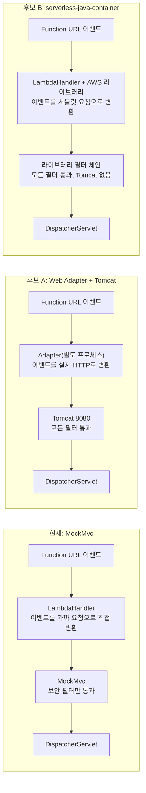
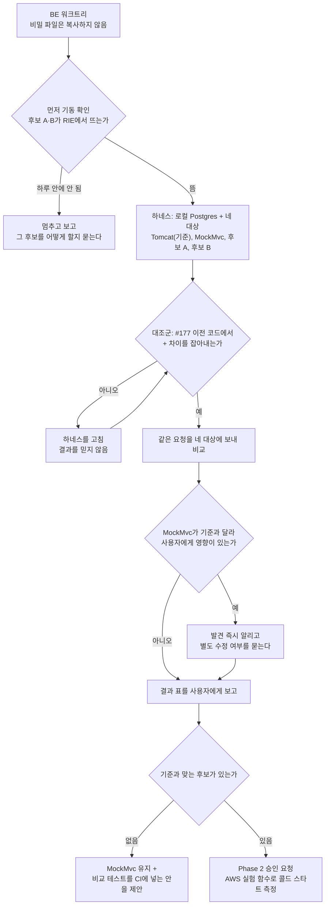

# 운영 요청 경로 비교 실험: MockMvc·Web Adapter + Tomcat·serverless-java-container

<!-- plan-result:start — 이 블록만 병합 뒤에도 고칠 수 있다(CLAUDE.md §11). 아래는 승인된 계획 원문 -->

## 구현 결과

> #180 · 2026-11-07 대조 · 이탈 4 · 미구현 2(둘 다 보완함) — 판정 근거(파일:줄)는 PR 본문 "계획 대비 구현"

- 이탈(단순화): 대상별 Dockerfile을 만들지 않고 Lambda 기본 이미지에 빌드 결과를 볼륨으로 붙였다. `images/`에는 후보 A의 `bootstrap`·`run.sh`만 있다.
- 이탈(대상 없음): 204 빈 본문 항목을 넣지 않았다. 204를 내는 API가 코드에 없어 빈 data 응답(200)으로 대신 봤다.
- 이탈(대응값 없음): Lambda 전용 15개는 Tomcat에 대응값이 없어 MockMvc를 기준으로 비교했다.
- 이탈(불필요): ID는 정규화하지 않았다. 시드 ID가 고정이라 차이가 나지 않았다.
- 미구현 → 보완함: 기대값의 근거가 3개 항목에만 있어, 기대값이 있는 항목 모두에 근거를 적고 결과에 출력했다.
- 미구현 → 보완함: 내부 작업의 서비스 도달을 응답만으로 보던 4종을 로그 표식과 함수 실패로 확인했다. 6종 모두 세 경로에서 도달했다.
- 계획에 없던 변경: 요청 26개 추가, DB 복구 측정과 DNS 원인 추적, 운영 로그 Logs Insights 읽기(쓰기 없음), 후보 A의 `--server.address=127.0.0.1`, 표기 차이 외 비교 정규화, 다른 JSON 경로 출력.
- 대조 결과 고친 것: 결과 문서의 단정 문장과 사실 오류(후보 A의 OpenAPI에 내부 경로 3개가 추가된다는 누락 포함)를 고쳤다.

<!-- plan-result:end -->

> 운영 요청이 테스트 도구 MockMvc를 지나는 구조를 바꿀지 근거로 정한다. 먼저 로컬 Docker에서 세 경로의 응답을 표준 Tomcat과 비교한다(Phase 1). 통과한 후보가 있을 때만 다시 승인을 받아 AWS에서 콜드 스타트를 잰다(Phase 2). 이 계획으로 승인받는 범위는 Phase 1이고, 운영 코드·설정은 바꾸지 않는다.

## Context

**왜 하나.** 사용자가 _"mockmvc는 테스트 제품이잖아 저렇게 냅둬도 되냐"_ 고 물었고, 조사 중 운영 버그를 찾았다(BE #177, 직접 측정).

| 검색어 | 수정 전 `+` | 수정 전 `%20` | 수정 후 `+` |
| --- | --- | --- | --- |
| Spring Boot | 1건 | 5건 | 5건 |
| 리액트 성능 | 4건 | 20건(요청 상한) | 20건 |

원인은 MockMvc가 서버와 다르게 동작한 것이다. 같은 부류로 `Vary` 첫 값만 전달(#121), HSTS 누락(#40)이 이미 있었다. 로컬 `bootRun`은 Tomcat이라 이런 차이가 개발 중에 드러나지 않는다.

Spring 문서는 차이를 이렇게 쓴다. _"기본으로 컨텍스트 경로가 없고, `jsessionid` 쿠키도 없으며, forward·error·async 디스패치도 없다"_ (번역, [MockMvc 문서](https://docs.spring.io/spring-framework/reference/testing/mockmvc/vs-end-to-end-integration-tests.html)).

**아직 모르는 것.** 남은 차이가 얼마나 있는지, 후보로 옮기면 동작이 정말 맞아지는지, 콜드 스타트가 얼마나 달라지는지 모른다. "Tomcat이면 빨라진다"는 근거가 없다. 지금 운영의 콜드 스타트 최적화(`warmUp`, 2026-07-25 `v43→v44` 첫 요청 −53%, 직접 측정)는 MockMvc 경로 위에서 만든 것이다.

### 세 구조



- **Web Adapter:** AWS가 유지하는 [aws-lambda-web-adapter](https://github.com/aws/aws-lambda-web-adapter). 일반 웹 서버를 Lambda에서 돌리게 이벤트를 HTTP로 바꿔 준다.
- **serverless-java-container:** AWS가 유지하는 [Java 라이브러리](https://github.com/aws/serverless-java-container). 포트 없이 서블릿 요청 객체를 만들어 넘긴다.
- **RIE(Runtime Interface Emulator):** AWS Lambda 기본 이미지에 든 로컬 에뮬레이터. 이번 로컬 실험의 실행 환경이다.

### 지금까지 확인한 사실(소스·문서를 읽음, 실행은 안 함)

| 항목 | 현재 MockMvc | A: Web Adapter v1.1.0 | B: serverless-java-container 2.1.7 |
| --- | --- | --- | --- |
| 쿼리 `+` | 우리가 직접 변환(#177) | Tomcat 표준 | `URLDecoder`로 공백 처리(`AwsHttpServletRequest:934-940`) |
| 필터 | 보안 필터만(`LambdaHandler.kt:111-113`) | Tomcat이 전부 실행 | `ServletContextInitializer` 전부 실행(`ServerlessServletEmbeddedServerFactory`) |
| 응답 쿠키 | 자체 변환으로 `cookies` 배열 | 실험에서 확인 | `AwsProxyResponse`에 `cookies` 필드가 없어 변환 코드가 필요 |
| 내부 작업 6종 | 핸들러 분기 | `POST` 하나로 전달(`lib.rs:1549`), 앱에 HTTP 경로가 새로 생겨 외부 차단 필요 | 핸들러 분기 유지 |
| SnapStart 전후 처리 | Java 런타임이 CRaC로 처리 | _"앱은 SnapStart 수명 주기에 직접 접근하지 못한다"_ (번역, [어댑터 문서](https://github.com/aws/aws-lambda-web-adapter/blob/v1.1.0/docs/guide/src/features/snapstart.md)), HTTP 훅 2개 필요 | 변화 없을 것으로 예상(Java 런타임 유지) |
| 복원 단계 제한 | 10초(세 경로 공통, Lambda의 제한으로 어댑터 문서가 서술) | 같은 10초 안에 복원 훅과 앱 준비 확인까지 끝내야 함 | 같은 10초 |
| 내부 작업 실패 | 함수 실패로 끝나 `Errors` 알람이 울리고 비동기 호출이 재시도됨(`docs/TRAFFIC-MANAGEMENT.md`) | 기본은 500 응답이라 함수 성공으로 끝남. 알람·재시도가 사라짐. `AWS_LWA_ERROR_STATUS_CODES`는 상태 코드 단위로만 바꿈 | 핸들러 분기 유지라 변화 없음 |
| 인증 필터의 DB 예외 | 함수 실패, `Errors` 알람 | 응답으로 끝날 것으로 예상, `App5xx`에도 안 잡힐 수 있음 | 기본은 라이브러리가 오류 응답으로 바꿈(`LambdaContainerHandler:224-238`). `setDisableExceptionMapper(true)`로 함수 실패 유지 가능 |
| DB 없이 기동 | 워밍업이 실패해도 부팅 계속(`LambdaHandler.kt` 주석) | 준비 확인을 `/actuator/health`로 하면 DB 헬스가 포함돼 503, 초기화·복원 실패. TCP 확인으로 바꿔야 함 | 실행으로 확인 |
| 워밍업 | 그대로 | 체크포인트 전 훅에서 실제 HTTP로 다시 구성 | 가짜 이벤트로 유지 |
| 8080 리스닝 소켓 | 없음(#121에서 제거) | 다시 열림 | 없음 |
| `spring-test`의 운영 포함 | 포함 | 뺄 수 있음 | 뺄 수 있음 |
| 우리 버전과의 호환 | 해당 없음 | 앱 버전과 무관 | Boot 3.5.8·Spring 6.2.8로 빌드됨(우리는 3.5.16·6.2.19), 실행 확인 필요 |

**응답 형식의 기준.** AWS 문서의 Function URL 응답 필드는 `statusCode`·`headers`·`body`·`cookies`·`isBase64Encoded`이고, _"`set-cookie` 헤더를 직접 넣지 말고 응답 페이로드의 `cookies`에 넣는다"_ (번역, [Function URL 호출 문서](https://docs.aws.amazon.com/lambda/latest/dg/urls-invocation.html))고 쓴다. `multiValueHeaders`는 문서에 없다.

### 전체 흐름



## 판단이 필요했던 항목

| 항목 | 결정 | 근거·기각한 대안 |
| --- | --- | --- |
| 비교 기준 | 기본은 같은 코드를 Tomcat으로 띄운 응답. 운영 요구가 따로 있는 항목은 기대값을 적어 그것으로 판정(Claude 제안) | 서블릿 컨테이너 표준 동작이 목표다. 다만 Tomcat과 같다고 다 맞는 것은 아니다. HSTS는 HTTPS 요청에만 붙고, 오류 본문은 FE가 읽는 `code`가 있어야 하며, Lambda 전용 항목은 Tomcat에 대응값이 없다. 기각: 현재 운영을 기준으로 삼기 — MockMvc의 버그까지 정답이 된다 |
| 순서 | 동작 비교 먼저, 콜드 스타트 나중(Claude 제안) | 동작이 안 맞는 후보는 잴 이유가 없다. AWS 쓰기는 2026-11-06부터 로컬 키로 못 해 사용자 작업이 생기므로, 후보가 확정된 뒤로 미룬다 |
| 후보 | Web Adapter + Tomcat, serverless-java-container 2.1.7 | 사용자가 Tomcat 복귀를 물었고, 둘 다 AWS가 유지한다. 2.1.x가 Boot 3.x 라인이다(저장소 README). 기각: `SpringDelegatingLambdaContainerHandler` — 범용 핸들러라 내부 작업 분기를 넣을 자리가 없어 `getHttpApiV2ProxyHandler`를 쓴다 |
| 결과 선택지 | "MockMvc 유지 + 실제 Tomcat과 비교하는 테스트"도 후보로 둔다 | 옮기지 않아도 같은 부류의 버그를 CI에서 잡을 수 있다. 어느 쪽이 나은지는 결과를 본 뒤 묻는다 |
| 실행 환경 | `public.ecr.aws/lambda/java:17`(arm64 있음)의 RIE(Claude 제안) | 실제 Java 런타임과 핸들러를 그대로 탄다. 기각: JVM 안 테스트 — `LambdaHandler` init이 `sslmode=require`를 고정하고, 어댑터는 Rust 프로세스라 못 넣는다. 기각: `sam local` — 설치만 늘고 같은 RIE를 쓴다 |
| DB·비밀 | 로컬 `pgvector/pgvector:pg17` + 운영 덤프 스키마(`src/test/resources/db/schema.sql`) + 더미 시드. 비밀 파일을 복사하지 않는다(Claude 제안) | `shadowJar`가 `src/main/resources`를 담으므로, 복사하지 않아야 실험 이미지가 운영에 닿을 수 없다. Postgres는 `sslmode=require` 때문에 TLS를 켠다 |
| 어댑터 입수 | 공개 이미지 `public.ecr.aws/awsguru/aws-lambda-adapter:1.1.0` | README가 레이어 30과 함께 안내하는 버전이다. 레이어 직접 조회(`GetLayerVersionByArn`)는 로컬 키에 거부됐고, 권한을 늘리지 않는다 |
| 응답 판정 | AWS 문서의 응답 필드만 유효로 본다 | 문서에 없는 `multiValueHeaders`로만 나간 값은 사용자에게 안 간다고 친다 |
| PoC 코드 | `main`에 병합하지 않고 패치 파일로 남긴다 | 결정 전에 운영 코드를 바꾸지 않는다. 형태는 `scripts/pagination-experiment/`(실행 스크립트 + `results/<날짜>.md`)를 따른다 |
| 콜드 스타트 허용치 | Phase 1 보고 때 사용자에게 묻는다 | 측정 전에 정해야 결과에 맞춘 해석을 막는다. Phase 1은 콜드 스타트를 재지 않으므로 그때 물어도 늦지 않다 |

### 뒤집힌 전제

| 발견 | 그래서 바뀐 것 |
| --- | --- |
| 제가 MockMvc 문제의 예로 든 "201 `Location` 경로 오류"는 `fromCurrentRequest`가 코드 이력에 없고 `Location`을 만드는 코드도 없다 | 근거에서 뺀다. BE `docs/BE-ARCHITECTURE.md`의 서술을 고친다 |
| 7월 502 때 어댑터는 `AWS_LAMBDA_EXEC_WRAPPER` 없이 떠 있었다(`docs/PERFORMANCE.md` 5장). 정식 방식은 어댑터가 앱을 별도 프로세스로 띄우고, 앱이 수명 주기를 직접 받지 못한다 | "7월 구조로 되돌리기"가 아니다. HikariCP 정리를 HTTP 훅으로 옮겨야 한다. 502의 원인은 같은 문서 안에서 "프록시했다"와 "폴링만 했다"가 어긋나 미확정이고, 재발하지 않는다고 말할 근거가 없다. 복원 뒤 연속 호출을 Phase 2 통과 조건으로 둔다 |
| 후보 A는 기본 설정으로 내부 작업 실패가 함수 실패가 아니게 된다 | 재시도·알람이 사라지는 것을 응답 비교만으로는 못 본다. 함수 성공·실패와 알람 조건까지 판정한다 |
| 어댑터가 `x-amzn-request-context`를 항상 덮어쓴다(`lib.rs:1591-1596`) | 내부 작업 경로의 외부 차단 후보가 생겼다. 실험 항목에 넣어 검증한다 |
| 로컬 키가 2026-11-06부터 조회 전용이다 | AWS 쓰기가 필요한 Phase 2는 infra PR과 CloudShell을 쓴다. Phase 1을 AWS 없이 설계했다 |

### 위험 관리

- **운영 영향 없음:** Phase 1은 AWS 쓰기 0건, 운영 DB 접속 0건이다. 운영 사이트로 요청도 보내지 않는다.
- **에뮬레이터의 한계:** RIE에는 SnapStart와 Function URL 변환이 없다. 그래서 콜드 스타트 결론을 내지 않고, 실제 HTTP 응답 확인은 Phase 2로 넘긴다.
- **RIE에서 후보가 안 뜰 수 있다:** 이미 아는 걸림돌이 셋이다. RIE와 Tomcat이 둘 다 8080을 쓰고(어댑터 문서), 공개 이미지에 `/opt/bootstrap`이 없을 수 있으며(저장소 `layer/bootstrap` 복사), 시작 클래스는 `LinkSphereBeApplicationKt`다. 그래서 하네스보다 기동 확인을 먼저 한다. 하루 안에 안 되면 멈추고, 그 후보를 빼거나 AWS에서 볼지 묻는다. "통과한 후보만 Phase 2" 원칙이 있어 임의로 넘기지 않는다.
- **도달하지 않는 입력:** AWS 문서는 `rawQueryString`의 문자를 제한한다. 운영에 도달할 수 없는 입력의 차이는 결과 표에 "도달 안 함"으로 따로 표시해 판단을 흐리지 않게 한다.
- **SnapStart 훅은 RIE에서 안 불린다:** 후보 A의 체크포인트 전·복원 뒤 훅은 컨테이너 안에서 직접 호출해 흐름만 확인한다. 실제 스냅샷 동작은 Phase 2까지 모른다.

## 세부 계획

### Phase 1 — 로컬 동작 비교(이번 승인 범위, BE)

브랜치는 `origin/main`에서 `exp/serving-path`로 만든다. FE 세션이라 `git -C <BE> worktree add`를 쓰고, 비밀 파일은 이번만 복사하지 않는다.

| 위치 | 변경 내용 |
| --- | --- |
| `scripts/serving-path-experiment/run.sh`(신규) | 컨테이너를 띄우고 대조군·네 대상을 차례로 실행해 결과를 낸다 |
| `scripts/serving-path-experiment/compare.py`(신규) | 표준 라이브러리만 쓴다. Function URL 이벤트를 만들어 RIE에 보내고 Tomcat에는 HTTP로 보내 비교한다 |
| `scripts/serving-path-experiment/requests.json`(신규) | 아래 요청 목록 |
| `scripts/serving-path-experiment/seed.sql`(신규) | 더미 회원·글·카테고리. 실제 값 없음 |
| `scripts/serving-path-experiment/images/`(신규) | 대상별 Dockerfile·`run.sh` |
| `scripts/serving-path-experiment/poc/*.patch`(신규) | 후보 A·B의 PoC 패치와 기준 커밋 |
| `scripts/serving-path-experiment/results/<날짜>.md`(신규) | 결과 원본 |
| `docs/DEPLOY.md` "MockMvc 방식을 사용하는 이유" | 실험 결과 링크와 요약 |
| `docs/BE-ARCHITECTURE.md:864` | 없는 `Location` 서술을 지운다 |
| `docs/plans/2026-11-07-serving-path-comparison.md`(신규) | 이 계획의 스냅샷, `구현 결과` 블록 |

**비교 요청(요청 목록의 묶음)**

| 묶음 | 항목 |
| --- | --- |
| 쿼리 | `+`, `%20`, `%2B`, 같은 키 반복, 값 없는 키, 빈 값, 값 안의 `=`, 인코딩된 한글, 깨진 `%ZZ`, `[`·`\|` |
| 경로 | 없는 경로의 404 본문, 끝 슬래시, `%2F`, `;jsessionid=`, `/api` 단독, `/api` 밖 경로 |
| 메서드·본문 | 405, CORS 사전 요청, `HEAD`, 깨진 JSON, 415, 한글 JSON, base64 본문, 빈 본문 |
| 쿠키·인증 | `cookies` 배열 여러 개, 깨진 쿠키, 따옴표 값, 잘못된 토큰 401, 로그인·갱신·로그아웃의 `Set-Cookie`, `CloudFront-Viewer-Address`로 도는 IP 한도 |
| 응답 | `Vary` 여러 값, HSTS, `Content-Type` charset, 한글 본문, 204 빈 본문, 오류 본문의 `code` |
| 큰 요청 | 헤더 합계 약 7.5KB·9KB(Tomcat 기본 한도 8KB 전후, 후보 A는 어댑터 헤더 2개가 더 붙음), WAF 한도 안의 큰 본문 |
| DB 중단 | DB를 끈 채 기동, 토큰이 있는 요청의 필터 예외, 내부 작업 실패. 응답과 함께 함수 성공·실패를 판정 |
| Lambda 전용 | 워밍 핑·배포 관문의 최소 이벤트, 내부 작업 6종의 분기 도달, 외부 요청의 내부 경로 차단, 로그의 요청 ID, 로그의 이메일 가림 |
| 후보 A 훅 | 컨테이너 안에서 체크포인트 전 → 복원 뒤 → 일반 요청 순서로 직접 호출 |

- **판정 열:** 항목마다 기대값(기본은 Tomcat 응답, 운영 요구가 있으면 그 값)과 근거를 적는다.
- **이벤트 형태:** AWS 문서의 페이로드 형식에 `Managed-AllViewerExceptHostHeader`가 넘기는 헤더(`CloudFront-Viewer-Address`, `X-Forwarded-Proto` 등)를 넣는다. Tomcat 기준 요청에도 같은 헤더를 보낸다.
- **격리:** 로그인 실패 한도가 뒤 대상을 429로 바꾸지 않게 대상마다 DB를 초기화한다.
- **내부 작업:** 외부 API 값이 더미라 끝까지 성공하지 못하는 것이 있어, 해당 서비스에 도달했는지까지만 본다.
- **정규화:** 시간·ID·토큰 값은 비교 전에 정규화한다.

**PoC에서 만들 코드(병합 안 함)**

후보 B는 HTTP 경로만 바꾸고 내부 작업 분기는 그대로 둔다.

```kotlin
private val container = SpringBootLambdaContainerHandler
    .getHttpApiV2ProxyHandler(LinkSphereBeApplication::class.java)

private fun dispatch(input: InputStream, output: OutputStream, context: Context) {
    val event = mapper.readTree(input)

    when (event.get("linksphereJob")?.asText()) {
        // 내부 작업 6종은 지금 그대로
    }

    val request = mapper.treeToValue(event, HttpApiV2ProxyRequest::class.java)
    val response = container.proxy(request, context)
    // Set-Cookie를 cookies 배열로 옮긴다. FunctionUrlResponse와 같은 역할
    mapper.writeValue(output, FunctionUrlResponse.from(response))
}
```

`/api` 경로 처리(`setServiceBasePath`·`setStripBasePath`), 필터 예외를 함수 실패로 유지하는 `setDisableExceptionMapper(true)`, 스냅샷 전 워밍업, `--logging.*`·`sslmode` 인자를 옮기는 코드도 들어간다. `server.servlet.context-path`를 이 라이브러리가 읽는지는 실행으로 확인한다.

후보 A는 진입점이 `LambdaHandler`에서 Tomcat으로 바뀌어 고칠 곳이 더 많다.

```sh
#!/bin/sh
# run.sh: 함수 핸들러로 지정한다
exec java -cp "./:lib/*" com.example.linksphere.LinkSphereBeApplicationKt \
  --server.port=8081 \
  --logging.structured.format.console=logstash \
  --logging.structured.json.customizer=com.example.linksphere.global.common.EmailMaskingLogCustomizer \
  --spring.datasource.hikari.data-source-properties.sslmode=require
```

```text
AWS_LAMBDA_EXEC_WRAPPER=/opt/bootstrap
AWS_LWA_PORT=8081
AWS_LWA_READINESS_CHECK_PROTOCOL=tcp
AWS_LWA_PASS_THROUGH_PATH=/api/internal/lambda-events
AWS_LWA_SNAPSTART_BEFORE_CHECKPOINT_PATH=/api/internal/snapstart/before
AWS_LWA_SNAPSTART_AFTER_RESTORE_PATH=/api/internal/snapstart/after
```

```kotlin
@RestController
@RequestMapping("/internal")
class LambdaLifecycleController(/* 내부 작업 서비스, HikariCheckpointRestoreLifecycle */) {
    // 내부 작업 6종. 어댑터가 넣은 x-amzn-request-context로 외부 요청을 거른다
    @PostMapping("/lambda-events")
    fun events(@RequestBody event: JsonNode, @RequestHeader("x-amzn-request-context") context: String?) { }

    // 연습 요청을 실제 HTTP로 보낸 뒤 Boot의 수명 주기로 커넥션 풀을 멈춘다. HikariDataSource.close()는 다시 열 수 없다
    @PostMapping("/snapstart/before")
    fun beforeCheckpoint() { }

    // 커넥션 풀을 다시 시작한다
    @PostMapping("/snapstart/after")
    fun afterRestore() { }
}
```

함께 만드는 것은 셋이다.

- `x-amzn-lambda-context`를 읽어 로그의 요청 ID를 넣는 필터
- 내부 작업 실패를 함수 실패로 돌려주는 방식(`AWS_LWA_ERROR_STATUS_CODES`에 전용 상태 코드를 지정)
- 훅과 내부 작업 경로를 토큰 없이 통과시키는 `SecurityConfig` 규칙. 지금은 `anyRequest().authenticated()`라 훅이 401이 되고 초기화가 실패한다

**함께 재는 값(참고용, 결론에 쓰지 않음):** 바꿔야 하는 줄 수, fat JAR 크기, 로컬 시작 시간.

### Phase 1 보고(승인 지점)

아래를 보여 주고 다음을 묻는다. 코드는 그 답을 들은 뒤에만 움직인다.

- 항목별 비교 표(대상 네 개, 차이별 사용자 영향, 도달 여부)
- MockMvc에서 새로 찾은 운영 버그. 찾는 즉시 먼저 알린다
- 후보별 필요한 코드 변경과 새로 생기는 위험
- 제 추천: MockMvc 유지 + 비교 테스트 / 후보로 Phase 2 / 후보 제외
- Phase 2로 간다면 콜드 스타트 허용치

### Phase 2 — AWS 콜드 스타트 측정(별도 승인, 지금은 설계 초안)

| 항목 | 초안 |
| --- | --- |
| 실행 위치 | 운영과 별도 실험 함수를 대상마다 하나씩. 도쿄, 2048MB, arm64, java17, SnapStart 동일. MockMvc도 함께 재서 시기를 맞춘다 |
| 별도 함수인 이유 | 운영 함수의 새 버전으로 재면 `$LATEST`를 잠시 바꿔야 한다. 그 사이 다른 세션의 BE 배포가 돌면 실험 설정이 관문을 통과해 `prod`로 승격될 수 있다 |
| 만드는 법 | infra PR의 별도 스택. CloudFormation이 환경변수를 지우므로(T5) 환경변수 복사만 사용자가 CloudShell에서 1회 실행 |
| 측정 | 20분 간격 EventBridge 룰이 대상마다 같은 `GET /api/post?size=5` 호출, `REPORT`의 `Restore Duration`으로 콜드 판별, 조회 전용 키로 Logs Insights 집계(`docs/PERFORMANCE.md` §7 규칙) |
| 추가 확인 | 실제 Function URL로 쿠키·헤더, 복원 뒤 연속 호출 정상(7월 502가 "첫 요청만 성공"이었다), 복원 실패 0건, 실제 스냅샷에서 훅 동작 |
| 비용 | Java SnapStart는 추가 비용이 없다고 AWS 문서가 쓴다([SnapStart 요금](https://docs.aws.amazon.com/lambda/latest/dg/snapstart.html#snapstart-pricing)). 요청·실행 시간 요금은 든다. 금액은 그때 계산한다 |
| 정리 | 끝나면 스택을 지운다. `.claude/CLAUDE.md:234`의 Web Adapter 금지 규칙은 실험 함수에만 예외로 두고, 운영에 옮기기로 결정할 때만 고친다 |

운영 전환은 이 계획에 없다. 결과를 본 뒤 따로 계획한다.

## 영향 범위 (§5)

BE는 `pnpm graph`가 없어 grep으로 확인했다. Phase 1에서 `main`에 들어가는 것은 스크립트·결과·문서뿐이다.

**CRUD 실패 지점**

| 동작 | 깨질 수 있는 것 | 대응 |
| --- | --- | --- |
| 등록·수정·삭제 | 로컬 시드 DB에서만 실행한다. 운영 데이터는 건드리지 않는다 | 비밀 파일 미복사, 더미 환경변수 |
| 읽기 | 운영 영향 없음 | 운영에 요청을 보내지 않는다 |
| 중복·동시 요청 | 이번 비교 대상이 아니다 | 멱등 키 경로는 코드를 바꾸지 않는다 |

**기존 기능 회귀**

| 대상 | 소유 파일 | 확인 |
| --- | --- | --- |
| 운영 요청 경로 | `LambdaHandler.kt`, `FunctionUrlResponse.kt`, `FunctionUrlQuery.kt` | `main`에서 바꾸지 않는다 |
| 배포 파이프라인 | `.github/workflows/deploy.yml` | 바꾸지 않는다. 문서 변경은 경로 필터로 배포가 안 돌 수 있어 run 유무를 확인해 보고한다 |
| 빌드 산출물 | `build.gradle.kts`, `verifyShadowJar` | `main`에서 바꾸지 않는다 |
| 문서 서술 | `docs/DEPLOY.md`, `docs/BE-ARCHITECTURE.md`, `README.md` | 운영 구조 서술은 그대로 맞고, 결과 링크만 더한다 |

**배포 순서.** 데이터 계약 변경이 없고 FE는 그대로다.

## 검증 방법

- **대조군:** `#177` 이전 커밋 `a220e25`의 MockMvc 이미지로 돌려 `search=Spring+Boot` 차이를 잡아야 한다. 현재 코드에서는 그 차이가 없어야 한다. 못 잡으면 하네스 오류로 보고 결과를 쓰지 않는다.
- **재현성:** 같은 커밋으로 두 번 돌려 판정이 같아야 한다.
- **대상 기동:** 네 대상 모두 시드 데이터가 든 `GET /api/post`가 200이어야 비교를 시작한다.
- **빠짐 없음:** 요청 목록의 모든 항목이 대상별 판정을 갖는다. 실패·미실행은 그렇게 적는다.
- **비밀 없음:** 커밋 전 스크립트·결과에 운영 값이 없는지 확인한다.
- **PR 전:** `plan-verifier`로 계획과 diff를 대조하고, 본문에 `## 계획 대비 구현`을 쓴다. `./gradlew ktlintCheck test integrationTest shadowJar`로 `main` 영향이 없음을 확인한다.

## 남은 것

- **콜드 스타트 수치:** Phase 1로는 알 수 없다.
- **실제 Function URL 변환:** RIE에 없어 Phase 2에서 확인한다.
- **CloudFront를 지난 뒤의 실제 값:** 이번 이벤트는 AWS 문서와 관리형 정책 설명으로 만든다. 운영 값과의 대조는 실제 Function URL을 쓰는 Phase 2에서 한다. 로컬 키로는 CloudFront 정책 조회가 거부돼 권한을 늘리지 않는다.
- **Spring Boot 4 이동:** `docs/BE-ARCHITECTURE.md`가 따로 계획한다고 쓴 일이다. 후보 B는 3.x 라인으로 옮겨야 하므로 비교 때 함께 적지만, 이번에 옮기지 않는다.
- **사용자 몫:** Phase 1에는 없다. Phase 2의 CloudShell 1회는 Phase 1 보고 때 이유와 함께 묻는다.
