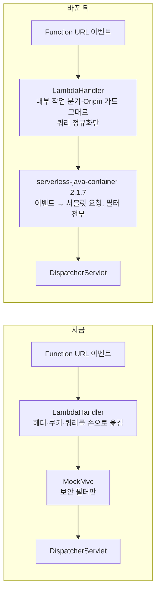
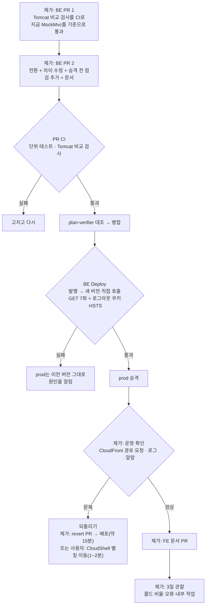

# 운영 요청 경로를 MockMvc에서 serverless-java-container로 옮기기

<!-- plan-result:start — 이 블록만 병합 뒤에도 고칠 수 있다(CLAUDE.md §11). 아래는 승인된 계획 원문 -->

## 구현 결과

> Phase 1 #191 · Phase 2 #192 · 2026-11-10 대조 · 이탈 4 · 미구현 3(1건 보완함, 2건은 내용이 맞아 고치지 않음) · Phase 3·4는 다음 PR에서 이 블록을 갱신 — 판정 근거(파일:줄)는 각 PR 본문 "계획 대비 구현"

**Phase 1(#191)**

- 이탈(계획보다 엄격): PR 검사는 목록에 없는 차이뿐 아니라, 목록에 있는데 사라지거나 글자가 달라진 차이, 요청 목록에 없거나 Lambda 전용인 허용 항목, 미실행, 로그 확인 실패, Tomcat 결과 없음도 실패로 친다. 허용 목록에는 이유와 차이 문자열을 그대로 적는다. 동작을 일부러 바꾼 PR이 목록을 같이 고쳐 리뷰에 드러나게 하려는 것이다.
- 이탈(나눔): `q-empty-name` 하나에 넣기로 한 두 요청을 `q-empty-name`(`?size=20&=`)과 `q-eq-only`(`?=`)로 나눴다. 요청 하나가 한 형태만 재야 어느 쪽이 깨졌는지 보인다. `size`는 다른 쿼리 요청과 같은 20이다.
- 미구현 → 보완함: `q-bare`(`?search`)를 대조 뒤 넣었다.
- 계획에 없던 변경: `docs/CI-CHECK-GATE.md`에 `serving-path` 검사 절과 운영 파라미터 두 줄을 더했다(문서 동기화). 이 검사를 필수 체크로 걸지 않는다는 점도 이 문서에 적었다.
- 계획에 없던 변경(뒤집힌 전제): CloudFront는 `X-Forwarded-Proto`를 지우고 넘긴다(AWS CloudFront 문서의 요청 헤더 표). 계획의 "HSTS는 `x-forwarded-proto: https`로 만든다"는 운영 이벤트에 이 헤더가 있다는 근거가 없다. 그래서 이 헤더·포트를 뺀 요청에도 HSTS가 실려야 하는 `l-no-proto`를 넣었다(지금 MockMvc 통과). 전환 뒤에는 CloudFront가 붙이는 `X-Forwarded-For`로 `ForwardedHeaderFilter`가 돌고, 라이브러리 scheme 기본값이 `https`라 HSTS가 실린다(spring-web 6.2.19·core 2.1.7 바이트코드, 실행 확인은 Phase 2).

**Phase 2(#192)**

- 이탈(뒤집힌 전제 반영): 승격 전 로그아웃 점검 이벤트에 `x-forwarded-proto: https` 대신 CloudFront가 실제로 넘기는 `x-forwarded-for`만 넣었다. 계획대로면 운영에 없는 헤더로 HSTS를 확인하게 된다. 같은 이벤트(`l-logout-gate`)와 `l-no-proto`가 이 PR의 비교 검사에서 HSTS와 함께 통과해, Phase 1에 바이트코드로만 확인했던 HSTS 경로를 실행으로 확인했다.
- 이탈(사용자 결정, 계획 승인 뒤): `serving-path` 검사의 경로 필터를 없애 모든 PR에서 돌게 하고, 잡 이름을 `compare`에서 `serving-path`로 바꿨다. 규칙셋 필수 체크로 걸기 위해서다. 필수 체크에 경로 필터가 있으면 해당 없는 PR이 "Expected"로 멈추고, `application.yml`·`SecurityConfig`·필터만 바꿔도 응답이 달라진다. 규칙셋 변경은 병합 뒤 따로 한다. Phase 1에서 문서에 적은 "필수 체크로 걸지 않는다"를 뒤집는다.
- 미구현 → 고치지 않음: `docs/CI-CHECK-GATE.md`와 `.github/workflows/api-docs-pages.yml` 주석의 MockMvc 언급. 둘 다 스펙을 만드는 테스트(`OpenApiSpecExportTest`)가 MockMvc를 쓴다는 설명이라 전환 뒤에도 내용이 맞다.
- 계획에 없던 변경: 하네스 요청에 `l-logout-gate`를 더했다. 배포 관문과 같은 로그아웃 이벤트를 PR 검사에서 먼저 돌려, 승격 전 점검이 새 버전에서 통과하는지 병합 전에 본다.
- 계획에 없던 변경(문서 동기화): README·`docs/DEPLOY.md`의 배포 검증 서술에 로그아웃 점검을, `docs/CI-CHECK-GATE.md`·`docs/DEPLOY.md`·`CHANGELOG.md`에 필수 체크 전환을 반영하고, 고친 문서의 "마지막 검토" 줄을 갱신했다.
- 계획에 없던 발견(운영 측정): `?=`는 Function URL이 Lambda를 부르기 전에 400(`InvalidQueryStringException`)으로, `?size=5&=`는 403(`InvalidSignatureException`)으로 막는다. 계획이 걱정한 "`?=` 함수 실패"는 운영 밖에서 도달하지 않는다. 정규화의 이름 빈 쌍 처리는 방어로 남기고, Phase 4의 "`?=`가 200이다" 기준은 "배포 전후 같은 400이다"로 바꾼다. `?search`는 도달한다(200).

<!-- plan-result:end -->

> 운영 Lambda가 요청을 MockMvc(테스트 도구)로 처리하던 것을 serverless-java-container 2.1.7(Phase 1·2의 후보 B)로 바꾼다. Phase 1·2에서 찾은 Tomcat과의 차이를 넘기기 전에 고치고, 승격 전 점검을 늘린다. API 모양·DB는 바꾸지 않는다.

## Context

**왜 하나.** 사용자가 _"mockmvc는 테스트 제품이잖아 저렇게 냅둬도 되냐"_ 고 물었다. 비교 실험 결과(직접 측정)는 이렇다.

- **Phase 1(BE #180, 로컬 Docker, 요청 82개):** 기대값 실패는 MockMvc 0, B 0이었다. Tomcat과 다른 항목은 MockMvc 17, B 16이었다.
- **Phase 2(BE #189, 실제 SnapStart, 함수마다 콜드 205건):** 콜드 p50은 MockMvc 1,746ms, B 1,713ms였다. 복원 실패와 앱 500은 0건이었다.

그래서 콜드 스타트는 옮길 이유도 걸림돌도 아니다. 옮기는 이유는 구조다.

- 운영 JAR에서 `spring-test`가 빠진다.
- Tomcat처럼 서블릿 필터가 모두 돈다. 지금은 보안 필터만 돈다.
- MockMvc가 Tomcat과 다르게 읽은 일이 세 번 있었다. `+` 검색(#177), `Vary` 첫 값(#121), HSTS(#40)다.

**사용자 결정(2026-11-10):** B 전환 계획을 plan mode로 세우고, 승인 전에는 구현하지 않는다. 계획을 쓰는 중에 아래 넷을 더 정했다(모두 추천안).

- 손으로 친 주소는 검색어만 Tomcat처럼 맞춘다.
- Tomcat 비교 검사를 CI로 만들어 전환보다 먼저 넣는다.
- SDK 발행 경로 계획보다 이 전환을 먼저 한다.
- 사용자가 두 가지를 맡는다. 배포 직후 브라우저 확인, 그리고 급할 때 CloudShell에서 별칭을 옮기는 것이다.

### 바뀌는 것



### 전체 흐름



## 판단이 필요했던 항목

| 항목 | 결정 | 근거·기각한 대안 |
| --- | --- | --- |
| 라이브러리 버전 | `aws-serverless-java-container-springboot3:2.1.7` | README가 2.x는 Boot 3.x, 3.x는 Boot 4.x 라인이라고 쓴다. 지금 Boot는 3.5.16이다. Phase 1·2가 이 버전으로 쟀다. 기각: 3.x는 Boot 4가 필요하다 |
| 핸들러 클래스 이름 | `com.example.linksphere.LambdaHandler` 그대로 | infra `lib/baseline-stack.ts`의 handler 값을 안 바꿔도 된다. 운영 함수 설정이 바뀌지 않는다(T5 위험 없음) |
| 내부 작업 분기·Origin 가드 | `proxy()` 앞에 그대로 둔다 | 이벤트 모양이 다르고, 가드는 원본 이벤트의 `domainName`을 본다. Phase 1에서 6종 분기 도달을 확인했다 |
| 실행 인자 | `--` 인자 3개를 `System.setProperty`로 옮긴다. `--server.port=-1`은 뺀다 | 라이브러리가 인자 없이 `run(new String[0])`을 부른다(`SpringBootLambdaContainerHandler.initialize`, javap). 자체 웹 서버 팩토리를 소스로 넣어 Tomcat 팩토리가 빠지므로 포트를 열지 않는다. 시스템 프로퍼티는 커맨드라인보다 낮지만 yml보다 높다 |
| 쿼리 정규화 | 값 안의 `=`는 `%3D`로 바꾼다. 이름만 있는 쌍은 `이름=`으로 바꾸고, 이름이 빈 쌍은 버린다. `FunctionUrlQuery`를 고쳐 쓴다 | 라이브러리는 쌍을 `split("=")`로 나눈다(core 2.1.7 `AwsHttpApiV2ProxyHttpServletRequest.parseRawQueryString`, javap). 그래서 세 경우가 Tomcat과 다르다. `a=b=c`는 값이 `""`가 된다. `k`는 값이 `null`이 되고 경고 로그가 남는다. **`?=`는 `"=".split("=")`가 빈 배열이라 `[0]`에서 `ArrayIndexOutOfBoundsException`이 나고, 잡는 예외가 `UnsupportedEncodingException`뿐이라 함수 실패가 된다.** Tomcat은 첫 `=`만 나누고 이름이 빈 쌍은 버린다 |
| 끝 슬래시(`/api/post/`) | 라이브러리대로 200을 받아들인다(사용자 결정) | 라이브러리가 끝 슬래시를 지워 넘기고 끄는 설정이 없다. 보안 필터와 MVC가 같은 지운 경로를 보므로 인가 우회는 없다. FE는 보내지 않는다. 비교 검사의 허용 목록에 `p-slash`로 적는다. 기각: 앞단에서 404를 직접 만들기. 앱의 `NOT_FOUND` 본문을 흉내 내는 코드가 생긴다. 기각: `search=a=b`도 그대로 두기. 검색어를 버려 뜻이 바뀐다 |
| 라이브러리 설정 | `setServiceBasePath("/api")`, `setStripBasePath(true)`, `setDisableExceptionMapper(true)`, `setQueryStringCaseSensitive(true)`, `setDefaultContentCharset("UTF-8")`, `setLogFormatter(null)` | 앞 둘은 컨텍스트 경로를 맞춘다. 나머지 넷은 기본값이 Tomcat·지금과 달라서 넣는다(`ContainerConfig.defaultConfig()`, javap). 예외 매퍼를 끄면 필터 예외가 지금처럼 함수 실패로 끝난다(Phase 1 `d-filter`). 쿼리 키는 기본값이 대소문자를 가리지 않는다. 문자셋 기본값은 `ISO-8859-1`이다. 접속 로그는 요청마다 IP를 INFO로 남긴다. 지금은 접속 로그가 없다 |
| `spring-test` | `implementation` 줄을 지운다. 테스트는 `spring-boot-starter-test`로 계속 쓴다 | 운영 코드에서 쓰는 곳이 `LambdaHandler`·`FunctionUrlResponse`뿐이고, 둘 다 이번에 바뀐다 |
| 승격 전 점검 | `deploy.yml`에 로그아웃 호출 1회를 더한다. `cookies` 배열에 `__Host-refreshToken=`·`Max-Age=0`이 있고 HSTS 헤더가 있는지 본다 | 지금 점검은 GET의 `statusCode`만 본다. 쿠키 변환은 라이브러리 응답에 `cookies` 필드가 없어 우리가 만드는 부분이다. 깨지면 로그인이 전부 깨진다. 쿠키가 없는 로그아웃은 DB에 쓰지 않는다(`revokeByRefreshToken`이 바로 돌아간다) |
| Tomcat 비교 검사 | Phase 1 하네스를 HEAD 대상 CI로 만들어 전환 PR보다 먼저 넣는다(사용자 결정) | `+` 버그(#177)는 서빙 경로를 Tomcat과 비교하는 검사가 없어 약 3개월 넘게 남았다. 공개 저장소라 Actions 시간이 무료다. 먼저 넣으면 전환 PR 자체가 이 검사를 받는다. 기각: 로컬에서 한 번만 돌리고 결과를 PR에 붙이기. 라이브러리를 올릴 때(3.x) 다시 잡아 주지 못한다 |
| 되돌리기 | 기본은 제가 revert PR → 배포. 로그인이 깨지는 등 급하면 사용자가 CloudShell에서 별칭을 옮긴다(사용자 결정) | 로컬 키에는 Lambda 쓰기 권한이 없다. BE 배포는 최근 6회 모두 5~6분 걸렸다(PR CI 포함 약 15분). 별칭 이동은 1~2분이다(BE `docs/DEPLOY.md` 1202-1203). 옮기기 전에 옛 버전을 직접 연속 호출한다(BE `.claude/CLAUDE.md`의 `prod` 이동 규칙) |
| SDK 발행 경로 계획과 순서 | 이 전환을 먼저 한다(사용자 결정) | 둘 다 `LambdaHandler` init을 바꾼다. SDK 계획은 첫 발행 시간을 여러 날 재야 한다. 전환을 나중에 하면 init이 바뀌어 그 측정을 다시 해야 할 수 있다. 대가: 사용자가 느끼는 첫 등록 응답 개선(약 0.8초 → 목표 0.5초 이하)은 그만큼 늦어진다 |
| `Expires` 형식(`1 Jan` → `01 Jan`) | 그대로 둔다 | RFC 6265 §5.1.1은 브라우저가 일(day)을 1~2자리로 읽게 한다(`day-of-month = 1*2DIGIT`). §4.1.1은 서버가 `rfc1123-date`(2자리)를 쓰라고 한다. B가 권장 형식이다 |
| `/apix/...`가 `/x/...`로 읽힘 | 고치지 않는다 | CloudFront `/api/*` 경로 규칙에 걸리지 않아 Lambda까지 오지 않는다. Function URL은 OAC로 잠겨 있다 |
| 깨진 `%ZZ` | 고치지 않는다 | 지금도 함수 실패다. 운영에서는 CloudFront가 400으로 먼저 막는다(#181→#182 결정) |

### 뒤집힌 전제

| 발견 | 그래서 바뀐 것 |
| --- | --- |
| PoC는 `--server.port=-1`을 뺐다 | 라이브러리가 자체 웹 서버 팩토리를 넣어 Tomcat을 만들지 않는다. 검증에 "로그에 `Tomcat started`가 없다"를 넣었다 |
| 라이브러리가 `spring-cloud-function-serverless-web` 4.1.5를 끌고 오고, 그 안의 `ServerlessAutoConfiguration`이 `@ConditionalOnMissingBean` 웹 서버 팩토리를 등록한다. 로컬 `bootRun`의 Tomcat을 바꿀 수 있다 | Boot의 `ServletWebServerFactoryAutoConfiguration`이 `@AutoConfigureOrder(HIGHEST_PRECEDENCE)`라 먼저 Tomcat 팩토리를 등록한다(spring-boot-autoconfigure 3.5.16, javap). 그러면 이 설정은 빠진다. 다만 순서로 추론했을 뿐 실행은 안 했다. 검증에 로컬 `bootRun`이 8080에서 뜨는지를 넣었다 |
| 라이브러리 `spring.factories`의 `AwsSpringWebRuntimeInitializer`는 모든 기동에서 돈다 | `_HANDLER`가 있고 그 클래스를 못 불러올 때만 동작한다(javap). 로컬에는 `_HANDLER`가 없고, Lambda에서는 `LambdaHandler`를 불러올 수 있어 아무것도 안 한다 |
| PoC는 `secure(true)`를 뺐다 | HSTS는 `forward-headers-strategy: framework` 필터가 `x-forwarded-proto: https`로 만든다. Phase 1에서 이 헤더가 있는 요청은 Tomcat과 같았고, 헤더가 없는 내부 호출만 HSTS가 빠졌다. 승격 전 점검 이벤트에 이 헤더를 넣는다 |
| `?=`는 Phase 1·2 요청 목록에 없었다 | 정규화에서 버리고 하네스 요청에 넣는다 |
| `SessionAuthenticationFilter`가 `@Component`이면서 보안 체인에도 들어 있어, 필터가 모두 돌면 두 번 등록된다 | 같은 인스턴스라 두 번째는 `OncePerRequestFilter`가 건너뛴다. 로컬 Tomcat도 지금 이렇게 돈다. 바꾸지 않는다 |

### 위험 관리

- **로그인·쿠키:** 승격 전 점검에서 로그아웃 쿠키를 본다. 로그인과 갱신은 Tomcat 비교 검사가 본다(Phase 1에서 차이 없음). 운영 브라우저 확인은 아래 "남은 것"의 사용자 몫이다.
- **요청 헤더 쪼개기:** 라이브러리는 헤더 값을 콤마로 나눈다. 예외는 `Date`·`If-Modified-Since`·`User-Agent`·`accept-*`다. 앱이 읽는 헤더는 `X-Access-Token`, `Authorization`, `Idempotency-Key`, `CloudFront-Viewer-Address` 넷이다. 형식상 넷 다 콤마가 없다. `X-Origin-Verify`는 넘기기 전에 원본 이벤트에서 읽는다. `X-Forwarded-For`는 첫 값만 쓰는데, Tomcat도 결과가 같다.
- **문자셋:** JSON 응답은 Spring이 UTF-8로 쓴다. 기본 문자셋을 UTF-8로 두어 charset 없는 텍스트 응답의 한글이 깨지지 않게 한다.
- **DB TLS:** `sslmode=require`가 시스템 프로퍼티로도 먹는지 하네스 DB에서 확인한다(`pg_stat_ssl`).
- **콜드·연속 호출:** Phase 2 끝 `verify`에서 B는 연속 GET 두 번째도 콜드였다(1건, 원인 모름). 배포 뒤 3일 동안 운영 `Restore Duration` 건수를 배포 전 같은 기간과 비교한다.
- **라이브러리 유지보수:** 2.1.6 앞에 13개월 공백이 있었다. 3.0.1·3.0.2·3.0.4의 수정은 3.x에만 있다. 구현 전에 그 릴리스 노트를 읽는다. 우리 경로에 닿는 수정이 있으면 멈추고 알린다.

## 세부 계획

### Phase 1 — BE PR: Tomcat 비교 검사를 CI로

| 위치 | 변경 내용 |
| --- | --- |
| `scripts/serving-path-experiment/run.sh` | `TARGETS="tomcat head"`를 더한다. 지금 트리를 한 번 빌드해 Tomcat(`LinkSphereBeApplicationKt`)과 Lambda(`LambdaHandler`) 두 대상으로 띄운다. 기존 대상은 그대로 둔다 |
| `scripts/serving-path-experiment/compare.py` | `report --gate <파일>`을 더한다. 기대값 실패가 있거나, 목록에 없는 Tomcat과의 차이가 있으면 종료 코드 1을 낸다 |
| `scripts/serving-path-experiment/accepted-differences.json`(신규) | 지금 MockMvc의 차이 17개를 요청 id와 이유로 적는다 |
| `scripts/serving-path-experiment/requests.json` | `q-empty-name`(`?=`, `?size=5&=`), `q-bare`(`?search`), `q-case`(`?SIZE=1`)를 더한다 |
| `.github/workflows/serving-path.yml`(신규) | PR에서 `LambdaHandler.kt`·`FunctionUrl*.kt`·`build.gradle.kts`·`scripts/serving-path-experiment/**`가 바뀌면 돈다 |

### Phase 2 — BE PR: 전환

| 위치 | 변경 내용 |
| --- | --- |
| `build.gradle.kts:220-221` | `spring-test` 줄을 `aws-serverless-java-container-springboot3:2.1.7`로 바꾼다 |
| `src/main/kotlin/com/example/linksphere/LambdaHandler.kt` | 아래 코드. KDoc의 MockMvc 서술과 init 주석을 고쳐 쓴다 |
| `src/main/kotlin/com/example/linksphere/FunctionUrlResponse.kt` | 입력을 `AwsProxyResponse`로 바꾼다. `multiValueHeaders`의 `Set-Cookie`는 `cookies`로, 나머지는 `, `로 합친다. `isBase64Encoded`를 싣는다 |
| `src/main/kotlin/com/example/linksphere/FunctionUrlQuery.kt` | `toMockMvcQuery`를 `normalize`로 바꾼다(아래) |
| `src/test/.../FunctionUrlResponseTest.kt`, `FunctionUrlQueryTest.kt` | 새 입력과 새 규칙으로 다시 쓴다. `FunctionUrlOriginGuardTest`는 그대로 둔다 |
| `SecurityConfig.kt:85-87`, `OpenApiSpecExportTest.kt:28` 주석 | MockMvc의 `secure(true)` 서술을 지금 경로로 고친다 |
| `.github/workflows/deploy.yml` 승격 전 점검 | 로그아웃 점검 1회를 더한다(아래) |
| `scripts/serving-path-experiment/accepted-differences.json` | MockMvc 차이 목록을 B 기준으로 바꾼다. `p-slash`를 더한다 |
| BE 문서 | `MockMvc`를 서술하는 곳을 전부 고친다. `docs/DEPLOY.md`(22곳), `docs/PERFORMANCE.md`(7곳), `README.md`(4곳), `docs/BE-ARCHITECTURE.md`(4곳), `docs/TRAFFIC-MANAGEMENT.md`(2곳), `docs/AI-ASYNC-PROCESSING.md`, `docs/CI-CHECK-GATE.md`, `.github/workflows/api-docs-pages.yml` 주석이다. `LambdaHandler.kt:줄`을 가리키는 문서도 줄 번호를 맞춘다. `CHANGELOG.md`에 새 항목을 넣는다. `docs/plans/*`, `docs/HISTORY.md`, 실험 결과 파일은 고치지 않는다 |
| BE `.claude/CLAUDE.md` | MockMvc 언급이 없다. "Web Adapter를 다시 붙이지 않는다" 규칙과 "레이어 없음"은 그대로 맞으므로 고치지 않는다 |

```kotlin
// LambdaHandler.kt companion object init(요지)
Thread.currentThread().contextClassLoader = LambdaHandler::class.java.classLoader

// 라이브러리가 builder.run()을 인자 없이 부른다. 지금의 -- 인자를 시스템 프로퍼티로 옮긴다(yml보다 우선).
System.setProperty("logging.structured.format.console", "logstash")
System.setProperty("logging.structured.json.customizer", EmailMaskingLogCustomizer::class.java.name)
System.setProperty("spring.datasource.hikari.data-source-properties.sslmode", "require")

LambdaContainerHandler.getContainerConfig().apply {
    setServiceBasePath("/api")
    setStripBasePath(true)
    setDisableExceptionMapper(true)
    setQueryStringCaseSensitive(true)
    setDefaultContentCharset("UTF-8")
}

container = SpringBootProxyHandlerBuilder<HttpApiV2ProxyRequest>()
    .defaultHttpApiV2Proxy()
    .initializationWrapper(InitializationWrapper())
    .servletApplication()
    .springBootApplication(LinkSphereBeApplication::class.java)
    .buildAndInitialize()
container.setLogFormatter(null)
applicationContext =
    WebApplicationContextUtils.getRequiredWebApplicationContext(container.servletContext) as ConfigurableApplicationContext

warmUp() // WARMUP_PATHS를 /api/... 로, container.proxy(warmUpRequest(path), WarmUpContext)
warmUpAwsSdk()

// dispatch(): 내부 작업 분기 → Origin 가드(그대로) 뒤
val request = LambdaContainerHandler.getObjectMapper().treeToValue(event, HttpApiV2ProxyRequest::class.java)
request.rawQueryString = request.rawQueryString?.let(FunctionUrlQuery::normalize)
mapper.writeValue(output, FunctionUrlResponse.from(container.proxy(request, context)))
```

```kotlin
// FunctionUrlQuery.kt
fun normalize(rawQueryString: String): String =
    rawQueryString.split("&")
        .filter { it.isNotEmpty() && !it.startsWith("=") }
        .joinToString("&") { pair ->
            val index = pair.indexOf('=')
            if (index < 0) "$pair=" else pair.substring(0, index + 1) + pair.substring(index + 1).replace("=", "%3D")
        }
```

```bash
# deploy.yml 승격 전 점검에 더하는 호출(요지)
echo '{"rawPath":"/api/auth/logout","headers":{"x-forwarded-proto":"https"},"requestContext":{"http":{"method":"POST"}}}' > /tmp/verify-logout-event.json
aws lambda invoke --function-name "$FN:$VERSION" --payload fileb:///tmp/verify-logout-event.json /tmp/verify-logout.json > /dev/null
jq -e '.statusCode == 200
  and any(.cookies[]?; startswith("__Host-refreshToken=") and contains("Max-Age=0"))
  and any(.headers | keys[]; ascii_downcase == "strict-transport-security")' /tmp/verify-logout.json
```

### Phase 3 — FE PR: 문서

| 위치 | 변경 내용 |
| --- | --- |
| `docs/SYSTEM-ARCHITECTURE.md:313` | BE 요청 경로 서술을 바꾼다 |
| `docs/SERVICE-GLOSSARY.md:197` | MockMvc 항목을 바꾼다 |

### Phase 4 — 배포 뒤 확인

병합 직전에 지금 `prod` 버전 번호를 `list-aliases`로 적어 둔다(지금은 204). 되돌릴 때 쓴다.

| 누가 | 무엇을 | 어떻게 | 통과 기준 |
| --- | --- | --- | --- |
| 제가 | 배포 | `gh run watch`로 BE Deploy | 승격 전 점검(GET 7회 + 로그아웃)이 success |
| 사용자 | 브라우저 확인(2분) | `https://linksphere.click`에서 로그인 → 새로고침 → 로그아웃 | 새로고침 뒤에도 로그인 상태이고, 로그아웃 뒤 로그인 화면이 뜬다. 결과를 대화로 알려 주면 제가 그 시각의 운영 로그(401·오류)를 확인한다 |
| 제가 | CloudFront 경유 요청 | `https://linksphere.click/api`에 읽기 요청 8회 안팎. 배포 전에 같은 요청의 응답을 먼저 받아 둔다. 요청 사이에 쉬고 WAF 403을 먼저 확인한다 | `post?size=5`의 HSTS·`Vary`·`Content-Type`이 배포 전과 같다. 두 단어 검색의 `+`와 `%20` 건수가 같다. `search=a=b`가 그 검색어로 검색된다. `?=`가 200이다. CORS 사전 요청이 그대로다. 쿠키 없는 로그아웃의 `Set-Cookie`가 그대로다 |
| 제가 | 로그 | 조회 전용 키로 Logs Insights | `Tomcat started`·접속 로그 줄이 없다. 오류 0건이다. JSON 로그에 `awsRequestId`가 붙는다 |
| 제가 | 알람 | `link-sphere-api-*` 3개 | OK |
| 제가 | 내부 작업 | 다음 피드 수집·정리 cron과 실제 글·댓글 등록이 생기면 로그 확인 | 작업이 끝까지 돈다. 운영에 일부러 쓰지 않는다 |
| 제가 | 콜드 | 3일 뒤 `Restore Duration` 건수와 p50 | 배포 전 3일과 비교해 보고한다. 판정 기준은 두지 않는다(운영 트래픽이라 조건이 다르다) |

**되돌리기.** 위에서 로그인·등록이 깨지면 바로 알린다.

- 급하면 사용자가 CloudShell(도쿄)에서 아래를 실행한다. 출력이 `200` 다섯 줄과 버전 번호 한 줄이면 끝이다. 그 뒤 제가 로컬에서 `list-aliases`로 `prod`가 옛 버전인지 확인한다.
- 급하지 않으면 제가 revert PR을 내고 배포까지 확인한다.

```bash
export AWS_PAGER=""
V=<병합 직전에 적어 둔 버전>
echo '{"rawPath":"/api/post","rawQueryString":"size=5","requestContext":{"http":{"method":"GET"}}}' > /tmp/rb.json
for i in 1 2 3 4 5; do
  aws lambda invoke --function-name "link-sphere-api:$V" --region ap-northeast-1 --payload fileb:///tmp/rb.json /tmp/rb-out.json --query StatusCode --output text > /dev/null
  jq -r '.statusCode' /tmp/rb-out.json
done
aws lambda update-alias --function-name link-sphere-api --name prod --function-version "$V" --region ap-northeast-1 --query FunctionVersion --output text
```

## 영향 범위 (§5)

BE는 `pnpm graph` 대상이 아니다. 모든 HTTP 요청이 이 경로를 지나므로 공용 파일과 같다고 보고 아래를 짚는다.

**CRUD 실패 지점**

| 동작 | 깨질 수 있는 것 | 막는 것 |
| --- | --- | --- |
| 등록(글·댓글·가입·비밀번호 재설정) | `Idempotency-Key` 헤더를 못 읽으면 400이 된다. 본문의 한글이 깨질 수 있다 | Tomcat 비교 검사(헤더·한글 본문 항목) |
| 읽기(목록·상세·검색) | 쿼리를 다르게 읽는다(`=`, 이름만 있는 쌍, 대소문자, `?=` 함수 실패) | `FunctionUrlQuery.normalize` + 단위 테스트, 대소문자 설정, 비교 검사, 승격 전 GET 점검 |
| 수정·삭제 | 인증 헤더·쿠키를 못 읽으면 401이 된다 | 비교 검사(로그인·갱신·로그아웃 흐름) |
| 로그인·갱신·로그아웃 | `Set-Cookie`가 `cookies`로 안 나가면 로그인이 유지되지 않는다 | `FunctionUrlResponseTest`, 승격 전 로그아웃 점검 |
| 중복·동시 요청 | 실행 환경은 한 번에 한 요청만 받는다. 이 점은 바뀌지 않는다 | 해당 없음 |
| count·페이지네이션 | cursor 경로 | 승격 전 cursor 2쪽 점검(기존) |

**기존 기능 회귀**

| 대상 | 소유 파일 | 확인 |
| --- | --- | --- |
| 내부 작업 6종 | `LambdaHandler.kt` 분기 | 코드를 안 바꾼다. 비교 검사의 도달 표식, 배포 뒤 로그 |
| Origin 가드 | `FunctionUrlOriginGuard.kt` | 안 바꾼다. 기존 테스트 6개 |
| 워밍 핑(5분마다), 승격 전 점검 | infra `lib/baseline-stack.ts:143`, `deploy.yml` | 최소 이벤트 모양이 Phase 2 측정 입력과 같다 |
| 로그 형식·이메일 가림·요청 ID | `EmailMaskingLogCustomizer`, `handleRequest`의 MDC | Phase 1에서 차이 없음. 배포 뒤 로그 |
| DB TLS 강제 | init 시스템 프로퍼티 | 하네스 DB `pg_stat_ssl` |
| 로컬 개발(`bootRun`) | `LinkSphereBeApplication.kt` | 새 의존성으로도 Tomcat 8080이 뜨는지 |
| 테스트 | `src/test/**` | 전체 `./gradlew test` 통과. `spring-test`는 테스트 의존성으로 남는다 |
| OpenAPI 내보내기·Pages | `OpenApiSpecExportTest`, `api-docs-pages.yml` | 스펙 diff 0 |
| HSTS 의존 문서 | `SecurityConfig.kt:85-87` 주석 | 주석만 고친다 |
| 운영 함수 설정 | infra | 핸들러 이름이 같아 바꾸지 않는다 |

**배포 순서.** API 계약 변경이 없다. BE 한 번이면 되고, FE 문서는 BE 배포를 확인한 뒤 낸다.

## 검증 방법

- **단위:** `./gradlew test`, ktlint. `FunctionUrlQueryTest`에 `a=b=c`·`k`·`?=`·`=x`·`a=1&&b=2`·`+`·`%3D`를 넣는다. `FunctionUrlResponseTest`에 여러 `Set-Cookie`, `Vary` 세 값, base64 응답을 넣는다.
- **Tomcat 비교(로컬 Docker, CI):** 기대값 실패 0건. Tomcat과의 차이는 목록에 있는 것뿐이어야 한다. `q-eq`·`q-empty-name`·`q-bare`·`q-case`는 Tomcat과 같아야 한다. 같은 빌드로 2회 돌려 판정이 같은지 본다.
- **기동:** RIE 컨테이너 로그에 `Tomcat started`와 접속 로그가 없다. 로컬 `bootRun` 로그에 `Tomcat started on port 8080`이 있다.
- **DB TLS:** 하네스 DB에서 앱 커넥션의 `pg_stat_ssl.ssl`이 모두 true다.
- **배포·운영:** Phase 4 표대로 한다.
- **PR 전:** `plan-verifier`로 계획과 diff를 대조한다. PR 본문에 `## 계획 대비 구현`을 쓰고 `check-pr-body.js`로 확인한다.

## 남은 것

- **Spring Boot 4:** 라이브러리를 3.x로 올려야 한다. 그때 Tomcat 비교 검사를 다시 돌린다.
- **SDK 발행 경로 계획:** 이 전환이 끝난 뒤 세운다. 먼저 SnapStart가 자격 증명을 어떻게 다루는지 확인한다. 구간 로그(#168)는 그 계획이 끝날 때까지 둔다.
- **알 수 없는 `linksphereJob` 값:** 지금은 `GET /` 404로 끝나지만 B에서는 `rawPath`가 없어 함수 실패가 될 수 있다. 보내는 코드가 우리 디스패처뿐이라 고치지 않는다.
- **사용자 몫(동의함):**
  - 배포 직후 브라우저 확인(2분). Phase 4 표대로 하고, 결과를 알려 주면 제가 로그를 확인한다.
  - 급할 때만 CloudShell 별칭 이동(1~2분). Phase 4 "되돌리기"의 명령이고, 제가 버전 번호를 채워 드린다.
