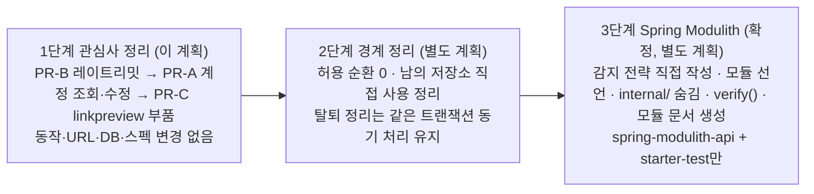

# BE 구조 재구성 — 로드맵과 1단계(관심사 정리)

<!-- plan-result:start — 이 블록만 병합 뒤에도 고칠 수 있다(CLAUDE.md §11). 아래는 승인된 계획 원문 -->

## 구현 결과

> PR-B #201 · 2026-11-15 대조(1단계 중 PR-B만, PR-A·PR-C는 아직) · 이탈 0 · 미구현 2(둘 다 보완함) — 판정 근거(파일:줄)는 PR 본문 "계획 대비 구현"

**PR-B(#201)**

- 미구현 → 보완함: 클래스 이름(`TableRateLimit`)과 테이블 이름(`auth_rate_limits`)이 어긋나는 것을 `BE-ARCHITECTURE.md` "남은 것"에 적었다
- 미구현 → 보완함: `.claude/CLAUDE.md` 요약표의 "global → domain 허용 3쌍"을 1쌍으로 고쳤다
- 계획에 없던 변경: 이름 변경을 따라 테스트 9개 파일의 import·주석과 `LinkPreviewRepository` 주석 2곳을 고쳤다
- 계획에 없던 변경: 문서 동기화 — BE-ARCHITECTURE §2 규칙 표·§7 선례 이름·§11 간선 수, §11 도구 표의 Spring Modulith 행("안 씀" → "3단계 도입 예정")
- 계획에 없던 변경: 같은 패키지 클래스를 가져오던 import 5줄을 지웠다
- 승인 뒤 원문을 고친 것(병합 전): 두 번째 독립 검토를 받아 사용자가 세 가지를 다시 정했다 — 감지 전략 직접 작성 확정, 탈퇴 코드는 2단계에 한 번만 이동(`accountdeletion` 신설 취소), 링크 미리보기는 부품만 이동. PR-A·PR-C 절과 2·3단계 메모가 처음 승인된 판과 다르다

<!-- plan-result:end -->

## Context

- **계기**: 사용자가 `domain/auth`에 Controller·Service·DTO·Repository·엔티티(`MemberSession*` 등)가 섞여 있다며 업계 표준인지, Spring Modulith가 필요한지 물었다(2026-11-15).
- **목적(사용자 결정, 2026-11-15)**: 표준 방식을 끝까지 적용하면서 배운다(B안). 3단계 Spring Modulith 도입을 확정한다. 다른 안인 "위험 위주로 하고 2단계 뒤 재판단"(A안)은 고르지 않았다.
- **전제**: 재구성이므로 기존 `docs/BE-ARCHITECTURE.md`의 구조 규칙(도메인별 평면, 서브패키지 금지)은 제약으로 삼지 않는다. 결과에 맞춰 그 문서를 고친다.
- **조사 결론**
  - 한 기능 폴더에 역할별 파일을 함께 두는 것은 Spring Boot 문서의 "전형적인 배치" 예시와 같다([Structuring Your Code](https://docs.spring.io/spring-boot/reference/using/structuring-your-code.html)). 권고가 아니라 예시다.
  - Kotlin은 패키지 단위 가시성이 없어서([Kotlin](https://kotlinlang.org/docs/visibility-modifiers.html)), 레이어별 하위 폴더는 찾기 편함 말고 얻는 것이 없다.
  - 실제 문제는 **응집도**다. auth가 탈퇴 정리 때문에 post·interaction·fcm 저장소를 직접 지우고, 범용 레이트리밋이 auth 테이블을 빌려 쓴다.
- **다른 모델(Fable 5.2) 독립 검토 반영**: 판정은 "1단계는 설계 수정 3건을 반영하면 승인할 만하다, Modulith는 2단계 뒤 재판단"이었다. 지적한 코드 사실은 직접 확인했다.
- **두 번째 독립 검토(Fable 5.2, 2026-11-15, 승인 뒤·PR-B 구현 뒤)**: 판정은 "고치고 진행"이었다. PR-B는 계획과 일치했다. 지적한 코드 사실은 직접 읽어 확인했고, 이를 받아 사용자가 세 가지를 정했다.
  - Modulith 모듈 감지는 감지 전략을 직접 쓰는 방식으로 지금 확정한다. 그래서 1단계 패키지 경로가 최종이다.
  - 탈퇴 코드는 1단계에서 옮기지 않고 auth에 둔다. 2단계에서 최종 자리로 한 번만 옮긴다.
  - 링크 미리보기는 부품만 새 패키지로 옮기고, API와 이메일 인증 확인은 post에 남긴다.
- **버린 대안**
  - 기능 안 레이어 하위 폴더: 도메인당 4~23파일이라 이득이 없다.
  - 헥사고날: [카카오페이](https://tech.kakaopay.com/post/home-hexagonal-architecture/)가 "코어를 쓰는 컴포넌트 모듈 2개 이상"을 조건으로 든다. 이 레포는 CRUD와 외부 API 조합이다.
  - Gradle 멀티모듈 + `internal`: 배포 단위가 하나여도 컴파일 경계는 얻을 수 있다. 버리는 이유는 Shadow JAR·SnapStart 빌드 복잡도와 1인 161파일 규모의 비용이다.
    - 정정: 이전 판의 "실행 앱이 1개라 전제가 맞지 않는다"는 틀린 이유였다.

## 지금 구조의 문제와 판단 관점

| 문제 | 증거 | 결과 | 겪은 적 |
|---|---|---|---|
| 패키지 순환 (post↔comment·interaction 등 간선 8개를 목록으로 허용) | `PackageGraphDocTest.kt:15-29` | 한쪽을 고치면 다른 쪽이 영향받음 | 있음: Service 순환으로 기동 실패(`ArchitectureRulesTest.kt:14-16`, 2026-09-21). Service 순환만 테스트로 막음 |
| auth가 탈퇴할 때 다른 도메인 데이터를 직접 지움 | `AccountDeletionService.kt:38-49`, 남의 Repository 7개 | 회원 데이터를 저장하는 기능을 추가할 때마다 auth를 고쳐야 함 | 확인 못 함(잠재) |
| 공통 코드(global)가 auth 테이블을 씀 | `RateLimitService.kt:35` | 의존 방향이 거꾸로 됨 | 없음(작음) |
| 다른 도메인의 Repository·엔티티 직접 사용 32쌍 | 위 "세는 명령" | 테이블을 바꿀 때 영향 범위를 찾기 어렵고, 막는 장치가 없음 | 확인 못 함(잠재) |
| (문제 아님) 한 폴더에 Controller·Service·DTO·Repository를 함께 둠 | Spring Boot 문서 예시 | — | — |

판단 관점: 지금 겪는 문제인가, 바꿀 때 몇 곳을 고치는가, 기계가 막아 주는가(문서 < ArchUnit < Modulith < Gradle 모듈), 비용(1인·Lambda), 되돌리기 비용.

## 전체 흐름



## 1단계 — 바뀌는 패키지

```
지금                                   1단계 뒤
domain/auth/  14파일 · API 15개         domain/auth/          로그인·세션·가입·비밀번호(변경·재설정)·이메일 인증·탈퇴
                                                              + MemberSession*·MemberActionToken* 그대로 (아래 "세션 배치")
                                       domain/member/        + MemberController: 계정 조회·수정·닉네임 확인 (/auth/account… 경로 유지)
global/common/RateLimitService          global/ratelimit/     RateLimitService·RateLimitRepository·TableRateLimit (신설)
  → domain/auth 테이블 사용               (global → domain 의존 2쌍 감소, 허용 순환 8→7)
domain/post/  23파일                    domain/post/          글·검색·AI + 미리보기 API·이메일 인증 확인 (17파일)
                                       domain/linkpreview/   URL 검증·메타데이터 추출·미리보기 캐시 (신설, 6파일)

의존 방향
auth ──▶ member ◀── member의 MemberController
post · comment · feed · tools ──▶ linkpreview ──▶ infra.youtube   (linkpreview는 member를 모른다)
```

| 항목 | 지금 | 1단계 뒤 |
|---|---|---|
| `domain/auth` 파일 / API | 14 / 15 | 12 / 12 (레이트리밋 2파일과 계정 API 3개가 빠짐. 탈퇴·비밀번호 변경은 남음) |
| 허용 패키지 순환 | 8 | 7 |
| global→domain 예외 | 3쌍 | 1쌍(`SecurityConfig`→필터) |
| 남의 Repository·엔티티 직접 import | 32 (아래 명령) | 거의 같음 → 2단계 |
| URL·응답·DB·OpenAPI | — | 변화 없음 |

세는 명령: `domain|infra|global` 각 파일의 `import com.example.linksphere.(domain|infra).<pkg>.<Class>` 중 다른 패키지의 `Table*`·`*Repository*`를 (출발 패키지, 클래스) 쌍으로 셌다. 줄 단위로 세면 43이다(독립 검토). import만 세므로 JPQL·native SQL 문자열 안의 조인(`MemberSessionRepository.kt:28`)은 빠진다.

### 세션 배치 — `MemberSession*`·`MemberActionToken*`은 auth에 그대로 (같은 패키지)

| 기준 | 사실 (직접 grep·git) | 판단 |
|---|---|---|
| 밖에서 누가 코드로 쓰나 | `MemberSessionService`: auth 안 `AuthService`·`PasswordResetService`·`AccountDeletionService`·필터. auth 밖은 `SecurityConfig.kt:3·29`(필터 등록)뿐이고 나머지는 주석. fcm은 `getSessionFamilyId()`(`FcmTokenController.kt:29`)로 받아 세션 클래스를 모름. 토큰 2파일은 `AuthService`·`PasswordResetService`만 씀 | 밖에서 독립적으로 쓰는 곳이 없음 → 별도 모듈 근거 없음 |
| 함께 바뀌나 | git: 세션 파일이 바뀐 6커밋 중 4번 인증 흐름 파일과 함께, 토큰 2커밋 중 2번 함께 | 같이 바뀜 → 같은 모듈 |
| 크기 | 세션 4파일 420줄, 토큰 2파일 66줄 | 하위 폴더로 나눌 만큼 크지 않음 |
| 하위 패키지(`auth/session`)로 둘 때 | Modulith 규칙에서는 하위 패키지가 내부 → 2단계 뒤 탈퇴 쪽이 쓸 `revokeAllForMember`를 `@NamedInterface`로 다시 공개해야 함 | 얻는 것 없이 표시만 늘어남 → 지금은 안 함 |

- **형제 모듈로 올릴 조건**: 세션을 발급하는 두 번째 인증 수단(소셜 로그인·API 키)이 생기거나, 세션 관리 API(기기 목록 등)가 생길 때.
- **3단계(Modulith)에서**: `MemberSessionService`·필터는 auth 루트에 두고, Repository·엔티티 4개는 `auth/internal/`로 옮긴다.
  - 이때 `MemberSessionRepository.kt:28` JPQL 안의 `SessionWithRole` 전체 이름 문자열도 함께 고쳐야 한다(컴파일러가 못 잡음).

### PR-B `refactor(config)`: 레이트리밋을 `global/ratelimit`으로 (가장 작아서 먼저)

- `RateLimitService`, `TableAuthRateLimit`(ID 클래스 `AuthRateLimitId` 포함), `AuthRateLimitRepository`를 `global/ratelimit/`의 `RateLimitService`·`TableRateLimit`(`RateLimitId`)·`RateLimitRepository`로 옮긴다.
  - `global/common`이 아니라 전용 패키지에 두는 이유: common은 이미 16파일이 섞여 있다(독립 검토 지적).
  - `@Table(name = "auth_rate_limits")`는 유지한다. DB·SQL·백업은 바꾸지 않는다. 클래스명과 테이블명이 어긋나는 것은 "남은 것"에 적는다.
- 호출부 import 변경: `LambdaHandler`, `PostController`, `PostService`, `LinkPreviewController`, `AuthService`, `AuthController`, `PasswordResetService`, `UploadController`.
- 검사
  - `AppWideArchitectureRulesTest.kt:97-98` `ignoreDependency` 2줄과 import를 지우고 "세 쌍"을 "한 쌍"으로 고친다.
  - `DOCUMENTED_CYCLE_EDGES`에서 `"global.common" to "domain.auth"`를 지운다. `global.exception`↔`global.common` 순환은 `CursorCodec.kt:3` 때문에 남는다.
  - "8개" 문구를 7로 고친다(`PackageGraphDocTest.kt:11·17-18`, `LayerSkeletonRulesTest.kt:118·130`).
- 테스트: `RateLimitServiceTest`, `RateLimitServicePurgeIntegrationTest`를 `test/.../global/ratelimit`로 옮긴다.

### PR-A `refactor(auth)`: 계정 조회·수정·닉네임 확인을 member로

- **옮기는 기준**: 경로가 `/auth/account/*`이고 회원 행만 읽고 쓰는 API다. 세션이나 다른 도메인을 건드리는 것은 옮기지 않는다.
  - 옮김: GET·PATCH `/auth/account`, GET `/auth/account/nickname-availability`.
  - auth에 남김: 비밀번호 변경(전체 세션 폐기·재발급), 탈퇴(세션 폐기·쿠키 만료·다른 도메인 정리), 가입 화면용 `/auth/email-availability`.
- **먼저 커밋**: 닉네임 21자 요청이 400 `INVALID_INPUT`, `message`가 `checkNicknameAvailability.nickname:`으로 시작함을 확인하는 테스트(아래 근거 표 참고).
- **`MemberController` 신설**: 클래스에 `@Tag(name = "인증", description = "회원가입·로그인·토큰 갱신·계정 조회")`, `@RequestMapping("/auth")`, `@Validated`를 지금 값 그대로 단다. 메서드 이름도 그대로 둔다.
- **`MemberService`에 응답 DTO를 돌려주는 메서드를 새로 둔다**: `getAccount`·`updateAccountResponse`(이름은 구현 때 정함)·닉네임 확인 응답.
  - 지금 `findById`·`updateAccount`는 `TableMember`를 돌려준다(`MemberService.kt:74·77`). 컨트롤러가 이를 직접 받으면 `controllersMustNotDependOnEntities`(`LayerSkeletonRulesTest.kt:53-57`)를 어긴다.
  - 기존 메서드의 시그니처는 바꾸지 않는다. `signup`·`changePassword`가 엔티티 반환을 계속 쓴다.
  - 변환 코드 `AuthService.toAccountResponse`(`:240-247`)를 `MemberDTO.kt`의 `AccountResponse.from(TableMember)`로 옮긴다. `id.toString()`은 유지한다.
  - `AccountResponse`·`NicknameAvailabilityResponse`는 `MemberDTO.kt`로 옮긴다.
- `AuthService`의 `getAccount`·`updateAccount`·`isNicknameAvailable`을 지운다. `isEmailAvailable`은 남긴다.
- **탈퇴는 이번에 옮기지 않는다**(사용자 결정). `AccountDeletionService`가 회원 행을 직접 고치고(`:57-67`) 탈퇴 상태의 절반이 이미 member에 있어, 최종 자리는 2단계에서 정한다.
- 대가: `/auth/account/*`가 컨트롤러 2개(member·auth)로 나뉜다. URL은 그대로다.
- 테스트
  - `AuthControllerTest`·`AuthServiceTest`의 계정 조회·수정·닉네임 부분을 `MemberControllerTest`·`MemberServiceTest`로 나눈다.
  - `AccountPermissionSecurityTest`(`:83-89`)는 대상 컨트롤러 2개와 mock을 함께 둔다.

### PR-C `refactor(post)`: URL 검증·메타데이터 추출·미리보기 캐시를 `domain/linkpreview`로

- **먼저 커밋**: `previewLink`·`GET /link-preview` 특성 테스트를 넣는다. 지금은 0개다. 검사할 것은 이메일 미인증 차단, trim→검증→캐시 순서, 응답 매핑, 컨트롤러가 레이트리밋을 먼저 세는지다.
- **옮길 파일(6개)**: `UrlMetadataExtractor`(`UrlMetadata`는 이 파일에 유지 — `TableLinkPreview.toMetadata()`가 참조해 DTO 파일에 두면 `persistenceMustNotDependOnUpperLayers` 위반), `SafeUrlValidator`, `WeakTitleDetector`(추출기가 씀), `LinkPreviewService`, `LinkPreviewRepository`, `TableLinkPreview`.
- **post에 남기는 것**(사용자 결정): `LinkPreviewController`, `PostService.previewLink`(`:418-427`), `LinkPreviewResponse`.
  - 이메일 인증 확인은 "글 등록과 같은 게이트"라는 post의 정책이다. 남기면 linkpreview가 member를 모른다.
  - 대가: 엔드포인트(post)와 캐시 테이블(linkpreview)의 소유 패키지가 다르다.
- `PostService`의 `findFresh(url) ?: extract(url)` 두 곳(`:97·326`)은 2단계 대상이다. 모듈 API가 둘로 새는 상태다.
- 간선: post→infra.youtube가 사라지고 post→linkpreview가 생긴다. comment→post, feed→post는 다른 이유로 남는다.
- 3단계 숙제: `UrlMetadataExtractor.kt:4`가 `infra.youtube.dto.YoutubeSnippet`을 쓴다. Modulith에서는 하위 패키지가 내부라 공개 표시가 필요하다.

### 모든 PR 공통

- **이동 전용 커밋과 수정 커밋을 나눈다.** git이 이름 변경을 추적하게 하려는 것이다. squash 병합이라 PR 안에서만 효과가 있다.
- **시작 전**: `git worktree list`와 열린 PR 목록으로 `AuthService`·`PostService`·`RateLimitService`를 건드리는 진행 중 브랜치가 있는지 본다. 있으면 순서를 조정한다.
- **문서**: README 트리, BE-ARCHITECTURE(§1 패키지 표와 그래프 블록, §3, §9, §11 Modulith 행 → "3단계 도입 예정", "남은 것"), 경로·줄을 적은 문서(`ACCOUNT-DELETION.md`·`TRAFFIC-MANAGEMENT.md`·`DATA-PROTECTION.md`·`AI-ASYNC-PROCESSING.md`·`PAGINATION.md`·`.claude/CLAUDE.md:322-323`·`new-domain.md`)를 고친다.
  - FE `ONBOARDING.md` §5는 1단계 끝에 FE PR로 따로 고친다.
  - 동작이 바뀌지 않는 refactor라 CHANGELOG는 넣지 않는다.
- 이 계획은 `docs/plans/2026-11-15-be-structure-stage1.md`로 PR-B에 커밋한다.

## 2단계 메모 (별도 계획)

- 허용 순환 7개를 0개로 줄인다. 기준은 지금의 두 단계 패키지가 아니라 **3단계 모듈 지도**다.
  - `global`을 모듈 하나로 보면 `global ↔ auth` 순환이 새로 잡힌다(`SecurityConfig.kt:3` → 세션 필터, auth → `global.common`·`global.ratelimit`). 필터 등록을 auth가 제공하도록 뒤집을지, `global`을 모듈에서 뺄지 정한다.
  - 댓글 좋아요는 comment로 옮긴다.
  - post가 정의한 조회 인터페이스를 interaction·comment가 구현한다.
  - 디스패처를 도메인 쪽으로 옮긴다.
- 남의 저장소 직접 사용을 정리한다. 가장 많은 것은 `MemberRepository` 8건과 `TablePost` 5건이다. `PasswordResetService.kt:25`의 `MemberRepository` 직접 사용도 대상이다.
  - **엔티티 공개 범위**는 두 안을 비교해서 정한다: "Repository만 숨기고 엔티티는 공개" vs "둘 다 숨김(DTO 변환·쿼리 수 증가)".
- **탈퇴 코드의 최종 자리를 정해 한 번만 옮긴다.** 회원 행 변경(신청 표시·익명화)은 `MemberService`를 거치게 한다. 엔드포인트는 쿠키 만료 때문에 auth나 auth 위 모듈에 둔다(member에 두면 member → auth 순환).
- **탈퇴 정리를 이벤트로 바꿀 때는 같은 트랜잭션의 동기 리스너로 한다.**
  - `@ApplicationModuleListener`는 `@Async` + `REQUIRES_NEW`라서([Events](https://docs.spring.io/spring-modulith/reference/events.html), 독립 검토가 인용) Lambda에서 응답 뒤 멈출 수 있다(`LambdaSelfInvoker.kt:17-19`). 또 개인정보 삭제가 부분만 적용될 수 있다.
  - 삭제 순서(폴더 아이템 → 폴더)를 보존한다.
- 쿼리 수 회귀 테스트를 먼저 둔다.

## 3단계 Spring Modulith 도입 (확정, 2단계 뒤 별도 계획)

- **얻는 것**: `allowedDependencies` 선언, 모듈 문서 생성, 모듈 단위 통합 테스트, 중첩 모듈(1.3+, [Fundamentals 1.4](https://docs.spring.io/spring-modulith/reference/1.4/fundamentals.html)).
  - 평면 패키지에서는 모든 타입이 공개라 `verify()`가 더 잡는 것이 없다. 그래서 3단계는 의존성 추가와 함께 **각 모듈의 Repository·엔티티를 `internal/`로 옮기는 일**을 한다. 예: auth의 세션·토큰 저장소 4개.
- **첫 결정: Spring Boot 4 이동이 먼저인가, Modulith 1.4가 먼저인가.** Modulith 1.4는 Boot 3.5용 이전 세대이고 문서가 표시하는 최신 안정판은 2.1.1이다. Boot 3.5 OSS 지원은 2026-06-30에 끝났다(`BE-ARCHITECTURE.md` "남은 것"). 1.4 줄의 지원 종료일은 확인하지 못했다.
- **모듈 감지는 감지 전략을 직접 쓴다**(사용자 결정, 2026-11-15). [Fundamentals 1.4](https://docs.spring.io/spring-modulith/reference/1.4/fundamentals.html)는 _"기본 전략도 어노테이션 방식도 맞지 않으면 `ApplicationModuleDetectionStrategy` 구현을 제공해 감지를 바꿀 수 있다"_ (번역)고 쓰고, `spring.modulith.detection-strategy` 프로퍼티로 등록한다.
  - 고른 이유: 지금 폴더 구조(`domain/<도메인>`)를 그대로 쓰고, 새 도메인 패키지가 자동으로 모듈이 된다.
  - 버린 안 (가) 패키지를 루트 바로 아래로 올리기: 문서 기본값이지만 1단계에서 옮긴 패키지와 아키텍처 테스트 4곳의 경로를 다시 고친다.
  - 버린 안 (다) `explicitly-annotated` + ArchUnit 검사: 같은 안전을 얻으려고 장치 두 개를 유지한다.
  - 확인할 것: 전략 인터페이스가 어느 jar에 있는지. 문서는 검증·문서화용이면 전략과 등록을 테스트 소스에 두라고 안내한다.
- **계획이 빠뜨렸던 1.4 제약**(두 번째 독립 검토, 문서 원문 확인)
  - 하위 패키지는 이름과 상관없이 내부다: _"`order.internal`은 모듈 기본 패키지의 다른 모든 하위 패키지와 마찬가지로 내부로 본다"_ (번역). `infra/*/dto`와 `global`의 하위 패키지는 `@NamedInterface`·`Type.OPEN`·모듈 제외 중 하나로 처리한다.
  - Kotlin은 `package-info.java`가 없어 `@ApplicationModule`(`allowedDependencies`)을 모듈 루트 패키지의 타입 하나에 붙인다.
  - `verify()`는 바이트코드만 본다. JPQL·native SQL 문자열의 다른 모듈 테이블 조인은 잡지 못한다.
- 각 단계 PR 본문에는 업계 표준·지금·바뀐 뒤 구조를 그림으로 나란히 둔다(학습 목적).
- **업계 사례**: 운영 후기는 카카오뱅크(Kotlin, 대형 레거시 채널 서버, 2025-07, [글](https://tech.kakaobank.com/posts/2507-legacy-to-modular-monolith-with-spring-modulith/)) 1건을 찾았다. 1인 소규모 앱 사례는 찾지 못했다.
  - 카카오뱅크는 `explicitly-annotated`를 쓰다가 포기했다. _"추가되는 도메인에 `@ApplicationModule`을 붙이는 것을 생략 할 경우 모듈 테스트에서 탐지 되지 않아서, 결과적으로는 코드의 침범을 막아주지 못했습니다"_ 라고 쓰고, 직접 만든 감지 전략으로 바꿨다.
- **도입 시 범위**: `spring-modulith-api`와 테스트 범위 `spring-modulith-starter-test`만 넣는다. starter-core는 런타임 모듈을 끌고 와 SnapStart 초기화에 영향이 있을 수 있다.
  - Modulith 1.4.14는 ArchUnit 1.4.2에 의존하고 레포는 1.5.1이라 `dependencyInsight`로 호환을 확인한다. 1.4 줄의 지원 기간도 확인한다.
- **모듈 지도**: `global`·`infra`를 모듈로 볼지, Controller·엔티티를 가진 `infra.fcm`을 도메인으로 옮길지 정한다.

## 라이브러리 동작 근거 (설치본 버전 기준, 2026-11-15 확인)

버전은 Spring Boot 3.5.16 BOM에서 읽었다: Spring Framework 6.2.19, Hibernate 6.6.53, Spring Data 2025.0.13, springdoc 2.10.0(swagger-core 2.2.55), ArchUnit 1.5.1. 소스 jar가 없어 같은 태그 GitHub 원본과 설치 jar `javap`로 확인했다.

| 이동이 기대는 동작 | 근거 | 확인 수준 | 영향 |
|---|---|---|---|
| `@EntityScan`이 없으면 루트 패키지 아래 엔티티를 스캔 | Boot v3.5.16 `JpaBaseConfiguration.getPackagesToScan` → `AutoConfigurationPackages`. 레포에 `@EntityScan`·`@EnableJpaRepositories`·`scanBasePackages` 0건 | 원본 소스(에이전트 인용) + grep 직접 | 새 패키지의 엔티티도 찾는다 |
| Repository 스캔도 같은 목록 | Boot v3.5.16 `AbstractRepositoryConfigurationSourceSupport.getBasePackages` | 원본 소스(에이전트 인용) | `global/ratelimit`에서도 등록된다 |
| 이름을 바꿀 엔티티를 JPQL이 이름으로 쓰지 않음 | `TableAuthRateLimit`·`TableLinkPreview`는 native·derived만 씀. JPQL 엔티티 이름 사용 0건. `@Entity` 기본 이름 원문은 못 가져옴 | grep 직접 | 이름을 바꿔도 깨질 쿼리 없음 |
| 문자열 FQN은 컴파일러가 못 잡음 | 문자열 FQN 3건(`MemberSessionRepository.kt:28`·`SecurityUtils.kt:8`·`AppWideArchitectureRulesTest.kt:81`) 모두 이동 대상 아님. 기동 시 JPQL 검증 여부는 확인 안 함 | grep 직접 | PR마다 grep을 다시 돈다 |
| 빈 이름 = 단순 클래스 이름 | Spring v6.2.19 `AnnotationBeanNameGenerator.buildDefaultBeanName`. 이름 문자열로 빈을 찾는 곳 0건, 새 클래스명과 겹치는 기존 클래스 0건 | 원본 소스(에이전트) + grep 직접 | 이동해도 빈 이름이 안 바뀜 |
| `@RequestParam @Size`: `@Validated`가 있으면 AOP 검증(`ConstraintViolationException`), 없으면 MVC 자체 검증(`HandlerMethodValidationException`) | Spring v6.2.19 `HandlerMethod.MethodValidationInitializer.checkArguments`. 설치 jar `javap`: `HandlerMethodValidationException` → `ResponseStatusException` → `ErrorResponseException` | 원본 소스(에이전트) + jar 직접 | 빠뜨려도 검증은 돈다. `GlobalExceptionHandler.kt:431`로 가서 `message`만 바뀌므로 유지하고 테스트로 고정 |
| 스키마 이름 = 단순 클래스 이름 | springdoc v2.10.0 `useFqn` 기본 false, swagger-core v2.2.55 `TypeNameResolver.getNameOfClass`. springdoc 설정 0건 | 원본 소스(에이전트) + grep 직접 | DTO를 옮겨도 스키마 이름 그대로 |
| 같은 `@Tag`는 이름으로 합쳐짐 | springdoc `OpenAPIService.addTags`(이름 비교). 핸들러를 가로지르는 합치기는 미확인 | 원본 소스(에이전트), 일부 미확인 | 선례(`PostController.kt:18`·`LinkPreviewController.kt:17`)처럼 같은 문자열을 쓰고 스펙 diff로 확인 |
| operationId = 메서드 이름 | 컨트롤러 메서드 이름 중복 0건. springdoc의 중복 처리 코드는 못 찾음 | grep 직접 | 메서드 이름 그대로 두면 바뀔 일 없음 |
| ArchUnit이 새 패키지를 자동으로 포함 | `PackageGraphDocTest.packageOf`(`:111-118`), `ArchitectureRulesTest.kt:43-45`, slices 패턴 | 테스트 코드 직접(일부 에이전트) | 새 패키지도 순환·그래프 검사 대상 |
| Kotlin all-open·no-arg는 어노테이션 기준 | `build.gradle.kts:253-256` | 빌드 파일 직접 | 엔티티를 옮겨도 그대로 |

## 영향 범위

- **CRUD**: 테이블·쿼리·트랜잭션 경계가 바뀌지 않는다. `@Transactional`이 붙은 메서드를 그대로 옮긴다.
- **회귀 위험과 막는 수단**

| 위험 | 막는 수단 |
|---|---|
| `@Validated`가 빠져 검증 실패 `message`가 바뀜 | 먼저 넣는 21자 테스트(`code`·`message`) |
| 태그·operationId 변화 | `./gradlew openApiSpec` 결과를 운영 스펙과 키 정렬(`jq -S`) 뒤 diff해 0 확인 + PR `api-compat` |
| `previewLink` 이동 중 순서·게이트 누락 | 먼저 넣는 특성 테스트 |
| 보안 테스트가 404로 실패 | 대상 컨트롤러 2개 |
| Lambda 잡의 `getBean(타입)` | 타입으로 찾으므로 영향 없을 것으로 봄. `integrationTest`·`serving-path`로 확인 |
| 문서 `파일:줄` 밀림 | PR마다 목록 갱신 |

- **배포 순서**: API 계약이 같아 FE와 순서를 맞출 필요가 없다.

## 검증

1. PR마다 `./gradlew test integrationTest`. `PackageGraphDocTest`가 출력하는 블록으로 문서를 갱신한다.
2. `./gradlew openApiSpec` 결과를 운영 스펙과 키 정렬(`jq -S`) 뒤 diff해 0을 확인한다(컨트롤러를 옮기면 순서만 바뀔 수 있다). `api-compat`·`serving-path`·`check`가 통과해야 한다.
3. 병합 뒤 배포 success를 확인하고, 운영 GET `/api/category` 200, 옮긴 경로를 지나는 요청 한 번(PR-B는 GET `/api/auth/email-availability`), CloudWatch 앱 5xx 0건을 본다.
4. PR 전에 plan-verifier에게 계획과 diff 대조를 맡겨 `## 계획 대비 구현`에 남긴다.
