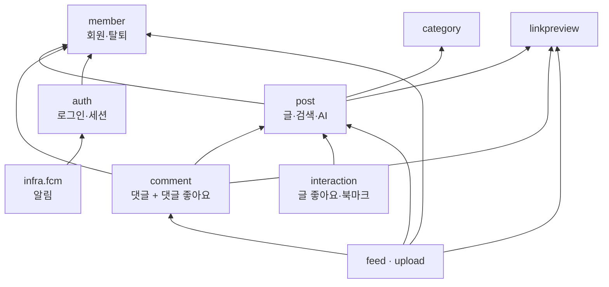

# BE 구조 재구성 2단계 — 모듈 경계 정리

<!-- plan-result:start — 이 블록만 병합 뒤에도 고칠 수 있다(CLAUDE.md §11). 아래는 승인된 계획 원문 -->

## 구현 결과

> PR-1 #204 · PR-2 #206 · PR-3 #207 · PR-4 #210 · 2026-11-16 대조 · PR-1 이탈 0 · 미구현 0 · PR-2 이탈 3 · 미구현 0 · PR-3 이탈 0 · 미구현 0 · PR-4 이탈 0 · 미구현 0 — 판정 근거(파일:줄)는 각 PR 본문 "계획 대비 구현"

**PR-1(#204)**

- 계획대로: 조회별 SQL 문 수 기준값, 탈퇴 뒤 잔존 0건, 다른 패키지의 저장소·엔티티 사용 금지 규칙(지금 있는 57건 허용) 세 가지를 테스트로 넣었다. 운영 코드는 바꾸지 않았다
- 실측한 기준값: 피드 비로그인 7, 피드 로그인(필터 5종 포함) 10, 피드 검색 11, 글 상세 9, 댓글 목록 4, 내 댓글 1, 전체 북마크 10, 폴더 안 11, 북마크 검색 11, 폴더 안 검색 12, 로그인 확인 1 — 계획의 추정 범위 안이다
- 대조에서 발견해 보완함: 검색 기준값을 전체 북마크로만 쟀던 것에 폴더 안 + 검색 조합을 더했다(PR-9c가 바꾸는 경로)
- 구현 때 정한 것: 금지 규칙은 `domain`뿐 아니라 `global`·`infra`의 두 단계 패키지까지 본다. 루트(`LambdaHandler`)와 `tools/`는 처음부터 뺐다(계획은 `tools/` 제외를 PR-10에 적었다). 바이트코드의 타입 참조만 봐서 지역 변수로만 받는 엔티티와 `@Query` 문자열 속 교차 참조는 못 잡는다(뒤쪽은 PR-10 몫)
- 계획에 없던 변경: 없앤 위반이 허용 목록에 남으면 실패하는 테스트와, 저장소·엔티티를 20개 미만으로 찾으면 실패하는 보호 단언을 더했다
- 계획에 없던 변경: 잔존 테스트에 탈퇴 신청 단계(세션 폐기·알림 토큰 삭제, 나머지는 유지)와 "다른 회원의 행은 그대로"·"살아 있는 세션 0건" 확인을 더했다
- 계획에 없던 변경: 계획 목록에 없는 조회 2개(피드 검색, 전체 북마크 최신순)의 기준값도 고정했다
- 계획과 다르게 확인: 검증 2의 `openApiSpec` 비교는 로컬에서 돌리지 않았다 — 운영 코드(`src/main`) 변경이 없고 CI `api-compat`가 같은 비교를 한다
- 문서: BE-ARCHITECTURE §2 규칙 표에 새 테스트 2행, §3 "다른 도메인 Repository 허용"을 "지금 있는 곳만 남기고 새로 쓰지 않음"으로, `.claude/CLAUDE.md` 패턴 표 같은 행을 고쳤다

**PR-2(#206)**

- 계획대로: `global/job`에 맡기는 인터페이스와 처리하는 인터페이스를 두고 운영용(Lambda self-invoke)·개발용(같은 프로세스의 전용 스레드) 구현을 나눴다. 개발용은 `AsyncConfig` 풀을 쓰지 않고, JSON으로 바꿨다가 되돌려 운영과 같은 처리기를 탄다. 잡 이름 6개와 `linksphereJob`·`event` 모양은 그대로다. `infra.aws → post·comment·feed` 순환 간선 3개가 없어져 허용 간선이 7개에서 4개가 됐다
- 계획대로: 개발 환경 기본값은 "같은 프로세스에서 처리"이고 `tools/*Runner` 프로필 7개는 "생략"이 기본값이다. 운영은 `LambdaHandler`가 초기화 때 시스템 프로퍼티로 Lambda용을 고른다(로그 형식·TLS 설정을 넣는 기존 방식과 같다)
- 이탈(위치): 처리기를 모으는 곳이 `LambdaHandler`가 아니라 새 클래스 `JobRunner`다 — 개발용 구현도 같은 처리기를 타야 하고, 생성자로 바로 받으면 빈 순환이 된다
- 이탈(범위 확대): 계획이 가리킨 분기(잡 4개)뿐 아니라 account-purge·orphan-image-gc까지 6개 모두 처리기로 옮겼다 — 넷만 옮기면 `LambdaHandler`에 이름으로 찾는 길과 `when` 분기가 함께 남는다
- 이탈(보장 위치): 개발용 구현이 스스로 커밋을 기다리지 않는다. "커밋 뒤에 부른다"는 호출하는 쪽의 계약이다(운영용도 같다) — 호출부는 AFTER_COMMIT 리스너 둘과 트랜잭션이 없는 피드 수집이고, 커밋 뒤 콜백 안에서는 새 커밋 뒤 작업을 등록할 수 없어 구현 안에서 다시 기다리게 만들지 않았다
- 계획에 없던 변경: 잡 이름 6개·맡기는 JSON의 글자 모양·도구 프로필 목록을 고정하는 테스트, 잡 이름이 겹치면 시작할 때 실패하는 검사를 더했다
- 계획에 없던 변경: "생략"을 설정값만이 아니라 세 번째 구현(`SkippingJobPublisher`)으로 뒀다
- 계획에 없던 변경: 처리기가 잡 내용을 되돌릴 때 `LambdaHandler`의 자체 매퍼 대신 Spring의 `ObjectMapper`를 쓴다(맡기는 쪽이 이미 쓰던 매퍼다). Lambda 런타임 비교에서 잡 6종이 모두 서비스까지 닿는 것을 확인했다
- 확인한 것: 개발 환경에서 글을 등록하니(임시 Postgres에 붙인 로컬 서버) `PENDING`이던 글이 약 7초 뒤 요약·태그·임베딩·카테고리가 채워진 `COMPLETED`가 됐다. 운영 DB에는 쓰지 않았다. `openApiSpec` 결과는 운영 스펙과 차이 0
- 문서: BE-ARCHITECTURE(§1 잡 표·패키지 표·그래프, 접미사 표, §7-5, §9 순환 표, 체크리스트), README 트리, AI-ASYNC-PROCESSING §2·§2.2·§4.3, RSS-FEED-BOT 코드 지도, `.claude/CLAUDE.md` 패턴 표, CHANGELOG `Changed`, 주석의 옛 클래스 이름

**PR-3(#207)**

- 계획대로: `ErrorResponse`를 `global/exception`으로 옮겼다. 클래스 이름과 필드는 그대로라 스펙이 바뀌지 않는다. `global.exception → global.common` 순환 간선이 없어져 허용 간선이 4개에서 3개가 됐다(`CursorCodec`이 `InvalidInputException`을 던지는 반대 방향만 남는다)
- 계획대로: `SecurityConfig`가 global의 `RequestAuthenticationFilter` 타입으로 필터를 받고 auth의 `SessionAuthenticationFilter`가 그것을 구현한다. `globalMustNotDependOnDomain`의 예외 1쌍을 지워 global → domain 의존은 예외 없이 금지다
- 구현 때 정한 것: 새 타입은 `global/config/security`에 둔 서블릿 `Filter` 하위 인터페이스다. 구현이 지킬 계약(만료·무효 토큰은 예외 대신 요청 속성으로 남긴다, 구현 빈은 하나)을 그 타입의 주석에 적었다
- 확인한 것: 필터 자동 등록은 새 테스트 없이 실제 `SecurityConfig`를 쓰는 기존 보안 테스트 4개로 봤다. `SecurityConfig`에 auth 타입 의존을 일부러 넣으면 규칙이 실패하는 것을 확인하고 되돌렸다. `openApiSpec` 결과는 로컬 생성 때 붙는 `servers` 말고 운영 스펙과 같다
- 문서: BE-ARCHITECTURE(§1 패키지 표·그래프, §2 검사 표, §3 global → domain 예외, §9 순환 표, 업계 비교 표의 간선 수), README 트리, `.claude/CLAUDE.md` 요약표, 테스트 주석의 간선 수. 동작이 같아 CHANGELOG에는 넣지 않았다

**PR-4(#210)**

- 계획대로: `TablePost`가 카테고리 엔티티 대신 id 집합만 든다(`post_categories` 테이블은 그대로). category는 id·name·slug만 담은 `CategoryInfo`를 돌려주는 조회와 "있는 id만 돌려주기"를 제공하고, 글 등록·수정에서 없는 id는 지금처럼 오류 없이 버린다. 카테고리 필터는 `PostService`가 이름·slug를 id로 먼저 풀어 저장소에 id 집합만 넘기고, 맞는 카테고리가 없으면 전체 글이 아니라 빈 결과다. 허용 위반이 57곳에서 54곳이 됐다
- 실측한 기준값(전 → 뒤): 피드 비로그인 7 → 8, 피드 로그인 10 → 11, 카테고리로 거르기 10 → 12, 피드 검색 11 → 12, 글 상세 9 → 10, 전체 북마크 10 → 11, 폴더 안 11 → 12, 북마크 검색 11 → 12, 폴더 안 검색 12 → 13 — 계획의 추정과 같다. 글과 카테고리 이름을 한 문장으로 읽던 것이 "연결 테이블에서 id 읽기"와 "category에 이름 묻기"로 나뉘었고, 카테고리로 거를 때는 이름·slug를 id로 푸는 문장이 하나 더 든다
- 확인한 것: 요소 컬렉션은 글 수와 상관없이 한 문장으로 읽힌다(카테고리가 붙은 글 3개가 든 목록이 정확히 +1). 조인 + `IN` 필터는 PR-1 테스트와 새 통합 테스트로 봤다. `openApiSpec` 결과는 로컬 생성 때 붙는 `servers` 항목 말고 운영 스펙과 같다
- 확인하지 못한 것: Hibernate 설치본 소스는 읽지 않고 통합 테스트로만 봤다. 빈 `IN ()`은 만들지 않는다(id가 비면 쿼리를 건너뛰거나 항상 거짓 조건을 건다)
- 구현 때 정한 것: 필터 값은 `null`이면 거르지 않음, 빈 집합이면 결과 없음으로 구분한다. 응답에 이름을 붙일 때 category에 없는 id는 뺀다
- 계획에 없던 변경: 글과 카테고리의 연결을 실제 Postgres로 보는 통합 테스트(`PostCategoryIntegrationTest`)를 더했다 — slug·이름·여러 개 필터, 맞는 카테고리 없음, 없는 id 버리기, 수정·삭제 때 연결 행
- 계획에 없던 변경: 카테고리 자동 분류(`PostCategoryClassifier`)도 category의 저장소·엔티티 대신 Service에 묻고 id를 돌려준다. 엔티티를 돌려주던 `CategoryService.getCategoriesByIds`는 없앴다
- 계획에 없던 변경: `PostResponseAssembler`가 `CategoryService`를 쓴다. 그래서 조립기 설명을 "어느 Service도 참조하지 않는다"에서 "자기를 부르는 Service를 참조하지 않는다"로 고쳤다(category는 post를 모르므로 순환이 아니다)
- 계획에 없던 변경: SQL 문이 늘어 운영 응답 시간을 배포 전후로 쟀다(값은 PR 본문)
- 문서: BE-ARCHITECTURE(§2 검사 표와 §3의 위반 수, 조립기 서술), `application.yml`과 조립기 주석. 동작이 같아 CHANGELOG에는 넣지 않았다

<!-- plan-result:end -->

## Context

- **무엇을 하나**: 1단계(#201·#202·#203)에서 패키지를 나눴다. 2단계는 패키지끼리 서로의 속을 들여다보는 곳을 없앤다. 3단계(Spring Modulith 도입)가 요구하는 상태를 먼저 만드는 일이다.
- **왜**: 지금은 한 기능이 다른 기능의 테이블을 직접 읽고 지운다. 테이블 하나를 바꾸면 어디가 영향받는지 찾기 어렵고, 막아 주는 검사도 없다.
- **사용자 기준(2026-11-16)**: 위험이 있어도 업계가 권장하는 쪽을 고른다. 목적은 구조 학습이다. 설명은 백엔드를 모른다고 가정하고 쓴다.
- **끝난 뒤의 모습**: URL·응답·DB 스키마·OpenAPI 스펙은 그대로다. 달라지는 것은 코드 구조와 조회 쿼리 수(아래 표), 로그인 확인 속도, 개발 환경 동작이다.

## 지금 문제 (직접 읽어 확인)

| 문제 | 쉬운 말 | 수 |
|---|---|---|
| 패키지 순환 | A가 B를 알고 B도 A를 안다. 한쪽만 고칠 수 없다 | 허용 목록 7개 + global→auth 예외 1쌍 |
| 남의 저장소 직접 사용 | 다른 기능의 테이블을 그 기능에 묻지 않고 직접 읽고 쓴다 | 운영 코드 44건(`tools/` 10건 제외) |
| 남의 엔티티에 묶임 | 내 테이블 정의가 남의 테이블 정의를 품고 있다 | JPA 연관 4곳(`TableComment.member`·`.post`, `TableBookmark.post`, `TablePost.categories`) |
| 글자로만 적힌 교차 참조 | 쿼리 문자열 안에 남의 테이블이 있어 검사 도구가 못 본다 | 2곳(`MemberSessionRepository.kt:28`, `FcmTokenRepository.kt:56-71`) |
| 개발 환경에서 뒷일 생략 | 내 컴퓨터에서는 AI 요약·댓글 알림이 실행되지 않는다 | `LambdaSelfInvoker.kt:61-64` |

## 사용자 결정 (2026-11-16)

| 질문 | 결정 | 근거 |
|---|---|---|
| 어디까지 숨기나 | 저장소와 엔티티 둘 다. 모듈 사이에는 ID와 전용 객체만 오간다 | Grzybek "모듈의 데이터는 비공개, 인터페이스로만", Spring Data 팀·Microsoft "애그리거트 사이는 ID로만 참조" |
| 탈퇴 코드의 자리 | 로직은 member, 주소(`POST /auth/account/deletion`)는 auth | Microsoft·Modulith "주 데이터의 상태를 바꾼 쪽이 알리고 나머지가 반응" |
| 삭제에 딸린 정리 시점 | 2단계는 같은 묶음으로 바로(동기). 3단계에서 Modulith 이벤트 기록과 함께 "나중에"(비동기) | 회원 영구 삭제는 배치라 비동기 이점이 없고, 개인정보는 반쯤 지워진 상태가 가장 나쁘다 |
| 개발 환경 뒷일 | 2단계에 포함. 전달 장치를 콘센트(인터페이스)·플러그(운영용, 개발용) 구조로 | AWS 처방 지침의 포트와 어댑터 |
| 로그인 확인의 회원 역할 조회 | 원칙대로 나눠 읽는다(로그인한 요청마다 저장소 왕복 +1). 전후 속도를 잰다 | 같은 원칙. 느리면 그다음에 캐시를 검토 |

출처 인용은 조사 에이전트가 원문에서 가져온 것이다. Vernon 원문 PDF는 읽지 못해 Microsoft 문서의 인용으로만 확인했다.

## 목표 구조

- 화살표는 "안다(부른다)"는 뜻이고 한 방향만 있다. 그림에 없는 `global`·`infra.aws` 등은 모두가 아래로만 쓴다.
- **연결 규칙 세 가지**

| 상황 | 방식 | 예 |
|---|---|---|
| 아래 모듈에 묻는다 | 그 모듈의 공개 Service를 직접 부른다. 돌려받는 것은 전용 객체 | comment → `MemberService.findAuthors(ids)` |
| 위 모듈의 답이 필요하다 | 묻는 쪽이 인터페이스(`*Port`)를 정하고 위 모듈이 구현한다 | post가 정한 `PostInteractionPort`를 interaction이 구현 |
| "일어났으니 각자 정리해라" | 같은 트랜잭션의 동기 이벤트 | member의 `MemberPurgedEvent`를 auth·fcm·interaction·comment·post가 듣는다 |

- 포트를 아래 모듈에 쓰면 새 순환이 생긴다(member가 auth의 인터페이스를 구현하면 member → auth). 그래서 위 방향에만 쓴다.
- 포트 구현은 Service가 아니라 저장소만 쓰는 별도 `@Component`로 둔다. `PostService ↔ InteractionService` 빈 순환을 피한다.

## PR 순서 (각 PR은 URL·응답·DB·스펙 변화 없음)

| # | 내용 | 끊기는 것 | 파일 수(테스트 포함, 추정) |
|---|---|---|---|
| 1 | 안전망 | — | 5-7 |
| 2 | 뒷일 전달 장치 | `infra.aws → post·comment·feed` 3개 | 15-18 |
| 3 | global 정리 | `global.exception ⇄ global.common`, global→auth 예외 | 6-8 |
| 4 | 글의 카테고리를 ID 집합으로 | `TablePost.categories` 연관 | 9-11 |
| 5 | 댓글 좋아요를 comment로 | `interaction ⇄ comment` | 10-12 |
| 6 | 탈퇴 로직을 member로 | auth가 남의 저장소 7개를 지우던 것 | 14-16 |
| 7a | member 경계 — auth 쪽 | 로그인 확인의 회원 조인, `AuthService`의 `TableMember` | 10-12 |
| 7b | member 경계 — post·comment·feed·upload | `TableComment.member`, 닉네임·봇 필터 | 14-16 |
| 8 | post ↔ comment | `post → comment`, `TableComment.post` | 12-14 |
| 9a | post ↔ interaction — 통계·글 등록 북마크 | `post → interaction`(서비스·조립기) | 10-12 |
| 9b | 내가 북마크·좋아요한 글 필터 | `PostRepositoryImpl`의 `TableBookmark`·`TablePostReaction` | 5-6 |
| 9c | 폴더 안 글 목록 | `TableBookmark.post`, interaction의 `TablePost` | 10-12 |
| 10 | 마무리 | 허용 순환 0, 금지 규칙 고정 | 6-8 |

### PR-1 안전망

- **쿼리 수 기준값**: 피드 목록(로그인·비로그인·필터별), 글 상세, 댓글 목록, 내 댓글, 폴더 안 글 목록(최신순·검색)의 SQL 문 수를 Hibernate Statistics로 세어 고정한다. `@PostgresIntegrationTest` 선례를 따른다. 1차 캐시가 조회를 가리지 않게 픽스처는 `JdbcTemplate`으로 넣는다.
- **탈퇴 뒤 잔존 0건**: 영구 삭제 뒤 북마크·폴더·폴더 아이템·글 좋아요·댓글 좋아요·조회 기록·FCM 토큰에 그 회원 행이 없는지 보는 통합 테스트. 이벤트로 바꾼 뒤 듣는 쪽을 빠뜨려도 조용히 통과하는 것을 막는다.
- **금지 규칙을 먼저 넣는다**: "다른 도메인의 저장소·`@Entity` 의존 금지" ArchUnit 규칙을 지금 위반 목록을 허용한 채로 추가한다. 이후 PR마다 목록이 줄고, 새 위반은 바로 막힌다.

### PR-2 뒷일 전달 장치

- `global/job/`에 `JobPublisher`(뒷일을 맡긴다)와 `JobHandler`(잡 이름, 처리)를 둔다. 처리기는 각 도메인이 구현하고 `LambdaHandler`가 타입으로 모아 쓴다.
- 구현 둘: `infra.aws`의 Lambda용(지금의 self-invoke), 개발용(같은 프로세스의 **전용 실행기**에서 커밋 뒤 실행).
  - `AsyncConfig`의 풀(core 2)을 쓰면 `processAiJob`이 하위 작업을 기다리다 교착한다. 그래서 전용 실행기를 쓴다.
  - 개발용도 JSON으로 바꿨다가 되돌린 뒤 같은 처리기를 탄다. 직렬화 문제가 개발 환경에서 드러난다.
- `LambdaHandler.kt:289-330`의 분기와 삭제 경합 예외 처리를 처리기로 옮긴다. 잡 이름 6개와 `linksphereJob`·`event` 필드는 그대로 둔다(배포 순간 떠 있는 호출 호환).
- **개발 환경 동작이 바뀐다**: 글을 등록하면 Gemini 호출과 크롤링이 실제로 돈다. `tools/*Runner` 프로필에서는 "생략"을 기본으로 하는 설정값을 둔다.
- 확인할 것: 구현을 환경으로 고르는 방식이 SnapStart 초기화에서 기대대로 도는지.

### PR-3 global 정리

- `ErrorResponse`를 `global.exception`으로 옮긴다(스키마 이름은 클래스 이름이라 스펙 그대로).
- `SecurityConfig`가 auth의 필터 구체 타입 대신 global이 정한 타입에 의존하고 auth의 필터가 그것을 구현한다. `AppWideArchitectureRulesTest`의 `ignoreDependency` 삭제. 필터 자동 등록에 영향이 없는지 보안 테스트로 확인한다.

### PR-4 글의 카테고리를 ID 집합으로

- `TablePost.categories`를 `@ElementCollection` + `@CollectionTable(name = "post_categories")`의 `MutableSet<Long>`으로 바꾼다. 테이블은 그대로다(`schema.sql:301-304`).
- category가 전용 객체(id·name·slug)를 돌려주는 조회와 "존재하는 id만 돌려주기"를 제공한다. 없는 id를 조용히 버리는 지금 동작을 유지한다(`PostService.kt:111`).
- 카테고리 필터는 이름·slug를 id로 먼저 푼다. id가 0개면 빈 결과다(조건을 빼면 전체 글이 나온다).
- 확인할 것: 요소 컬렉션의 배치 로딩 쿼리 수, Criteria 조인 + `IN` 동작(PR-1 테스트로).

### PR-5 댓글 좋아요를 comment로

- `TableCommentReaction`·`CommentReactionRepository`·엔드포인트 2개를 comment로 옮긴다. `@Tag("좋아요·북마크")` 문자열과 메서드 이름을 그대로 둬 스펙이 바뀌지 않게 한다.

### PR-6 탈퇴 로직을 member로

- `AccountDeletionService`·`AccountPurgeService`를 member로 옮긴다. 비밀번호 대조도 member가 한다. 컨트롤러는 auth에 남아 member를 부르고 쿠키를 만료시킨다.
- member가 동기 이벤트 2개를 낸다: `MemberDeletionRequestedEvent`(auth가 세션 폐기, fcm이 토큰 삭제), `MemberPurgedEvent`(auth·fcm·interaction·comment·post가 자기 데이터 삭제).
- 듣는 쪽에는 `@Transactional(propagation = MANDATORY)`를 단다. 폴더 아이템 → 폴더 → 북마크 순서는 interaction의 리스너 하나 안에 둔다.
- 발행하는 쪽은 예외를 잡지 않는다. 하나가 실패하면 그 회원의 삭제 전체가 되돌려지는 지금 동작이 유지된다.

### PR-7a·7b member 경계

- `MemberService`의 공개 메서드가 `TableMember` 대신 전용 객체를 돌려준다: 작성자 일괄 조회(공개 닉네임·이미지 규칙은 member 안에서 적용), 이메일 인증 확인, 닉네임 부분 일치 id 목록, 봇 id, 프로필 이미지 URL 사용 여부, 로그인용 자격 정보.
- **7a(auth)**: `MemberSessionRepository.kt:28`의 조인을 없애고 역할은 member에 묻는다. 로그인 흐름의 분기 순서(`AuthService.kt:152-183`)는 그대로 둔다. 바꾸기 전후의 인증 요청 응답 시간을 재서 남긴다.
- **7b**: `TableComment.member`와 `@EntityGraph`를 지우고 회원을 일괄 조회한다. 닉네임·봇 필터는 member에서 id를 받아 `IN`으로 건다. 필터 문자열 파싱을 Service로 올리고 저장소에는 id 집합만 넘긴다.
  - 유지할 동작: 닉네임은 소문자 부분 일치이고 `%`·`_`를 이스케이프하지 않는다. 탈퇴 신청 중인 회원은 빠진다.
  - id 목록이 비면 닉네임은 빈 결과, 봇 제외는 조건 없음.
- `FcmTokenRepository.kt:56-71`이 `member_sessions`를 읽는 것은 auth의 공개 조회(살아 있는 세션 계열 id)로 바꾼다. `infra.fcm → domain.auth` 의존이 생긴다. fcm을 domain으로 옮길지는 3단계 모듈 지도에서 정한다.

### PR-8 post ↔ comment

- post가 id 기반 공개 조회를 제공한다: 볼 수 있는 글인지 확인, 제목, 작성자 id. `PostVisibility.assertVisible(TablePost, …)`를 밖에서 쓰던 5곳이 이것을 쓴다.
- 댓글 수는 `PostCommentPort`(post가 정하고 comment가 구현).
- 글 삭제는 삭제 **전에** 동기 이벤트를 낸다. comment가 듣고 이미지를 정리한다. 댓글 행·좋아요·북마크는 DB cascade가 지우므로 리스너를 만들지 않는다.
- `TableComment.post`를 지운다. "내 댓글"은 댓글을 읽은 뒤 post에 "보이는 글의 제목"을 묻고, 빠진 만큼 다시 채운다. cursor는 읽은 댓글 행의 마지막 키로 만든다.

### PR-9a·9b·9c post ↔ interaction

- **9a**: `PostInteractionPort`(좋아요·북마크 수와 내 상태 일괄 조회, 글 등록 시 북마크). 지금의 batch 쿼리를 그대로 실행해 쿼리 수가 늘지 않게 한다. 글 등록 시 북마크는 `postRepository.flush()` 뒤에 부른다.
- **9b**: `isBookmarked`·`isLiked`는 포트에서 id 집합을 받아 `IN`. 비로그인이면 지금처럼 무시한다. 집합이 비면 쿼리 없이 빈 결과다. id 수 상한을 두고 넘으면 로그를 남긴다.
- **9c(가장 위험, 단독 PR)**: 폴더 안 글 목록을 두 경로로 나눈다.
  - 최신순·오래된순(검색 없음): interaction이 자기 테이블에서 읽고 post에 "보이는 글"을 물어 빠진 만큼 채운다. 지금 쓰는 인덱스 경로가 유지된다.
  - 제목·열람·관련도·검색: interaction이 후보 id를 넘기고 post가 첫 정렬 키로 DB 정렬해 돌려준다. 순서는 DB가 정하고 메모리에서는 같은 키 안의 순서만 맞춘다.
  - cursor 형식(`BookmarkListSort.keyTypes`)은 그대로 둔다.
  - `BookmarkFolderService.kt:237-283`이 복사해 쓰던 검색·자판 보정·임베딩 흐름을 post의 공개 메서드 하나로 모은다. 북마크 검색이 임베딩 호출 한도를 쓰지 않는 지금 동작은 유지한다.

### PR-10 마무리

- PR-1의 허용 위반 목록과 `DOCUMENTED_CYCLE_EDGES`를 비운다. 단, 허용 순환 목록은 간선을 끊는 PR마다 줄인다(없어진 간선이 목록에 남으면 `PackageGraphDocTest.kt:86-92`가 실패한다).
- `@Query` 문자열에서 남의 모듈 엔티티·테이블 이름을 찾는 검사를 넣는다. 글자로만 적힌 교차 참조를 막는 유일한 장치다.
- `tools/*Runner`의 저장소 직접 사용 10건은 규칙에서 뺀다(로컬 1회성 도구). 3단계 모듈 지도에서 다시 본다.

## 영향 범위

**조회 쿼리 수(코드로 센 추정, PR-1에서 실측해 고정)**

| 조회 | 지금 | 뒤 | 이유 |
|---|---|---|---|
| 피드 목록(로그인) | 10 | 11 | 카테고리 이름 조회 |
| 피드 목록 + 필터(북마크·좋아요·닉네임·봇·카테고리) | 10 | 필터마다 +1 | id 목록 조회 |
| 글 상세 | 8-9 | 9-10 | 카테고리 이름 |
| 댓글 목록 | 4 | 5 | 회원 일괄 조회 |
| 내 댓글 | 1 | 2 이상 | 글 제목·공개 여부 |
| 폴더 안 글 목록(최신순) | 10-11 | 11-12 이상 | 카테고리 이름, 다시 채우기 |
| 로그인한 모든 요청 | 인증 1 | 2 | 회원 역할 조회 |
| 알림 발송 1건 | — | +1 | 세션 계열 id를 auth에 묻기 |

- 카테고리 이름과 봇 id는 실행 환경에 기억해 두면 늘지 않는다. 기억해 둘지는 실측 뒤 정한다(값을 DB에서 직접 바꾸면 늦게 반영되는 대가가 있다).

**깨질 수 있는 기존 동작과 막는 수단**

| 위험 | 막는 수단 |
|---|---|
| 목록의 쪽 경계·건수 틀어짐(필터를 `IN`으로) | 기존 `CursorPaginationIntegrationTest`·`PostSearchIntegrationTest` + 필터별 케이스 추가 |
| 폴더 안 글 목록의 정렬·cursor | 9c 전용 통합 테스트(정렬 5종 × 검색 유무, 비공개 전환된 글 포함) |
| 탈퇴 정리 누락 | PR-1의 잔존 0건 테스트 |
| 로그인 분기 순서 변경 | `AuthServiceTest`의 기존 케이스 유지 + 순서 단언 |
| 스펙 변화(컨트롤러 이동) | `openApiSpec` 결과를 운영과 비교, `api-compat` |
| 리스너가 읽기 전용 트랜잭션에서 실행 | `MANDATORY` 전파 + 통합 테스트 |
| 떠 있는 뒷일 호출과의 호환 | 잡 이름·필드 유지, `serving-path` |
| 테스트 수정량 | 다른 도메인 저장소를 직접 쓰는 테스트 파일 27개. PR마다 해당분만 고친다 |

- **일관성**: 필터가 한 문장에서 두 문장으로 바뀐다. 그 사이 북마크를 해제하면 한 건이 더 보이거나 덜 보일 수 있다.
- **배포 순서**: API 계약이 같아 FE와 맞출 것이 없다. PR 사이 순서는 표의 번호를 따른다.

## 모든 PR 공통

- 워크트리에서 작업하고, 시작 전에 `git worktree list`·열린 PR·`git log origin/main..main`을 확인한다.
- 선례: 포트 구현의 batch 조회는 `PostResponseAssembler`, 배치 잡은 `AccountPurgeService`, 통합 테스트는 `@PostgresIntegrationTest`, 커밋 뒤 잡은 BE-ARCHITECTURE §7-5.
- 이 계획은 `docs/plans/2026-11-16-be-structure-stage2.md`로 PR-1에 커밋한다. PR마다 `구현 결과` 블록에 결과를 더한다.
- PR 본문에는 업계에서 흔한 모양·지금·바뀐 뒤를 그림으로 나란히 두고, 백엔드를 모르는 독자 기준으로 쓴다.
- 문서: BE-ARCHITECTURE(§1 패키지 표·그래프, §3 "다른 도메인 Repository 허용"을 금지로, §7-5 전달 장치, §9 순환 표, 접미사 표에 `*Port`), README 트리, 경로·줄을 적은 문서, `.claude/CLAUDE.md` 패턴 표. FE `ONBOARDING.md` §5는 2단계 끝에 FE PR로.
- 동작이 같은 refactor는 CHANGELOG에 넣지 않는다. 개발 환경 동작이 바뀌는 PR-2와 인증 조회가 느는 PR-7a는 `Changed`에 적는다.

## 검증

1. PR마다 `./gradlew ktlintCheck test integrationTest`. 쿼리 수 기준값이 바뀌면 PR 본문에 전후 숫자를 적는다.
2. `./gradlew openApiSpec` 결과를 운영 스펙과 `jq -S 'del(.servers)'` 뒤 비교해 차이 0. CI `check`·`api-compat`·`serving-path` 통과.
3. 병합 뒤 배포 success 확인, 운영 요청(`/api/post?size=1`, `/api/common/category-option`, 무인증 401 경로)과 알람 3개 확인.
4. PR-7a: 바꾸기 전후 로그인한 요청의 응답 시간을 운영에서 같은 방법으로 재서 남긴다(WAF 한도에 걸리지 않게 요청 수를 기록하며 천천히).
5. PR-2: 개발 환경에서 글을 등록해 AI 요약이 실제로 채워지는지, 운영에서 글 등록 뒤 AI 요약과 댓글 알림이 지금처럼 도는지 확인한다.
6. PR-9c: 운영에서 폴더 안 글 목록을 정렬별로 열어 순서와 다음 쪽이 맞는지 확인한다.
7. PR을 열기 전에 fresh subagent(plan-verifier)에게 계획과 diff 대조를 맡겨 `## 계획 대비 구현`에 남긴다.

## 확인하지 못한 것 (해당 PR에서 먼저 확인)

- Hibernate 6.6의 요소 컬렉션 배치 로딩, Criteria 조인 + `IN`, 빈 `IN ()` 렌더링 → 설치본 소스와 통합 테스트로.
- Postgres 드라이버의 바인드 파라미터 상한, 운영의 사용자당 북마크·좋아요 최대 건수(읽기 전용 계정으로 조회).
- FE가 `excludeBots`를 기본으로 보내는지.
- 로그인 확인이 실제로 얼마나 느려지는지.

## 3단계로 넘기는 것

- 삭제 정리 이벤트를 "커밋 뒤 따로"로 바꾸기: Modulith 이벤트 기록 테이블 + PR-2의 전달 장치 + 재시도 작업.
- `infra.fcm`을 domain으로 옮길지, `tools`를 모듈로 볼지.
- 각 모듈의 저장소·엔티티·포트 구현을 `internal/`로 내리기.
