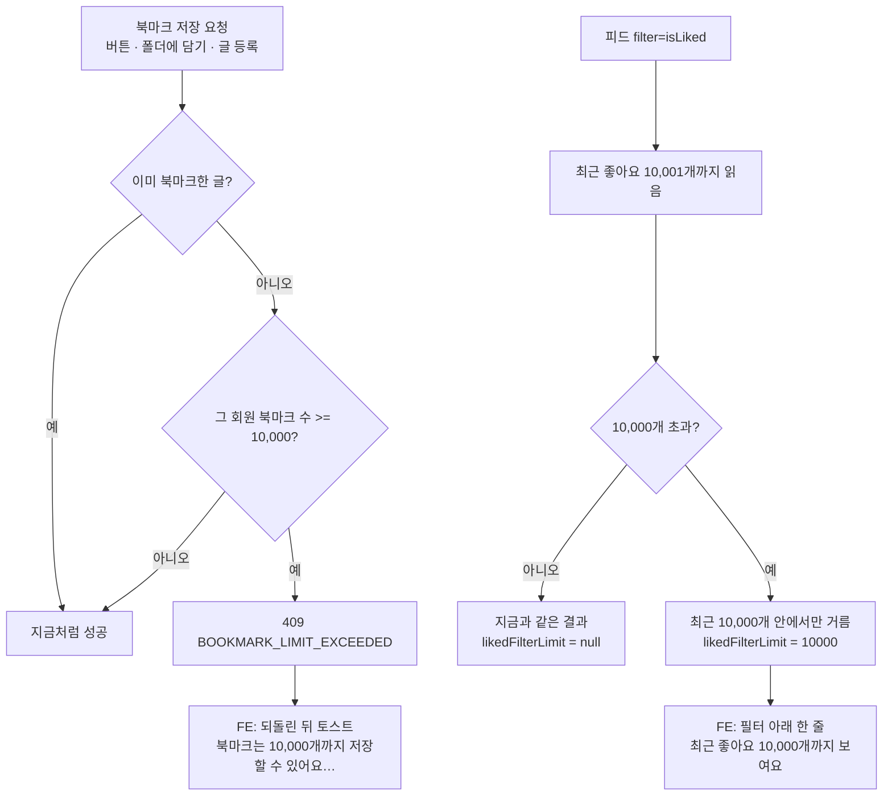

# 북마크 저장 한도와 좋아요 필터 범위 — 글 번호 목록이 드라이버 한계에 닿지 않게

<!-- plan-result:start — 이 블록만 병합 뒤에도 고칠 수 있다(.claude/CLAUDE.md "계획과 PR 본문"). 아래는 승인된 계획 원문 -->

## 구현 결과

**BE-1(#221)**

> #221 · 2026-11-18 대조 · 이탈 2 · 미구현 1 — 판정 근거(파일:줄)는 PR 본문 "계획 대비 구현"

- 이탈(구현 방식): `BookmarkQuota`를 `@Component`가 아니라 `BookmarkRepository`의 확장 함수로 두었다. 빈으로 두면 통합 테스트 8개의 설정을 고쳐야 했다. 검사 규칙은 계획과 같다.
- 이탈(저장소 사실): "스펙 파일 갱신"은 하지 않았다. 이 저장소는 스펙 파일을 커밋하지 않고 빌드 때 만든다. 컨트롤러 설명만 고쳤다.
- 미구현: 측정에서 쿼리 수는 기록하지 않았다. 이 PR은 조회 경로를 바꾸지 않아 쿼리 수 기준 테스트가 그대로 통과한다. 응답 시간(제목순 161ms·열람순 69ms·검색 75ms·피드 필터 37ms, 로컬 테스트 컨테이너 7회 중앙값)은 CHANGELOG에 있고 측정 코드는 남기지 않았다.
- 미구현 → 보완함: 예외가 409 `BOOKMARK_LIMIT_EXCEEDED` 응답이 되는지 보는 컨트롤러 테스트, 한도로 실패한 글 등록이 글 행과 멱등 키를 남기지 않는지 실제 커밋·롤백으로 보는 테스트.
- 계획에 없던 변경: 북마크가 새로 생기는 네 번째 경로(여러 글 일괄 담기)를 구현 중 찾아 같은 한도를 걸었다. 새로 생길 수를 더해 한도를 넘으면 묶음 전체를 거절한다. 완료 조건의 "세 경로"는 네 경로가 됐다. **Phase 2(FE-1)의 안내 대상에도 일괄 담기를 더한다.**
- 계획에 없던 변경: 하나를 지우면 하나를 다시 저장할 수 있는지, 남의 북마크 수가 내 한도에 들지 않는지 보는 통합 테스트.
- 측정 뒤 한도 숫자: 가장 느린 화면이 161ms라 10,000을 유지했다(사용자에게 수치를 알리고 진행).

**FE-1(FE #638)**

> FE #638 · 2026-11-18 대조 · 이탈 5 · 미구현 1 — 판정 근거(파일:줄)는 FE PR 본문 "계획 대비 구현"

- 이탈(구현 방식): 안내 문구를 함수형(`bookmarkLimitExceeded(limit)`)과 상수(`BOOKMARK_MAX_COUNT`)로 두지 않고 숫자를 적은 고정 문구로 두었다. 숫자를 쓰는 곳이 이 문구 하나뿐이다. BE 값과는 손으로 맞춘다.
- 이탈(구현 위치): 토스트를 엔티티 mutation의 `onError`가 아니라 폴더 선택 창의 훅에서 띄운다. 그 창이 이미 실패 토스트를 띄워 엔티티에서 띄우면 2개가 뜬다. "마지막 요청에서만"이라는 조건은 두지 않았다(기존 실패 토스트처럼 실패한 요청마다 뜬다).
- 이탈(테스트 위치): 북마크 저장·폴더 담기 409는 창 훅 테스트가, 글 등록 409는 MSW가 아니라 오류 분류 함수 테스트가 본다.
- 이탈(검증 방법): 브라우저 녹화 대신 모킹 e2e와 그 스크린샷으로 화면을 확인했다. 워크트리에 `.env`를 복사하는 명령이 권한에서 거부돼 dev 서버를 띄우지 못했다.
- 미구현(추가하지 않음): "409 뒤 화면 되돌리기" 테스트. 되돌리기는 오류 종류와 무관하고 기존 테스트가 단언한다.
- 정정: 위 BE-1 항목의 "안내 대상에 일괄 담기를 더한다"는 하지 않았다. FE는 일괄 담기 주소를 부르지 않는다.
- 계획에 없던 변경(사용자 요청): 한도 안내 토스트의 "북마크 보기" 버튼, 삭제 뒤 "되돌리기"가 한도로 실패했을 때의 같은 안내.
- 계획에 없던 변경: 버튼 달린 토스트의 배치를 공용 래퍼가 정하게 한 뒤(FE #641·#642, FE `docs/plans/2026-11-18-toast-stacked-action.md`) 그 위로 올렸다.

**BE-2(#222)**

> #222 · 2026-11-18 대조 · 이탈 1 · 미구현 0 — 판정 근거(파일:줄)는 PR 본문 "계획 대비 구현"

- 좋아요를 최근 순서로 10,001개 읽어 10,000개만 넘기고, 하나가 더 있었을 때만 목록 응답의 `likedFilterLimit`이 10000이다. 인덱스는 더하지 않았고 기존 경고 로그는 그대로 두었다.
- 이탈(저장소 사실): "스펙 갱신"은 하지 않았다. 이 저장소는 스펙 파일을 커밋하지 않고 빌드 때 만든다. 글 목록 API 설명에 `likedFilterLimit` 문장만 더했다.
- 계획에 없던 변경: 좋아요 저장소의 옛 전체 조회 메서드(`findPostIdsByUserId`)를 지웠다. 쓰는 곳이 없어졌다. 이 메서드를 stub하던 기존 단위 테스트 하나는 새 메서드를 stub하게 고쳤다(단언은 그대로).
- 문서 동기화: `BE-ARCHITECTURE.md`의 "마지막 검토" 줄, 이 블록의 FE-1 결과(FE PR 본문에서 옮김).

**FE-2(FE #645)**

> FE #645 · 2026-11-18 대조 · 이탈 2 · 미구현 0 — 판정 근거(파일:줄)는 FE PR 본문 "계획 대비 구현"

- 이탈(구현 위치, 사용자 선택): 안내를 필터 훅·필터 카드가 아니라 목록 훅·목록 화면에 두었다. 실제 화면 미리보기 2안(목록 맨 위 가운데 / 필터 카드 안 칩 줄 아래) 가운데 사용자가 목록 맨 위를 골랐다. 자판 보정 안내와 같은 자리·모양이고, 필터 카드 아래·첫 글 위라 "필터 아래 한 줄"은 그대로다. 필터 카드 안은 응답이 온 뒤 카드가 한 줄 늘어 아래 줄과 목록이 밀려 기각했다.
- 이탈(검증 방법): 브라우저 녹화 대신 모킹 e2e와 그 스크린샷으로 화면을 확인했다(FE-1과 같은 이유).
- 계획에 없던 변경: 결과가 없을 때도 빈 목록 안내 위에 같은 안내를 띄운다(미리보기 비교 때 함께 알림).
- 계획에 없던 변경: 안내가 생기고 사라질 때 목록의 스크롤 기준 위치를 다시 잰다. 모킹 e2e 3건(칩 켜고 끄기와 자리, 좁은 화면 한 줄, 결과 없음).
- 문서 동기화: FE `docs/SEARCH.md` §5에 범위 안내와 자리 결정, §8 코드 지도 한 행, "마지막 검토" 줄. 스펙 원본(`openapi.json`)도 함께 갱신.
- 네 단계(BE-1 #221, FE-1 FE #638, BE-2 #222, FE-2 FE #645)가 모두 병합·배포됐다.

<!-- plan-result:end -->

> 한 회원의 북마크는 10,000개까지만 저장되고, 피드의 "좋아요한 글만" 필터는 최근 좋아요 10,000개 안에서 찾는다. 둘 다 화면에 이유를 알린다.

## Context

### 왜 필요한가

구조 재구성 2단계(PR-9b #218, PR-9c #219)부터 post는 북마크·좋아요 테이블을 직접 읽지 않는다. interaction이 "이 회원이
북마크(좋아요)한 글 번호 전부"를 건네고 post가 그 번호를 `IN (…)`으로 받아 거른다.

- 번호 하나가 SQL 바인드 값 하나다. 설치본 pgjdbc 42.7.11은 한 문장의 바인드 값이 65,535개를 넘으면 예외를 던진다
  (`PgPreparedStatement.maximumNumberOfParameters()`, 2단계에서 바이트코드로 확인). 그 회원의 해당 화면이 500이 된다.
- 지금은 10,000개를 넘으면 경고 로그만 남긴다(`PostService.POST_ID_FILTER_WARN_SIZE`, `PostCandidateService.CANDIDATE_WARN_SIZE`).
  알람에는 연결돼 있지 않다.
- 운영 최대는 북마크 95개·좋아요 9개다(2026-11-17, 읽기 전용 계정 조회). 급한 문제는 아니고, 벽에 닿을 수 없게 만드는 것이 목적이다.

### 번호 목록이 쓰이는 곳

| 화면 | 넘기는 번호 | 코드 |
| --- | --- | --- |
| 피드 `filter=isBookmarked` | 그 회원의 북마크 글 전부 | `PostService.resolveInteractionFilter` → `PostInteractionPort.findBookmarkedPostIds` |
| 피드 `filter=isLiked` | 그 회원의 좋아요 글 전부 | 같은 함수 → `findLikedPostIds` |
| 북마크함 제목순·열람순·관련도순·검색 | 그 회원(폴더)의 북마크 글 전부 | `BookmarkedPostFinder` → `PostCandidateService.rankVisible` |

북마크함 최신순·오래된순(검색 없음)은 번호 목록을 쓰지 않아 벽이 없다.

### 선례 조사 (2026-11-17 검색, 공식 원문은 대부분 직접 읽지 못한 재인용)

| 서비스 | 누르기(저장·좋아요) | 목록 보기 | 출처 |
| --- | --- | --- | --- |
| Spotify | 재생목록 하나 10,000곡 한도 유지(보관함 한도는 2020-05 폐지) | — | [TechCrunch](https://techcrunch.com/?p=1993286) |
| YouTube | 재생목록 5,000개(공식 문서 미확인) | — | [Android Central](https://www.androidcentral.com/youtube-music-liked-songs-problem) |
| Instagram | 좋아요·저장 모두 공개된 한도 없음 | 좋아요 목록은 최근 300개 | [socialz.ai](https://socialz.ai/blog/how-to-see-posts-you-liked-on-instagram) |
| X | 좋아요·북마크 한도 없음 | 좋아요 약 3,200개, 북마크 API 최근 800개 | [X Developers 포럼](https://devcommunity.x.com/t/how-to-get-more-than-800-bookmarks/204704), [John Loeber](https://johnloeber.com/docs/twitter-likes.html) |
| Raindrop.io | 한도 없음 | — | [도움말](https://help.raindrop.io/limitations.md) |

### 바뀐 뒤의 흐름

## 판단이 필요했던 항목

| 항목 | 결정 | 근거·기각한 대안 |
| --- | --- | --- |
| 북마크 처리 방식 | 저장 한도(쓰기 때 거절) | 사용자 결정(질문, 2026-11-17). 기각: 잘라 내기(일부 글이 말없이 빠짐), 최근 N개만 보기(X의 "북마크가 사라졌다" 불만 — 북마크는 다시 찾으려고 담는다), 배열 한 개로 넘기기만 하기(벽은 없어지지만 쪽마다 드는 비용에 상한이 없음, 이 레포의 Hibernate 6.6에서 미검증) |
| 한도 숫자 | 10,000 | 사용자 결정. 기존 경고 기준과 같고 운영 최대의 약 100배, 벽의 약 1/6. 기각: 5,000·1,000 |
| 좋아요 처리 방식 | 누르기는 무제한, `filter=isLiked`만 최근 10,000개 + 화면 안내 | 사용자 결정. Instagram·X와 같은 방향. 기각: 좋아요 저장 한도(선례와 다름), 지금 그대로(벽에서 500), 안내 없이 자르기 |
| 한도 안내 문구 | "북마크는 10,000개까지 저장할 수 있어요. 기존 북마크를 정리한 뒤 다시 시도해 주세요." | 사용자 결정(한도 + 해결 방법) |
| 좋아요 필터 안내 문구 | "최근 좋아요 10,000개까지 보여요" | 사용자 결정(선택지 설명에 적은 문구). 놓는 자리와 모양은 FE-2에서 미리보기로 다시 확인받는다 |
| 이미 북마크한 글을 한도에서 다시 저장 | 성공(지금과 같음) | `setBookmark`·`addBookmarkFolder`는 멱등이 계약이다(`InteractionService.kt:41` 주석). 한도는 새로 생기는 북마크에만 건다 |
| 글 등록에 북마크를 켰는데 한도 | 등록 전체를 실패시키고 이유를 알림 | 선례: 고른 폴더가 없으면 등록이 `FOLDER_NOT_FOUND`로 실패한다(`post.queries.ts:108`, `PostUtil.resolveSubmitError`). 기각: 글만 등록하고 북마크는 조용히 생략(말없이 다른 결과) |
| 오류 상태·코드 | 409 `BOOKMARK_LIMIT_EXCEEDED` | 이 레포에서 "지금 상태 때문에 못 한다"는 409다(`DUPLICATE_*`, `COMMENT_DELETED`). 기각: 429(시간이 지나도 풀리지 않음), 400(입력이 틀린 것이 아님) |
| 동시 요청 | 세고 나서 넣는 방식 그대로(잠그지 않음) | 여러 글을 동시에 저장하면 한도를 몇 개 넘을 수 있다. 벽까지 5만 개 넘게 남아 해가 없다. 기각: 회원 행 잠금(모든 북마크 저장이 느려짐) |
| 잘림 표시를 싣는 곳 | 글 목록 응답에 `likedFilterLimit: Int?` (평소 null, 잘렸을 때 10000) | 숫자를 서버가 주면 FE가 같은 상수를 따로 들지 않는다. 기각: boolean(FE에 숫자 상수가 하나 더 생김), 응답 헤더(생성 스펙 타입에 안 잡힘) |
| 좋아요 조회 인덱스 | 추가하지 않음 | PK가 `(user_id, post_id)`라 한 회원의 행만 읽어 정렬한다. 10,000개를 넘는 회원이 생기기 전에는 차이가 없다 |
| 기존 경고 로그 | 그대로 둠 | 한도가 생긴 뒤 이 경고는 "울리면 한도가 뚫린 것"이라는 안전망이 된다 |

### 위험 관리

- 10,000개일 때의 속도는 재지 않았다. BE-1에서 북마크 10,000개를 넣고 북마크함 제목순·검색과 피드 필터의 응답 시간을 재서
  보고한다. 눈에 띄게 느리면 숫자를 낮출지 다시 묻는다(구현을 멈추고 질문).
- BE가 먼저 배포되고 FE가 뒤따르는 사이, 한도에 걸린 회원은 지금의 실패처럼 버튼이 말없이 되돌아간다. 그 회원은 없다(최대 95개).

## 세부 계획

### Phase 1 — BE-1: 북마크 저장 한도 (BE PR)

| 위치 | 변경 내용 |
| --- | --- |
| `domain/interaction/BookmarkLimits.kt` (신규, `BookmarkFolderLimits.kt`를 본뜸) | `MAX_BOOKMARKS_PER_MEMBER = 10_000`과 이유 주석 |
| `domain/interaction/BookmarkRepository.kt` | `countByUserId(userId): Long` |
| `domain/interaction/BookmarkQuota.kt` (신규 `@Component`) | `assertCanAdd(userId, postId)` — 이미 북마크했으면 통과, 아니고 수가 한도 이상이면 `BookmarkLimitExceededException` |
| `InteractionService.setBookmark`(저장 쪽)·`addBookmarkFolder`, `PostInteractionAdapter.bookmarkNewPost` | insert 전에 `assertCanAdd` 호출 |
| `global/exception/BookmarkLimitExceededException.kt` (신규), `GlobalExceptionHandler.kt` | 409 `BOOKMARK_LIMIT_EXCEEDED` |
| `InteractionController`·`PostController`의 OpenAPI 설명 | 세 엔드포인트의 실패 목록에 `409 BOOKMARK_LIMIT_EXCEEDED` 추가(스펙 파일 갱신) |
| 테스트 | 단위: 한도에서 새 글 저장 → 예외, 이미 북마크한 글 → 성공, 해제 → 성공. 통합: 북마크 10,000개(`generate_series`)에서 세 경로 각각 409, 글 등록은 글 행도 남지 않음. 구현을 깨서 실패 확인 |
| 측정 | 같은 10,000개 데이터로 북마크함 제목순·검색, 피드 `filter=isBookmarked`의 응답 시간과 쿼리 수 기록 |
| 문서 | `docs/BE-ARCHITECTURE.md`(한도 표·§7), `CHANGELOG.md`, 계획 파일 `docs/plans/2026-11-17-bookmark-limit-liked-filter.md` |

### Phase 2 — FE-1: 한도 안내 (FE PR, BE-1 배포 확인 뒤)

| 위치 | 변경 내용 |
| --- | --- |
| `src/shared/config/error-code.ts` | `BOOKMARK_LIMIT_EXCEEDED` |
| `src/shared/config/texts.ts` | `messages.error.bookmarkLimitExceeded(limit)` |
| `src/entities/bookmark/folder/config/bookmark-folder.contract.ts` | `BOOKMARK_MAX_COUNT = 10_000`(BE `BookmarkLimits`와 같은 값이라는 주석) |
| `interaction.queries.ts`의 `useBookmarkPostMutation.onError`, `bookmark-folder.queries.ts`의 폴더 담기 `onError` | 되돌린 뒤 코드가 `BOOKMARK_LIMIT_EXCEEDED`면 토스트(마지막 요청에서만, `isSessionExpired`면 조용히) |
| `src/entities/post/utils/post.util.ts`의 `resolveSubmitError` | 글 등록 실패 사유에 한도 문구 추가 |
| `src/shared/api/generated/openapi.gen.ts` | BE-1 스펙으로 다시 생성 |
| 테스트 | MSW 409로 세 경로의 토스트·되돌리기 검증, 다른 실패는 지금처럼 조용한지 검증 |
| 문서 | `docs/BOOKMARK.md`, `CHANGELOG.md` |

### Phase 3 — BE-2: 좋아요 필터 범위 (BE PR)

| 위치 | 변경 내용 |
| --- | --- |
| `PostReactionRepository.kt` | `findRecentPostIdsByUserId(userId, limit)` — `created_at DESC, post_id DESC` |
| `PostInteractionPort.kt`·`PostInteractionAdapter.kt` | `findLikedPostIds` → `findRecentLikedPostIds(userId): LikedPostIds(ids, truncated)` (10,001개를 읽어 초과 여부 판정). 부르는 곳은 `PostService` 하나 |
| `PostService.resolveInteractionFilter`·`getPostsByCursor` | 잘렸으면 응답에 `likedFilterLimit = 10000` |
| `PostPageResponse` | `likedFilterLimit: Int?` 추가(스펙 갱신) |
| 테스트 | 통합: 좋아요 10,001개에서 가장 오래된 글이 빠지고 표시가 실림, 10,000개 이하는 null·결과 그대로, 북마크 필터와 함께 쓸 때 교집합. 단위: 포트 호출. `QueryCountBaselineIntegrationTest` 기준값 확인 |
| 문서 | `docs/PAGINATION.md`, `docs/BE-ARCHITECTURE.md`, `CHANGELOG.md` |

### Phase 4 — FE-2: 좋아요 필터 안내 (FE PR, BE-2 배포 확인 뒤)

| 위치 | 변경 내용 |
| --- | --- |
| `openapi.gen.ts` | BE-2 스펙으로 다시 생성 |
| `src/shared/config/texts.ts` | `likedFilterLimited(limit)` |
| `src/widgets/post/post-list/hooks/usePostListFilter.ts`·`ui/PostListFilter.tsx` | 첫 쪽 응답의 `likedFilterLimit`이 있으면 필터 아래 안내 한 줄 |
| 미리보기 | 실제 클래스·토큰으로 만든 화면을 먼저 보여 주고 확인받은 뒤 반영 |
| 테스트·문서 | MSW로 표시 유무 두 경우, `CHANGELOG.md` |

## 영향 범위

- **API**: 북마크 저장·폴더 담기·글 등록에 새 실패(409 `BOOKMARK_LIMIT_EXCEEDED`), 글 목록 응답에 선택 필드 하나. DB 스키마 변화 없음.
- **배포 순서**: 각 쌍에서 BE 먼저. 새 필드는 선택이라 옛 FE가 무시하고, 새 오류는 옛 FE에서 지금의 실패와 같게 보인다.
- **사용자 체감**: 북마크 10,000개·좋아요 10,000개를 넘는 회원에게만 달라진다. 지금 해당 회원 없음.
- **쿼리 수**: 새 북마크 저장에 `exists` + `count` 두 번이 더 든다. 좋아요 필터는 문장 수 그대로.
- **깨질 수 있는 것**: 멱등 재시도(`shouldRetryIdempotentMutation`)가 409를 다시 보내지 않는지, 글 등록의 멱등 키가 실패한 등록을 기억하지 않는지 — 구현 때 코드로 확인하고 테스트한다.

## 검증 방법

- BE: `./gradlew test`(단위·통합), `serving-path`, 스펙 비교. 새 테스트는 구현을 깨서 실패하는지 한 번 확인.
- FE: `pnpm type-check` · `pnpm test` · `pnpm lint` · `pnpm check:deps` · `pnpm check:docs`, 변경 화면은 브라우저 녹화.
- 배포 뒤: 워크플로 success 확인, 운영 응답 200·401, 알람 OK, ERROR 로그 0건. 운영에는 쓰기 요청을 보내지 않는다.

### 완료 조건

- 북마크 10,000개인 회원이 새 글을 저장하면 세 경로 모두 409이고 화면에 이유가 뜬다. 이미 북마크한 글과 해제는 그대로 된다.
- 좋아요 10,001개인 회원의 `filter=isLiked`가 오류 없이 최근 10,000개 안에서 거르고 안내가 뜬다.
- 바꾸면 안 되는 것: 한도 아래 회원의 모든 응답, 북마크함 최신순·오래된순 경로, 좋아요 누르기.

## 남은 것

- 10,000개에서의 속도 — BE-1 측정 뒤 숫자를 유지할지 확인.
- 좋아요 필터 안내의 자리와 모양 — FE-2 미리보기에서 확인.
- 경고 로그를 알람에 연결할지 — 이 계획 범위 밖. 한도가 생기면 필요가 줄어든다.
- FE의 `BOOKMARK_MAX_COUNT`는 BE 값과 손으로 맞춘다(스펙에 실을 자리가 없어 대조 테스트를 못 둔다).
