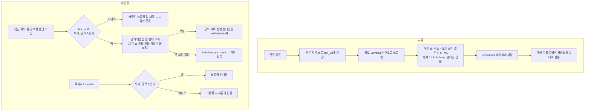

# 댓글의 LinkSphere 글 링크 카드에 그 글의 제목·썸네일 보여 주기

<!-- plan-result:start — 이 블록만 병합 뒤에도 고칠 수 있다(.claude/CLAUDE.md "계획과 PR 본문"). 아래는 승인된 계획 원문 -->

## 구현 결과

> #224 · 2026-11-19 대조 · 이탈 2 · 미구현 0 — 판정 근거(파일:줄)는 PR 본문 "계획 대비 구현"

- 이탈(검증 방법): 병합 전 화면 확인을 "운영과 같은 원격 DB에 붙인 로컬 BE에서 실제 그 댓글을 GET으로만 본다" 대신, 임시 Postgres
  컨테이너에 테스트용 스키마와 더미 글·댓글을 넣은 로컬 BE로 했다. 운영과 같은 DB에 쓰기 가능한 계정으로 붙는 로컬 실행이 권한
  확인에서 막혔고 우회하지 않았다. 실제 운영 댓글의 카드는 배포 뒤 운영 화면 확인에서 처음 본다.
- 이탈(절차): 계획은 "실패하는 테스트를 먼저 쓰고 실패 출력을 남긴다 → 구현" 순서였다. 실제로는 저장소 쿼리·조회 창구·응답 조립·
  후처리 건너뛰기를 먼저 쓰고 주소 판정만 "항상 우리 글 아님"으로 비워 둔 채 테스트를 써 실패 출력을 남긴 뒤 주소 판정을 구현했다.
  새 테스트가 컴파일 오류가 아니라 단언에서 실패하게 하려는 것이었고, 실패 출력은 고치기 전 코드가 아니라 이 상태에서 나왔다.
- 계획에 없던 변경: comment에 내주는 전용 객체 `PostLinkPreview`(신규 파일)를 두었다. 저장소 투영을 post 밖으로 내보내지 않는
  구현 세부다.
- 계획에 없던 변경: 비로그인용 쿼리 `findPublicPreviews`를 따로 두었다(계획은 쿼리 하나). 공개 조건과 "비로그인은 공개 글만"은
  계획과 같다.
- 계획에 없던 변경: `CommentService`를 조립하는 기존 통합 테스트 6개 클래스의 `@Import`에 `PostLinkParser`를 더했다. 새 빈을 찾지
  못해 컨텍스트가 뜨지 않았기 때문이고 기존 단언은 바꾸지 않았다.
- 계획에 없던 변경: 계획의 테스트 목록 밖 케이스를 더했다. 댓글을 쓴 뒤 비공개로 바뀐 글, 삭제된 댓글과 그 답글, 주소 판정의
  흉내 낸 호스트·대문자·빈 설정이다.
- 계획에 없던 변경(문서 동기화): `README.md` 파일 트리, `docs/DEPLOY.md`의 `APP_FRONTEND_URL` 설명, `application.yml` 주석에
  새 파일과 설정값의 새 쓰임을 적었다.
- 대조 뒤 보완: `PostLookupService` 클래스 주석이 묻는 것을 세 가지로만 적고 있어 링크 카드 정보를 더했다.
- 아직 진행 전(이 PR 뒤): 배포·운영 화면 확인, FE `docs/COMMENT.md` 문서 PR.

<!-- plan-result:end -->

> 댓글에 우리 글 주소가 있으면 BE가 주소를 크롤링하지 않고, 댓글을 줄 때마다 글 테이블에서 "지금 이 사람이 볼 수 있는 글"의
> 제목·설명·썸네일을 읽어 기존 응답 칸(`linkMetadata`)에 싣는다. 응답 모양이 그대로라 FE 코드는 바뀌지 않는다.

## Context

**요청(2026-11-19):** 댓글에 LinkSphere 글 주소를 붙이면 링크 카드에 "Link Sphere"와 주소만 나온다. 다른 사이트 링크처럼
썸네일과 제목이 보이면 어떤 글인지 바로 알 수 있다.

**지금 동작(코드 추적):**

- 댓글 등록·답글·수정 때 BE가 본문의 첫 주소를 `link_url`에 저장한다(`CommentService.kt:225`·`288`·`428`).
- 커밋 뒤 별도 Lambda가 그 주소를 크롤링(서버가 주소의 HTML을 받아 제목·썸네일 태그를 읽는 일)해 `link_title`·
  `link_description`·`link_og_image`에 저장한다(`CommentPostProcessService.kt:82-89`).
- 우리 글 주소 `/post/<id>`는 어떤 글이든 같은 SPA 껍데기 HTML을 돌려준다. FE `index.html:6`에는
  `<title>Link Sphere</title>`만 있고 `og:image`·`og:title`이 없다.
- 댓글 응답은 저장값을 그대로 싣고(`CommentService.kt:502-513`), FE는 그대로 그린다(`CommentItem.tsx:90-115`).

**운영 데이터(읽기 전용 조회, 2026-11-19):** 우리 글 주소가 달린 댓글 2건 모두 `link_title = 'Link Sphere'`, 썸네일·설명 없음.
글 411개 중 썸네일 301개, 설명 284개(평균 125자), 비공개 28개.

**선례:**

- 저장소 선례: "내 댓글" 목록이 원글 제목을 볼 때마다 post에 묻고, 비공개로 바뀐 글은 빠진다
  (`PostLookupService.findVisibleTitles`, `PostRepository.kt:21-24`). 이번 변경은 같은 방식을 링크 카드에 쓴다.
- 업계(아래 두 문장은 web-fetch 에이전트가 읽어 온 재인용): _"Slack은 URL을 크롤링해 흔히 쓰는 OpenGraph와 X 카드
  메타데이터를 찾는다"_ (번역, [Slack 개발자 문서](https://docs.slack.dev/messaging/unfurling-links-in-messages)) — 같은 문서가
  누구나 볼 수 없는 링크는 그 주소의 주인인 앱이 `link_shared` 이벤트를 받아 직접 채우는 경로를 둔다고 적는다.
  _"목록 안에서 이슈, 풀 리퀘스트, 토론을 참조하면 참조가 펼쳐져 제목과 상태를 보여 준다"_ (번역,
  [GitHub Docs](https://docs.github.com/en/get-started/writing-on-github/working-with-advanced-formatting/autolinked-references-and-urls)).
- 두 문서는 "자기 서비스의 내용은 자기 데이터로 답한다"까지만 뒷받침한다. 저장 시점 복사와 조회 시점 읽기 중 무엇을 쓰는지,
  권한 없는 사람에게 어떻게 보이는지는 적혀 있지 않다. Discourse·X 문서는 403으로 읽지 못해 근거로 쓰지 않았다.

## 판단이 필요했던 항목

| 항목 | 결정 | 근거·기각한 대안 |
| --- | --- | --- |
| 글 정보를 가져오는 시점 | 볼 때마다 BE가 글 테이블에서 읽는다(사용자 선택, 2026-11-19 질문) | 기각 A "저장할 때 한 번 복사": 글을 고치거나 비공개·삭제해도 옛 제목·썸네일이 댓글에 남고, 기존 댓글은 운영 DB를 직접 고쳐야 한다. 기각 C "브라우저가 글마다 조회": 링크된 글 수만큼 요청이 늘고 카드가 늦게 바뀌어 아래가 밀리며, BE는 계속 자기 사이트를 크롤링한다 |
| 볼 수 없는 글(남의 비공개·삭제) | 카드를 싣지 않는다(`linkMetadata = null`). 본문 링크는 남는다(사용자 선택) | 비공개 글을 404로 답해 존재를 숨기는 기존 규칙(`PostVisibility.kt`)과 같은 방향. 기각 "볼 수 없는 글 안내 카드": API 상태 칸과 새 문구·카드 모양이 필요. 기각 "지금처럼 Link Sphere 카드": 정보가 없다 |
| 카드 설명 줄 | 글의 `description`(사용자 선택) | 피드 글 카드가 제목 아래에 쓰는 값과 같다(FE `PostCard.tsx:219-223`). 기각 "AI 요약": 평균 591자라 2줄에서 잘린다. 기각 "설명 없이" |
| 응답 모양 | `LinkMetadata`(url·title·description·ogImage) 그대로 | 칸을 더하지 않으면 FE 코드·OpenAPI 스펙·버전 호환 표가 바뀌지 않는다. 카드 모양도 기존 외부 링크 카드를 그대로 쓴다 |
| 우리 글 주소 판정 | 호스트가 `app.frontend.url`의 호스트(앞의 `www.` 무시)이고 경로가 `/post/<UUID>`(끝 `/`·쿼리·`#` 허용)일 때만 | 설정값은 이미 메일 링크에 쓴다(`AuthService.kt:30`, `application.yml:83-87`). `/post/submit`·`/post/edit/<id>`·홈 등은 글이 아니라 대상에서 뺀다 |
| 후처리 크롤링 | 우리 글 주소면 건너뛴다 | 읽지 않을 값을 얻으려고 Lambda가 우리 CloudFront에 요청을 보낼 이유가 없다 |
| 이미 저장된 값 | `comments`의 옛 저장값(2건)은 고치지 않는다 | 우리 글 주소면 저장값을 읽지 않으므로 운영 DB 쓰기가 필요 없다 |

### 뒤집힌 전제

| 발견 | 그래서 바뀐 것 |
| --- | --- |
| FE는 `linkMetadata`를 그대로 그리고 `null`이면 카드를 안 그린다(`CommentItem.tsx:90`, `CommentEditForm.tsx:121`) | FE 코드 변경이 없어졌다. FE PR은 문서만 |
| 등록 응답은 목록을 다시 받지 않고 캐시에 그대로 들어간다(FE `comment.queries.ts:233-237`, `comment.keys.ts:45-53`) | 등록·수정 응답도 같은 조립을 거치게 해, 우리 글 링크는 등록 직후부터 카드가 보인다 |

### 위험 관리 — 고치기 전에 적는 깨질 수 있는 것

- **비공개 글 제목 유출**: 조회 조건은 `findVisibleTitles`와 같은 `isPrivate = false OR userId = :viewerId`를 SQL에 건다.
  비로그인(`viewerId` null)은 공개 글만 보여야 한다 — 통합 테스트로 확인한다.
- **외부 링크 카드 회귀**: 우리 글 주소가 아니면 지금 코드 경로를 그대로 탄다 — 통합 테스트로 확인한다.
- **N+1**: 댓글마다 묻지 않고 글 id를 모아 한 번에 묻는다(BE-ARCHITECTURE §7-8). 우리 글 링크가 없으면 추가 쿼리가 없다.
- **삭제된 댓글(톰스톤)**: 지금처럼 `linkMetadata = null`이고 글 조회 대상에서도 뺀다.
- **생성자 인자 추가**: `CommentService`·`CommentPostProcessService`를 직접 만드는 기존 단위 테스트의 생성 코드만 고친다.
  기존 단언은 바꾸지 않는다.

## 세부 계획

### 절차

1. BE 워크트리 생성(FE 세션이라 `git -C <BE> worktree add`, 그 전에 `git log origin/main..main` 확인) → `./scripts/worktree-bootstrap.sh`.
2. 실패하는 테스트를 먼저 쓰고 실패 출력을 남긴다 → 구현 → 검사 묶음 통과.
3. 로컬 화면 확인(스크린샷) → plan-verifier 대조 → BE PR → CI 확인 → **사용자 머지 승인**.
4. 배포 워크플로 성공과 운영 화면 확인 → FE 문서 PR(워크트리) → CI 확인 → **사용자 머지 승인** → 워크트리 정리.

### 백엔드 (PR 1, `feat(comment)`)

경로는 `src/main/kotlin/com/example/linksphere/` 기준.

| 위치 | 변경 내용 |
| --- | --- |
| `domain/post/PostLinkParser.kt` (신규) | `app.frontend.url`을 받아 `postIdOf(url): UUID?`를 준다. "우리 글 주소 판정" 규칙대로 맞으면 글 id, 아니면 null. 설정이 비면 항상 null |
| `domain/post/PostRepository.kt:10-24` | 투영 `VisiblePostPreview`(id·title·description·ogImage)와 `findVisiblePreviews(ids, viewerId)` 쿼리 추가. 공개 조건은 `findVisibleTitles`와 같다 |
| `domain/post/PostLookupService.kt:47-54` 아래 | `findVisiblePreviews(postIds, viewerId: UUID?)` 추가. 빈 목록이면 DB를 보지 않는다. 비로그인은 공개 글만 |
| `domain/comment/CommentService.kt:63-98` | `getComments`: 삭제되지 않은 댓글의 `linkUrl`에서 글 id를 모아 한 번 조회하고 조립에 넘긴다 |
| `domain/comment/CommentService.kt:488-514` | `toResponse`: 우리 글 주소면 조회 결과로 `LinkMetadata`를 만들고(없으면 null), 아니면 저장값을 쓴다. `toCommentResponse`(등록·답글·수정·멱등 재응답)도 작성자를 보는 사람으로 같은 조회를 거친다 |
| `domain/comment/CommentPostProcessService.kt:82-89` | `updateLinkMetadata`: 우리 글 주소면 크롤링·저장 없이 끝낸다 |
| `docs/BE-ARCHITECTURE.md` §7-8·§7-10, 마지막 검토 줄 | `PostLookupService`가 답하는 것에 "링크 카드에 쓸 글 미리보기" 추가 |
| `CHANGELOG.md` `[Unreleased]` → `Changed` | `comment` 항목 추가 |
| `docs/plans/2026-11-19-comment-post-link-preview.md` (신규) | 이 계획 사본. 대조 뒤 구현 결과 블록을 붙인다 |

### 테스트 (PR 1에 포함, `src/test/kotlin/com/example/linksphere/` 기준)

| 위치 | 확인하는 것 |
| --- | --- |
| `domain/post/PostLinkParserTest.kt` (신규, 순수 단위) | 맞는 주소(기본, `www.`, 끝 `/`, 쿼리, `#comment-…`)는 id, 다른 호스트·`/post/submit`·`/post/edit/<id>`·깨진 UUID·홈은 null |
| `domain/comment/CommentLinkedPostIntegrationTest.kt` (신규, `@PostgresIntegrationTest`, `MyCommentIntegrationTest`를 본뜸) | ① 공개 글 링크는 글의 제목·설명·썸네일이 실린다 ② 글 제목을 바꾸면 다음 조회에 새 제목 ③ 남의 비공개 글은 null, 글쓴이 본인에게는 실린다 ④ 비로그인은 공개 글만 ⑤ 없는 글 id는 null ⑥ 외부 링크는 저장값 그대로 ⑦ 저장값이 `Link Sphere`인 댓글도 글 값으로 나온다 ⑧ `createComment` 응답에 바로 실린다 |
| `domain/comment/CommentPostProcessServiceTest.kt` | 우리 글 주소면 `urlMetadataExtractor`를 부르지 않고 댓글을 저장하지 않는다(테스트 추가). 기존 테스트는 생성자 인자만 |
| `domain/comment/CommentServiceTest.kt` | 생성자 인자만 추가 |

새 테스트는 구현을 일부러 깨서(공개 조건 제거, 호스트 비교 제거) 실패하는지 한 번 확인한다.

### 프런트엔드 (PR 2, `docs(comment)`, 문서만)

| 위치 | 변경 내용 |
| --- | --- |
| `docs/COMMENT.md` §5 "구조"에 하위 절 추가, §8·§13 | 링크 카드가 외부 링크는 크롤링 저장값, 우리 글 링크는 조회 시점의 글 값이라는 것, 못 보는 글은 카드가 없다는 것, 기각한 대안 요약과 BE 계획 링크 |

같은 폴더 문서를 먼저 읽어 형식 규칙을 따른다. FE `docs/SYSTEM-ARCHITECTURE.md`는 댓글 링크 카드의 크롤링을 서술하지 않아
(258·261·298줄은 등록 화면 미리보기) 고칠 곳이 없는지 구현 때 다시 확인한다.

## 영향 범위

- **API 계약**: 변화 없음(`LinkMetadata` 4칸, `linkMetadata`는 원래 nullable). 달라지는 것은 값이다 — 우리 글 링크 댓글은
  `title`·`description`·`ogImage`가 글의 값이 되고, 볼 수 없으면 `linkMetadata`가 null이 된다.
- **대상 응답**: `GET /post/{postId}/comment`, 댓글 등록·답글·수정 응답. "내 댓글" 목록은 `linkMetadata`가 없어 무관.
- **쿼리 수**: 우리 글 링크가 있는 응답에만 글 조회 1개 추가(PK `IN`).
- **DB**: 스키마·데이터 변경 없음. 마이그레이션 없음.
- **배포 순서**: BE만 배포하면 끝난다. FE 문서 PR은 배포 뒤에 올린다.
- **패키지 의존**: `comment → post`는 이미 있는 간선이라 그래프 문서(`PackageGraphDocTest`)가 바뀌지 않는다.
- **바꾸지 않는 것**: 카드를 누르면 새 탭으로 여는 동작, 본문 링크, 카드 모양, 외부 링크 미리보기, 글 등록 화면 미리보기,
  글이 아닌 우리 주소의 카드.

## 검증 방법

**완료 조건**

- 끝 상태: 운영에서 스크린샷 속 댓글의 카드가 링크된 글의 제목("눈누: 상업적 이용 한글 폰트 검색 및 추천")·설명·썸네일로 보인다.
  외부 링크 카드는 그대로다. 남의 비공개 글 링크는 카드가 없다.
- 바꾸면 안 되는 것: 위 "바꾸지 않는 것", 응답 모양, FE 코드, DB.

**증명**

1. 고치기 전 실패 출력: 새 통합 테스트·파서 테스트·후처리 테스트.
2. `./gradlew ktlintCheck test integrationTest` 통과 출력(Docker 필요). 깨 보기 확인 결과.
3. 병합 전 화면: BE 워크트리에서 `./gradlew bootRun`(DB는 운영과 같은 원격 DB라 **GET만 호출**하고 로그인·쓰기를 하지 않는다),
   FE는 메인 체크아웃 수정 없이 프록시 대상만 환경변수로 로컬 BE에 맞춰 dev 서버를 띄운다 → 그 댓글이 달린 공개 글 상세의
   카드를 스크린샷으로 바로 보여 준다. dev 서버·`bootRun`은 다른 워크트리에서 떠 있지 않은지 먼저 확인한다.
4. PR CI: `check`·`api-compat`·`serving-path` 결과. `serving-path`가 실패하면 출력의 JSON을 `accepted-differences.json`에 옮기고
   이유를 적는다(시드에 우리 글 링크 댓글이 없어 바뀌지 않을 것으로 예상 — 추측).
5. 병합 뒤: `gh run list --branch main --workflow "Deploy to AWS Lambda (SnapStart)"`에서 병합 SHA가 success인지 확인 →
   운영 화면의 같은 댓글 스크린샷, 댓글 목록 응답의 `linkMetadata` 값(요청 1번).
6. FE 문서 PR: `pnpm check:docs`, CI 결과.

## 남은 것

- 주소 끝에 문장부호가 붙어 UUID가 깨진 경우(`…/post/<id>.`)는 우리 글 주소로 보지 않아 지금처럼 `Link Sphere` 카드가 된다.
- `comments`에 남은 옛 저장값 2건은 읽지 않으므로 그대로 둔다.
- 제안(수락 전, 이 계획 범위 밖): ① 우리 글 카드를 누르면 새 탭 대신 앱 안에서 이동 ② 글 주소 자체에 OG 태그를 실어
  카카오톡·Slack에 붙였을 때도 썸네일이 나오게 하기(CloudFront 구성 변경이 필요한 별도 작업).
