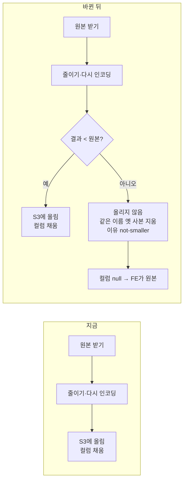
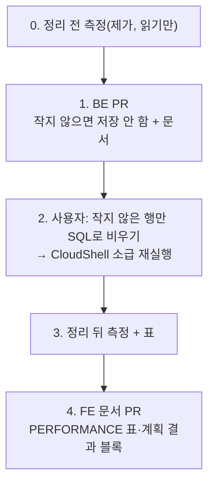

# og 이미지 사본은 원본보다 작을 때만 둔다

<!-- plan-result:start — 이 블록만 병합 뒤에도 고칠 수 있다(.claude/CLAUDE.md "계획과 PR 본문"). 아래는 승인된 계획 원문 -->

## 구현 결과

> #231 · 2026-11-26 대조 · 이탈 0 · 미구현 0 — 1단계(BE PR) 범위. 2~4단계(정리 SQL·소급 재실행·정리 뒤 측정·FE 문서 PR)는 이 PR 뒤에 하고, 결과는 FE `docs/PERFORMANCE.md` "피드 썸네일 사본"과 FE 계획 결과 블록에 적는다. 판정 근거(파일:줄)는 PR 본문 "계획 대비 구현"

- 대조 뒤 보완함: 첫 대조의 이탈 2·미구현 1을 PR 전에 고쳤다. 서비스 클래스 주석에 규칙 한 줄을 더했고, `OG-THUMBNAIL.md` §9에서 FE 문서와 겹치던 소급 수치(314건·293건)를 뺐고, CHANGELOG og 사본 항목에 이 PR 링크를 달았다
- 계획에 없던 변경: CHANGELOG og 사본 항목에 빠져 있던 원래 기능 PR(#230) 링크와 이 계획 경로를 달았다
- 계획에 없던 변경: 옛 계획(2026-11-25) 결과 블록에서 "PR 4(FE)" 항목에 FE #690으로 보완했다고 표시했고, 블록 끝에 이 계획을 가리키는 "후속" 줄을 더했다
- 계획에 없던 변경: `OG-THUMBNAIL.md` §5-3에 같은 규칙을 쓰는 도구 세 곳(mod_pagespeed, jpegoptim, Cloudflare Polish)을 원문을 다시 읽고 인용했다. §9에는 크기 비교 규칙의 테스트 기록(먼저 실패, 변이 둘, "늦게 온 잡" 테스트 원본을 고정 시드 잡음 PNG로 바꾸고 기대값 유지)과 운영 소급이 Lambda에서 돈 사실을 적었다
- 정정: 위 "선례" 표의 mod_pagespeed 인용은 2026-11-26 원문과 문구가 다르다. 지금 원문은 _"다시 인코딩한 결과가 원본보다 `ImageLimitOptimizedPercent`가 정한 만큼 작을 때만 남긴다(기본 100: 조금이라도 줄면)"_ (번역)이고 뜻은 같다. BE 문서에는 지금 원문을 번역해 실었다
- 문서 동기화: `OG-THUMBNAIL.md` 1장 쉬운 설명 문장, §5-2·§8의 `OgThumbnailService.kt` 줄 번호, `DEPLOY.md` 14장 제목
- 뒤 단계로 넘긴 약속: 3단계 표에 원본을 BE 요청 머리(Accept·UA)와 브라우저 머리로 각각 받은 크기 비교를 한 줄 넣는다(0단계에서 두 가지로 쟀고 모두 같았다)

<!-- plan-result:end -->

> BE가 만든 피드 카드용 사본 가운데 원본보다 큰 것(주로 YouTube 480×360)을 없앤다. 새 사본은 줄인 결과가 원본보다 작을 때만
> 저장한다. 이미 있는 사본 296개는 먼저 원본·사본 크기를 재고, 사본이 원본보다 작지 않은 행만 사용자가 SQL로 비운 뒤 소급을
> 다시 돌린다. 정리 전후의 용량·바이트를 표로 보여 준다. BE PR 1개, 사용자 운영 작업 2개(SQL, CloudShell 소급), FE 문서 PR 1개다.

## Context

### 계기

#690(FE, 목록 카드가 사본을 씀)의 Lighthouse CI를 풀어 보니, 피드 첫 화면 썸네일 10장 중 5장은 사본이 원본보다 컸다
(2026-11-26, 두 실행의 `network-requests`와 원본·사본 1회 GET).

| 원본 | 원본(바이트) | 사본(바이트) |
| --- | --- | --- |
| YouTube `hqdefault.jpg` 4장(480×360) | 14,965~23,858 | 22,239~34,676(약 +45%) |
| 위시켓 PNG | 77,263 | 105,871 |
| 토스 PNG(비교용, 줄어든 쪽) | 1,443,892 | 32,183 |

- 같은 첫 화면 기준으로 사본 덕분에 이미지 합계는 약 1,196,900 → 595,730바이트로 줄었다. 그래서 #690은 병합했다(2026-11-26
  사용자 결정).
- 지금 사본이 있는 글은 296개(og 이미지가 있는 글 317개 중)이고, 그중 146개가 `i.ytimg.com`이다(읽기 전용 계정, 2026-11-26).

### 지금 구조

| 지점 | 사실 | 근거 | 확인 수준 |
| --- | --- | --- | --- |
| 저장 직전 | 받은 원본(`source`)과 줄인 결과(`resized.bytes`)를 비교하지 않고 바로 올린다 | BE `OgThumbnailService.kt:97-110` | 직접 읽음 |
| 줄이기 | 배율 `min(1, max(960/가로, 540/세로))`라 작은 원본은 키우지 않지만, 늘 다시 인코딩한다(투명이면 PNG, 아니면 JPEG 0.8) | BE `OgThumbnailResizer.kt:71-75`, `:100` | 직접 읽음 |
| 사본이 더 커지는 예 | 사본과 원본 모두 480×360, 21,849 대 15,119바이트 | 둘을 받아 `sips`로 확인(2026-11-26) | 직접 실행 |
| 커지는 이유 | 줄일 픽셀이 없으면 다시 인코딩만 남는데, 이미 잘 압축된 원본보다 작게 못 만든다. 같은 원본을 libjpeg-turbo 품질 80으로 다시 저장하면 우리 사본과 같은 21,849바이트, 품질 60 + 허프만 최적화도 15,695바이트(원본보다 큼) | `djpeg`·`cjpeg` 실험(2026-11-26) | 직접 실행 |
| 소급 대상 | 사본이 없고 og 이미지가 있는 글만 id 순으로 고른다. 이미 사본이 있는 글은 다시 보지 않는다 | BE `PostRepository.kt:117`, `:122` | 직접 읽음 |
| 다시 만드는 법 | 사본 주소를 비우는 SQL(사용자)을 돌리고 소급을 처음부터 다시 돌린다. 이름이 원본 주소로만 정해져 같은 이름을 덮어쓴다 | BE `docs/OG-THUMBNAIL.md:198-200` | 직접 읽음 |
| 옛 사본 지우기 | 확장자를 알 수 없어 jpg·png 두 이름을 모두 지운다. 지우기 실패는 로그만 남긴다 | BE `OgThumbnailService.kt:69-71`, `:160-166` | 직접 읽음 |
| 소급 요약 | 실패를 `이유@사이트`로 세어 한 줄 로그에 남긴다 | BE `OgThumbnailBackfillService.kt` | 서브에이전트 보고, 구현 때 확인 |
| 테스트 고정물 | 서비스 테스트의 원본은 단색 PNG다. 단색 PNG는 아주 작게 압축돼 새 규칙에 걸릴 수 있다 | BE `OgThumbnailServiceTest.kt:227-231` | 직접 읽음(크기는 안 잼) |
| 로컬 AWS 키 | S3 목록은 거부된다(`s3:ListBucket`). 사본 크기는 공개 주소에 요청해 잰다 | 이전 세션 거부 기록 | 직접 겪음 |

### 선례

| 도구 | 동작 | 근거(누가 읽었는지는 칸마다) |
| --- | --- | --- |
| Google mod_pagespeed | _"최적화한 이미지가 이 비율만큼 작을 때만 낸다"_(번역, `ImageLimitOptimizedPercent`, 기본 100 = 조금이라도 작으면) | [reference-image-optimize](https://www.modpagespeed.com/doc/reference-image-optimize) — 조사 에이전트가 원문 확인 |
| Cloudflare Polish | _"변환하면 파일이 커질 때는 AVIF·WebP로 바꾸지 않는다"_, _"저품질 JPEG에 이미 있는 압축 흔적 때문에 WebP·AVIF 결과가 더 커질 수 있다"_(번역) | [Polish 설정](https://developers.cloudflare.com/images/polish/compression/) — 조사 에이전트가 원문 확인 |
| jpegoptim | 기본은 결과가 원본보다 크면 원본을 둔다. `-f, --force`가 _"결과가 원본보다 커지더라도 최적화를 강제한다"_(번역) | [jpegoptim.1](https://github.com/tjko/jpegoptim/blob/main/jpegoptim.1) — 조사 에이전트가 원문 확인 |
| lite-youtube-embed | YouTube 썸네일은 `i.ytimg.com/vi/<id>/hqdefault.jpg`를 그대로 쓴다 | [README](https://github.com/paulirish/lite-youtube-embed) — 조사 에이전트가 읽음 |
| Next.js 이미지 최적화 | 크기 비교 없음. 형식·애니메이션·실패일 때만 원본을 그대로 낸다 | [`image-optimizer.ts`](https://github.com/vercel/next.js/blob/canary/packages/next/src/server/image-optimizer.ts), `image-optimizer/transform.ts` — 조사 에이전트가 읽음 |
| Mastodon 미리보기 카드 | 크기 비교 분기 없음(한 파이프라인으로 처리) | [`preview_card.rb`](https://github.com/mastodon/mastodon/blob/main/app/models/preview_card.rb) — 조사 에이전트가 읽음 |

## 판단이 필요했던 항목

### 결정 표

| 항목 | 결정 | 근거·기각한 대안 |
| --- | --- | --- |
| 고칠지 | **결정(사용자, 2026-11-26)**: BE에서 고친다 | 기각: 기록만 남기고 그대로 두기(YouTube 146개가 장당 수 KB 큰 채로 남음) |
| 기존 사본 정리 | **결정(사용자, 2026-11-26)**: 원본·사본 크기를 먼저 재고, 사본이 원본보다 작지 않은 행만 SQL로 비운 뒤 소급을 다시 돌린다 | 멀쩡한 사본은 건드리지 않고, 피드가 큰 원본으로 돌아가는 구간이 없다. 기각 1: 사본 주소를 모두 비우고 다시 만들기(BE 문서의 다시 만드는 법. 몇 분간 1MB대 원본을 받고, 원본 사이트가 막으면 멀쩡한 사본이 빠진다 — 처음엔 이것을 골랐다가 같은 날 바꿈). 기각 2: 사본이 있는 글을 다시 보는 모드를 새로 만들기(쿼리 2개·조건부 비우기·모드 입력·통합 테스트가 늘어 계속 지켜야 함). 기각 3: 새 글부터만(YouTube 약 146개가 장당 7~11KB 큰 채로 남음) |
| 결과 보고 | **결정(사용자, 2026-11-26)**: 성능·용량이 얼마나 나아졌는지 표로 보여 준다 | 아래 "측정" |
| 비교 기준 | **제 판단**: 줄인 결과 바이트가 받은 원본 바이트보다 작을 때만 저장한다. 같거나 크면 이유 `not-smaller` | jpegoptim 기본 동작과 같다. "10% 이상 작아야" 같은 문턱은 근거가 없어 두지 않는다 |
| 작지 않을 때 | **제 판단**: 올리지 않고, 그 글·그 원본 주소의 사본 이름 두 개(jpg·png)를 조용히 지운다 | 다시 만들 때 옛 사본 파일이 남지 않게 한다. 두 확장자 지우기는 `handleOgImageChanged` 선례다. 새 글이면 없는 이름이라 S3가 그냥 성공한다 |
| 다른 형식으로 한 번 더 | **제 판단**: 하지 않는다(JPEG가 크면 PNG로도 인코딩해 비교하는 안) | 표본 10장 중 1장(위시켓)만 해당하고 글마다 인코딩이 한 번 는다 |
| 원본 그대로 올리기 | **제 판단**: 하지 않는다 | 2026-11-25 계획 위험 관리의 "항상 다시 인코딩한 JPEG·PNG만 올린다"를 지킨다 |
| CHANGELOG | **제 판단**: BE `[Unreleased]`의 og 사본 항목(아직 릴리즈 전)의 규칙 문장을 고치고 PR 링크를 단다. 새 항목은 만들지 않는다 | 릴리즈 전이라 독자는 최종 규칙만 보면 된다(FE `changelog-release` skill의 "릴리즈 전 항목" 처리와 같은 결) |
| 측정 | **제 판단**: 정리 전후로 사본은 HEAD 1회(본문 크기), 원본은 GET 1회(본문 크기)씩 재서 표를 만든다. 원본은 정리 전에 한 번만 잰다 | S3 목록 권한이 없다. 원본은 정리로 바뀌지 않는다 |
| 결과 문서 위치 | **제 판단**: 정본은 FE `docs/PERFORMANCE.md` "피드 썸네일 사본"이고, BE `OG-THUMBNAIL.md` §9는 링크만 둔다 | 같은 사실을 두 곳에 적지 않는다. 앞 측정도 그 절에 있다 |
| 비울 행 고르기 | **제 판단**: 0의 측정에서 사본 바이트 ≥ 원본 바이트인 행만 고른다. 원본이나 사본을 재지 못한 행은 건드리지 않는다 | 확인된 행만 바꾼다. 못 잰 행은 결과 표에 따로 센다 |
| 실행 순서 | **제 판단**: SQL 직후 소급을 이어서 돌린다 | 비운 글(작은 원본을 받는 쪽)이 다시 판단받기까지의 시간을 줄인다 |

### 뒤집힌 전제

| 발견 | 그래서 바뀐 것 |
| --- | --- |
| 2026-11-25 계획은 "작은 원본은 키우지 않는다"로 충분하다고 봤다. 픽셀만 보고 바이트는 보지 않았다 | 저장 직전에 바이트를 비교한다 |
| 소급을 다시 부르면 기존 사본도 다시 볼 것 같지만, 소급은 사본이 없는 글만 고른다 | 다시 볼 행의 사본 주소를 SQL로 먼저 비운다 |
| 처음엔 사본을 모두 비우는 안(BE 문서의 다시 만드는 법)을 골랐다 | 0의 측정으로 큰 행을 정확히 알 수 있어, 그 행만 비운다(2026-11-26 사용자 결정) |

### 위험 관리

| 위험 | 막는 방법 |
| --- | --- |
| 비운 행이 다시 판단받기 전까지 원본을 받는다 | 그 행은 원본이 사본보다 작은 쪽이라 바이트는 오히려 준다. SQL 직후 소급, 첫 1건을 제가 확인한 뒤 50건씩 이어 간다 |
| 소급이 그 전부터 실패하던 글(21개)도 다시 시도한다 | 그 글은 지금도 원본을 받고 있어 손해가 없다. 새로 사본이 생기면 새 규칙을 거친다 |
| 측정과 SQL 사이에 글의 og 이미지가 바뀐다 | 바뀌면 BE가 그 트랜잭션에서 사본 주소를 이미 비우고 새 잡을 낸다. SQL은 `og_image_thumbnail IS NOT NULL` 조건을 붙여 그런 행에 영향이 없다 |
| 기존 테스트의 단색 PNG가 새 규칙에 걸려 "저장됨" 기대가 뒤집힌다 | 그 테스트의 원본을 잡음이 섞인 그림(고정 시드)으로 바꾸고 기대값은 그대로 둔다. PR에 따로 적는다 |
| 측정 요청이 WAF 한도(5분 1,000건)에 걸린다 | 사본 HEAD는 정리 전 296건, 뒤 약 150건. 동시 2개로 나눠 보낸다 |
| 원본 측정 때 외부 사이트가 막는다 | 그 글은 "못 잼"으로 따로 세고 합계에서 뺀다 |
| 정리 SQL을 잘못 쓰면 다른 행·컬럼을 건드린다 | SQL은 사본 주소 컬럼 하나를 id 목록 행만 비우는 한 줄로 드리고, 예상 행 수를 함께 드린다. 실행 전후 행 수를 읽기 전용 계정으로 확인한다 |

## 세부 계획

### 0. 정리 전 측정 (제가, 읽기만)

| 위치 | 변경 내용 |
| --- | --- |
| 스크래치패드 스크립트(커밋하지 않음) | 읽기 전용 계정으로 og 이미지가 있는 글의 id·og 이미지·사본 주소를 뽑는다. 사본은 HEAD로 `content-length`, 원본은 GET 1회로 본문 크기·형식을 잰다. 결과를 JSON으로 남기고, 사본 ≥ 원본인 행의 id 목록(비울 행)과 사이트별 수를 뽑는다 |

### 1. BE PR

| 위치 | 변경 내용 |
| --- | --- |
| `src/main/kotlin/.../domain/post/OgThumbnailService.kt` `buildAndStore` | 줄인 뒤 `resized.bytes.size >= source.size`면 두 확장자 이름을 `deleteQuietly`하고 `NotStored("not-smaller")`를 돌려준다. 클래스 주석에 규칙 한 줄 |
| `src/test/kotlin/.../domain/post/OgThumbnailServiceTest.kt` | 새 테스트(먼저 실패 확인): 품질을 낮춰 작게 저장한 480×360 JPEG을 받으면 `not-smaller`, 올림 없음, 두 이름 지움, 컬럼 갱신 없음. 기존 `:63`·`:82`가 새 규칙에 걸리면 원본 고정물만 잡음 그림으로 바꾼다 |
| `docs/OG-THUMBNAIL.md` | 1장 순서도에 크기 비교 분기, §5-3 규칙(커지는 이유 한 줄 포함), §6 null의 뜻, §7 실패 이유 표에 `not-smaller`, §8 "자주 하는 수정"에 "일부 행만 다시 판단받게 하기"(그 행만 비우고 소급), §9에 FE `PERFORMANCE.md` 결과 링크, §11의 낡은 두 줄(`:239` "아직 운영에서 돌리지 않음", `:245` AWT 확인 예정)을 2026-11-25 소급 결과로 고침, 마지막 검토 날짜 |
| `docs/DEPLOY.md` 14장 | 제목의 "소급은 배포 뒤"를 적용 완료로, 일부 행을 다시 판단받게 하는 절차(id 목록 SQL + 같은 소급 명령) 몇 줄 |
| `CHANGELOG.md` `[Unreleased]` og 사본 항목 | 규칙 문장에 "원본보다 작지 않으면 만들지 않음", 파일 목록에 PR 링크 |
| `docs/plans/2026-11-26-og-thumbnail-not-smaller.md`(신규) | 이 계획 스냅샷과 구현 결과 블록 |
| `docs/plans/2026-11-25-og-thumbnail.md` 결과 블록 | "뒤로 넘긴 것"의 글 등록 구간 비교를 보완함으로(약 51ms, 1건, FE `PERFORMANCE.md`) |

### 2. 사용자 운영 작업 (BE 배포 확인 뒤)

| 시점 | 할 일 | 제가 준비하는 것 |
| --- | --- | --- |
| BE 배포 성공 확인 뒤 | `UPDATE posts SET og_image_thumbnail = NULL WHERE og_image_thumbnail IS NOT NULL AND id IN (<0에서 뽑은 id 목록>);` 실행 | id를 채운 명령과 예상 행 수, 실행 전후 행 수 확인(읽기 전용) |
| 바로 이어서 | CloudShell에서 `og-thumbnail-backfill`을 `limit 1`로 한 번 → 제가 로그·DB 확인 → `limit 50`과 `nextCursor`로 이어 감 | 붙여 넣을 명령(BE `DEPLOY.md` 14장과 같음), 매 호출 뒤 요약 로그 확인 |
| 일시 실패가 있으면 | cursor 없이 한 번 더 | 실패 이유·사이트별 수 |

### 3. 정리 뒤 측정

| 위치 | 변경 내용 |
| --- | --- |
| 0의 스크립트 | 같은 방법으로 사본 주소와 크기를 다시 잰다. 원본 크기는 0의 값을 쓴다 |

사용자에게 보여 줄 표(정리 전·후·차이):

| 항목 | 재는 방법 |
| --- | --- |
| 사본이 있는 글 수 | 읽기 전용 계정 |
| 사본 용량 합계(글이 가리키는 사본) | 사본 HEAD 합 |
| 피드 카드 이미지 바이트 합(og 이미지가 있는 모든 글, 카드 한 장 = 사본 또는 원본) | 사본 크기, 없으면 원본 크기 |
| 그중 YouTube 글 | 같은 방법, `i.ytimg.com`만 |
| 원본보다 작지 않아 뺀 사본 수(사이트별) | 0의 측정(비운 행)과 소급 요약 로그의 `not-smaller@사이트`를 맞춰 봄 |
| 사본이 있는 글 중 원본보다 큰 것 | 측정값 비교(정리 뒤 0이어야 함) |
| Lighthouse `/post` 이미지 합계·Performance 중앙값(그때 운영 피드) | 4의 FE PR CI |

### 4. FE 문서 PR

| 위치 | 변경 내용 |
| --- | --- |
| `docs/PERFORMANCE.md` "피드 썸네일 사본" | 첫 문단에 "BE는 원본보다 작을 때만 사본을 둔다", "어떻게 할지는 아직 정하지 않았다" 문장을 결과로 바꿈, 3의 표 |
| `docs/plans/2026-11-25-og-thumbnail.md` 결과 블록 | 남은 것 "사본이 원본보다 클 때 어떻게 할지" → 보완함(BE·FE PR 번호) |
| `docs/PLANS-INDEX.md` | `pnpm docs:index` |

## 영향 범위

- **화면**: 사본이 원본보다 작지 않은 글(주로 YouTube)은 목록 카드가 원본을 받는다. 그림은 같고 바이트는 줄어든다. 상세 화면 등은
  그대로다.
- **데이터 계약**: 응답 필드 `ogImageThumbnail`(null 허용)는 그대로다. null이 되는 경우가 하나 는다. FE 코드는 바뀌지 않는다.
- **데이터 생성·수정·삭제**
  - 생성: 새 글의 사본 잡이 작지 않으면 저장하지 않는다.
  - 정리 SQL: 사본이 원본보다 작지 않다고 잰 행만 사본 주소를 비운다(사용자 실행, YouTube 약 146행 안팎 예상). 소급이 그 행과
    전부터 실패하던 21행을 다시 판단한다.
  - S3: 작지 않은 글의 사본 파일은 소급이 지운다. 멀쩡한 사본은 건드리지 않는다.
  - 중복·동시 요청: 이름과 판단이 원본 주소로만 정해져 같은 잡이 두 번 돌아도 결과가 같다.
- **공유 코드**: `buildAndStore`는 새 글 잡(`OgThumbnailJobHandler`)과 소급(`OgThumbnailBackfillService`)이 함께 쓴다. 둘 다 같은
  규칙을 받는 것이 의도다.
- **비용**: 무료 범위다. 소급 재실행은 약 170건(Lambda 몇 분), S3 DELETE 약 300건, PUT은 전부터 실패하던 글이 새로 성공할 때만이다.
- **이전 동작을 단정하는 것**: `OgThumbnailServiceTest`의 저장 테스트 고정물, `OG-THUMBNAIL.md` §5-3의 "늘 다시 인코딩", BE
  CHANGELOG og 항목의 규칙 문장, FE `PERFORMANCE.md`의 "아직 정하지 않았다".

## 검증 방법

- **환경**: BE는 `git log origin/main..main` 확인 뒤 FE 세션에서 `git -C <BE> worktree add`로 새 워크트리, 비밀 파일은
  `./scripts/worktree-bootstrap.sh`. FE 문서 PR은 `EnterWorktree`.
- **BE(PR)**
  - 새 테스트가 고치기 전에 실패하는 출력을 남기고, 비교 줄을 일부러 깨 다시 실패하는지 한 번 본다.
  - 기존 테스트의 고정물을 바꿨다면 그 이유와 기대값이 그대로임을 PR에 적는다.
  - `./gradlew ktlintCheck test integrationTest shadowJar --no-daemon`(CI `check`와 같은 묶음), `./gradlew openApiSpec`(응답 스펙
    변화 없음).
  - PR CI `check`·`api-compat`·`serving-path` 통과, plan-verifier 대조.
  - 병합 뒤 BE 배포 워크플로가 그 SHA로 성공했는지 확인한다.
- **운영(정리)**
  - SQL 전후 행 수(읽기 전용 계정). 비운 행 수가 0의 id 목록 수와 같은지 본다.
  - 소급 첫 1건의 로그와 DB를 확인한 뒤 이어 간다. 끝난 뒤 요약 로그의 `not-smaller@사이트` 합과 DB의 사본 수를 맞춰 본다.
  - 작지 않아 뺀 글 하나의 옛 사본 주소에 HEAD 1회 → 200이 아님(`x-cache: Miss`).
  - 걸린 시간(SQL 시각 → 마지막 호출 끝)을 적는다.
- **측정**: 0과 3의 표. 정리 뒤 "사본이 원본보다 큰 글"이 0인지 본다.
- **FE 문서 PR**: `pnpm exec prettier --check`, `pnpm docs:index`, `pnpm check:docs`, PR CI(Lighthouse 포함) 통과.
- **완료 조건**
  - 운영에서 사본이 있는 모든 글의 사본이 원본보다 작다(잴 수 없던 글은 따로 적는다).
  - 작지 않아 뺀 글의 옛 사본 파일이 남지 않는다(표본 HEAD).
  - 정리 전·후 표를 사용자에게 보여 주고 FE `PERFORMANCE.md`에 적는다.
  - 배포 뒤 다음 새 글에도 규칙이 적용된다(그 글의 로그). 새 글이 늦으면 남은 것으로 둔다.
- **바꾸면 안 되는 것**: 응답 필드와 FE 코드, 960px·JPEG 0.8·투명이면 PNG 규칙, 받기 상한, `og_image` 컬럼, 작아지는 사본의 결과,
  소급 잡의 입력 모양.

## 남은 것

- **사용자 운영 작업 2개**: 작지 않은 행만 비우는 정리 SQL, CloudShell 소급 재실행(2026-11-26 질문에서 동의). 명령은 그 단계에서
  드린다.
- **범위 밖(언급만)**: BE `OG-THUMBNAIL.md` §11의 나머지 항목(EXIF 방향, CMYK, `OgImageBackfillRunner`), WebP 원본.
- **디자인 시스템 2단계**: 이 작업과 별개로 게이트 2가 다음 차례다.
